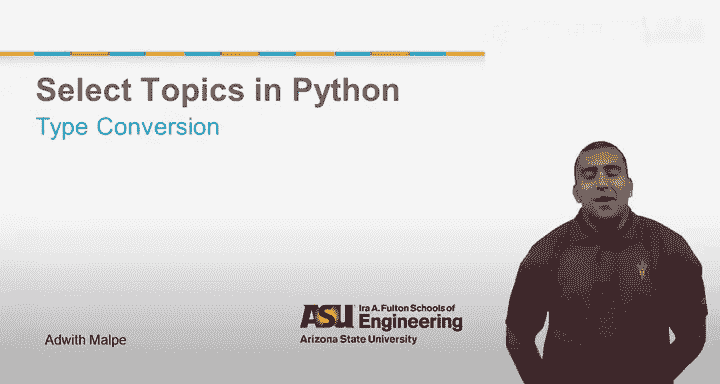
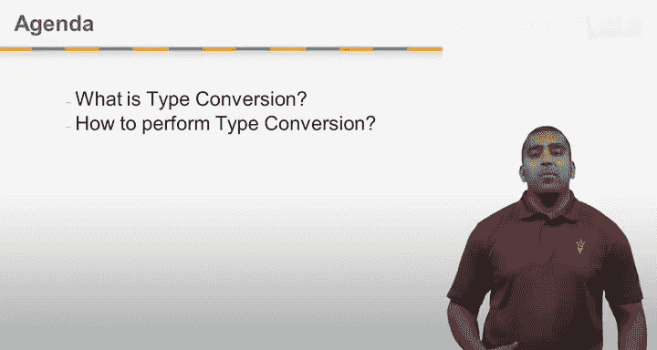
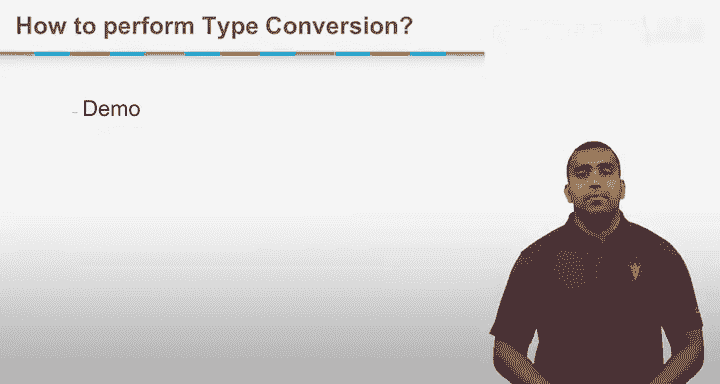
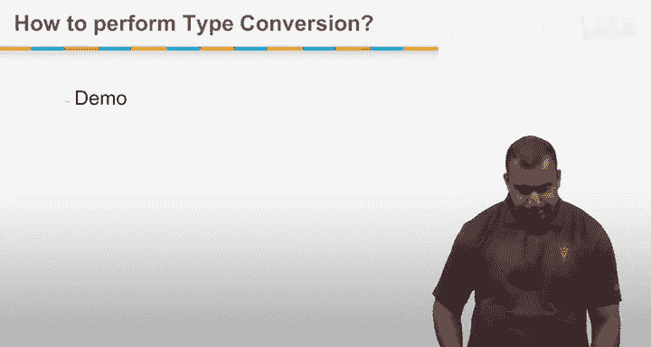
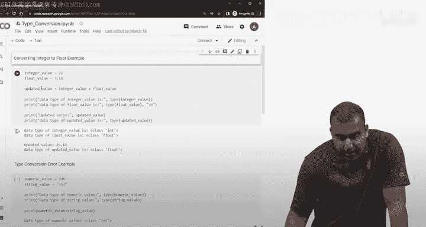

# 13：Python类型转换机制 🐍



在本节课中，我们将学习Python中的类型转换。类型转换是编程中一个基础且重要的概念，它允许我们将数据从一种类型转换为另一种类型，以便进行各种操作和计算。

## 什么是类型转换？ 🔄



类型转换是将对象从一种数据类型转换为另一种数据类型的过程。

显式类型转换也称为类型转换（type casting），用户通过预定义的函数来转换对象的数据类型。

类型转换的目标是将一种数据类型转换为另一种数据类型。



它通常由Python解释器执行。



## 类型转换演示 💻

上一节我们介绍了类型转换的基本概念，本节中我们来看看具体的代码示例。

### 示例一：整数与浮点数的隐式转换



在第一个示例中，我们创建了两个变量：一个名为`integer_value`的整数变量和一个名为`float_value`的浮点数变量。

当我们把这两个变量相加时，结果会存储在一个名为`updated_value`的变量中。

以下是相关代码和输出：

```python
integer_value = 22
float_value = 3.14
updated_value = integer_value + float_value

print(type(integer_value))   # 输出: <class 'int'>
print(type(float_value))     # 输出: <class 'float'>
print(updated_value)         # 输出: 25.14
print(type(updated_value))   # 输出: <class 'float'>
```

我们可以看到，当整数和浮点数一起执行运算时，除非明确指定返回整数，否则将返回浮点数值。

### 示例二：类型转换错误

现在，我们来看一个类型转换错误的例子。假设我们有一个数值为246的整数变量和一个数值为“357”的字符串变量。

以下是相关代码和输出：

```python
numeric_value = 246
string_value = "357"

print(type(numeric_value))   # 输出: <class 'int'>
print(type(string_value))    # 输出: <class 'str'>

# 尝试将整数和字符串相加会导致错误
# result = numeric_value + string_value  # 这行代码会引发TypeError
```

如果我们尝试打印这两个变量相加的结果，会得到一个类型错误。错误信息显示不支持整数和字符串的加法操作。因此，在进行不同类型的数据转换时，需要格外小心。

### 示例三：显式类型转换

在最后一个示例中，我们将演示显式类型转换。使用上面相同的变量，我们有一个数值为246的整数变量和一个数值为“357”的字符串变量。

以下是相关代码和输出：

```python
numeric_value = 246
string_value = "357"

print(type(numeric_value))   # 输出: <class 'int'>
print(type(string_value))    # 输出: <class 'str'>

# 显式将字符串转换为整数
numeric_value2 = int(string_value)
sum_value = numeric_value + numeric_value2

print(sum_value)             # 输出: 603
print(type(sum_value))       # 输出: <class 'int'>
```

我们通过调用`int()`函数，显式地将`string_value`变量转换为整数数据类型。这样，“357”就被转换成了整数类型。现在，当我们执行`numeric_value`和`numeric_value2`的加法操作时，我们得到了这两个值的和，即603。最后，我们打印出新变量`sum_value`的数据类型，可以看到它是整数类型。

## 总结 📝

本节课中我们一起学习了Python中的类型转换。我们了解了类型转换的基本概念，包括隐式转换和显式转换（类型转换）。通过具体的代码示例，我们看到了整数和浮点数之间的隐式转换，以及如何处理类型转换错误。最后，我们学习了如何使用`int()`等函数进行显式类型转换，以确保数据类型的正确性，从而顺利进行各种运算。掌握类型转换对于编写健壮和高效的Python代码至关重要。