# 16：条件分支语句（if-else） 🧠

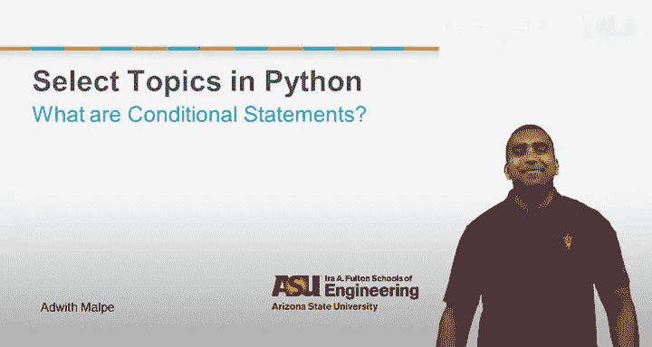

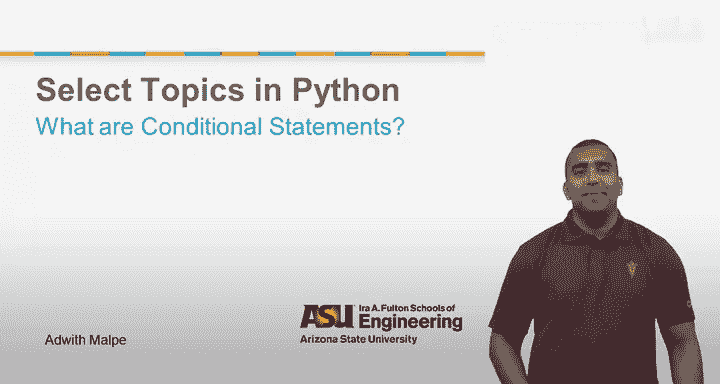

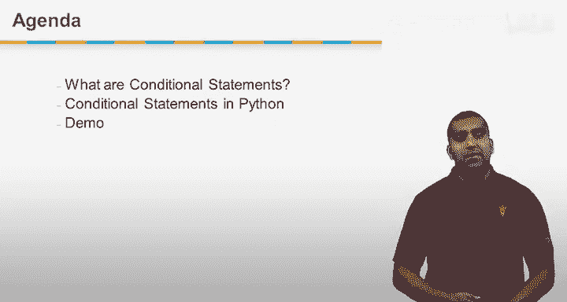

在本节课中，我们将学习条件语句。我们将了解什么是条件语句，以及如何在Python中实现它们。我们还将通过一个简短的演示，展示如何实现条件语句并运用上一课学到的逻辑运算符。

## 什么是条件语句？ 🤔

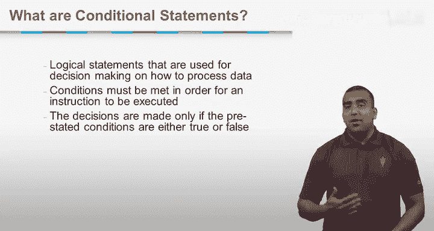

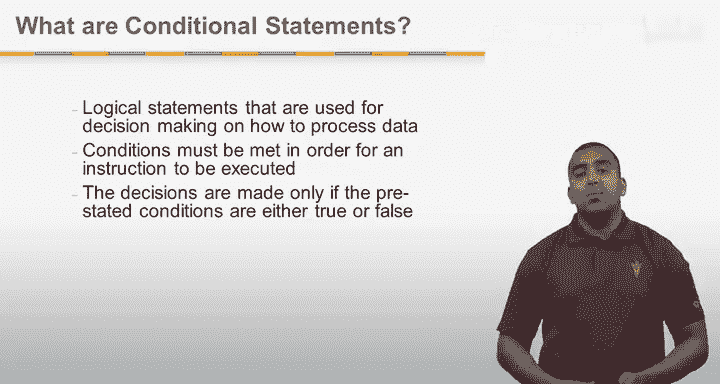

上一节我们介绍了课程目标，本节中我们来看看条件语句的基本概念。

条件语句是用于决策如何处理数据的逻辑语句。条件语句包含一些条件，只有满足这些条件时，才会执行相应的指令。只有当预设条件为真或假时，才会做出决策。

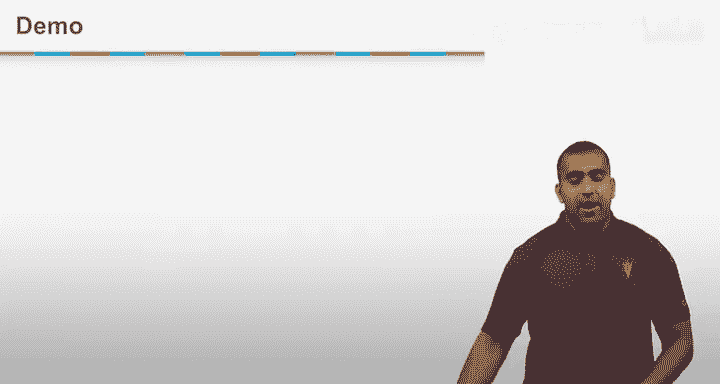

例如，我们有一个判断：如果这个判断为真，那么我们可以执行那个指令；然而，如果判断为假，那么我们就不能执行该指令，而必须做其他事情。这就是条件语句。

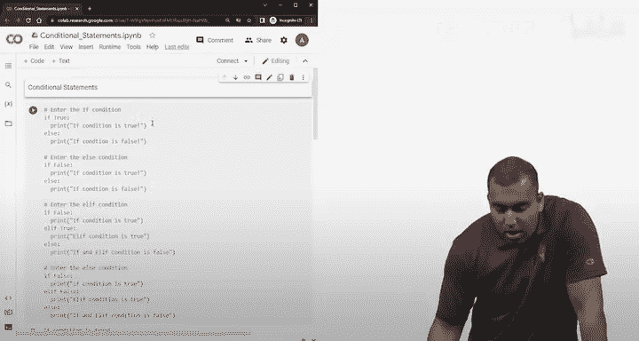

## Python中的条件语句 🐍

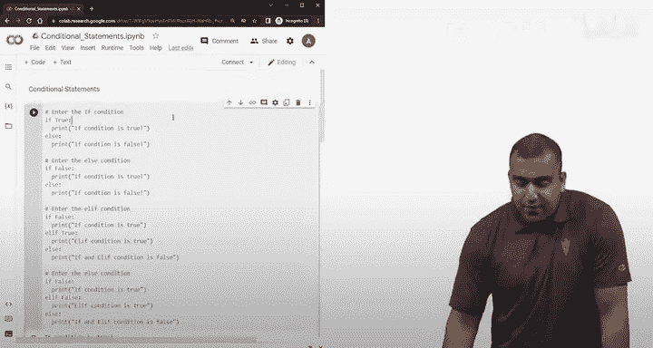

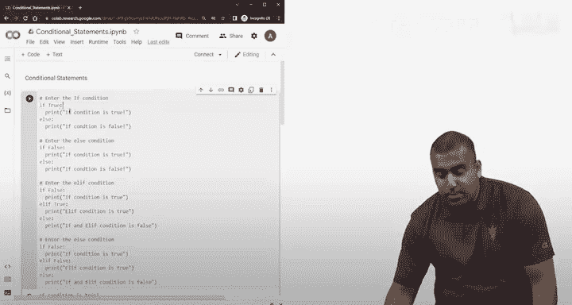

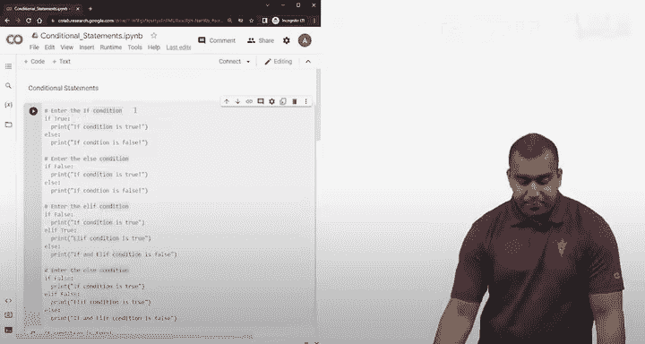

了解了条件语句的概念后，本节我们来看看它在Python中的具体语法。

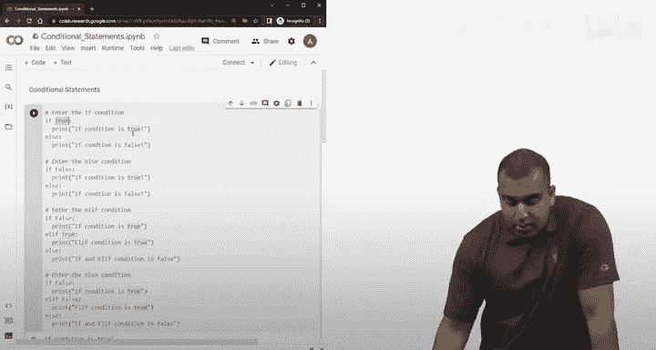

Python中的条件语句由以下语法表示：`if`、`elif`和`else`。
*   `if`语句是第一个被检查的条件。
*   `elif`是下一个语句，用于检查`if`语句的条件是否未通过。如果初始条件不满足，我们就进入`elif`块，它将检查下一个条件。
*   `else`是最后一个条件，如果`if`和`elif`语句的条件均未满足，则执行它。这是我们最后执行的部分。

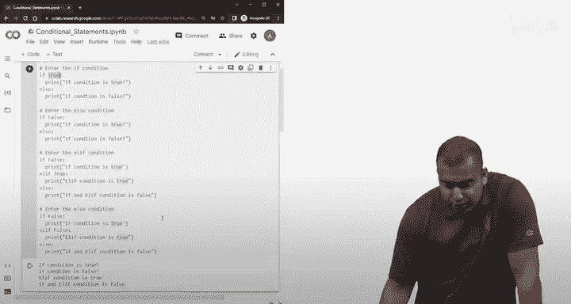

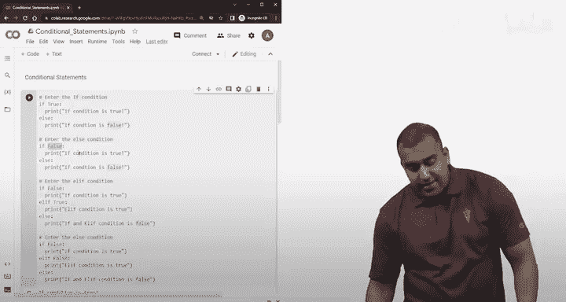

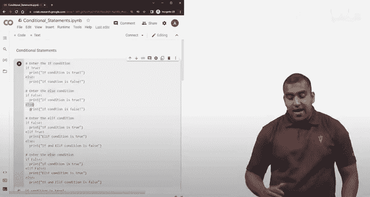

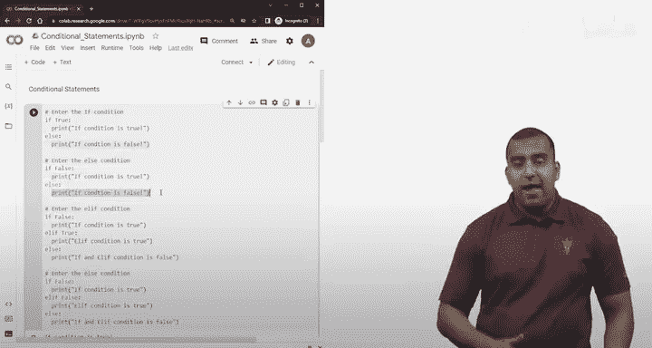

逻辑运算符可用于确定条件语句执行所需满足的条件。

现在让我们进入演示环节。

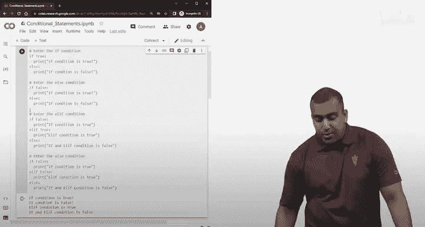

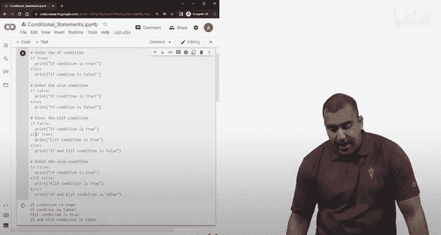

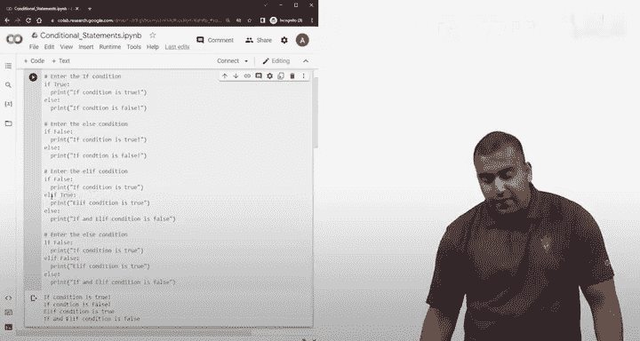

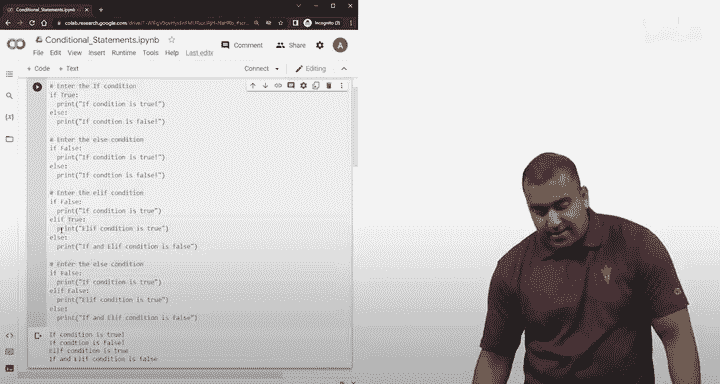

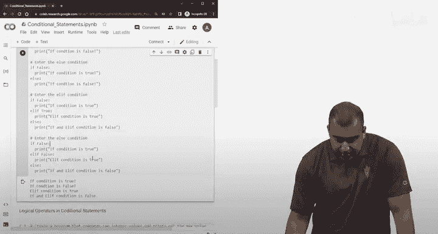

## 演示：基础条件语句 💻

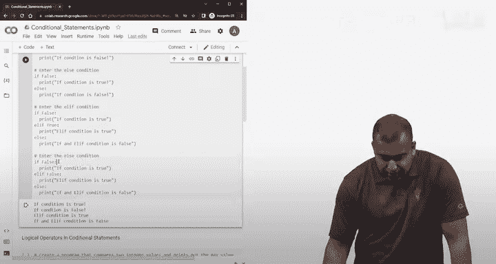

以下是条件语句的基本结构演示。

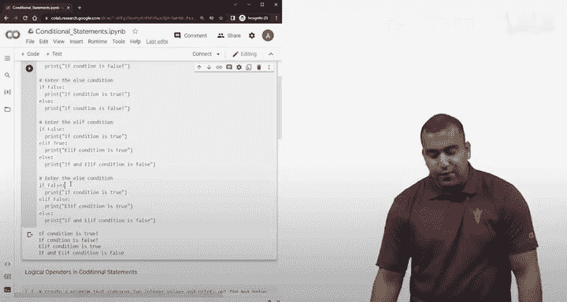

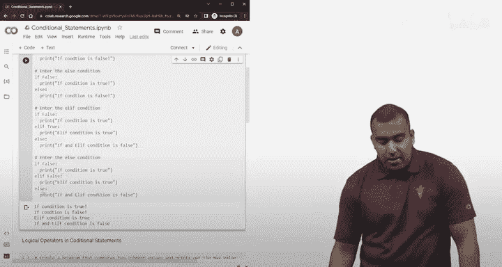

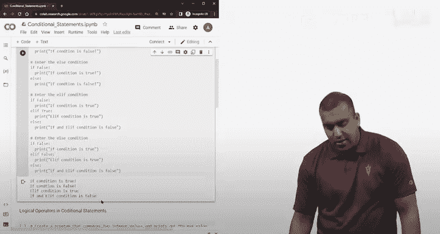

```python
# 示例 1: 基础 if-else
if True:
    print("if 条件为真")
else:
    print("if 条件为假")
```
运行此代码块，因为条件为`True`，所以会输出“if 条件为真”。如果将条件值改为`False`，则会输出“if 条件为假”。

```python
# 示例 2: 使用 if-elif-else
if False:
    print("if 条件为真")
elif True:
    print("elif 条件为真")
else:
    print("if 和 elif 条件均为假")
```
在这个例子中，`if`条件为假，因此检查`elif`条件。由于`elif`条件为真，所以输出“elif 条件为真”。

```python
# 示例 3: 进入 else 条件
if False:
    print("if 条件为真")
elif False:
    print("elif 条件为真")
else:
    print("if 和 elif 条件均为假")
```
如果`if`和`elif`的条件都为假，那么程序将进入`else`语句，执行其后的打印语句。

## 演示：在条件语句中使用逻辑运算符 ⚙️

在下一个示例中，我们将探讨条件语句中的逻辑运算符。

我们将创建一个比较两个整数值并打印出最大值的程序。

```python
# 示例 4: 比较两个数字
user_input1 = int(input("请输入第一个数字："))
user_input2 = int(input("请输入第二个数字："))

if user_input1 > user_input2:
    print(f"{user_input1} 大于 {user_input2}")
elif user_input2 > user_input1:
    print(f"{user_input2} 大于 {user_input1}")
elif user_input1 == user_input2:
    print(f"{user_input1} 等于 {user_input2}")
else:
    print(f"{user_input2} 大于 {user_input1}")
```
我强烈建议你尝试运行这个程序，输入你自己的整数值，理解它是如何工作以及如何通过每个条件的。

接下来，我们将创建一个程序，打印出学生努力学习并长时间学习会有什么结果。

```python
# 示例 5: 使用 and 和 or 运算符
work_hard = True
long_study_hours = True

if work_hard and long_study_hours:
    print("你将在本课程中取得好成绩。")
elif work_hard or long_study_hours:
    print("你需要投入更多学习时间或更努力地工作。")
else:
    print("你需要更努力地工作并投入长时间学习。")
```
对于`and`运算符，条件中的两个参数都必须为真，该条件才会返回真值。对于`or`运算符，只要其中一个条件为真即可。你可以通过更改`work_hard`和`long_study_hours`的值来运行此程序，看看会得到什么结果。

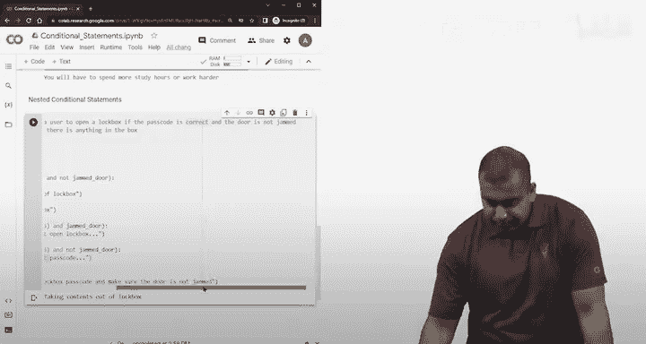

## 演示：嵌套条件语句 📦

最后，我们来看一个嵌套条件语句的例子。

在这个程序中，我们希望创建一个程序，允许用户在密码正确且门未卡住的情况下打开一个锁箱。如果箱子里有东西，我们还想把东西拿出来。

```python
# 示例 6: 嵌套条件语句
lockbox_passcode = "12345"
jammed_door = False
contents_in = True

if lockbox_passcode == "12345" and not jammed_door:
    if contents_in:
        print("正在从锁箱中取出物品。")
    else:
        print("锁箱内没有物品。")
elif lockbox_passcode == "12345" and jammed_door:
    print("门卡住了，无法打开锁箱。")
elif lockbox_passcode != "12345" and not jammed_door:
    print("用户必须输入正确的密码。")
else:
    print("请输入正确的锁箱密码，并确保门没有卡住。")
```
这是一个嵌套条件语句的示例。我将在下一课中更详细地解释其工作原理。

## 总结 📝

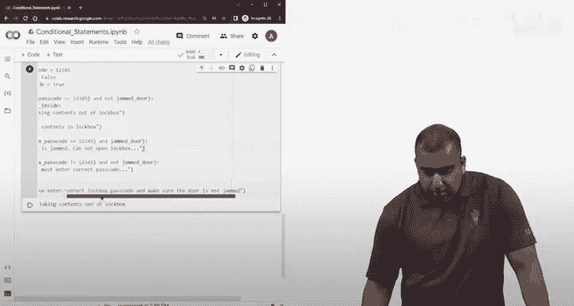

本节课中我们一起学习了Python中的条件分支语句。我们了解了`if`、`elif`和`else`的基本语法和用途，并通过多个示例演示了如何在实际编程中使用它们，包括结合逻辑运算符（`and`、`or`、`not`）以及构建嵌套条件结构。掌握条件语句是进行程序决策和流程控制的基础。