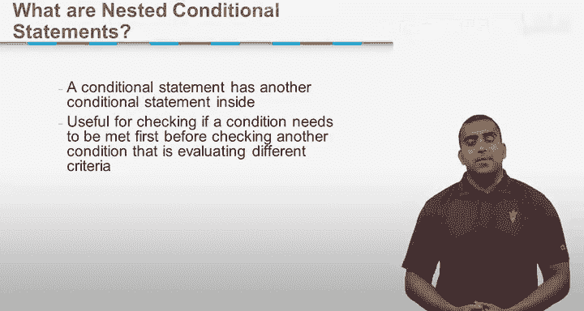
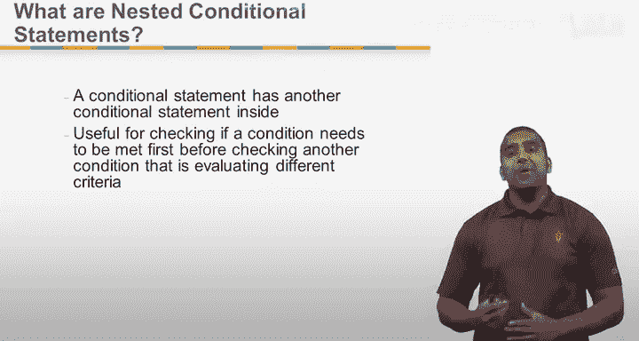
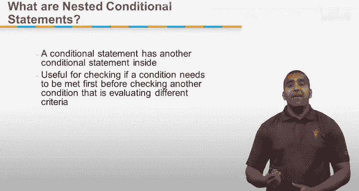
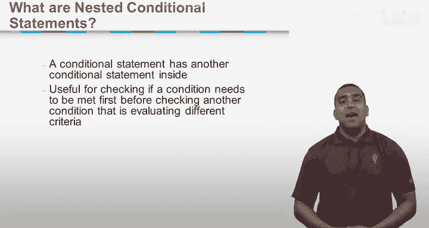
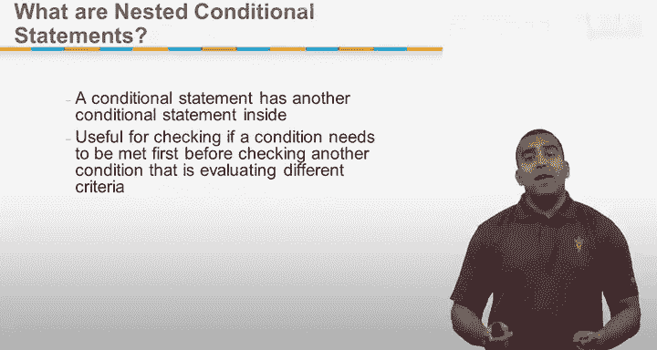
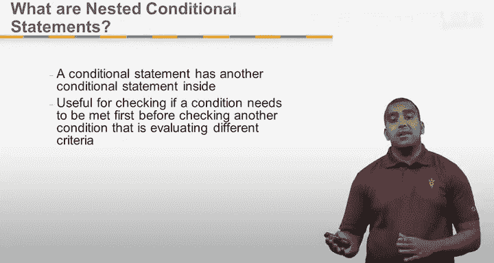
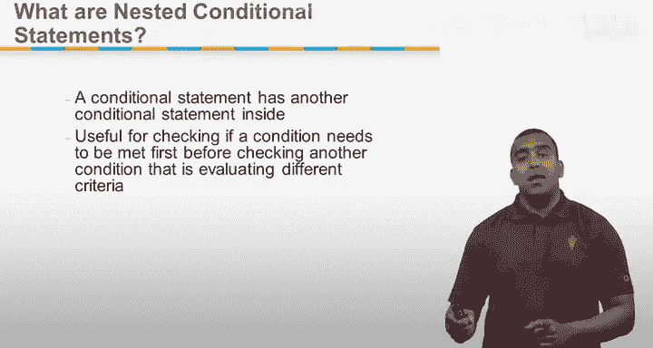
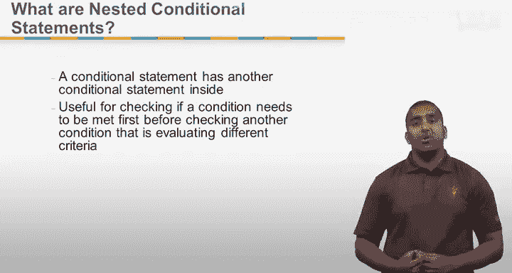

# 17：嵌套条件语句（if-elif-else）构建方法 🧩


在本节课中，我们将要学习**嵌套条件语句**的概念及其构建方法。嵌套条件语句允许我们在一个条件判断的内部再放置另一个条件判断，从而实现更复杂、更精细的逻辑控制。


---



## 什么是嵌套条件语句？ 🤔



上一节我们介绍了基础的条件语句，本节中我们来看看如何将它们组合起来。





一个**嵌套条件语句**是指在一个条件语句的代码块内部，包含了另一个条件语句。

这种结构非常有用，它允许我们先检查一个条件是否满足，然后再基于此去检查另一个评估不同标准的新条件。







例如，我们可能有一个 `if` 语句来检查某件事是否为真。嵌套条件语句意味着，在这个 `if` 语句的代码块内部，还会有另一个 `if` 语句。内部的 `if` 语句只有在外部 `if` 语句的条件为真时，才会被执行。




让我们通过一个演示来理解这个概念。

---

## 演示：保险箱示例 🔐

我们将回顾之前提到过的保险箱示例。通过这个例子，你将清晰地看到嵌套条件语句是如何工作的。

以下是示例代码：

```python
lockbox_passcode = 12345
jammed_door = False
contents_inside = True

if lockbox_passcode == 12345 and not jammed_door:
    if contents_inside:
        print("Taking contents out of the lockbox.")
    else:
        print("No contents in the lockbox.")
elif lockbox_passcode == 12345 and jammed_door:
    print("Door is jammed. Cannot open lockbox.")
else:
    print("Please enter the correct lockbox passcode and make sure the door is not jammed.")
```

这段代码是一个典型的嵌套条件语句示例。内部的 `if-else` 语句（检查 `contents_inside`）只有在外部 `if` 语句（检查密码和门是否卡住）的条件为真时，才会被评估和执行。

### 代码执行流程分析

以下是代码执行时可能发生的几种情况：

1.  **密码正确且门未卡住**：外部 `if` 条件为真，程序进入其代码块。接着检查内部条件：
    *   如果 `contents_inside` 为 `True`，则打印 `"Taking contents out of the lockbox."`。
    *   如果 `contents_inside` 为 `False`，则打印 `"No contents in the lockbox."`。
2.  **密码正确但门卡住了**：外部 `if` 条件为假，程序跳转到 `elif` 语句。由于 `elif` 条件为真，因此打印 `"Door is jammed. Cannot open lockbox."`。
3.  **密码错误**：外部 `if` 和 `elif` 条件均为假，程序执行 `else` 语句，打印 `"Please enter the correct lockbox passcode and make sure the door is not jammed."`。

我强烈建议你复制这段代码到 [Coabab](https://colab.research.google.com/) 或任何 Python 环境中运行，并尝试修改 `lockbox_passcode`、`jammed_door` 和 `contents_inside` 这三个变量的值。通过观察不同输入下的输出结果，你将能透彻理解嵌套条件语句的执行逻辑。

---

## 总结 📝

本节课中我们一起学习了**嵌套条件语句**。我们了解到，嵌套条件语句是将一个条件判断结构放置在另一个条件判断结构的内部，它允许我们构建多层次的、依赖性的决策逻辑。

关键要点在于：**内部的（嵌套的）条件语句，其执行与否完全取决于外部包裹它的那个条件语句的结果是否为真**。掌握这一概念，将使你能够编写出处理复杂场景的、逻辑严密的程序。

通过修改和运行演示代码，你已经迈出了成为嵌套条件语句大师的第一步。继续练习，你将会更加熟练地运用它。