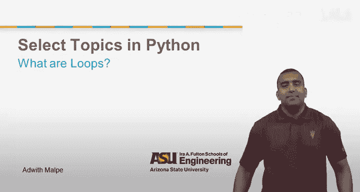
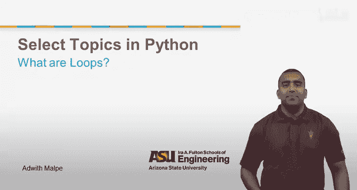
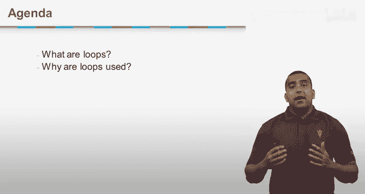
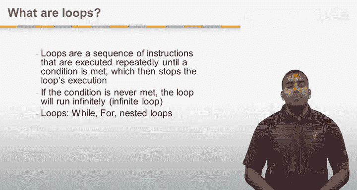
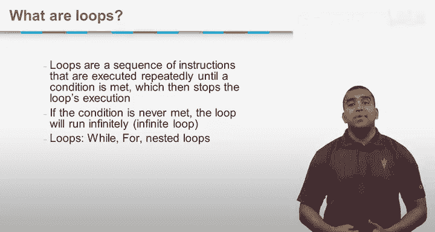
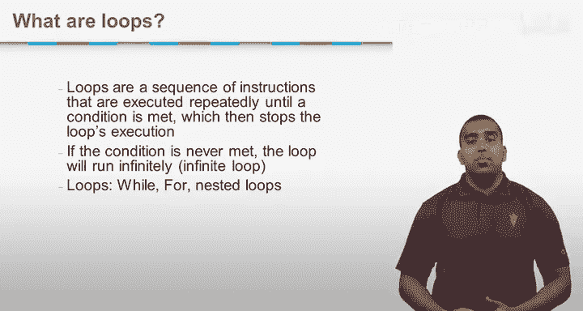
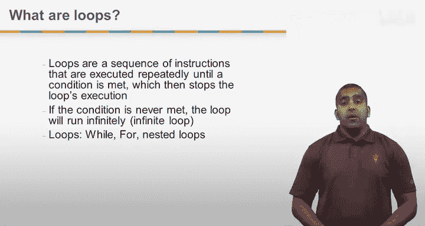
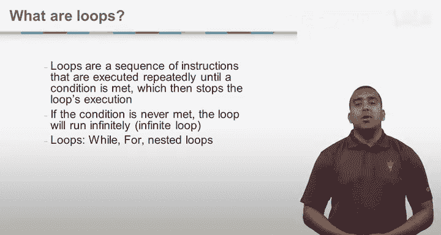

# 18：循环结构解析 🔄

在本节课中，我们将学习Python编程中的核心概念之一：循环。我们将探讨循环是什么、为什么在编程中需要使用循环，并介绍两种主要的循环类型。

---

## 什么是循环？ 🤔

上一节我们介绍了本节课的主题。本节中，我们来具体看看循环的定义。

循环是一系列指令，这些指令会被重复执行，直到满足某个条件，循环才会停止。

如果循环中的条件永远无法被满足，循环将无限运行下去，这种情况被称为无限循环。

---

## 为什么在编程中使用循环？ 💡

理解了循环的基本概念后，我们来看看循环在编程中的实际价值和用途。

循环用于以迭代的方式执行任务，而不是编写大量冗余的代码行。

以下是循环的几个主要用途：

*   循环可以用于多次执行相同的指令。
*   循环可以用于将相同的指令多次应用于不同的数据片段，这使其变得极其有用。
*   循环可以通过消除编写多行执行相同任务的代码的需要，来节省时间并减少错误。

---

## 我们将要学习的循环类型 🔁

在接下来的课程中，我们将重点学习两种循环：

*   **while循环**
*   **for循环**

我们也将学习**嵌套循环**，即一个循环位于另一个循环内部。

---

本节课中，我们一起学习了循环的基本定义、在编程中的重要性及其主要用途。循环是自动化重复任务、提高代码效率和可维护性的强大工具。在后续课程中，我们将深入实践`while`循环和`for`循环的具体用法。