# 21：嵌套循环结构实现 🔄

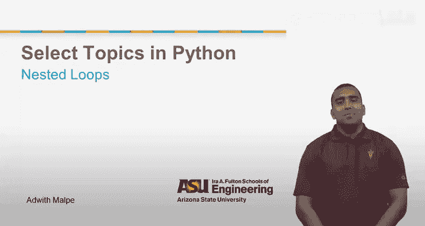

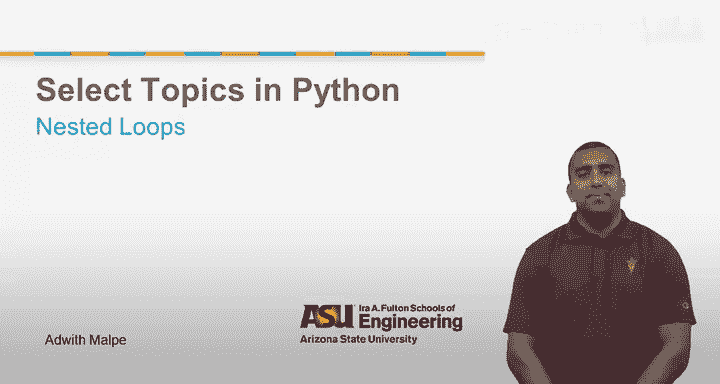

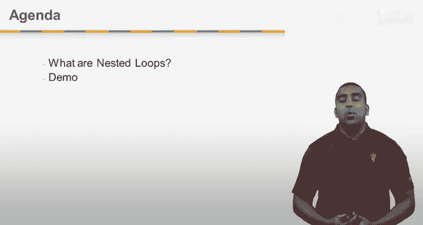

在本节课中，我们将学习嵌套循环的概念，并通过一个演示来理解其工作原理。我们将看到如何在一个循环内部放置另一个循环，并观察它们的执行顺序。

## 什么是嵌套循环？

嵌套循环是指在一个外层循环的循环体内，包含另一个内层循环。外层循环的每一次迭代都会触发内层循环的执行。内层循环会完整执行其所有迭代后，外层循环才会进入下一次迭代。这个过程会持续到外层循环执行完毕。

**核心概念**可以用以下伪代码描述：
```python
for outer_item in outer_sequence:
    # 外层循环体
    for inner_item in inner_sequence:
        # 内层循环体
```

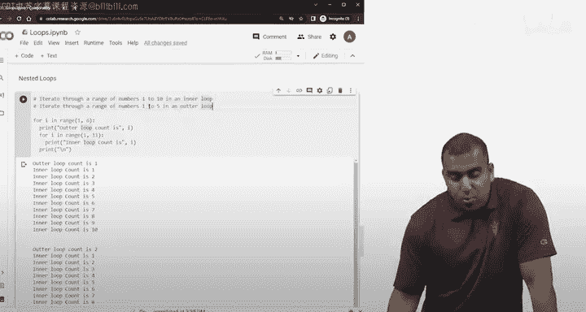

请注意，可以使用 `break` 语句来提前终止循环。

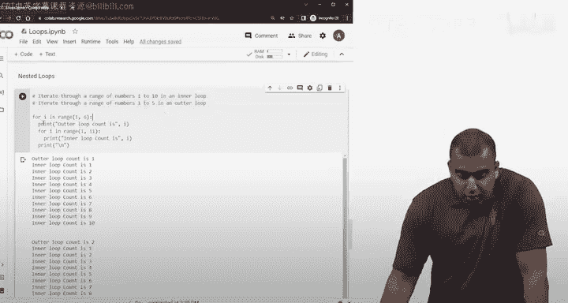

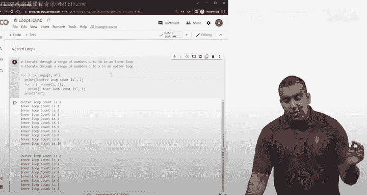

## 嵌套循环演示

现在，让我们通过一个具体的例子来理解嵌套循环的执行流程。

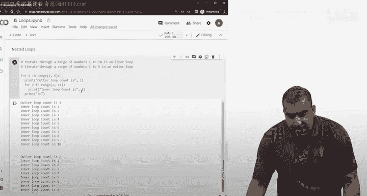

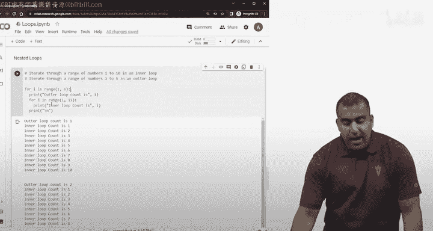

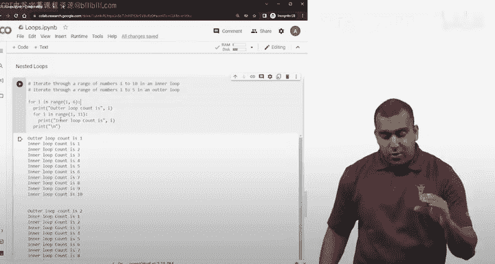

假设我们想让外层循环遍历数字1到5，而内层循环遍历数字1到10。

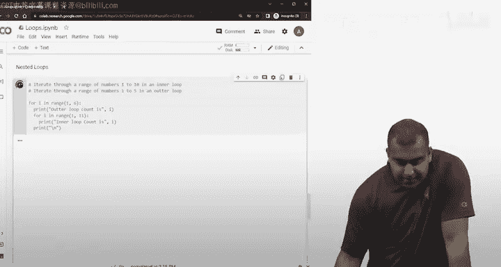

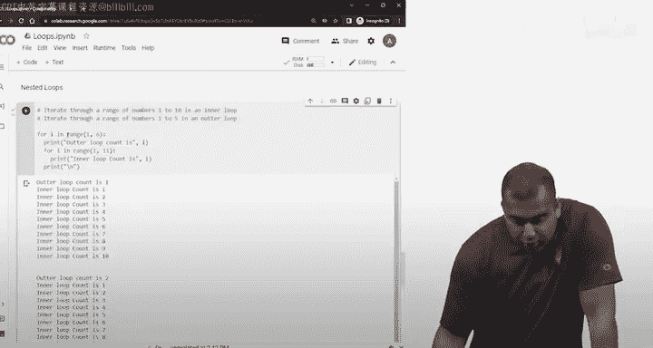

以下是实现此功能的代码：

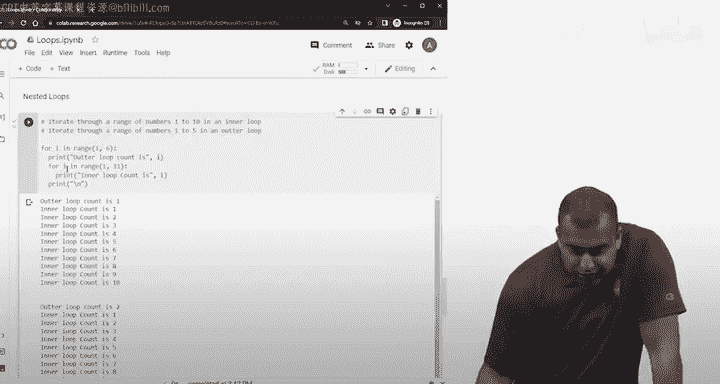

```python
for i in range(1, 6):
    print(f"外层循环计数: {i}")
    for j in range(1, 11):
        print(f"  内层循环计数: {j}")
    print()  # 打印一个空行，使输出更清晰
```

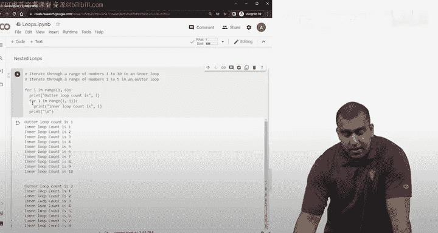

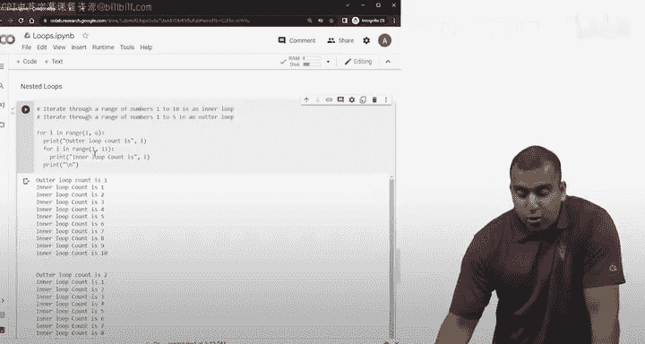

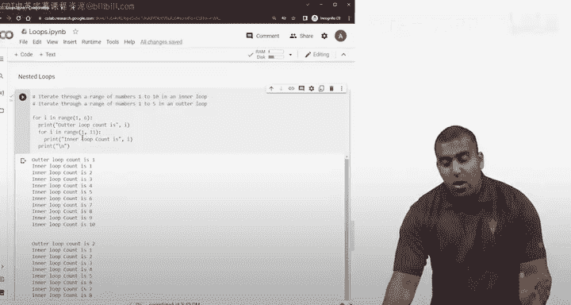

运行这段程序后，输出结果将如下所示：

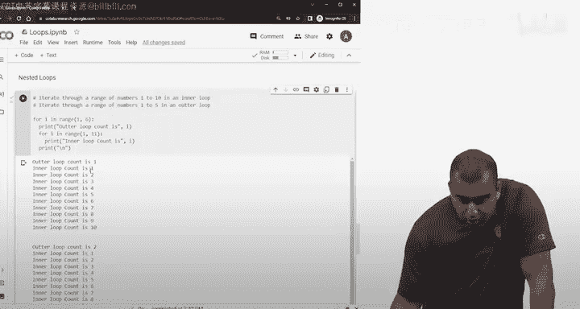

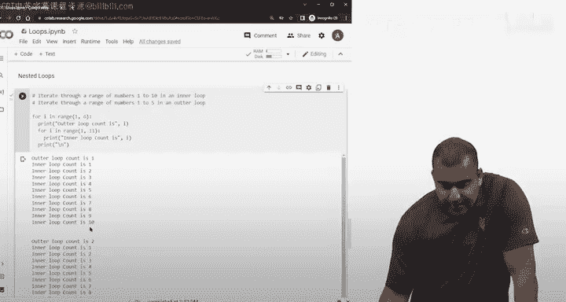

```
外层循环计数: 1
  内层循环计数: 1
  内层循环计数: 2
  ...
  内层循环计数: 10

外层循环计数: 2
  内层循环计数: 1
  内层循环计数: 2
  ...
  内层循环计数: 10

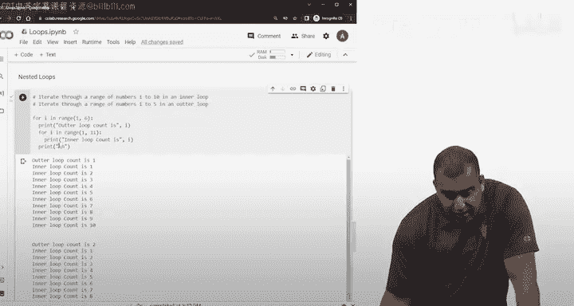

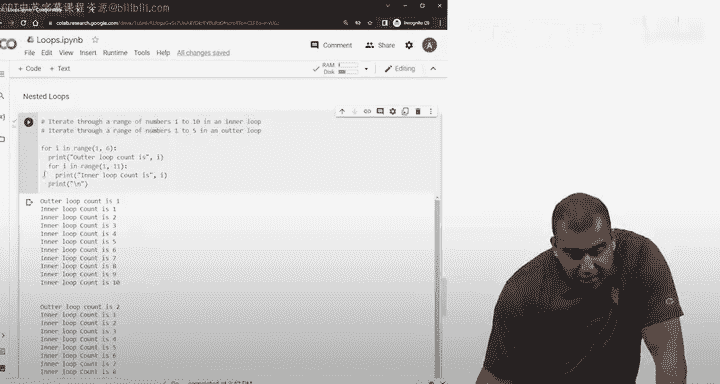

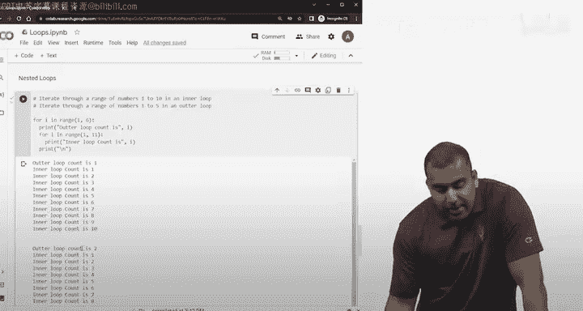

... (以此类推，直到外层循环计数为5)
```

让我们详细解析执行过程：


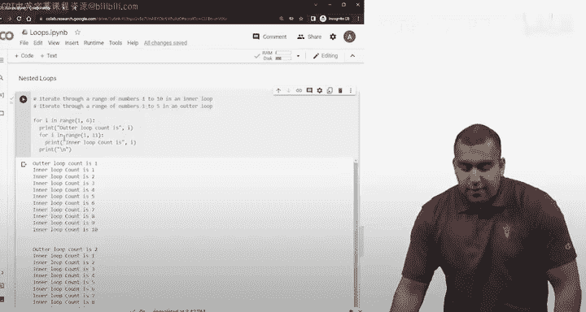

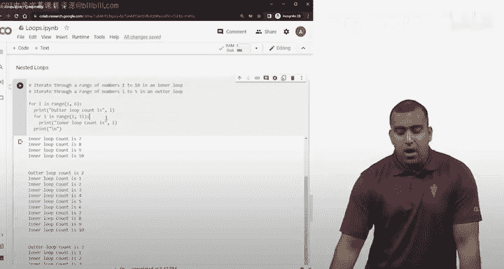

1.  **第一次外层迭代**：`i` 的值为1。程序打印“外层循环计数: 1”。
2.  **进入内层循环**：随后，程序进入内层 `for` 循环。`j` 的值从1开始，一直迭代到10。在此期间，程序会连续打印10行“内层循环计数: j”。
3.  **内层循环结束**：当 `j` 达到10，内层循环执行完毕。
4.  **打印空行并返回外层**：程序执行 `print()` 语句，然后返回到外层循环的起点，开始第二次迭代。
5.  **重复过程**：现在 `i` 变为2，重复步骤1到4。这个过程会一直持续，直到外层循环的 `i` 值达到5并完成最后一次迭代。

通过这个例子，你可以清晰地看到，**外层循环每执行一次，内层循环就会完整地执行其所有迭代**。

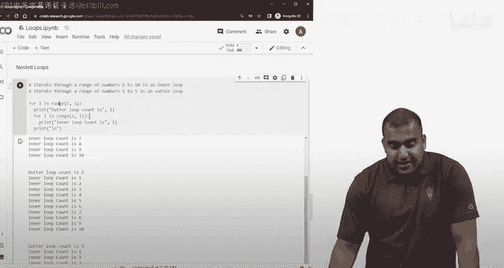


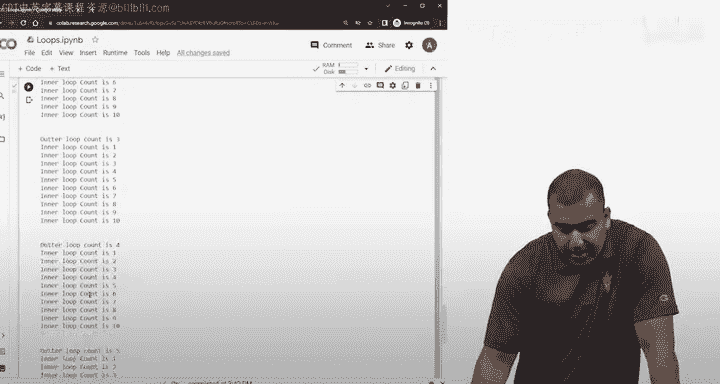

## 总结


本节课中，我们一起学习了嵌套循环。我们了解到嵌套循环是一个循环内包含另一个循环的结构。外层循环控制着内层循环的执行轮数，而内层循环在每一轮中都会完整运行。通过代码演示，我们观察了这种结构如何按顺序执行，并输出了清晰的计数结果。理解嵌套循环是处理多维数据（如矩阵、表格）和复杂重复模式的关键。