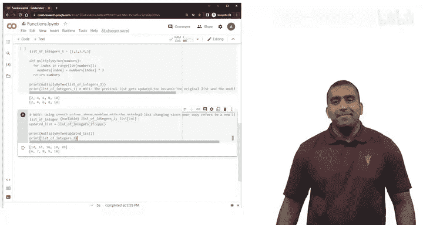

# 22：函数的创建与应用 🧮

在本节课中，我们将学习 Python 中函数的概念、作用以及如何创建和使用函数。函数是编程中组织代码、提高代码复用性和可读性的核心工具。

## 什么是函数？🤔

上一节我们介绍了课程概述，本节中我们来看看函数的具体定义。

函数是模块化的代码块，可以在程序中重复使用，以对不同数据片段执行单一相关的操作。

函数使代码变得更易读和可重用。

在 Python 中，我们使用关键字 **`def`** 来创建函数。

函数使用圆括号，并且可以接收参数，这些参数用于处理数据。

**`return`** 是 Python 中的一个关键字，用于返回函数中计算出的值。

## 为什么使用函数？💡

了解了函数的基本概念后，本节我们来探讨使用函数的原因。

函数可以在程序的不同部分多次使用，这为我们提供了极大的便利。相比于编写重复的代码行来处理数据，我们可以调用函数来操作不同的数据片段。

通过使用函数，你无需重复编写代码，这可以节省内存。同时，其他程序员也能更好地理解你的代码及其工作原理。

## 实战演示：创建与使用函数 🚀

理论部分已经介绍完毕，现在让我们通过几个具体的例子来实践如何创建和使用函数。

### 示例一：计算年度总销售额

以下是创建一个计算披萨公司年度总销售额程序的步骤。

1.  首先，我们创建一个名为 `total_sales` 的整数类型变量，并将其初始化为零。
2.  接着，创建另一个名为 `quantity` 的变量，并将其初始化为 200,000（单位）。
3.  然后，创建一个名为 `price` 的变量，并将其值设为 12.50（即每单位 12.50 美元）。
4.  现在，我们使用 `def` 关键字创建一个名为 `compute_annual_sales` 的函数。该函数需要接收两个参数：`quantity_sold`（销售数量）和 `price_per_unit`（单价）。
5.  在函数内部，我们通过计算 `quantity_sold` 乘以 `price_per_unit` 的乘积来得到总销售额。
6.  最后，使用 `return` 关键字返回计算出的总销售额。
7.  要使用这个函数，我们可以打印结果：`print("今年的总销售额是 $" + str(compute_annual_sales(quantity, price)))`。这里我们将函数返回的数值显式转换为字符串。

运行此程序将输出：`今年的总销售额是 $2500000.0`。

函数的便利之处在于，我们只需更改 `quantity` 和 `price` 这两个变量的值，就可以反复运行程序进行计算，而无需每次都重写计算逻辑。

### 示例二：确定两个数字中的最大值

在这个例子中，我们将创建一个函数，根据用户输入确定两个数字中的最大值。

1.  首先，获取用户输入的第一个整数：`user_input1 = int(input("请输入第一个整数: "))`。使用 `int()` 是为了确保输入被转换为整数类型。
2.  同样地，获取用户输入的第二个整数：`user_input2 = int(input("请输入第二个整数: "))`。
3.  接着，使用 `def` 关键字定义一个名为 `maximum_number` 的函数，它接收两个参数：`number1` 和 `number2`。
4.  在函数内部，我们使用条件判断：如果 `number1` 大于 `number2`，则返回 `number1`；否则，返回 `number2`。
5.  最后，调用函数并打印结果：`print("最大的数字是", maximum_number(user_input1, user_input2))`。

例如，如果用户输入 100 和 2000，程序将输出：`最大的数字是 2000`。

### 示例三：将列表中的每个元素乘以二

上一个例子处理了简单的数值，本节我们来看函数如何处理更复杂的数据结构，比如列表。

我们将创建一个函数，接收一个整数列表，并将列表中的每个项目乘以二，然后返回更新后的列表值并打印到屏幕上。

1.  首先，定义一个整数列表：`list_of_integers = [1, 2, 3, 4, 5]`。
2.  然后，创建一个名为 `multiply_by_two` 的函数，它接收一个名为 `numbers` 的参数。
3.  在函数内部，我们使用 `for` 循环遍历列表：`for index in range(len(numbers)):`。`range(len(numbers))` 会生成从 0 到列表长度减一的索引序列。
4.  在循环体内，通过索引访问列表中的每个元素，并将其乘以 2：`numbers[index] = numbers[index] * 2`。
5.  调用这个函数并打印更新后的列表：`multiply_by_two(list_of_integers)` 然后 `print(list_of_integers)`。

运行后，将输出：`[2, 4, 6, 8, 10]`。

这个例子展示了函数的强大之处：它可以对一系列值执行一组操作，而无需为每个单独的数值重复编写代码。

**注意**：在上述示例中，如果你在函数调用后打印原始列表 `list_of_integers`，会发现它也被修改了。这是因为在 Python 中，列表是可变对象，函数内对参数的修改会影响原始列表。

为了解决这个问题，我们可以使用 Python 内置的 **`.copy()`** 方法。

1.  创建另一个列表：`list_of_integers_2 = [6, 7, 8, 9, 10]`。
2.  创建一个变量 `updated_list`，它是原始列表的副本：`updated_list = list_of_integers_2.copy()`。
3.  现在，对副本调用函数：`multiply_by_two(updated_list)`。
4.  打印更新后的副本和原始列表：`print(updated_list)` 和 `print(list_of_integers_2)`。

此时，`updated_list` 会输出 `[12, 14, 16, 18, 20]`，而 `list_of_integers_2` 则保持不变，仍然是 `[6, 7, 8, 9, 10]`。这样就解决了原始列表被意外修改的问题。

## 总结 📝

本节课中，我们一起学习了 Python 函数的核心知识。我们了解了函数是用于封装可重用代码块的模块化工具，使用 **`def`** 关键字定义，可以接收参数并通过 **`return`** 语句返回值。我们探讨了使用函数可以提高代码的复用性、可读性和维护性。通过三个实战示例，我们练习了如何创建函数来计算数值、比较大小以及处理列表数据，同时也学习了使用 **`.copy()`** 方法来避免在函数中意外修改原始可变对象（如列表）。掌握函数的创建与应用是迈向高效编程的重要一步。