# 23：Python数学库使用指南 📚


在本节课中，我们将要学习Python中一个非常强大的工具——数学库（math library）。我们将了解什么是库，什么是数学库，并通过实际演示来学习如何使用它。


## 什么是库？ 📦

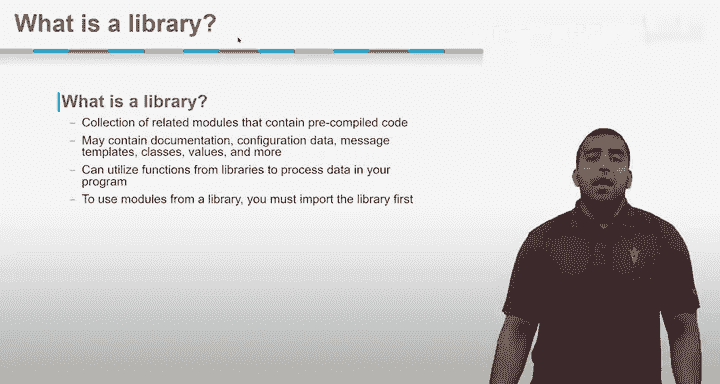

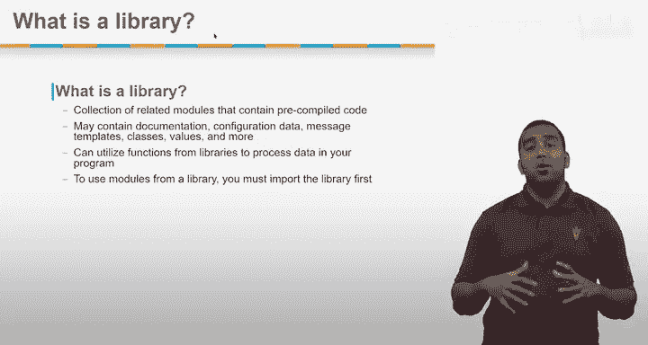

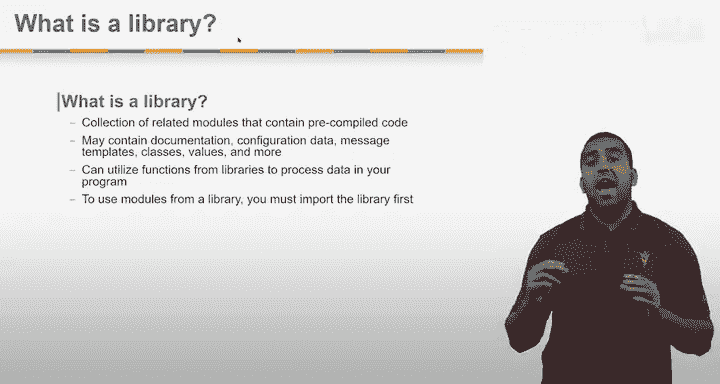

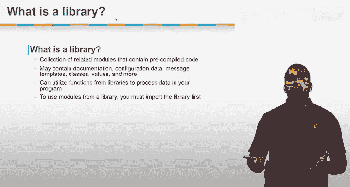

上一节我们介绍了课程目标，本节中我们来看看什么是库。

库本质上是一个包含预编译代码的相关模块的集合。这非常有用，因为我们可以利用已经生成的预编译代码来处理我们想要操作的数据。

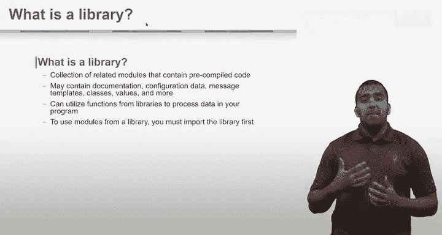

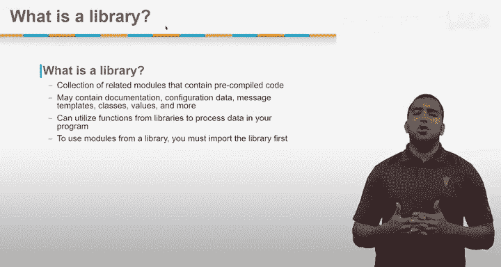


库可能包含文档、配置数据、消息模板、类、值等等。库极其强大，它们通过调用已经存在的函数或方法，帮助我们减少编写冗余代码的时间。

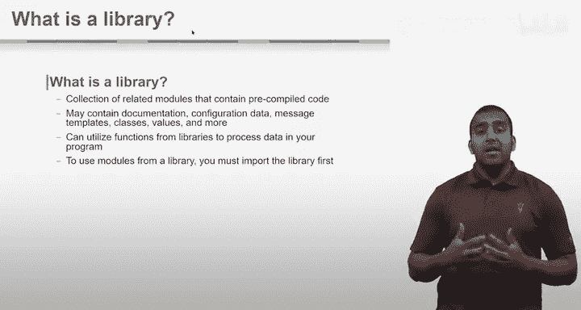

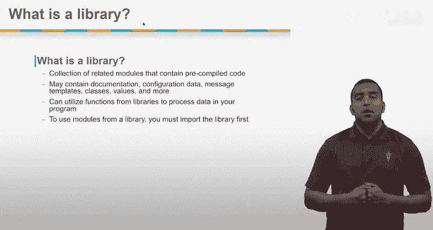

我们可以利用库中的函数来处理我们自己程序中的数据。

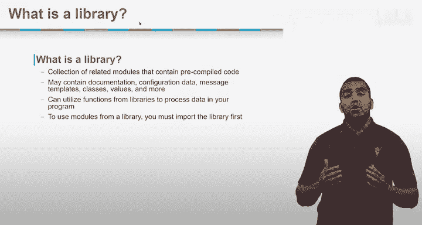

要使用库中的模块，我们必须使用 `import` 关键字，这将首先导入该库。

## 什么是数学库？ ➗

了解了库的基本概念后，我们来看看Python中一个具体的库——数学库。

数学库是一个提供对C标准定义的数学函数访问的库。数学库不能处理复数。然而，数学库确实为我们提供了许多有用的函数，我们可以利用它们来执行某些操作，例如求两个或多个数字的和、求多个数字的平方根等等。

我们可以使用C数学库来处理复数，因为Python的数学库不能处理复数。

需要注意的是，数学库中所有函数的返回值都是浮点数（float），除非有明确说明。

以下是三种导入和使用数学库的示例：

**示例1：导入整个库**
```python
import math
x = math.sqrt(81)
print(x)  # 输出：9.0
```

**示例2：导入特定函数**
```python
from math import sqrt, pow
x = sqrt(25)
y = pow(6, 2)
print(x, y)  # 输出：5.0 36.0
```

**示例3：为库设置别名**
```python
import math as m
print(m.sqrt(25))  # 输出：5.0
# 原库名依然可用
print(math.sqrt(36))  # 输出：6.0
```

## 数学库功能演示 💻

现在，让我们通过一个Python脚本来演示数学库的一些功能。


首先，导入数学库以便使用其中的函数。


```python
import math
```


### 计算平方根


使用数学库中的平方根函数计算81的平方根。


```python
x = math.sqrt(81)
print(f"square root of 81 is {x}")
# 输出：square root of 81 is 9.0
```

### 向下取整（floor）与向上取整（ceil）


以下是数学库中处理取整的函数示例。

向下取整函数 `floor` 返回不大于参数的最大整数。


```python
print(math.floor(2.7))  # 输出：2
```


向上取整函数 `ceil` 返回不小于参数的最小整数。


```python
print(math.ceil(2.2))  # 输出：3
```


### 幂运算


使用幂函数 `pow` 计算4的平方。


```python
print(math.pow(4, 2))  # 输出：16.0
```


### 数学常数

数学库的一个优点是它包含了许多有用的常数。


例如，获取圆周率π的值：


```python
print(math.pi)  # 输出：3.141592653589793
```

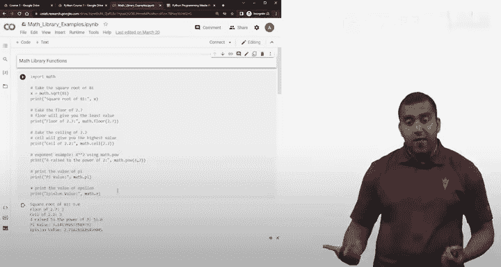


获取自然常数e的值：


```python
print(math.e)  # 输出：2.718281828459045
```


### 使用别名和选择性导入


我们可以为库设置别名以简化代码。


```python
import math as m
print(m.sqrt(25))  # 输出：5.0
```


也可以只导入需要的特定函数。


```python
from math import sqrt, pow
x = sqrt(25)
y = pow(6, 2)
print(x, y)  # 输出：5.0 36.0
```

### 查看库的帮助文档


如果你对数学库中所有可用的函数感兴趣，可以使用 `help()` 函数查看。

```python
help(‘math’)
```


运行这行代码将显示库的名称、描述以及所有可以使用的函数，例如正弦（sin）、正切（tan）、向上取整（ceil）、余弦（cos）等。这比通过搜索引擎查找要快捷得多。


## 总结 📝

本节课中我们一起学习了Python数学库的使用。

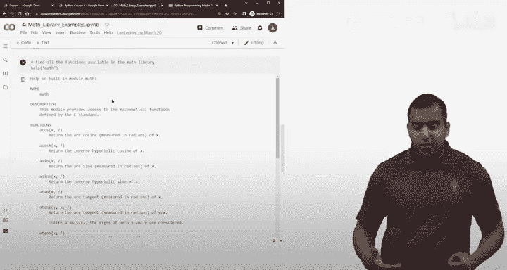


我们首先了解了库的概念，它是一组预编译代码的集合，能极大提高编程效率。接着，我们深入探讨了Python的数学库（math library），它提供了丰富的数学函数和常数，但不能处理复数。

我们通过多个示例演示了如何导入数学库（包括整体导入、设置别名和选择性导入），并实践了常用功能，如计算平方根（`sqrt`）、进行幂运算（`pow`）、向下取整（`floor`）、向上取整（`ceil`）以及获取常数π和e的值。


最后，我们学习了如何使用 `help(‘math’)` 快速查看库的所有可用函数，这是探索新库功能的实用技巧。掌握数学库能让你在编写涉及数学运算的程序时事半功倍。