# 24：Python随机库应用方法 🎲


在本节课中，我们将学习Python的`random`库。这个库允许我们生成随机数、从列表中随机选取元素，以及执行其他与随机数相关的操作。我们将介绍`random`库的基本概念，并通过具体示例演示其常用函数的使用方法。


---

## 什么是随机库？ 🤔

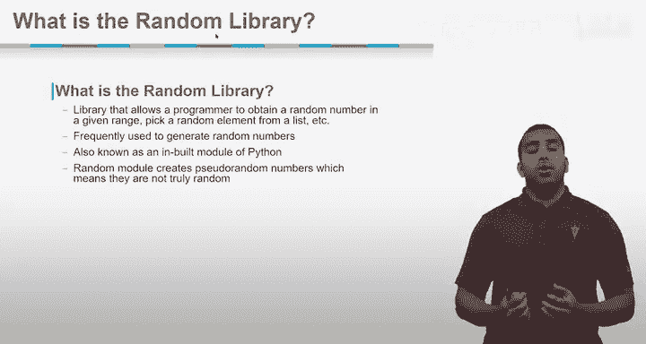

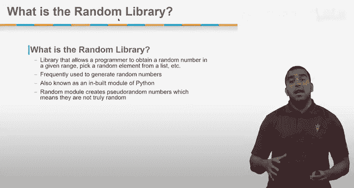

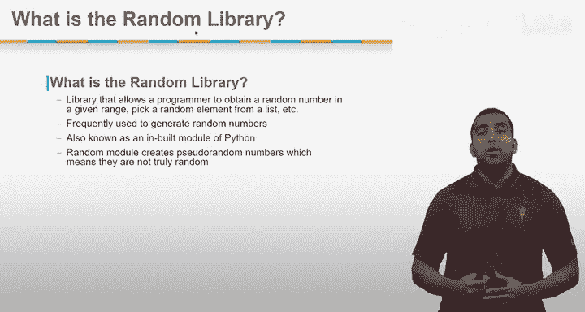

`random`库是Python的一个内置模块，它提供了多种生成随机数的函数。这些函数可以用于获取给定范围内的随机数、从列表中随机选取元素，以及进行其他涉及随机数的计算。

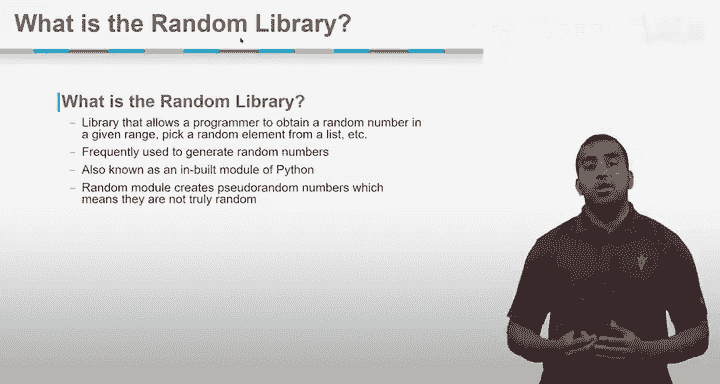

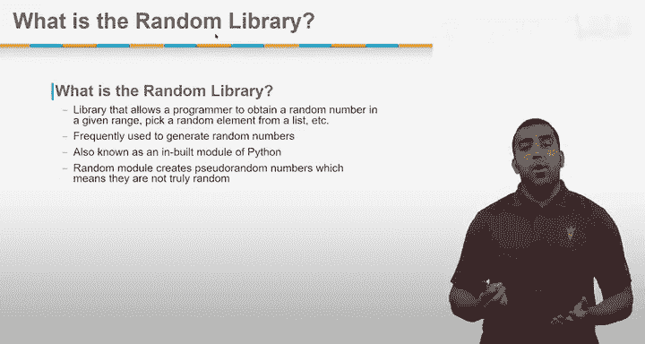

需要注意的是，`random`模块生成的是伪随机数。这意味着生成的数字并非完全随机，有时可能存在一定的偏差。


---

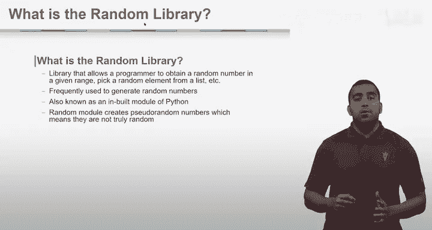

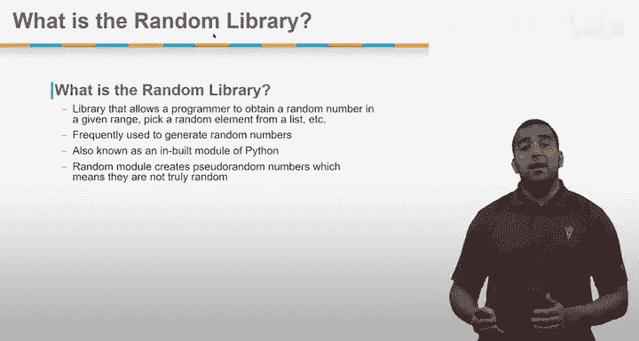

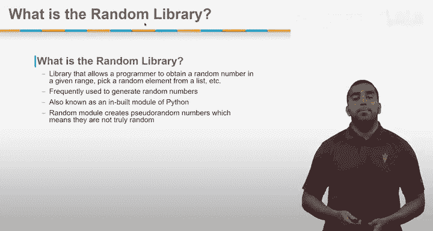

## 导入随机库 📥

在使用`random`库之前，我们需要先导入它。导入语句如下：

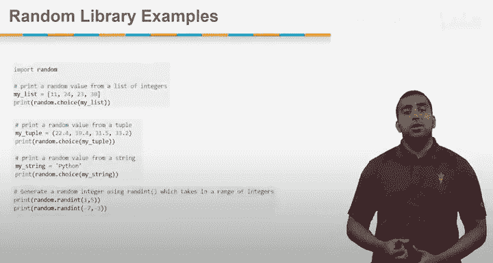

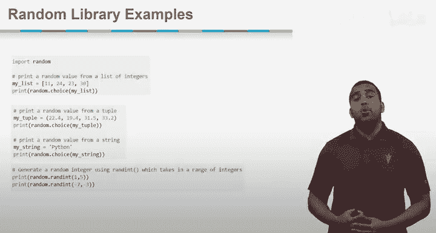

```python
import random
```

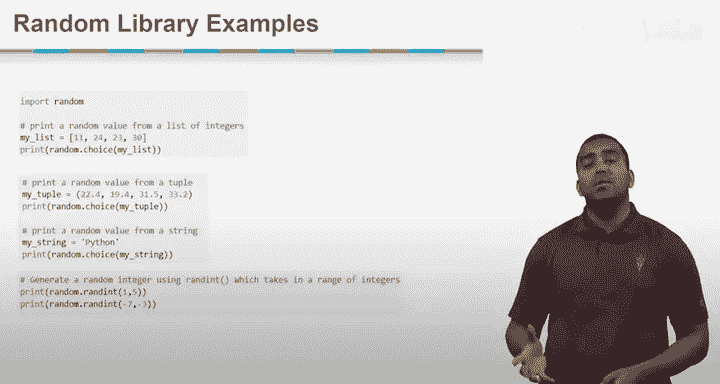

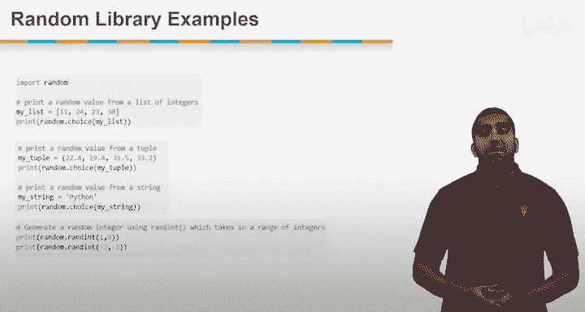

这行代码表示我们将在程序中使用`random`库提供的功能。

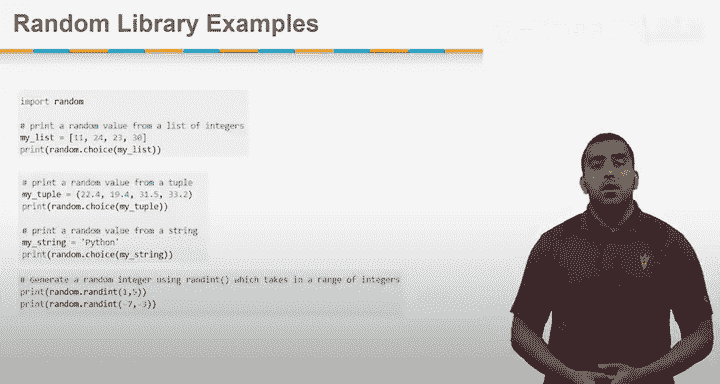

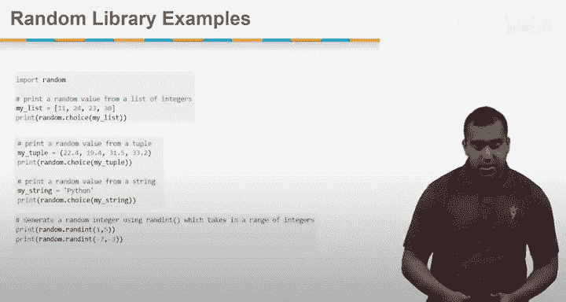

---

## 常用函数示例 📚


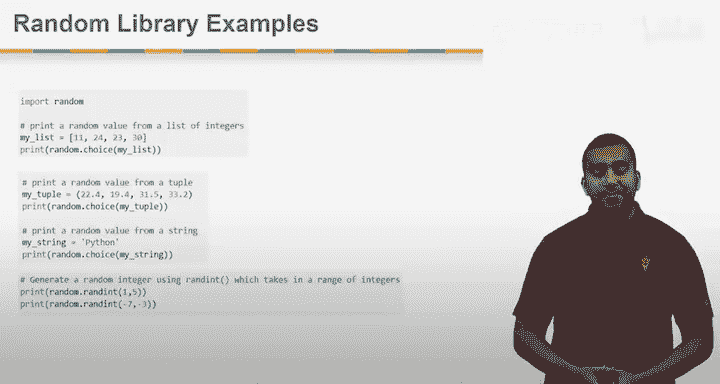

以下是`random`库中一些常用函数的示例。我们将逐一介绍这些函数及其用法。

### 从列表中随机选取元素

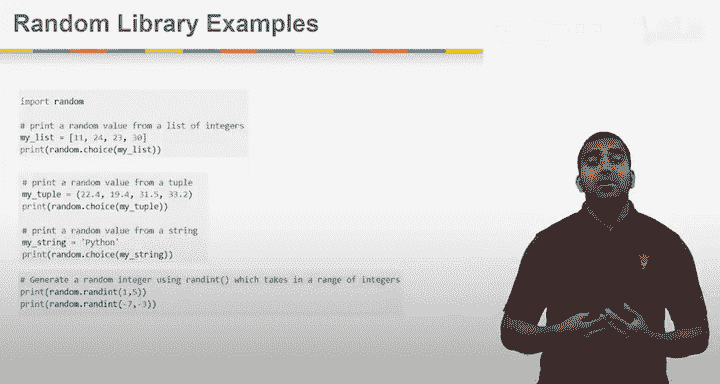

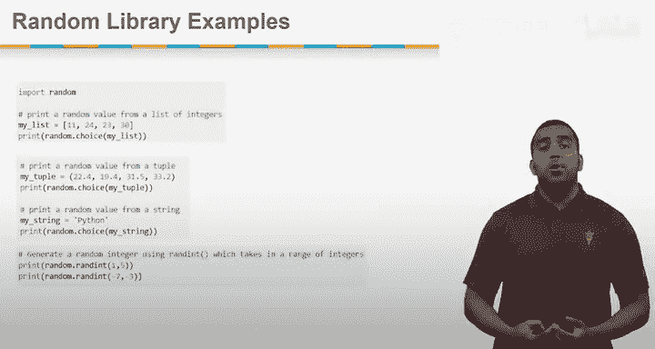

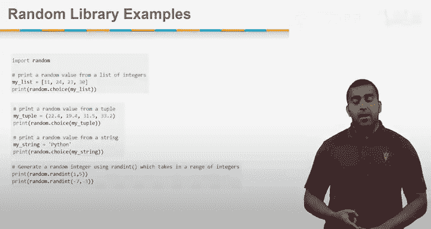

首先，我们创建一个整数列表，并使用`choice`函数从中随机选取一个元素。

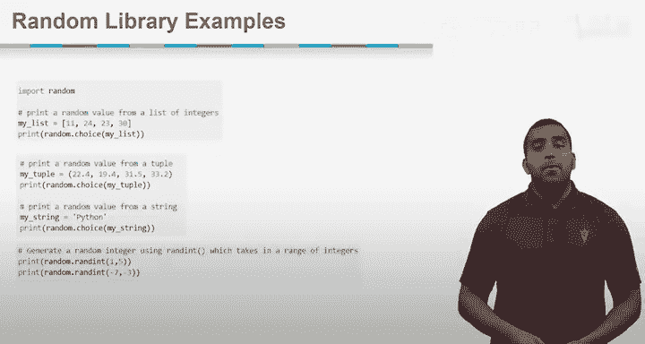

```python
my_list = [11, 24, 23, 30]
print(random.choice(my_list))
```


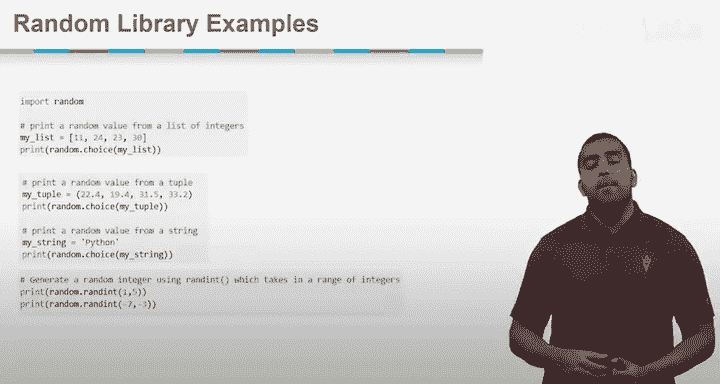

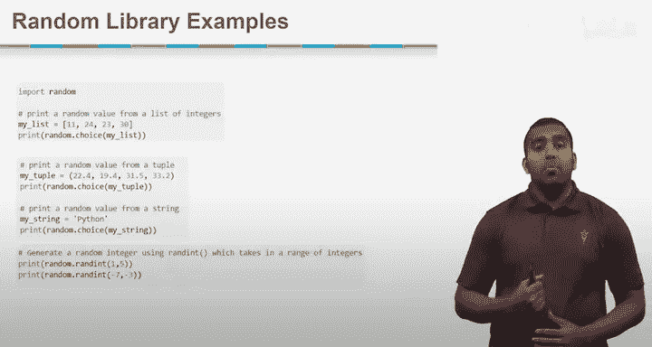

这段代码会从`my_list`中随机选取并打印一个整数。


### 从元组中随机选取元素


元组是一种不可变的数据结构，通常用于存储同一类型的数据。以下示例演示如何从元组中随机选取一个浮点数。

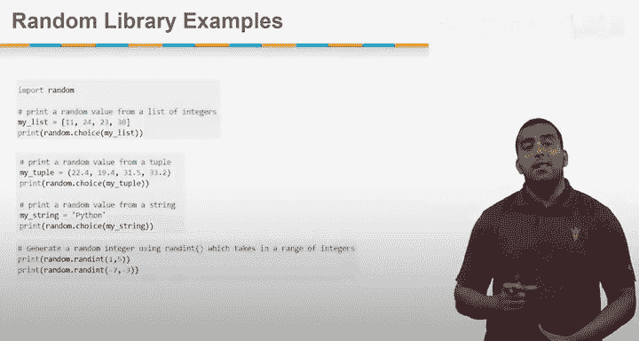

```python
my_tuple = (1.5, 2.7, 3.9, 4.2)
print(random.choice(my_tuple))
```

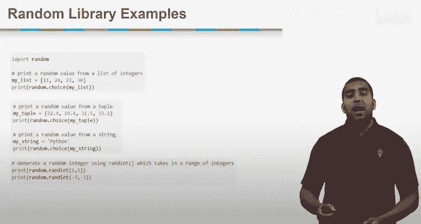


### 从字符串中随机选取字符

我们也可以从字符串中随机选取一个字符。以下示例展示了如何从字符串"Python"中随机选取一个字符。


```python
my_string = "Python"
print(random.choice(my_string))
```

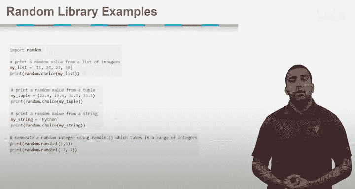

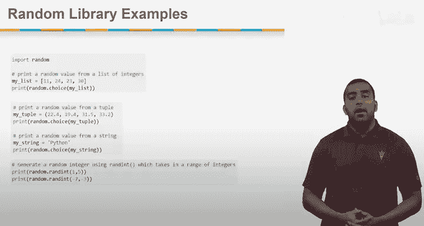

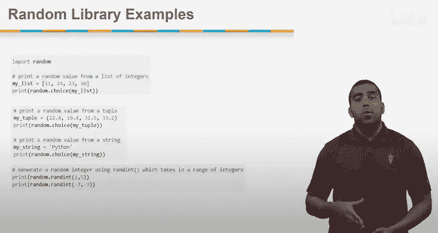

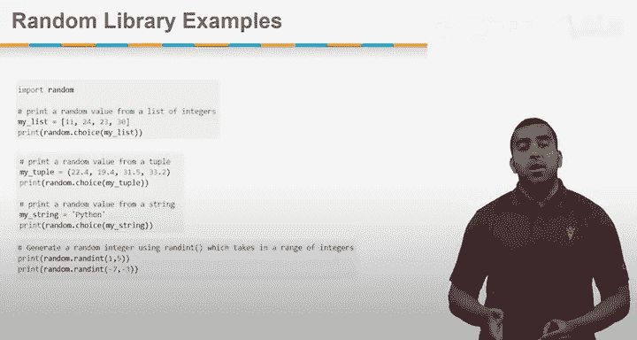

### 生成指定范围内的随机整数

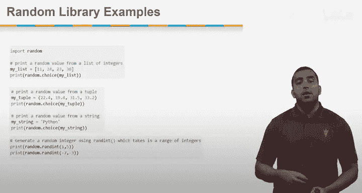


`randint`函数用于生成指定范围内的随机整数。以下示例生成1到5之间的随机整数，以及-7到3之间的随机整数。

```python
print(random.randint(1, 5))
print(random.randint(-7, 3))
```


---


## 演示与实践 🖥️

现在，让我们通过一个完整的演示来巩固所学内容。我们将逐步执行上述示例，并观察输出结果。


### 示例代码执行


首先，我们导入`random`库，并创建一个列表、一个元组和一个字符串。


```python
import random

# 从列表中随机选取元素
my_list = [11, 24, 23, 30]
print("随机选取的列表元素:", random.choice(my_list))


# 从元组中随机选取元素
my_tuple = (1.5, 2.7, 3.9, 4.2)
print("随机选取的元组元素:", random.choice(my_tuple))


# 从字符串中随机选取字符
my_string = "Python"
print("随机选取的字符:", random.choice(my_string))
```


执行上述代码后，每次运行都会得到不同的随机结果。

### 使用种子值


种子值用于控制随机数的生成。如果设置了种子值，生成的随机数将保持不变；否则，每次运行都会生成不同的随机数。以下示例展示了种子值的用法。

```python
random.seed(5)
print("种子值为5时的随机数:", random.random())
print("再次调用:", random.random())
```

### 生成随机浮点数


`random`函数可以生成0.0到1.0之间的随机浮点数。


```python
print("随机浮点数:", random.random())
```


### 随机打乱列表顺序


`shuffle`函数用于随机打乱列表中元素的顺序。以下示例展示了如何打乱一个水果列表。

```python
fruits = ["apples", "oranges", "grapes", "lemons"]
print("打乱前的列表:", fruits)
random.shuffle(fruits)
print("打乱后的列表:", fruits)
```

---


## 总结 📝


本节课中，我们一起学习了Python的`random`库。我们介绍了如何导入该库，并通过多个示例演示了其常用函数的使用方法，包括从列表、元组和字符串中随机选取元素，生成指定范围内的随机整数，使用种子值控制随机数生成，生成随机浮点数，以及随机打乱列表顺序。


`random`库在模拟、游戏开发、数据加密等多个领域都有广泛应用。掌握这些基本操作，将为你在Python编程中处理随机性任务打下坚实基础。