# 25：Python入门与应用：课程回顾 🎓

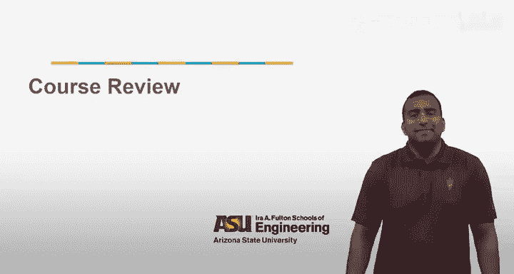

在本节课中，我们将回顾整个课程所涵盖的核心知识点。本次回顾将总结从编程语言基础到Python具体应用的完整学习路径，确保大家为后续课程打下坚实基础。

---

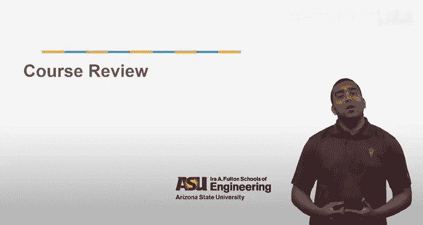

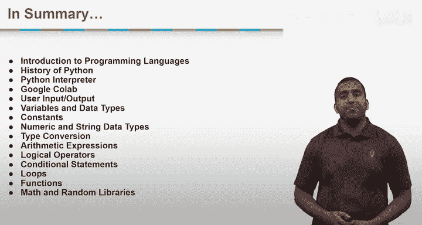

## 课程内容总览 📚

本课程系统性地介绍了编程语言的基本概念及其定义。

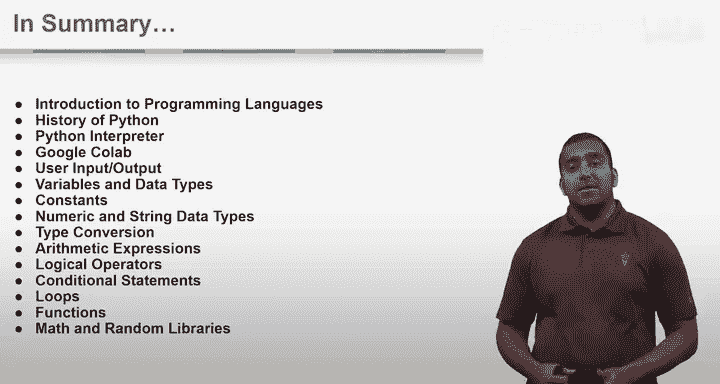

上一节我们概述了课程目标，本节中我们将逐一回顾具体的学习模块。

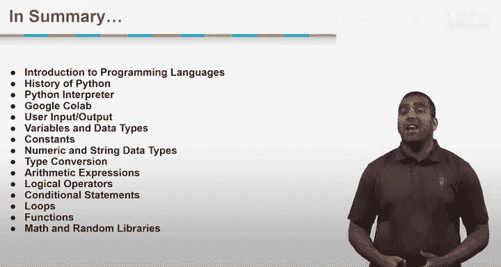

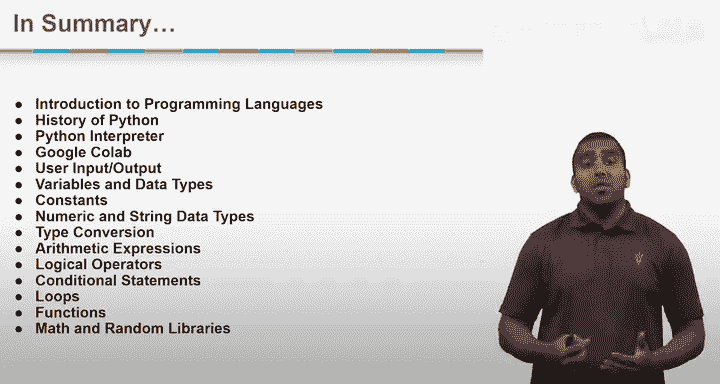

以下是本课程涵盖的主要知识点列表：

*   编程语言的基本概念与定义
*   Python的简要发展历史及其起源
*   Python解释器的作用与原理
*   课程中使用的在线集成开发环境：Google Colab
*   如何处理用户输入与输出
*   变量与数据类型，以及常量的概念
*   数值型与字符串数据类型
*   类型转换的方法
*   算术表达式
*   逻辑运算符
*   条件语句
*   循环结构
*   函数
*   math与random标准库的使用

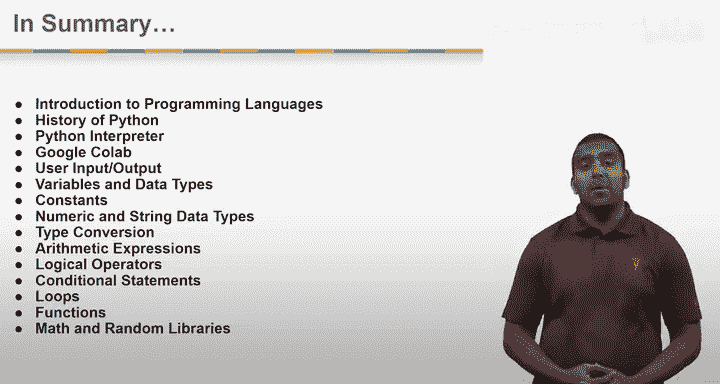

---

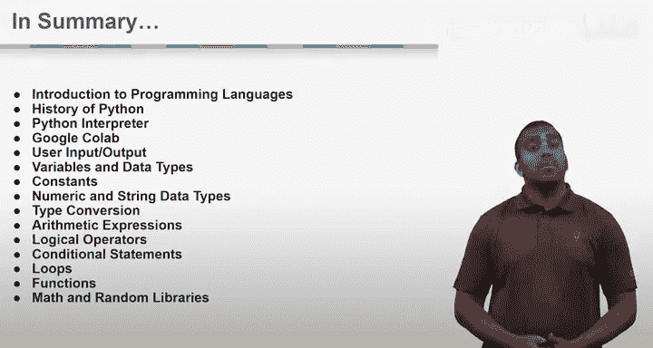

## 核心知识点详解 🔍

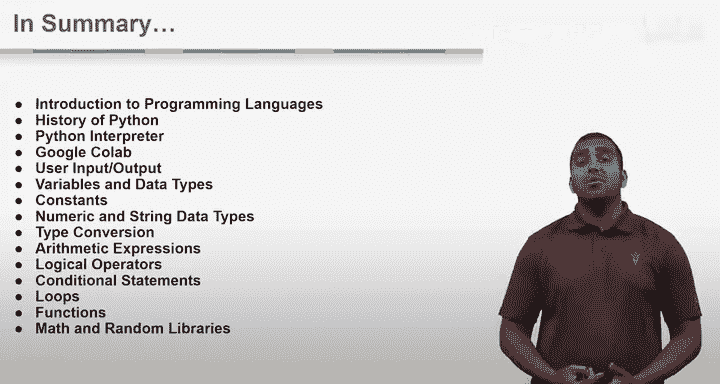

以上我们列出了所有主题，接下来将对其中几个核心概念进行简要说明。

**变量与数据类型**是编程的基石。变量用于存储信息，而数据类型定义了信息的种类，例如整数、浮点数或文本。

**条件语句与循环**构成了程序的控制流。条件语句允许程序根据不同情况做出决策，其基本结构通常用 `if-elif-else` 来描述。循环则用于重复执行特定代码块，例如 `for` 循环和 `while` 循环。

**函数**是将代码组织成可重用块的关键工具。定义一个函数的基本格式如下：
```python
def function_name(parameters):
    # 函数体
    return result
```

**标准库**，如 `math` 和 `random`，极大地扩展了Python的功能，使我们无需从头编写复杂代码即可实现数学运算和生成随机数等功能。

---

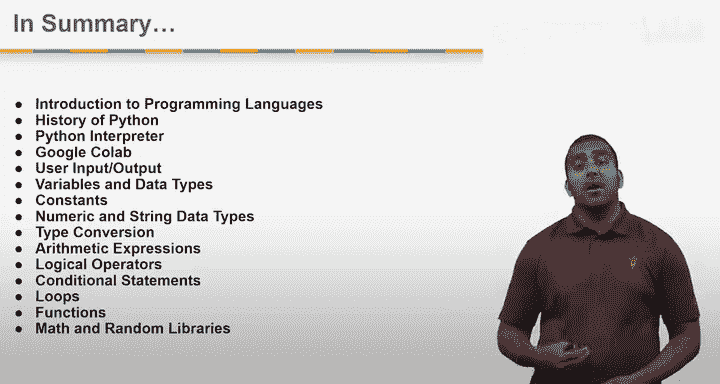

## 总结与展望 🚀

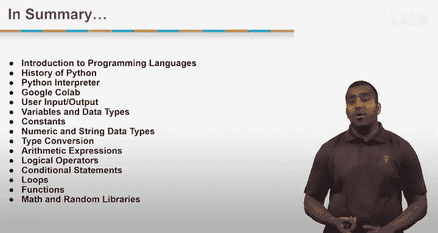

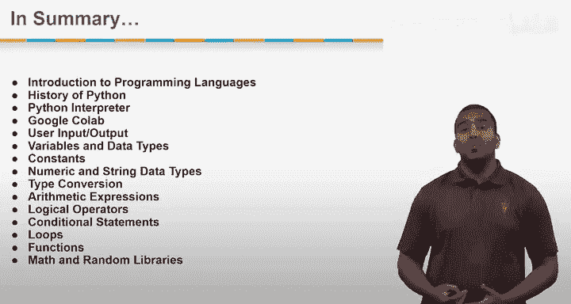

本节课中我们一起回顾了本课程的全部核心内容。我们学习了从编程基础、Python历史环境配置，到变量、控制流、函数及常用库等一系列关键知识。

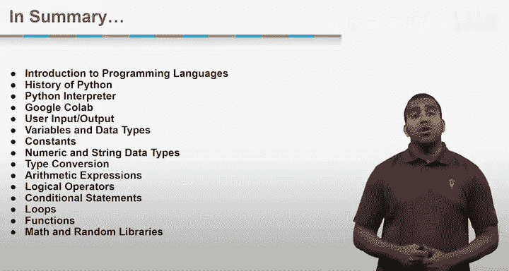

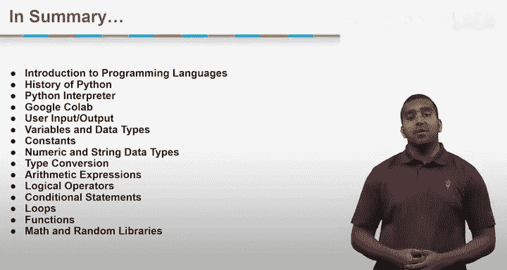

这些工具和概念对于接下来的课程至关重要。确保你完全理解本课程所教授的所有内容，是顺利进入后续学习阶段的基础。

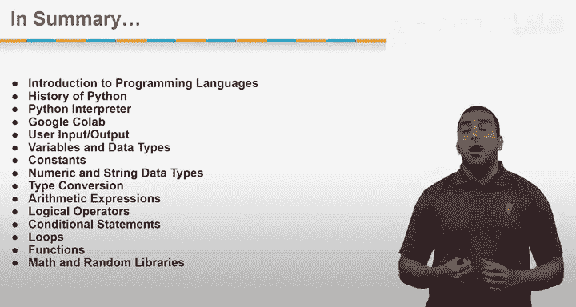

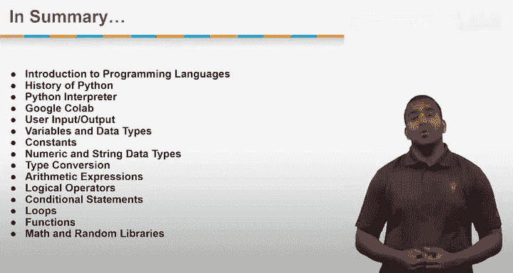

祝大家学习顺利，我们下次课程再见！