# 26：Python从入门到应用 🐍

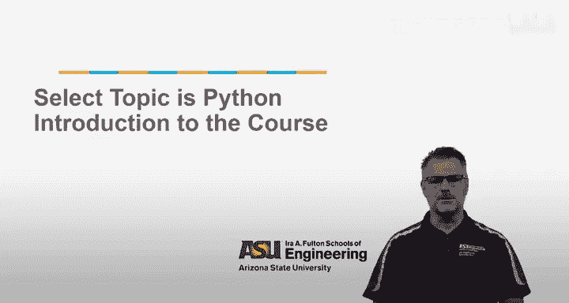

在本节课中，我们将学习《Python：从入门到应用的引导之旅》第二模块的课程介绍。我们将了解本模块的学习目标、所需工具以及整体安排。

欢迎各位来到第二模块的课程介绍。本课程的目标如下。

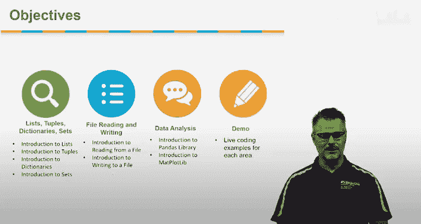

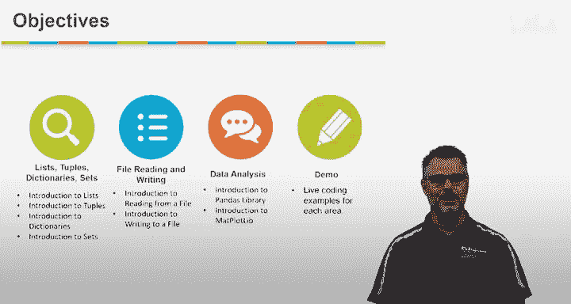

我们将涵盖列表、元组、字典和集合。

我们将学习如何处理文件的读取和写入。

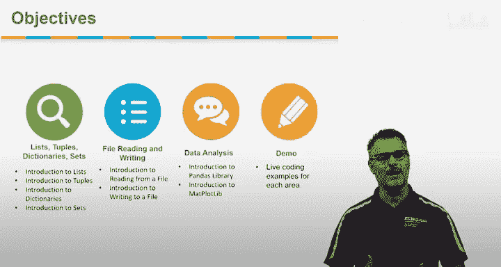

我们将探讨一些数据分析的内容。在整个模块中，我将进行一些实时演示。

以下是学习本课程需要准备的一些东西。你需要一个Python集成开发环境。

我推荐使用Google Colab。Colab是Google的一部分。

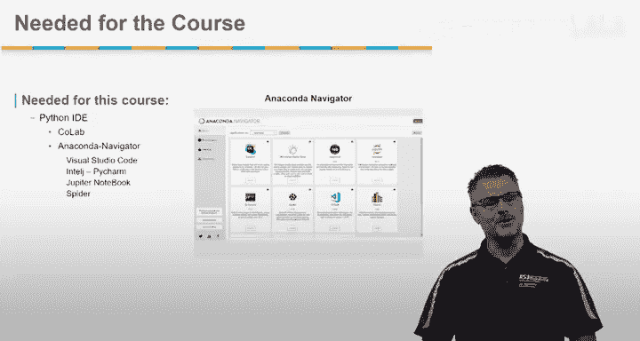

它已经包含了本模块所需的所有库和工具。

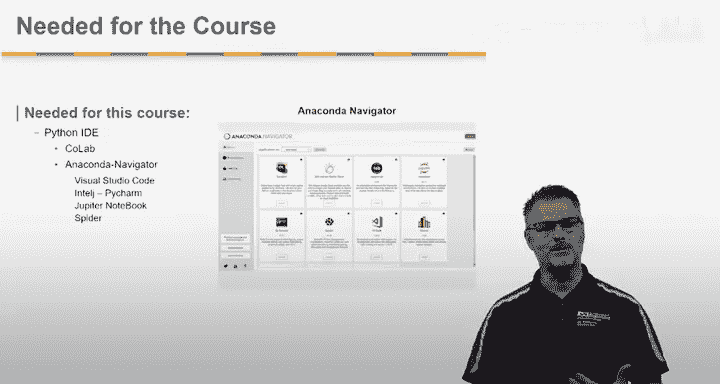

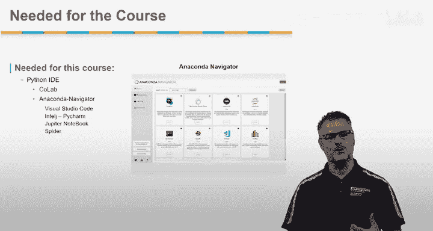

以下是其他一些你可以考虑的选项。有Anaconda，它是一个导航系统。

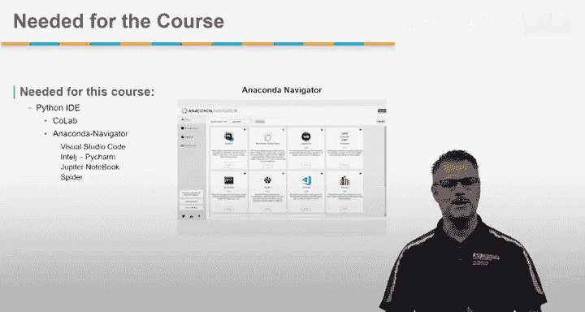

在这个导航系统中，你可以安装Visual Studio Code、PyCharm、Jupyter Notebook以及Spyder。

我期待在本模块中与大家一同学习，我们很快会再见面。谢谢。

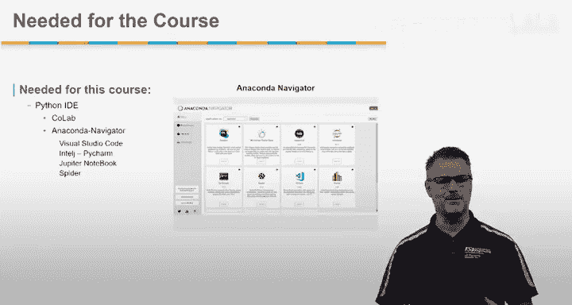

---

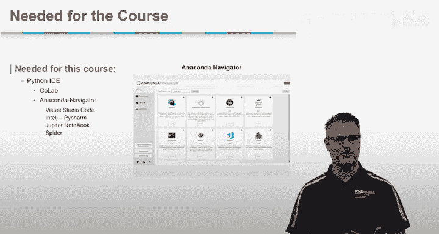

## 总结

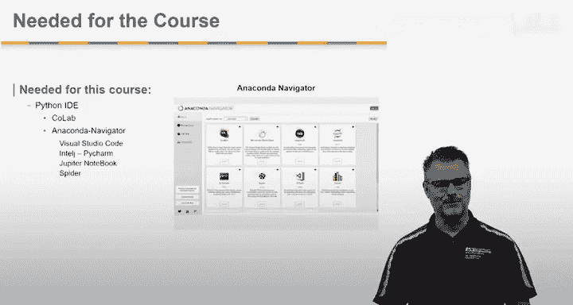

本节课中，我们一起学习了第二模块的课程概述。我们明确了本模块将学习**列表**、**元组**、**字典**和**集合**等数据结构，掌握**文件读写**操作，并初步接触**数据分析**。同时，我们了解了完成本模块学习所需的工具，特别是推荐使用**Google Colab**作为开发环境。