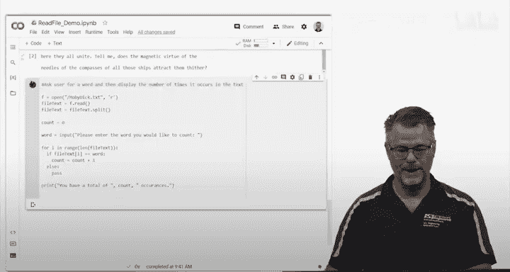

# 31：Python 文件读取基础教程 📖


在本节课中，我们将学习如何使用 Python 读取文件内容。我们将通过三个具体的示例来掌握文件读取的基本操作：读取并显示整个文件、读取文件时跳过特定行，以及统计文件中特定单词的出现次数。


---


## 概述 📋


文件操作是编程中的一项基础且重要的技能。本节课程将引导你完成三个任务，帮助你理解如何在 Python 中打开、读取和处理文本文件。我们将使用一个名为 `Moby Dick` 的文本文件作为示例。


---


## 准备工作：上传文件 📂


在开始编码之前，你需要将示例文件上传到你的工作环境。如果你使用的是在线平台（如 CoLab），请按照以下步骤操作：


1.  点击文件管理器图标。
2.  点击“上传”按钮。
3.  从你的电脑中选择 `Moby Dick` 文件并打开。
4.  上传完成后，文件会显示在文件列表中。


请暂停视频，完成文件上传操作。


---


## 任务一：读取并显示整个文件 📄


上一节我们准备好了文件，本节中我们来看看如何读取文件的全部内容并显示出来。


核心步骤是使用 `open()` 函数打开文件，并使用 `read()` 方法读取内容。


以下是实现此任务的代码步骤：


```python
# 1. 打开文件。需要将引号内的路径替换为你的文件实际路径。
f = open("/content/Moby Dick.txt", "r")
# 2. 读取文件全部内容到一个变量中。
file_text = f.read()
# 3. 打印文件内容。
print("--- File Contents ---")
print(file_text)
# 4. 关闭文件连接。
f.close()
```


运行这段代码后，你将看到 `Moby Dick` 文件的全部内容被打印在屏幕上。


---

## 任务二：读取文件并跳过第二行 ➡️

在掌握了读取整个文件后，我们来看看如何按行读取文件，并跳过特定的行（例如第二行）。


这里的关键是使用 `readlines()` 方法将文件按行读取为列表，然后使用循环和条件判断跳过指定行。


以下是实现此任务的代码步骤：


```python
# 1. 打开文件。
f = open("/content/Moby Dick.txt", "r")
# 2. 按行读取文件，得到一个列表。
lines = f.readlines()
# 3. 使用循环遍历每一行。
for i in range(len(lines)):
    # 4. 如果索引是1（即第二行），则跳过。
    if i == 1:
        continue
    # 5. 打印其他行。
    print(lines[i])
# 6. 关闭文件连接。
f.close()
```


运行代码，你会发现输出内容中缺少了原文件的第二行。


---


## 任务三：统计文件中单词的出现次数 🔢

最后，我们来实现一个更实用的功能：让用户输入一个单词，然后统计这个单词在文件中出现的次数。


这个任务结合了文件读取、字符串分割和循环计数。


以下是实现此任务的代码步骤：


```python
# 1. 打开并读取文件。
f = open("/content/Moby Dick.txt", "r")
file_text = f.read()
# 2. 将文本按空格分割成单词列表。
words = file_text.split()
# 3. 初始化计数器。
count = 0
# 4. 请求用户输入要查找的单词。
target_word = input("Please enter the word you would like to count: ")
# 5. 遍历单词列表进行统计。
for word in words:
    if word == target_word:
        count = count + 1
# 6. 输出统计结果。
print(f"You have {count} occurrences of the word '{target_word}'.")
# 7. 关闭文件。
f.close()
```


例如，如果你输入单词 “and”，程序会告诉你这个单词在文件中出现了多少次。

---


## 总结 ✨




本节课中我们一起学习了 Python 文件读取的三个核心操作：
1.  使用 `open()` 和 `read()` 读取整个文件。
2.  使用 `readlines()` 按行读取，并通过循环控制输出特定行。
3.  结合 `split()` 方法和循环，实现文件中特定单词的计数功能。

记住，完成文件操作后，使用 `close()` 方法关闭文件是一个好习惯。希望本教程对你有所帮助，我们下节课再见！