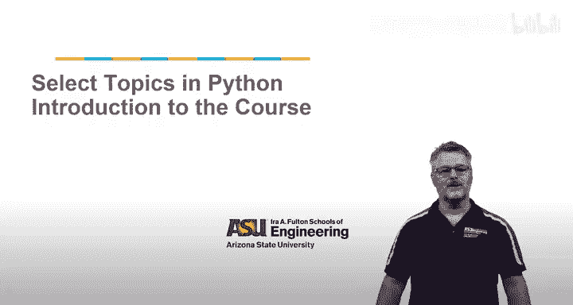

# 39：面向对象编程与图形用户界面 🐍🖥️

在本节课中，我们将学习面向对象编程的核心概念以及如何利用Python创建图形用户界面。课程分为两大主要部分：首先深入探讨面向对象编程，然后转向图形用户界面的构建与应用。

---

## 面向对象编程

上一节我们介绍了课程的整体结构，本节中我们来看看面向对象编程部分。我们将学习如何在Python中创建和使用对象，这是构建复杂程序的基础。

以下是本部分将涵盖的核心主题：

*   **创建对象**：学习如何在Python中定义类并实例化对象。
*   **继承**：理解类之间如何共享属性和方法，实现代码复用。
*   **多态**：掌握让不同类的对象对同一消息作出不同响应的能力。
*   **Python代码实现**：探讨在Python中具体实现上述概念的方法，特别是继承机制中需要注意的一些**语法限制**。

---

## 图形用户界面

在掌握了面向对象编程的基础后，我们将把注意力转向图形用户界面。这部分将教你如何为程序创建直观的视觉交互界面。

以下是本部分将学习的关键技能：

*   **使用Tkinter**：学习利用Python的标准GUI工具包Tkinter来创建窗口应用。
*   **使用控件**：掌握如何在图形用户界面中添加和使用按钮、文本框等交互控件。
*   **绘制图形**：学习在界面中实现和操作各种形状。
*   **综合应用与回顾**：复习所学知识，并尝试**使用图形用户界面实现一个游戏项目**，将理论与实践相结合。

---

本节课中，我们一起学习了面向对象编程的核心概念及其在Python中的实现方式，并初步了解了使用Tkinter构建图形用户界面的流程。我们期待在接下来的模块中与你一同实践这些知识。