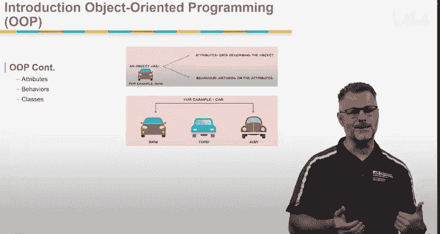

# 40：Python面向对象编程与类的应用（第一部分）🚗

在本节课中，我们将要学习面向对象编程的基础概念。我们将从介绍面向对象编程开始，并将其与过程式编程进行对比，然后探讨类和对象的核心概念及其方法论。

---

## 面向对象编程简介

上一节我们介绍了课程目标，本节中我们来看看什么是面向对象编程。面向对象编程是一种编程范式，它使用“对象”来设计应用程序和计算机程序。

过程式编程是将程序分解为不同函数的思想。然后，通过调用这些函数来执行程序的不同部分。

面向对象编程与过程式编程存在一些区别。这些区别非常简单。

在面向对象编程中，我们主要使用称为“对象”的东西。而在过程式编程中，我们使用函数。我们的目标是利用不同的对象来构建应用程序。这一点稍后会详细说明。

过程式编程通常采用自上而下的方法。当我们谈论面向对象编程时，它更像是一个自底向上的过程。

然而，当我们谈论Python时，情况有所不同。但一般来说，面向对象编程的一个优点被称为方法和函数的“重载”。在过程式编程中，你无法以任何形式实现重载。像Java、C++、C#、Python、PHP、JavaScript、Ruby等编程语言都利用了重载功能。但具体到Python，Python本身不允许重载。不过，考虑到这一点，我将向你展示一个技巧，如何在Python中实现类似重载的功能。

---

## 理解对象：以汽车为例

让我们来看一个具体的例子。你面前看到的是一辆汽车，它是一个对象。

在Python中，一切都被设计为某种对象。我们的目标是识别该对象的特征。

以下是对象的属性。在这个例子中，我们谈论的属性包括制造商、型号、颜色、年份、价格。

然后，我们有不同的“方法”。方法是用来修改或改变该对象内部事物的函数。在这个例子中，动作是启动、驾驶和停车。

接着，我们有“事件”。这辆车的事件可能是启动时、停车时或刹车时。

当然，我们还有对象本身。当我们开始分析时，我们希望尽可能多地分解项目，并为该对象识别尽可能多的组成部分。

如果我观察面前的这张桌子，这张桌子有它自己的特征。你会说，好吧，有一个桌面。是什么样的桌面？你会注意到它有桌腿，它们是标准桌腿吗？还是可以升降的电动桌腿？因此，你必须识别这些不同的特征。

然后，你必须识别这些特征的方法。

---

## 对象的细节：访问器与修改器

当我们开始详细讨论这些对象时，我们会遇到称为“访问器”和“修改器”的东西，它们也被称为获取器和设置器。

基本上，这些功能允许我们获取对象的各个部分，并将其带回我们的应用程序中。

正如你在这里看到的，我们有一个主要的汽车对象，然后它有属性。例如，有宝马、福特和奥迪。现在，每辆车都有自己的属性。一辆宝马可能有更好的轮胎，与福特或奥迪不同尺寸的轮胎。因此，我们希望确保在看待对象时，我们保持每个对象的身份和属性相互独立。

然后，我们有“实例”，即被创建的对象。它们在同一类中彼此不同。

---

## 本节总结与下节预告

本节课中我们一起学习了面向对象编程的基本概念，包括其与过程式编程的区别，以及对象、属性、方法和事件的定义。我们还初步了解了访问器和修改器的作用。

接下来，我打算在这里暂停，并在下一个视频中继续。我们将深入探讨面向对象编程，并进入一个应用程序的开发，对其进行非常彻底的检查。最后，我们会做一个示例。

我们很快再见。