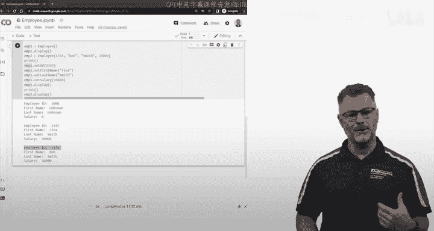

# 42：Python面向对象与类的应用（第三部分） 🐍


在本节课中，我们将学习如何创建一个完整的Python类，包括构造函数、方法以及如何通过设置器（setter）和获取器（getter）来修改和访问对象的属性。我们还将探讨Python中如何处理构造函数重载的问题。


---


## 创建类与构造函数


首先，我们创建一个名为 `Employee` 的类。我们将定义其构造函数，用于初始化员工对象的属性。


```python
class Employee:
    def __init__(self, *args):
        if len(args) < 4:
            self.ID = 1000
            self.first_name = "unknown"
            self.last_name = "unknown"
            self.salary = 0
        else:
            self.ID = args[0]
            self.first_name = args[1]
            self.last_name = args[2]
            self.salary = args[3]
```


在上面的代码中，我们使用 `*args` 来接收可变数量的参数。通过检查参数的长度，我们可以决定是使用默认值还是使用传入的参数来初始化对象的属性。


---


## 显示对象信息的方法


接下来，我们创建一个 `display` 方法，用于打印员工对象的所有信息。为了使输出更清晰，我们使用 `\n` 在每个属性后换行。


```python
    def display(self):
        print("Employee ID:", self.ID, "\nFirst Name:", self.first_name, "\nLast Name:", self.last_name, "\nSalary:", self.salary)
```


`\n` 是一个转义字符，表示换行。使用它可以让每个属性单独显示在一行，使输出更易读。


---


## 创建对象并测试


现在，我们创建两个 `Employee` 对象：一个使用默认参数，另一个使用自定义参数。


```python
emp1 = Employee()
emp2 = Employee(1234, "Bob", "Smith", 36000)
```


然后，我们调用 `display` 方法来查看这两个对象的信息。


```python
emp1.display()
print()  # 用于分隔输出
emp2.display()
```


运行上述代码，你将看到第一个员工的信息是默认值，而第二个员工的信息是我们传入的自定义值。


---


## 设置器与获取器


为了能够修改和访问对象的属性，我们创建设置器（setter）和获取器（getter）方法。


以下是获取器方法的示例：


```python
    def get_ID(self):
        return self.ID

    def get_first_name(self):
        return self.first_name

    def get_last_name(self):
        return self.last_name

    def get_salary(self):
        return self.salary
```


以下是设置器方法的示例：


```python
    def set_ID(self, ID):
        self.ID = ID

    def set_first_name(self, first_name):
        self.first_name = first_name

    def set_last_name(self, last_name):
        self.last_name = last_name

    def set_salary(self, salary):
        self.salary = salary
```


通过这些方法，我们可以在创建对象后修改其属性。


---


## 修改对象属性


使用设置器方法，我们可以修改 `emp1` 对象的属性。


```python
emp1.set_ID(2345)
emp1.set_first_name("Tina")
emp1.set_last_name("Smith")
emp1.set_salary(36000)
```


修改后，再次调用 `display` 方法查看更新后的信息。


```python
emp1.display()
```


---


## 总结


在本节课中，我们一起学习了以下内容：


1.  **创建类与构造函数**：我们创建了一个 `Employee` 类，并通过 `*args` 实现了灵活的构造函数，以支持默认值和自定义值的初始化。
2.  **定义显示方法**：我们创建了 `display` 方法，用于打印对象的属性，并使用 `\n` 使输出更清晰。
3.  **创建与测试对象**：我们实例化了两个员工对象，并验证了构造函数的行为。
4.  **实现设置器与获取器**：我们编写了设置器和获取器方法，以便在对象创建后修改和访问其属性。
5.  **修改对象属性**：我们使用设置器方法成功修改了对象的属性，并验证了修改结果。




通过这些步骤，我们掌握了Python中类的创建、对象初始化、方法定义以及属性访问与修改的基本操作。这些知识是面向对象编程的核心，将帮助你在实际项目中更好地组织和管理代码。