# 43：继承机制 🧬

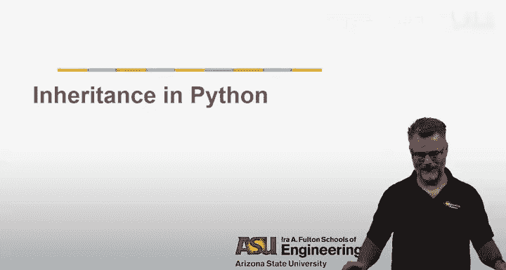

在本节课中，我们将要学习 Python 中的继承机制。我们将探讨继承的概念，以及它如何在 Python 中实现和应用。

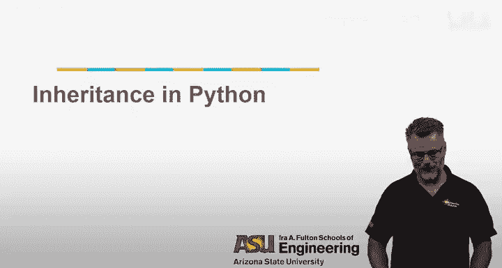

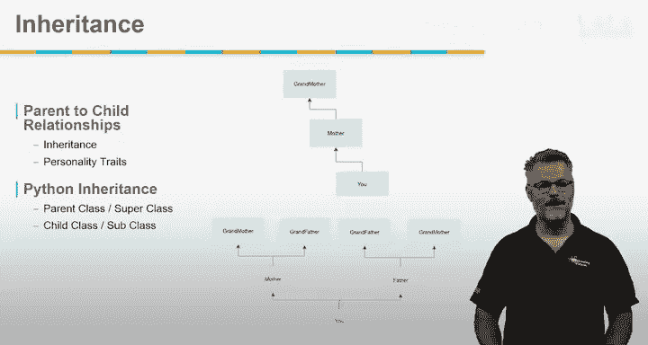

## 什么是继承？🤔

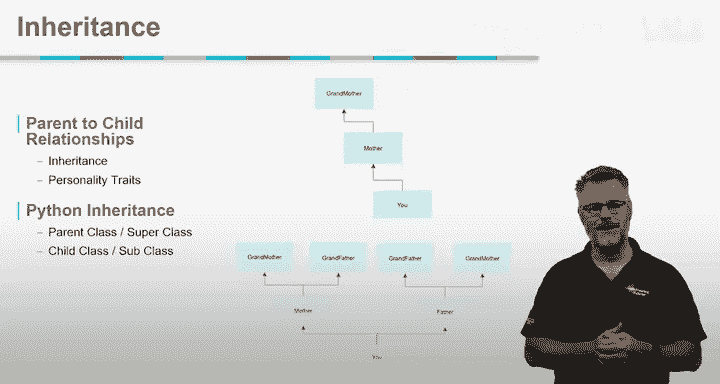

首先，让我们暂时抛开编程，从一般意义上理解“继承”这个概念。

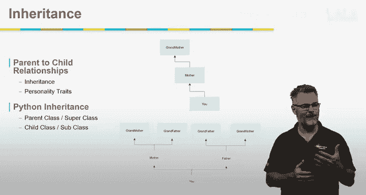

在家庭关系中，我有我的父母，而我的父母又有他们的父母，也就是我的祖父母。

当提到“继承”时，人们首先想到的通常是金钱。

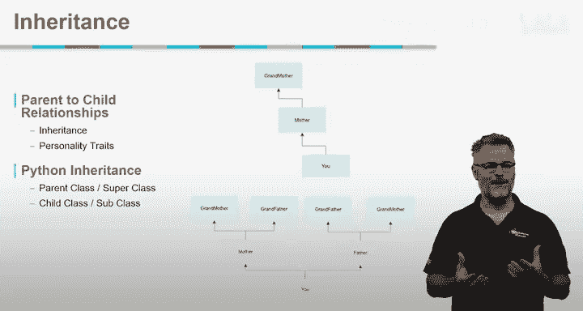

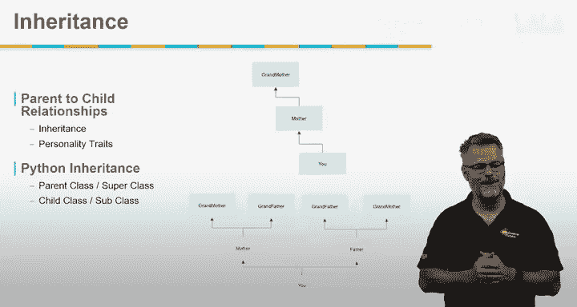

然而，继承不一定指金钱，它也可以指从父母那里继承的某些特征或属性。例如，你可能拥有和父母相同颜色的眼睛，拥有和母亲相似的笑容，或者拥有和祖父母相似的头发。这些特征会一代一代地传递下去。

关于代际传递，有一个重要特点：如果我有一个特征，我可以把它传递给我的孩子，但我不能把这个特征向上传递给我的父母。

## Python 中的继承 🔗

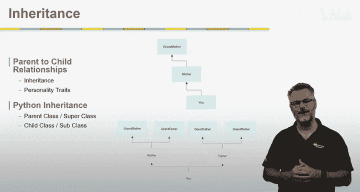

当我们开始讨论 Python 编程时，情况也是如此。


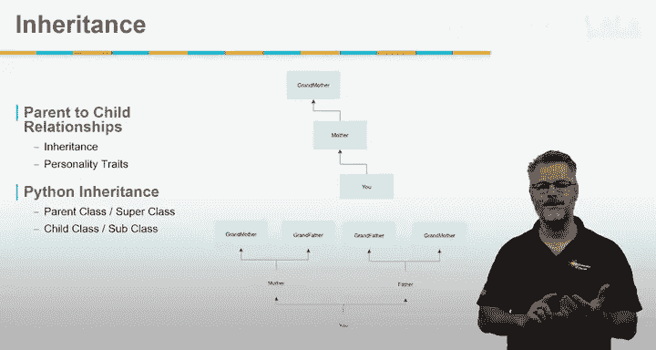

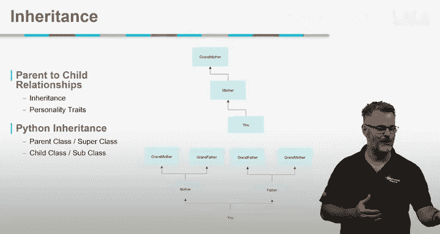

如果你有 C++、Java、C# 或其他语言的编程背景，你会知道继承是面向对象编程中一个非常常用的概念。


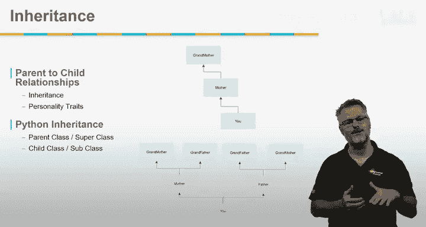

但是，在讨论这种关系时，通常只存在单一的关系，这意味着我只能向上追溯到一个父类或一个祖类。

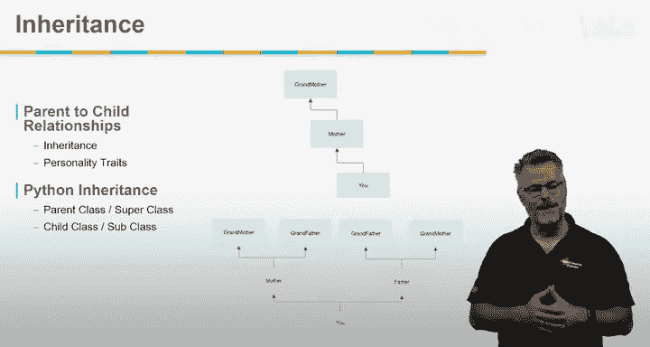

Python 在这方面非常独特，它允许多重继承。我可以有一个母亲或一个父亲，他们可以将特征传递给我。

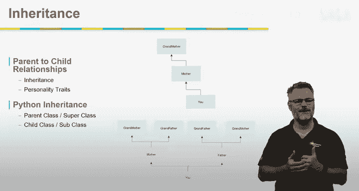

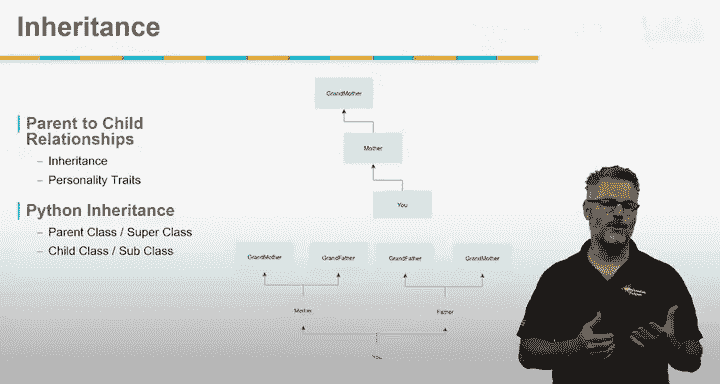

我可以从我父亲那边的祖父那里获得特征，也可以从我母亲那边的祖母那里获得特征，这些特征都会传递给我。

## 继承中的术语 📖

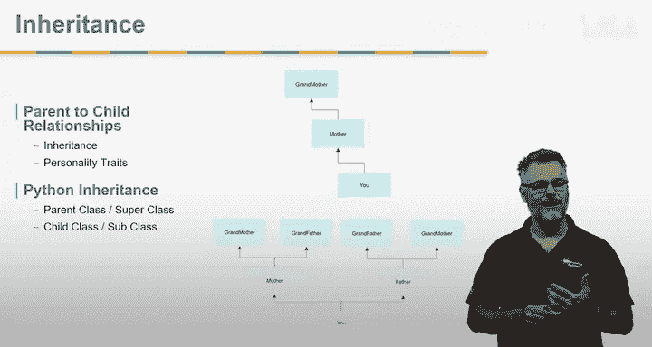

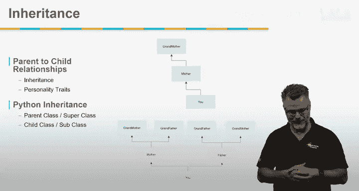

在讨论 Python 中的关系时，我们使用两个常用术语。

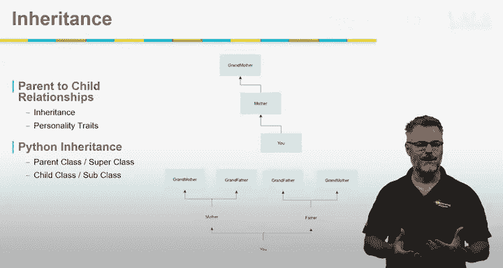

第一个是**父类**。父类是处于最高层级的类。

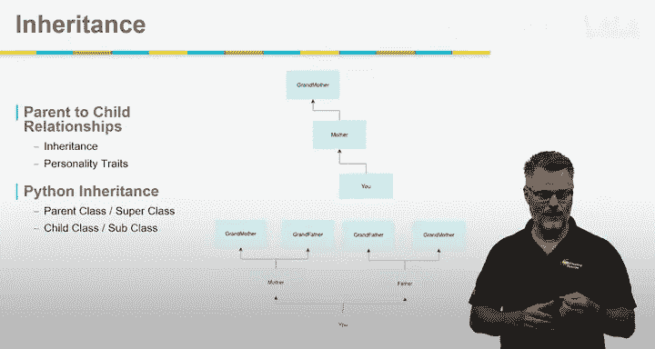

在我们的例子中，我的母亲是一个父类。而我母亲的父类，则是我的祖母。因为我是我母亲的孩子，我仍然可以访问属于我祖母的方法或属性。

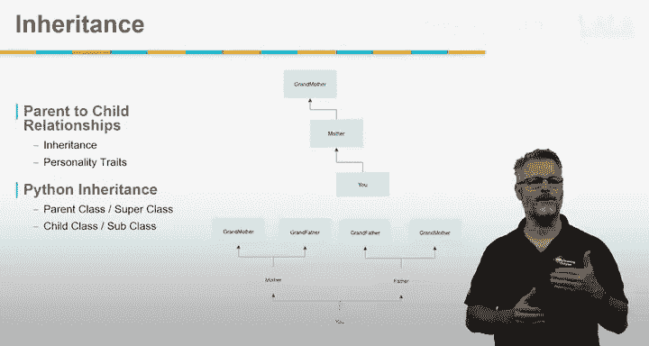

父类也被称为**超类**。

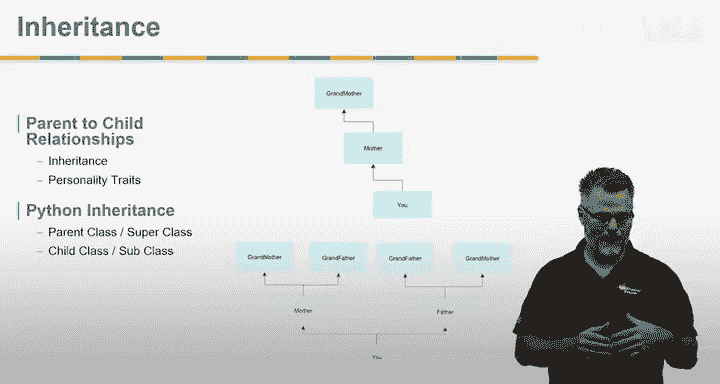

第二个术语是**子类**。子类是位于父类之下的类。

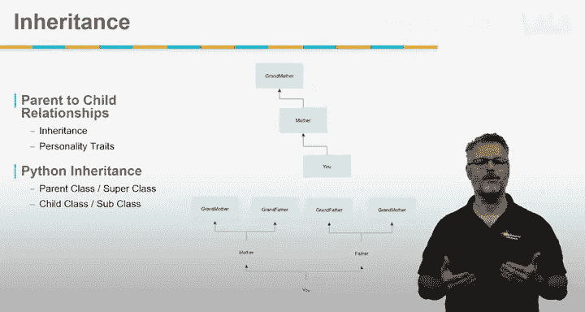

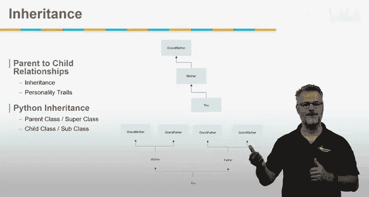

在这个例子中，我祖母的子类是我的母亲，我母亲的子类是我自己。


当我们查看多重继承时，情况也是如此。

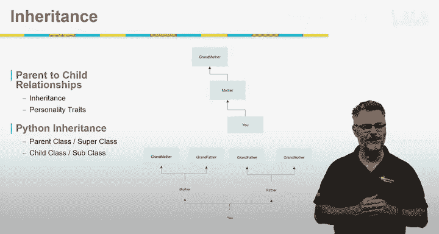

## 继承的类型：单继承与多重继承 ⚙️

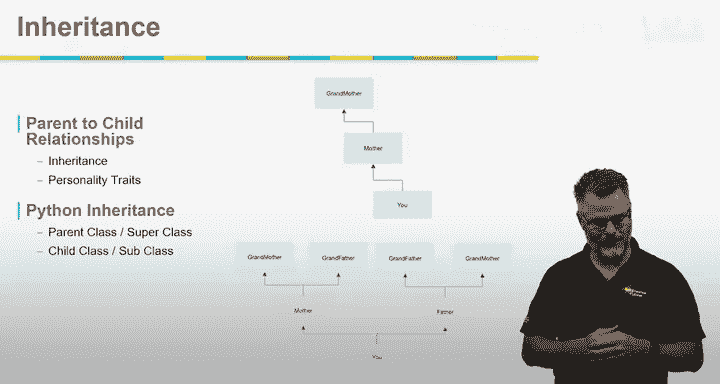

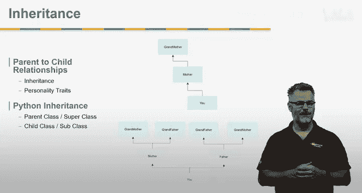

正如前面提到的，Python 内置了两种类型的继承：单继承和多重继承。

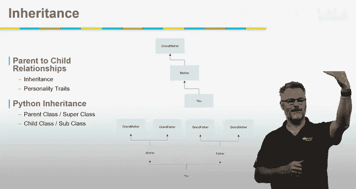

在单继承中，我们使用 `super()` 来调用父类。

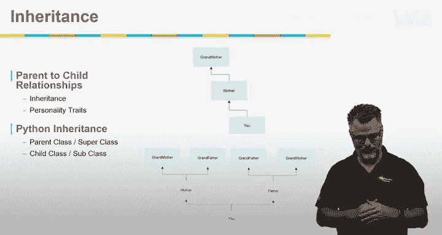

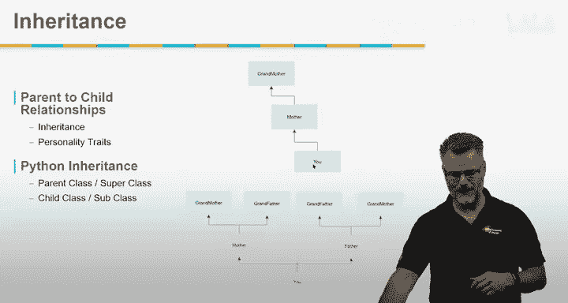

在多重继承中，我们使用方法解析顺序来组织对不同对象的调用。方法解析顺序总是从左到右查看，或者如果你构建了从上到下的层次结构，它总是从最高层级开始向下查找。

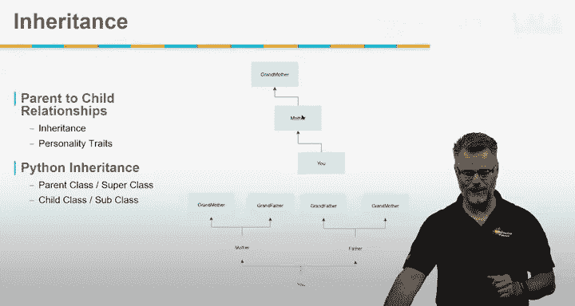

在使用多重继承时，我发现最有用的一点是确保在方法内部进行显式调用。我尽量不经常使用多重继承，但如果使用，就要确保这样做。

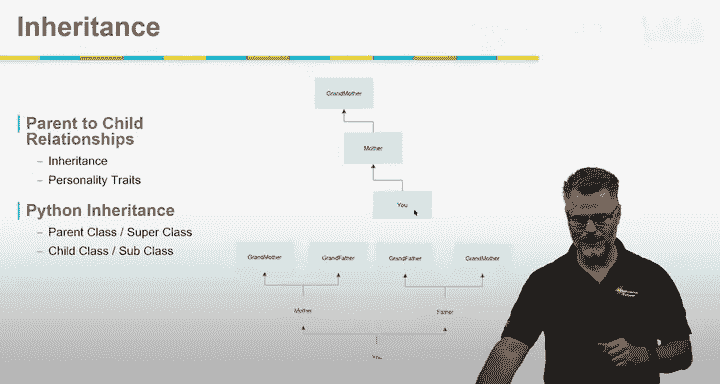

## 代码示例 💻

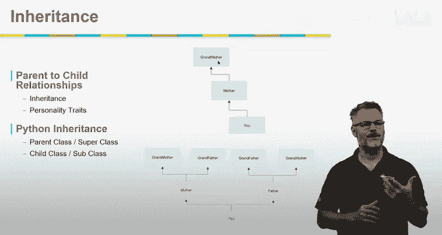


让我们看一下代码，并逐一讨论每种情况。

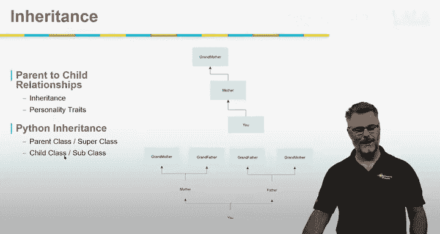

### 单继承示例

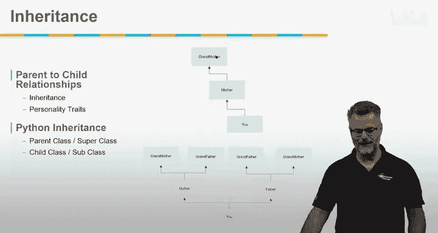

第一种情况是单继承。我有我的祖母类。注意，在 `class Grandmother:` 之后，括号里没有内容，这意味着这是这个类中的最高层级。

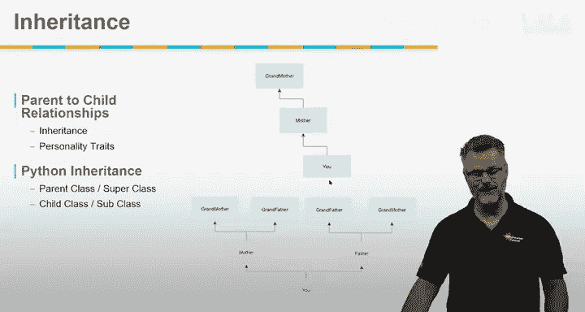

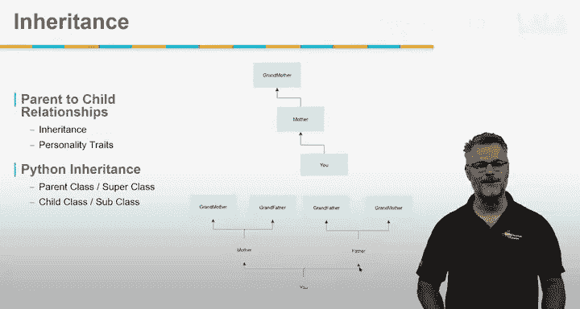

往下看，我有一个母亲类。注意，这里有括号 `(Grandmother)`，这表示 `Mother` 是 `Grandmother` 的子类。

再往下是“我”或“你”类。`You` 是 `Mother` 的子类。当然，在每个类中，我都定义了一个构造函数。

以下是核心代码结构：

```python
class Grandmother:
    def __init__(self, g_name):
        self.g_name = g_name

class Mother(Grandmother):
    def __init__(self, m_name, g_name):
        self.m_name = m_name
        super().__init__(g_name)  # 调用父类Grandmother的构造函数

class You(Mother):
    def __init__(self, name, m_name, g_name):
        self.name = name
        super().__init__(m_name, g_name)  # 调用父类Mother的构造函数

# 创建对象
you1 = You("Bob", "Tina", "Samantha")
```

在 `Mother` 的构造函数中，我使用 `super()` 来调用其父类 `Grandmother` 的构造函数。

在 `You` 的构造函数中，我同样使用 `super()` 来自动调用其父类 `Mother` 的构造函数。这是一种单继承的方法。

### 多重继承示例

现在让我们看一个多重继承的例子。这里我有母亲和她的父母。和之前一样，我的外曾祖母处于最高层级，我的外曾祖父也处于最高层级。

然后往下是我的母亲，她是我的外曾祖母和外曾祖父的孩子。

再往下是我父亲这边。我的曾祖母处于最高层级，我的曾祖父也是如此。然后我的父亲是曾祖母和曾祖父的儿子。

最后是“你”。“你”是你母亲的孩子，也是你父亲的孩子。

在这种情况下，我在构造函数中为每一个值传递参数。我没有像上面那样使用 `super()` 这个词，而是显式地使用 `Mother.__init__` 和 `Father.__init__` 来调用父类的构造函数。

以下是核心代码结构：

```python
class MothersMother:
    def __init__(self, mm_name): ...

class MothersFather:
    def __init__(self, mf_name): ...

class Mother(MothersMother, MothersFather):
    def __init__(self, m_name, mm_name, mf_name):
        self.m_name = m_name
        MothersMother.__init__(self, mm_name)   # 显式调用
        MothersFather.__init__(self, mf_name)   # 显式调用

class FathersMother:
    def __init__(self, fm_name): ...

class FathersFather:
    def __init__(self, ff_name): ...

class Father(FathersMother, FathersFather):
    def __init__(self, d_name, fm_name, ff_name): ...

class You(Mother, Father):
    def __init__(self, name, m_name, mm_name, mf_name, d_name, fm_name, ff_name):
        self.name = name
        Mother.__init__(self, m_name, mm_name, mf_name)  # 显式调用
        Father.__init__(self, d_name, fm_name, ff_name)  # 显式调用
```

在 `Mother` 的构造函数中，我显式地调用 `MothersMother` 和 `MothersFather` 的构造函数，并传入相应的值。处理继承基本上就是这样。

## 总结 📝

本节课中，我们一起学习了 Python 的继承机制。

我们首先从一般概念上理解了继承，即特征的代际传递。然后，我们将其与编程，特别是 Python 编程联系起来，了解到 Python 支持独特的**多重继承**。

我们学习了继承中的关键术语：**父类**和**子类**。接着，我们通过代码示例深入探讨了**单继承**和**多重继承**的实现方式。在单继承中，我们使用 `super()` 来调用父类；在多重继承中，我们更倾向于使用显式调用来明确指定父类，并了解了**方法解析顺序**的概念。


继承是面向对象编程的强大工具，它允许我们创建层次化的类结构，重用代码，并建立对象之间的清晰关系。理解并妥善运用继承，将使你的 Python 程序更加模块化和高效。