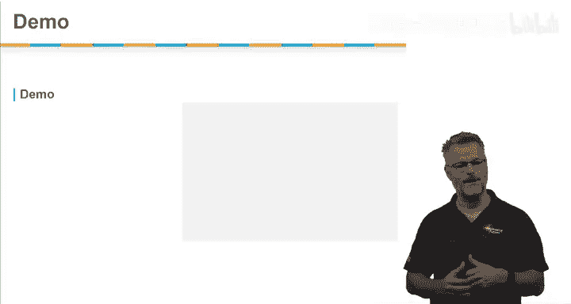

# 45：Python 多态性应用 🐍


在本节课中，我们将要学习 Python 中的多态性概念。多态性是面向对象编程的核心特性之一，它允许我们以统一的方式处理不同类型的对象。我们将探讨多态性的定义、在 Python 中的实现方式，以及如何通过方法重写和变通方法实现方法重载。


## 什么是多态性？🤔


上一节我们介绍了课程主题，本节中我们来看看多态性的基本定义。


多态性一词可以拆分为两部分。“Poly”意为“多”，“morphism”意为“形态”。因此，多态性指的是**同一方法**可以在**多种不同形态**下被调用和操作。


在编程中，这意味着我们可以反复调用同一个方法名，但该方法根据所操作对象的不同，会以不同的形式执行。


## 抽象方法与多态性示例 🍎


理解了基本概念后，我们通过一个具体例子来展示多态性。

以下是一个水果类的示例，其中定义了一个抽象方法：


```python
class Fruit:
    def calories(self):
        raise NotImplementedError("请在子类中实现 calories 方法")
```


这里的 `calories` 方法是一个**抽象方法**。它要求任何继承自 `Fruit` 类的子类都必须实现自己的 `calories` 方法。


接下来，我们创建几个具体的水果子类：


```python
class Apple(Fruit):
    def calories(self):
        print("苹果有 95 卡路里")
class Orange(Fruit):
    def calories(self):
        print("橙子有 45 卡路里")
class Banana(Fruit):
    def calories(self):
        print("香蕉有 105 卡路里")
```

每个子类都用自己的方式实现了 `calories` 方法，打印出各自特定的卡路里值。


然后，我们定义一个函数来调用这个方法：


```python
def fruit_calories(fruit):
    fruit.calories()
```


以下是使用示例：


```python
a1 = Apple()
b1 = Banana()
o1 = Orange()
fruit_calories(a1)  # 输出：苹果有 95 卡路里
fruit_calories(b1)  # 输出：香蕉有 105 卡路里
fruit_calories(o1)  # 输出：橙子有 45 卡路里
```


函数 `fruit_calories` 接收一个水果对象。它会自动识别传入对象的类型（苹果、香蕉或橙子），并调用该对象对应的 `calories` 方法。这就是多态性的体现：同一个函数调用，根据对象类型产生了不同的行为。

## Python 中的方法重载挑战与解决方案 🚗

在许多编程语言（如 Java、C++）中，支持“方法重载”，即同一个类中可以存在多个同名但参数不同的方法。然而，Python 本身并不直接支持这种形式的重载。

假设我们想创建一个 `Car` 类，其构造方法能接受不同数量的参数：


```python
# 注意：以下代码在 Python 中会报错，因为它不支持传统的方法重载
class Car:
    def __init__(self):
        self.color = None
        self.type = "unknown"

    def __init__(self, color):
        self.color = color
        self.type = "unknown"

    def __init__(self, color, car_type):
        self.color = color
        self.type = car_type
```


在 Python 中，只有最后一个 `__init__` 定义有效，之前的会被覆盖，因此无法实现重载。


为了解决这个问题，我们可以使用变长参数来模拟方法重载的功能：


```python
class Car:
    def __init__(self, *args):
        if len(args) == 0:
            self.color = None
            self.type = "unknown"
        elif len(args) == 1:
            self.color = args[0]
            self.type = "unknown"
        elif len(args) == 2:
            self.color = args[0]
            self.type = args[1]
# 使用示例
c1 = Car()          # color=None, type="unknown"
c2 = Car("blue")    # color="blue", type="unknown"
c3 = Car("red", "Ford") # color="red", type="Ford"
```


在这个解决方案中，`*args` 是一个元组，用于接收所有传入的参数。通过检查 `args` 的长度，我们可以判断用户传入了多少个参数，并据此执行不同的初始化逻辑，从而模拟了方法重载的行为。

## 方法重写（Overriding）✏️


与方法重载（Overloading）不同，方法重写（Overriding）是子类对父类中已有方法提供新的实现。


以下是方法重写的示例：


```python
class Grandmother:
    def get_name(self):
        return "Grandma Smith"
class Mother(Grandmother):
    def get_name(self):
        # 使用 super() 调用父类的方法，并在此基础上修改
        original_name = super().get_name()
        return f"Mother of {original_name}"
```


在 `Mother` 类的 `get_name` 方法中，我们使用 `super().get_name()` 调用了父类 `Grandmother` 的方法，然后对其结果进行了扩展。这就是方法重写：子类**覆盖**了父类的实现，但依然可以选择利用父类的功能。


## 总结 📚


本节课中我们一起学习了 Python 中的多态性。


我们首先了解了多态性的核心概念：**同一接口，多种实现**。然后通过水果类的例子，看到了多态性如何让同一个函数调用根据对象类型执行不同的操作。

接着，我们探讨了 Python 与传统语言在“方法重载”上的区别，并学习了如何使用 `*args` 变长参数来模拟实现根据不同参数数量执行不同逻辑的功能。


最后，我们区分了“方法重载”和“方法重写”。重载关注**同一类中**同名方法的不同参数列表，而重写是**子类**对继承自父类的方法进行重新定义。




掌握多态性、方法重写以及模拟重载的技巧，将使你能够编写出更灵活、更强大的面向对象 Python 程序。