# 47：使用Tkinter构建图形界面（第一部分）🎨

在本节课中，我们将要学习如何使用Python的Tkinter库来创建图形用户界面。我们将从基本概念开始，逐步介绍如何创建窗口、标签、按钮、文本框等组件，并学习如何布局和响应用户事件。

---

## 什么是图形用户界面（GUI）？🖥️

图形用户界面允许用户以更直观、交互的方式与程序进行互动，而不是像我们之前那样使用命令行提示符。到目前为止，我们主要使用Colab作为编程工具，但为了更高效地运行图形界面程序，我们将切换到像Spyder这样的集成开发环境。

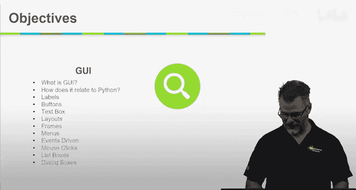

我们将导入Tkinter工具来构建图形界面。今天我们将学习的组件包括文本标签、按钮、下拉菜单、滚动条等。

---

## 创建基础窗口🪟

首先，我们需要导入Tkinter库并创建一个基础窗口。你可以把这个过程想象成制作披萨：底层是面团，然后你在上面添加酱料和各种奶酪。构建图形界面也是如此，首先创建底层框架，然后在其上添加各种组件。

以下是创建基础窗口的代码：

```python
from tkinter import *

root = Tk()
root.geometry('700x350')
label1 = Label(root, text='Welcome to GUIs and Python')
label1.pack()
root.mainloop()
```

在这段代码中：
*   `from tkinter import *` 导入了Tkinter的所有库。
*   `root = Tk()` 创建了主窗口框架。
*   `root.geometry('700x350')` 设置了窗口的大小。
*   `Label(root, text='...')` 创建了一个文本标签，并将其与`root`窗口关联。
*   `label1.pack()` 将标签组件添加到窗口中。
*   `root.mainloop()` 启动事件循环，使窗口持续运行，直到用户关闭它。

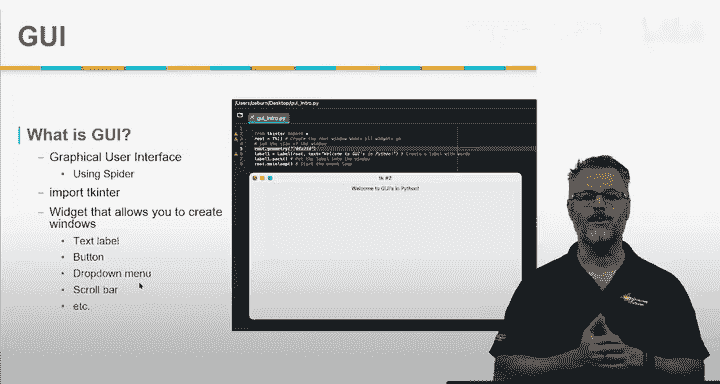

---

## 标签的定制🔧

上一节我们创建了基础窗口和标签，本节中我们来看看如何定制标签的外观，例如修改字体、大小和颜色。

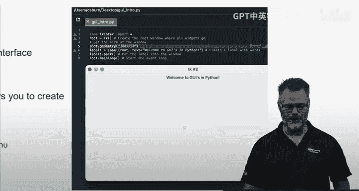

我们可以对标签进行多种修改。以下代码展示了如何创建两个具有不同样式的标签：

```python
from tkinter import *

root = Tk()
root.geometry('700x350')

label1 = Label(root, text='Welcome')
label1.pack()

label2 = Label(root, text='Python is amazing', font=('Helvetica', 16), fg='blue')
label2.pack()

root.mainloop()
```

在这段代码中：
*   我们创建了第二个标签`label2`。
*   使用`font=('Helvetica', 16)`参数设置了字体和大小。
*   使用`fg='blue'`参数将前景色（即文字颜色）设置为蓝色。你也可以使用`bg`参数来设置背景色。

组件在窗口上显示的顺序取决于你调用`.pack()`方法的顺序。

---

## 创建与布局按钮🔘

了解了标签之后，我们来看看如何创建按钮。按钮是交互的核心，我们可以设置其文本、字体、位置、颜色以及点击后执行的动作。

以下是创建多个按钮并控制其位置的示例：

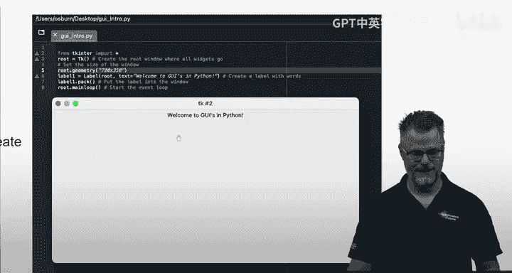

```python
from tkinter import *

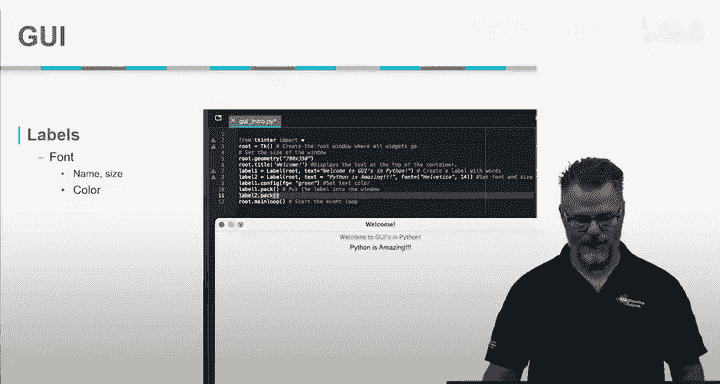

def welcome_message():
    print('Welcome to Python')

def quit_app():
    root.destroy()

root = Tk()
root.geometry('400x200')

button_quit = Button(root, text='Quit', fg='red', command=quit_app)
button_quit.pack(side=LEFT)

button_welcome = Button(root, text='Welcome', fg='pink', command=welcome_message)
button_welcome.pack(side=RIGHT)

button_top = Button(root, text='Top')
button_top.pack(side=TOP)

button_bottom = Button(root, text='Bottom')
button_bottom.pack(side=BOTTOM)

root.mainloop()
```

在这段代码中：
*   我们定义了两个函数：`welcome_message`用于打印消息，`quit_app`用于关闭程序。
*   创建了四个按钮，并使用`command`参数将函数与按钮点击事件绑定。
*   使用`.pack(side=...)`方法控制按钮的位置，可选值有`LEFT`、`RIGHT`、`TOP`、`BOTTOM`。

---

## 使用文本框获取用户输入📝

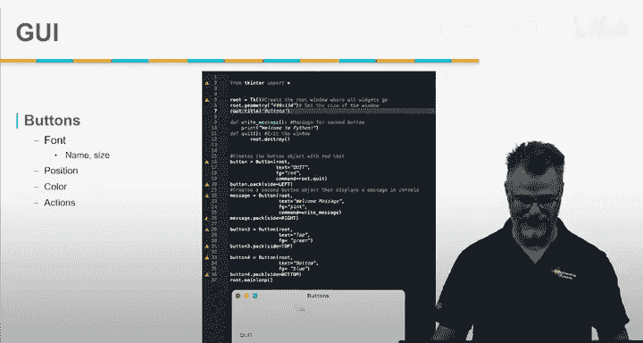

图形界面的一个重要功能是获取用户输入，这可以通过文本框实现。本节我们将学习如何创建文本框，并读取其中的内容。

以下示例创建了两个文本框和一个按钮，点击按钮会将第一个文本框的内容复制到第二个文本框：

```python
from tkinter import *

def insert_text():
    content = text_field1.get()
    text_field2.insert(END, content)

root = Tk()

label = Label(root, text='Enter your name:')
label.grid(row=0, column=0)

text_field1 = Text(root, height=1, width=20, bg='yellow')
text_field1.grid(row=0, column=1)

button1 = Button(root, text='Update', width=10, fg='red', command=insert_text)
button1.grid(row=2, column=2)

text_field2 = Text(root, height=1, width=20, bg='pink')
text_field2.grid(row=3, column=2)

root.mainloop()
```

在这段代码中：
*   `Text()` 小部件用于创建多行文本框，我们通过`height`和`width`参数设置其大小。
*   `.grid(row=..., column=...)` 方法用于以网格形式精确布局组件。
*   `text_field1.get()` 用于获取第一个文本框中的内容。
*   `text_field2.insert(END, content)` 将获取到的内容插入到第二个文本框的末尾。

---

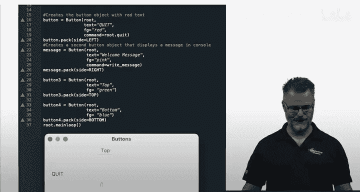

## 界面布局管理📐

为了让界面看起来更整洁，我们需要管理组件的布局。Tkinter提供了几种布局管理器，我们先来了解`.pack()`管理器的一些高级用法。

以下是使用`.pack()`进行不同布局的示例：

```python
from tkinter import *

root = Tk()
root.geometry('300x200')

# 默认从上到下居中排列
label1 = Label(root, text='Label 1', bg='lightblue')
label1.pack()

# 填充整个X轴（宽度）
label2 = Label(root, text='Label 2', bg='lightgreen')
label2.pack(fill=X)

# 填充X轴，并在左右两侧添加内边距
label3 = Label(root, text='Label 3', bg='lightcoral')
label3.pack(fill=X, padx=15)

# 填充X轴，并在组件之间添加垂直间距
label4 = Label(root, text='Label 4', bg='lightyellow')
label4.pack(fill=X, pady=5)

# 靠左排列
label5 = Label(root, text='Label 5 Left', bg='cyan')
label5.pack(side=LEFT)

# 紧挨着前一个组件靠左排列
label6 = Label(root, text='Label 6 Left', bg='magenta')
label6.pack(side=LEFT, padx=2)

# 靠右排列
label7 = Label(root, text='Label 7 Right', bg='orange')
label7.pack(side=RIGHT)

root.mainloop()
```

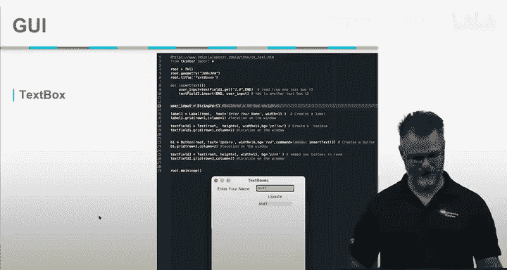

在这段代码中：
*   `fill=X` 让标签填充整个水平宽度。
*   `padx` 和 `pady` 参数用于设置水平和垂直方向的内边距。
*   `side` 参数控制组件在可用空间内的对齐方向。

---

## 使用框架组织界面🗂️

当界面元素较多时，可以使用框架来分组和组织它们，使布局更有条理。你可以将框架视为窗口内的子容器。

以下是如何创建和使用框架的示例：

```python
from tkinter import *

root = Tk()
root.geometry('400x300')

# 创建四个不同位置的框架
left_frame = Frame(root)
left_frame.pack(side=LEFT)

right_frame = Frame(root)
right_frame.pack(side=RIGHT)

top_frame = Frame(root)
top_frame.pack(side=TOP)

bottom_frame = Frame(root)
bottom_frame.pack(side=BOTTOM)

# 将按钮放入不同的框架中
button1 = Button(top_frame, text='Top Button')
button1.pack()

button2 = Button(bottom_frame, text='Bottom Button')
button2.pack()

button3 = Button(right_frame, text='Right Button')
button3.pack()

button4 = Button(left_frame, text='Left Button')
button4.pack()

# 创建一个带标签的框架来组织一组相关项目
fruit_frame = LabelFrame(root, text='Fruits')
fruit_frame.pack(pady=10)

Label(fruit_frame, text='Apples').pack()
Label(fruit_frame, text='Oranges').pack()
Label(fruit_frame, text='Bananas').pack()
Label(fruit_frame, text='Strawberries').pack()

root.mainloop()
```

在这段代码中：
*   `Frame()` 用于创建一个框架容器。
*   将框架`pack()`到主窗口的不同位置（左、右、上、下）。
*   创建按钮等组件时，将其父容器指定为对应的框架（如`top_frame`），而不是根窗口`root`。
*   `LabelFrame()` 创建一个带边框和标题的框架，非常适合对相关选项进行分组。

---

## 创建菜单栏🍽️

菜单是桌面应用程序的常见功能。在Tkinter中，菜单栏会显示在窗口的顶部。

以下是创建简单菜单栏的代码：

```python
from tkinter import *

def do_nothing():
    pass

root = Tk()
root.geometry('400x300')

# 创建菜单栏
menubar = Menu(root)
root.config(menu=menubar)

# 创建“文件”菜单
file_menu = Menu(menubar, tearoff=0)
menubar.add_cascade(label='File', menu=file_menu)
file_menu.add_command(label='New', command=do_nothing)
file_menu.add_command(label='Open', command=do_nothing)
file_menu.add_command(label='Save', command=do_nothing)
file_menu.add_separator()
file_menu.add_command(label='Exit', command=root.quit)

# 创建“帮助”菜单
help_menu = Menu(menubar, tearoff=0)
menubar.add_cascade(label='Help', menu=help_menu)
help_menu.add_command(label='About', command=do_nothing)

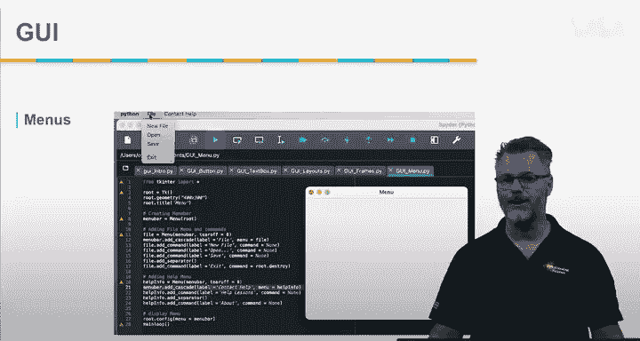

root.mainloop()
```

在这段代码中：
*   `Menu(root)` 创建菜单栏。
*   `root.config(menu=menubar)` 将菜单栏设置到窗口。
*   `add_cascade(label='File', menu=file_menu)` 添加一个名为“File”的下拉菜单。
*   `add_command()` 向下拉菜单中添加具体的命令项。
*   `add_separator()` 添加一条分隔线。

---

## 在界面中显示图片🖼️

Tkinter支持在界面中显示图片，但需要注意它原生支持`GIF`、`PGM`、`PPM`和`JPEG`格式。对于PNG等格式，可能需要额外的库。

以下是显示图片的示例：

```python
from tkinter import *

root = Toplevel()
root.title('Image Example')

# 加载图片文件
# 如果图片文件与Python脚本在同一目录，只需文件名即可。
# 本例假设图片在桌面，因此需要完整路径。
photo = PhotoImage(file='/Users/Osborne/Desktop/smile.png')

# 创建一个标签来显示图片
label = Label(root, image=photo)
label.pack()

root.mainloop()
```

在这段代码中：
*   我们使用`Toplevel()`创建了一个新窗口。
*   `PhotoImage()` 用于加载图片文件。请确保文件路径正确。
*   创建一个`Label`，并将其`image`参数设置为加载的`photo`对象。

---

## 事件驱动编程🖱️

到目前为止，我们的程序流程都是由代码预先决定的（批处理编程）。图形界面编程通常是**事件驱动**的，这意味着程序的流程由用户的动作（如键盘输入、鼠标点击）来驱动。

事件驱动编程是一种范式，其中程序的输出流程由传感器输出或用户动作（定义为事件）驱动。

---

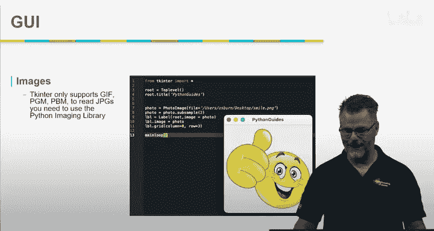

## 处理鼠标事件🎯

理解了事件驱动的概念后，我们来看看如何具体处理鼠标事件，例如点击、释放、光标进入和离开窗口。

以下代码演示了如何绑定并响应不同的鼠标事件：

```python
from tkinter import *

def button_pressed(event):
    status.set(f'Button pressed at ({event.x}, {event.y})')

def button_released(event):
    status.set(f'Button released at ({event.x}, {event.y})')

def entered_window(event):
    status.set('Mouse entered the window')

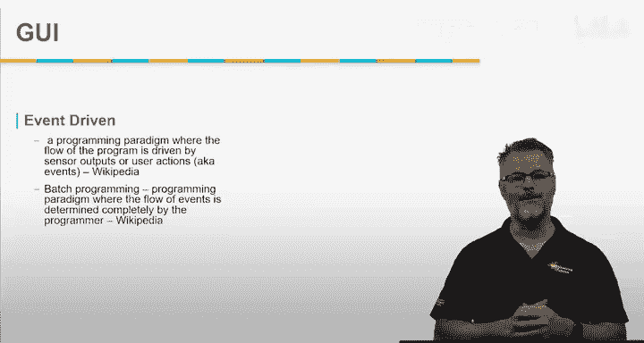

def exited_window(event):
    status.set('Mouse exited the window')

root = Tk()
root.title('Mouse Events')
frame = Frame(root, width=300, height=200)
frame.pack()

status = StringVar()
status.set('Mouse Event Status will be displayed here.')

label = Label(root, textvariable=status)
label.pack(side=BOTTOM)

# 将鼠标事件与处理函数绑定
frame.bind('<Button-1>', button_pressed)   # 左键按下
frame.bind('<ButtonRelease-1>', button_released) # 左键释放
frame.bind('<Enter>', entered_window)      # 光标进入区域
frame.bind('<Leave>', exited_window)       # 光标离开区域

root.mainloop()
```

在这段代码中：
*   我们定义了四个函数来处理不同的鼠标事件。
*   `frame.bind('<事件名称>', 处理函数)` 将特定事件绑定到处理函数。
*   `<Button-1>` 代表鼠标左键，`<Button-2>`和`<Button-3>`分别代表中键和右键。
*   `event.x`和`event.y`可以获取事件发生时的鼠标坐标。

---

## 创建列表框📋

列表框允许用户从预定义的列表中选择一个或多个项目。这在提供选项时非常有用。

以下是创建列表框的示例：

```python
from tkinter import *

root = Tk()
root.geometry('250x200')

label = Label(root, text='Select an auto part:')
label.pack()

# 创建列表框，设置选择模式为单选（SINGLE）或多选（MULTIPLE）
listbox = Listbox(root, selectmode=SINGLE)
listbox.pack()

# 向列表框中插入项目
parts = ['Brakes', 'Mufflers', 'Tires', 'Windshield Wipers', 'Headlights']
for part in parts:
    listbox.insert(END, part)

# 获取选中项目的索引
# selected_index = listbox.curselection()
# if selected_index:
#     selected_item = listbox.get(selected_index[0])
#     print(f'You selected: {selected_item}')

root.mainloop()
```

在这段代码中：
*   `Listbox()` 创建列表框。
*   `selectmode=SINGLE` 允许单选，`MULTIPLE` 允许多选。
*   `listbox.insert(END, item)` 在列表框末尾插入一个项目。
*   `listbox.curselection()` 返回当前选中项目的索引元组。
*   `listbox.get(index)` 根据索引获取项目内容。

---

## 使用对话框与用户交互💬

对话框用于向用户提示信息、警告、错误，或询问选择。它们能有效增强程序的交互性和健壮性。

Tkinter通过`messagebox`模块提供了多种标准对话框。

以下是使用不同类型对话框的示例：

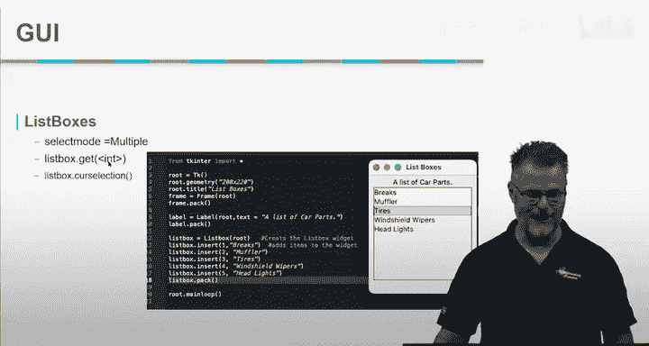

```python
from tkinter import *
from tkinter import messagebox

root = Tk()
root.withdraw() # 隐藏主窗口

# 信息提示框
messagebox.showinfo('Information', 'Please call support.')

# 警告框
messagebox.showwarning('Warning', 'This is a warning message.')

# 错误框
messagebox.showerror('Error', 'An error occurred!')

# 询问是否继续（是/否）
response = messagebox.askyesno('Question', 'Do you want to continue?')
print(f'User said: {response}')

# 询问确定或取消
response = messagebox.askokcancel('Confirm', 'Are you sure?')
print(f'User confirmed: {response}')

# 询问重试或取消
response = messagebox.askretrycancel('Failed', 'Do you want to try again?')
print(f'User wants to retry: {response}')

root.destroy()
```

在这段代码中：
*   我们从`tkinter`导入了`messagebox`子模块。
*   `showinfo`、`showwarning`、`showerror` 用于显示不同类型的提示框。
*   `askyesno`、`askokcancel`、`askretrycancel` 用于显示带有选择按钮的询问框，并返回用户的选择（布尔值）。

---

## 总结📚

在本节课中，我们一起学习了使用Tkinter构建图形用户界面的基础知识。我们从创建最基础的窗口开始，逐步学习了如何添加和定制标签、按钮、文本框等核心组件。我们还探讨了如何使用`.pack()`和`.grid()`进行布局管理，以及如何利用框架来组织复杂的界面。

此外，我们介绍了如何创建菜单栏、显示图片，并深入理解了事件驱动编程模型。通过处理鼠标事件、创建列表框和使用标准对话框，我们让程序具备了与用户进行丰富交互的能力。

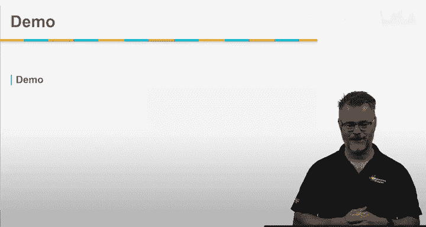

这些知识为你构建功能齐全的桌面应用程序奠定了坚实的基础。在接下来的课程中，我们将探索更高级的Tkinter组件和功能。