# 48：使用 Tkinter 构建图形界面（第二部分）📝

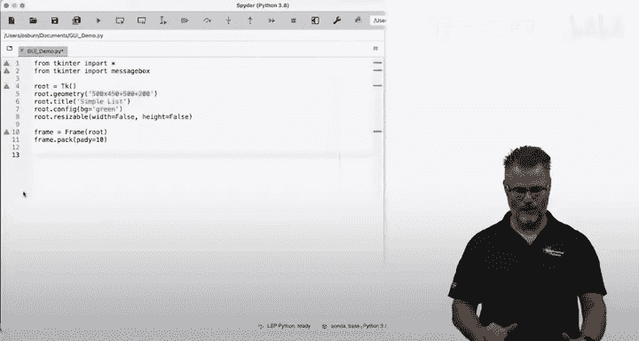

在本节课中，我们将学习如何使用 Python 的 Tkinter 库构建一个简单的待办事项列表应用。我们将创建一个带有输入框、按钮和列表的图形用户界面，并实现添加和删除任务的功能。

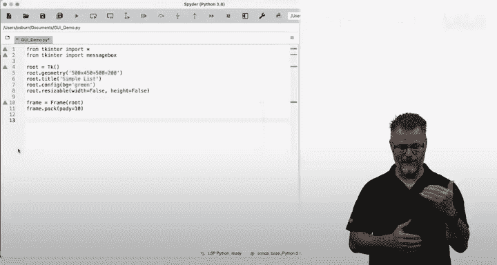

---

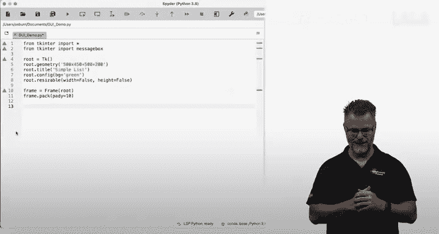

## 概述

我们将创建一个待办事项列表应用。这个应用将包含一个主窗口、一个用于显示任务的列表框、一个用于输入新任务的文本框，以及两个分别用于添加和删除任务的按钮。

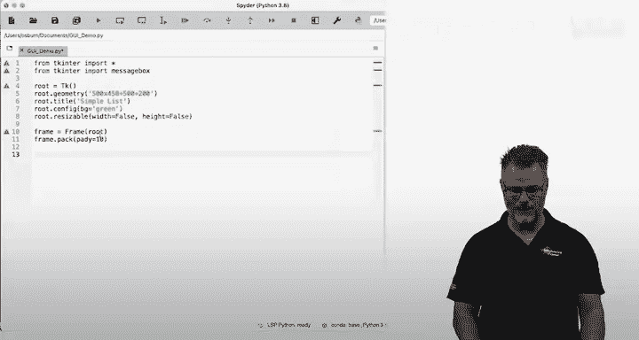

上一节我们介绍了 Tkinter 的基础知识，本节中我们来看看如何将这些组件组合起来，构建一个功能完整的应用。

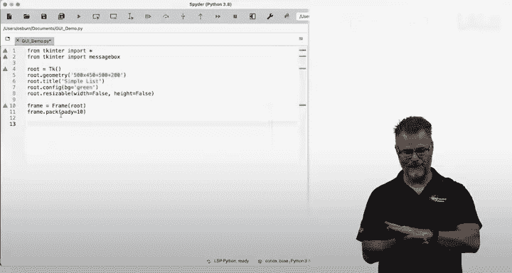

---

## 创建主窗口和框架

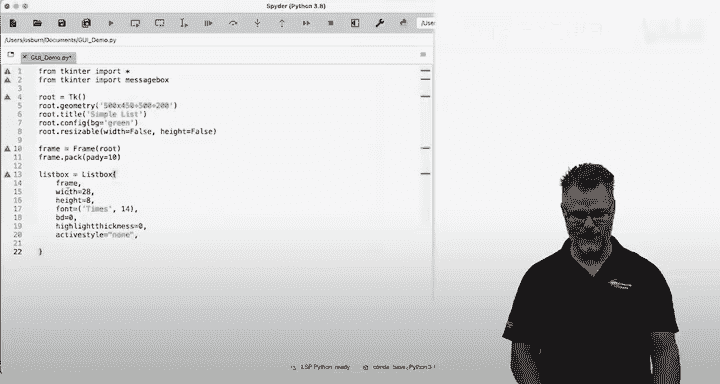

首先，我们需要导入 Tkinter 并创建应用程序的主窗口和框架。

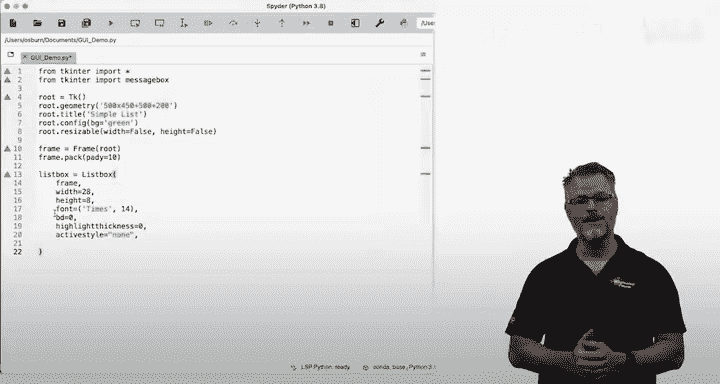

```python
import tkinter as tk
from tkinter import messagebox

root = tk.Tk()
root.geometry("400x400")
root.title("简单待办列表")
root.config(bg="green")

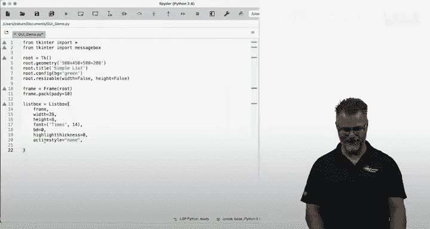

frame = tk.Frame(root)
frame.pack()
```

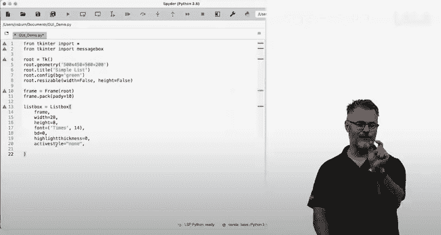

代码解释：
*   `tk.Tk()` 创建主窗口对象。
*   `.geometry("400x400")` 设置窗口大小为 400x400 像素。
*   `.title("简单待办列表")` 设置窗口标题。
*   `.config(bg="green")` 将窗口背景色设置为绿色。
*   `tk.Frame(root)` 在主窗口中创建一个框架，用于容纳其他组件。
*   `frame.pack()` 将框架放置到主窗口中。

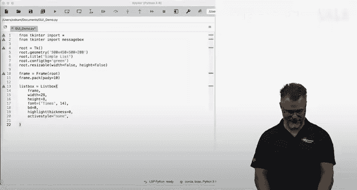

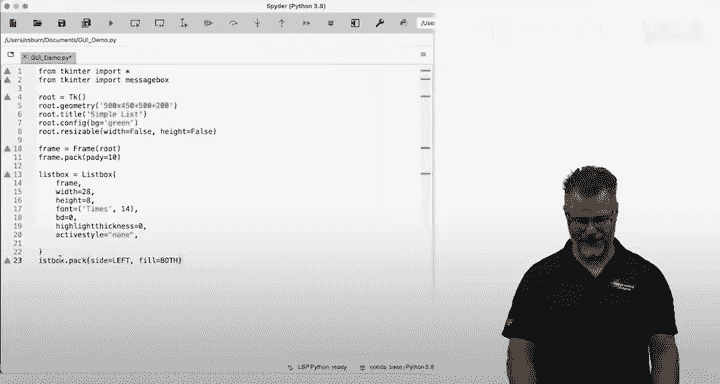

---

## 创建列表框

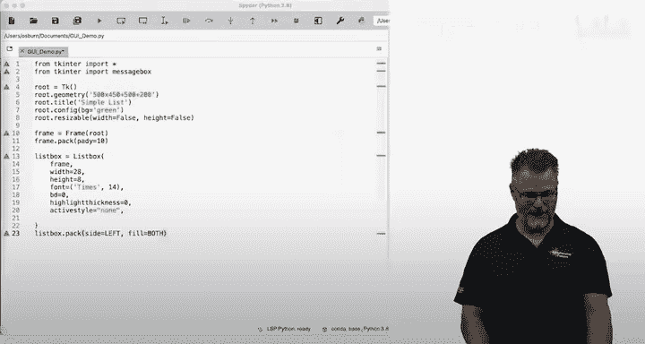

接下来，我们创建一个列表框来显示待办事项。

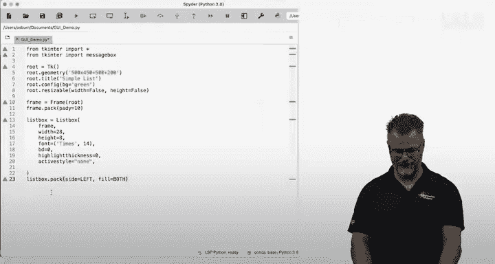

```python
listbox = tk.Listbox(
    frame,
    width=28,
    height=8,
    font=("Times", 14),
    bd=0,
    activestyle="none"
)
listbox.pack(side=tk.LEFT, fill=tk.BOTH)
```

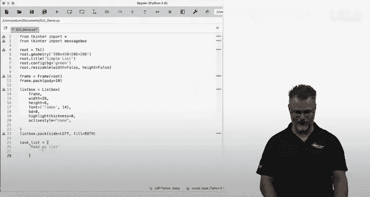

以下是列表框的关键参数：
*   `frame`：指定列表框放置在哪个框架内。
*   `width` 和 `height`：设置列表框的宽度和高度。
*   `font=("Times", 14)`：设置列表框中文本的字体和大小。
*   `bd=0`：将边框厚度设置为 0。
*   `activestyle="none"`：移除选中项时右侧的默认高亮样式。

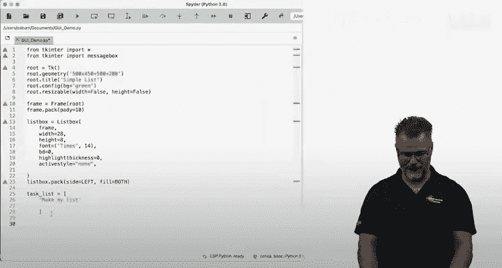

---

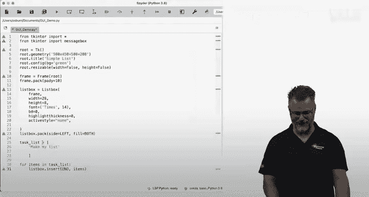

## 添加初始任务并配置滚动条

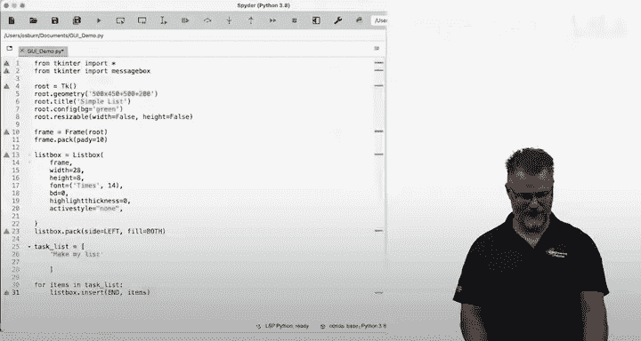

现在，我们向列表框中添加一些初始任务，并为它配置一个滚动条。

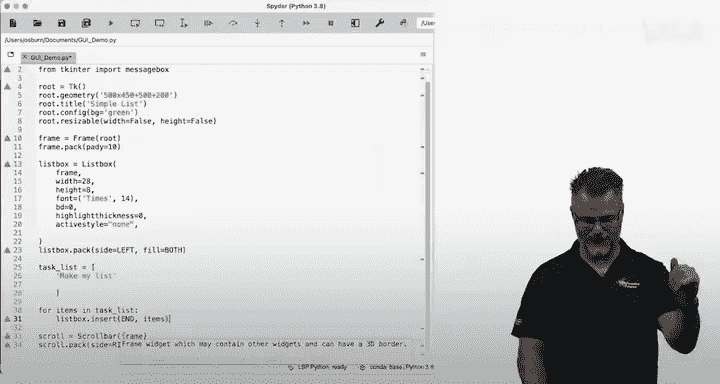

```python
tasks = ["制作我的列表"]

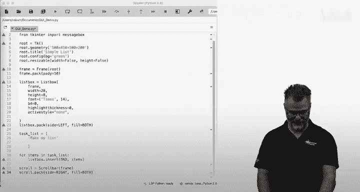

for item in tasks:
    listbox.insert(tk.END, item)

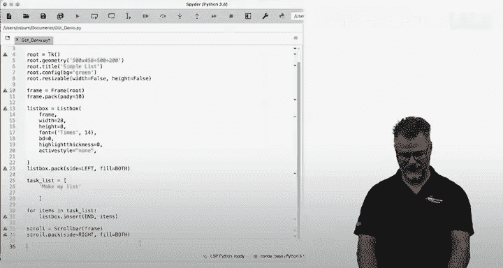

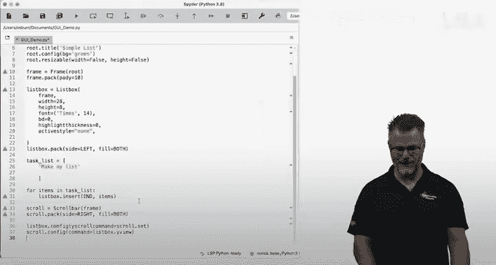

scrollbar = tk.Scrollbar(frame)
scrollbar.pack(side=tk.RIGHT, fill=tk.BOTH)

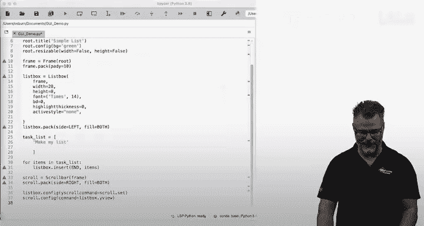

listbox.config(yscrollcommand=scrollbar.set)
scrollbar.config(command=listbox.yview)
```

代码解释：
*   我们定义了一个包含初始任务的列表 `tasks`。
*   使用 `for` 循环和 `listbox.insert(tk.END, item)` 将每个任务插入到列表框的末尾。
*   创建一个垂直滚动条 `tk.Scrollbar` 并将其放置在框架的右侧。
*   使用 `listbox.config(yscrollcommand=scrollbar.set)` 和 `scrollbar.config(command=listbox.yview)` 将列表框与滚动条关联起来。

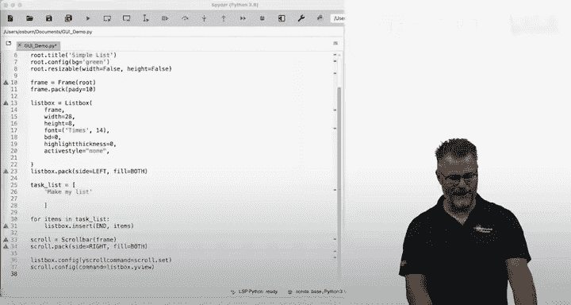

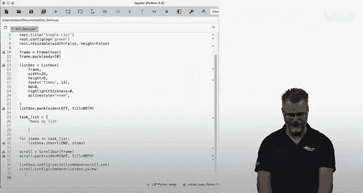

---

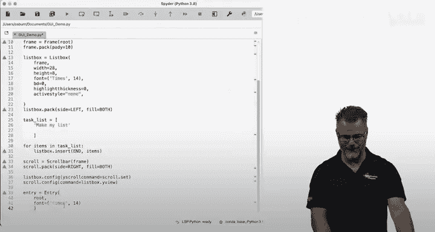

## 创建任务输入框

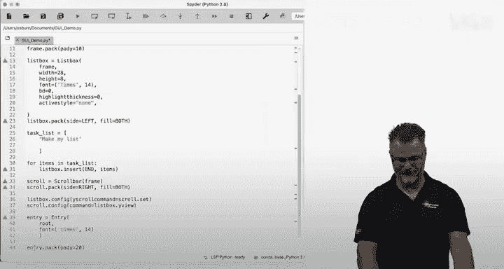

用户需要一个地方来输入新的任务。我们创建一个输入框（Entry）。

```python
entry = tk.Entry(root, font=("Times", 14))
entry.pack(pady=20)
```

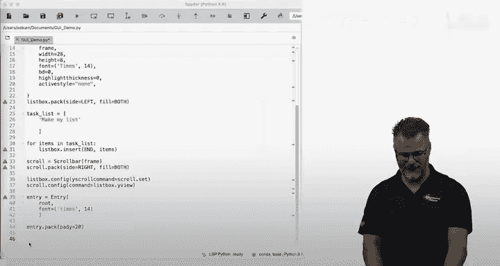

代码解释：
*   `tk.Entry(root, font=("Times", 14))` 在主窗口中创建一个输入框，并设置字体。
*   `.pack(pady=20)` 将输入框放置到窗口中，并设置垂直方向的外边距为 20 像素。

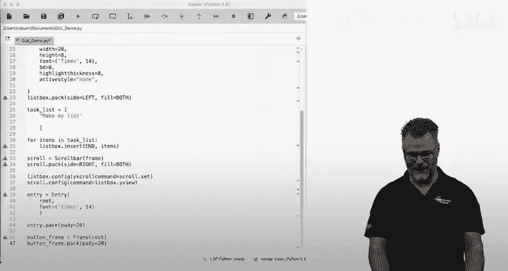

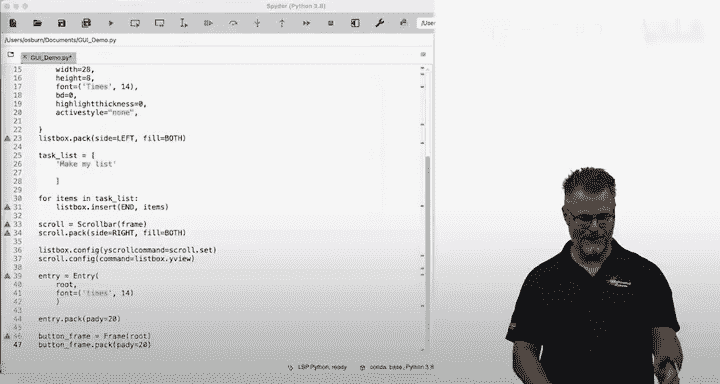

---

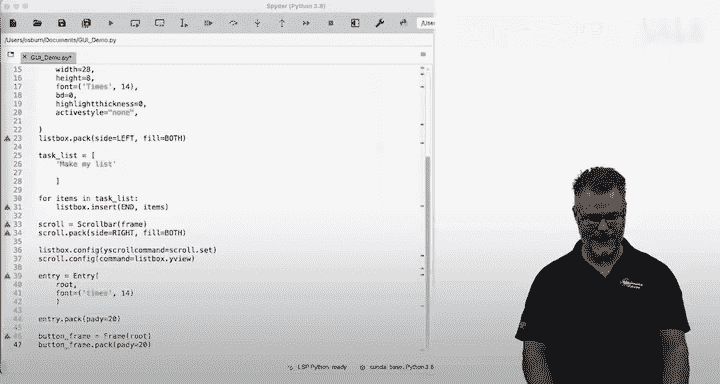

## 创建功能按钮

我们需要两个按钮来触发“添加任务”和“删除任务”的操作。

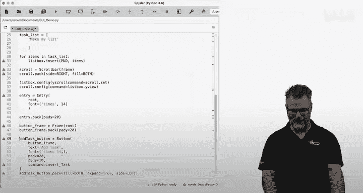

```python
add_button = tk.Button(
    root,
    text="添加任务",
    font=("Times", 14),
    padx=20,
    pady=10,
    command=insert_task
)
add_button.pack(pady=10)

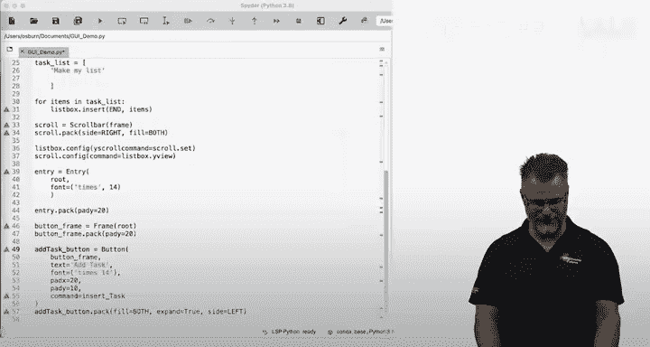

delete_button = tk.Button(
    root,
    text="删除任务",
    font=("Times", 14),
    padx=20,
    pady=10,
    command=delete_task
)
delete_button.pack()
```

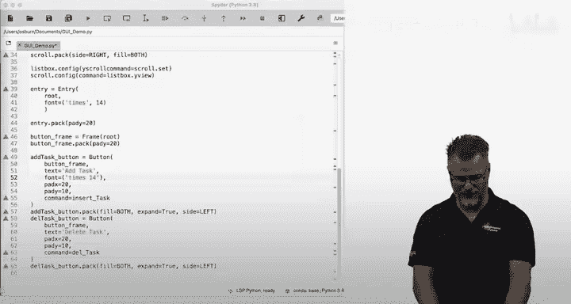

以下是按钮的关键参数：
*   `text`：按钮上显示的文本。
*   `font`：按钮文本的字体。
*   `padx`, `pady`：按钮内部文本周围的填充。
*   `command`：按钮被点击时要执行的函数名。这里我们指定了 `insert_task` 和 `delete_task`，我们稍后会定义它们。

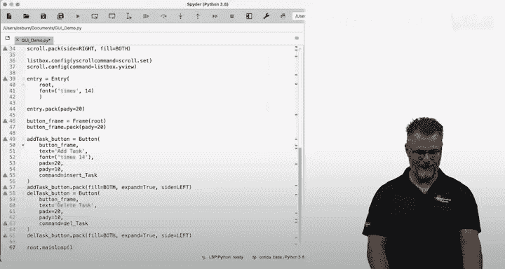

---

## 定义按钮功能函数

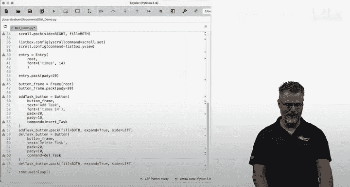

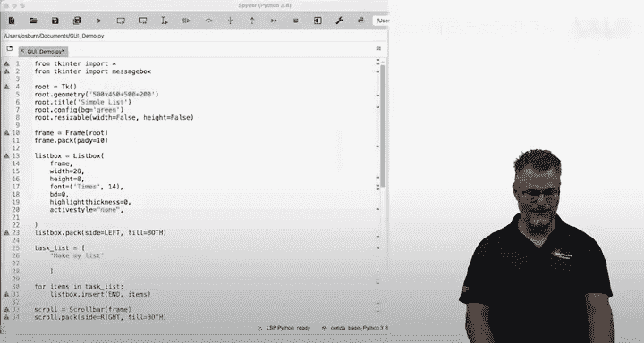

现在，我们来定义当按钮被点击时实际执行的函数。

```python
def insert_task():
    task = entry.get()
    if task != "":
        listbox.insert(tk.END, task)
        entry.delete(0, tk.END)
    else:
        messagebox.showwarning("警告", "请输入任务内容。")

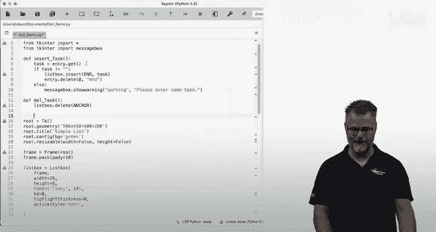

def delete_task():
    try:
        selected_task_index = listbox.curselection()[0]
        listbox.delete(selected_task_index)
    except IndexError:
        messagebox.showwarning("警告", "请先选择一个要删除的任务。")
```

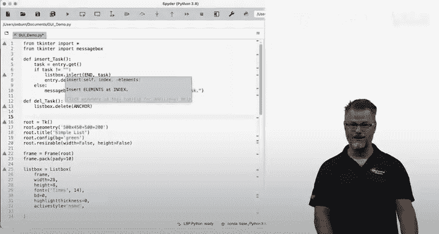

函数解释：
*   **`insert_task` 函数**：
    1.  使用 `entry.get()` 获取输入框中的内容。
    2.  判断内容是否为空。如果不为空，则使用 `listbox.insert(tk.END, task)` 将其添加到列表框末尾，并使用 `entry.delete(0, tk.END)` 清空输入框。
    3.  如果内容为空，则使用 `messagebox.showwarning` 弹出一个警告对话框。
*   **`delete_task` 函数**：
    1.  使用 `listbox.curselection()` 获取当前选中项的索引。这是一个元组。
    2.  尝试获取第一个索引 `[0]`，并使用 `listbox.delete(selected_task_index)` 删除该项。
    3.  如果没有选中任何项（会引发 `IndexError`），则弹出警告对话框。

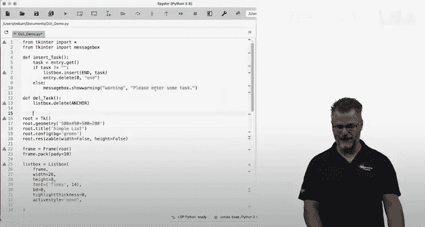

---

## 启动主事件循环

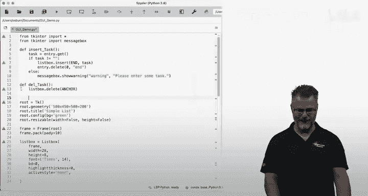

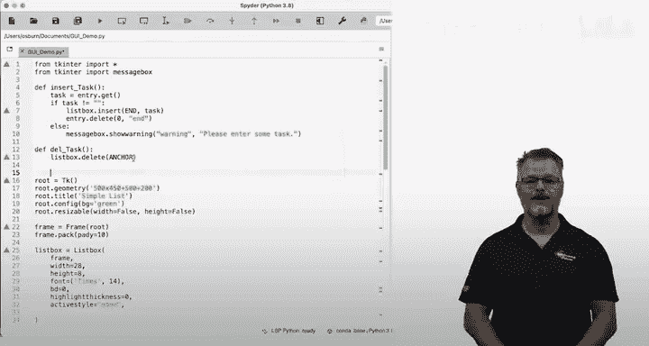

最后，我们需要启动 Tkinter 的主事件循环，让窗口保持运行并响应用户操作。

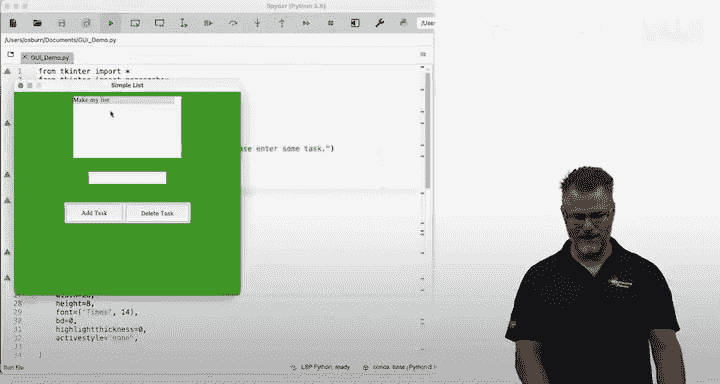

```python
root.mainloop()
```

---

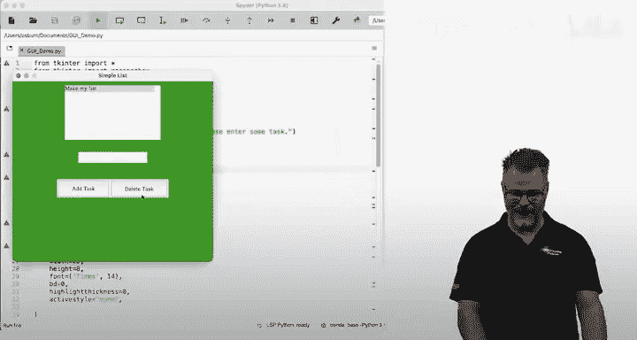

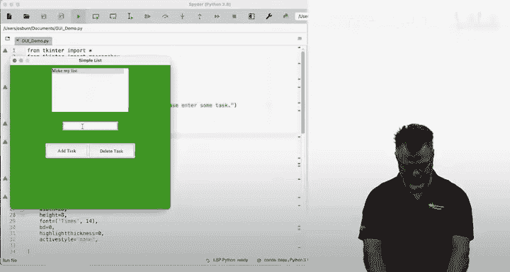

## 运行与测试应用

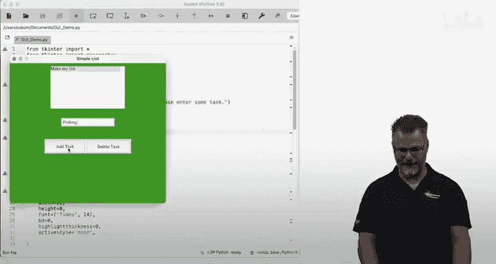

将以上所有代码段按顺序组合成一个完整的 Python 脚本并运行。

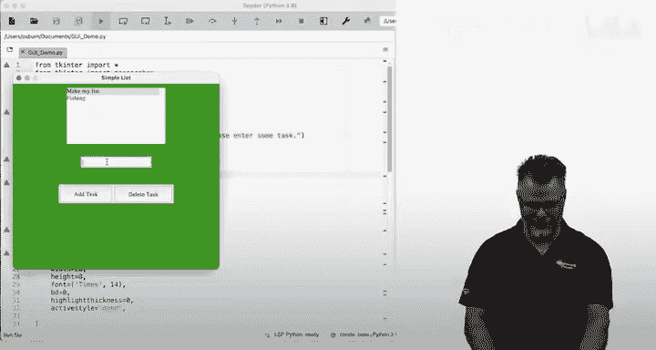

运行后，你将看到一个绿色背景的窗口，其中包含：
*   一个显示着“制作我的列表”的列表框。
*   一个用于输入新任务的文本框。
*   “添加任务”和“删除任务”两个按钮。

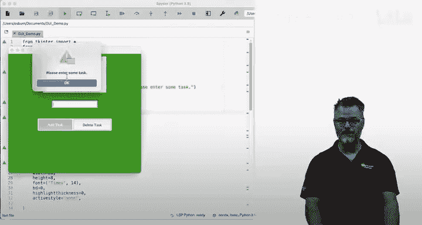

你可以进行以下操作：
1.  在文本框中输入新任务，点击“添加任务”按钮，任务会出现在列表框中。
2.  点击列表框中的一个任务将其选中，然后点击“删除任务”按钮，该任务将从列表中被移除。
3.  如果尝试添加空任务或删除时未选中任务，将会看到相应的警告提示。

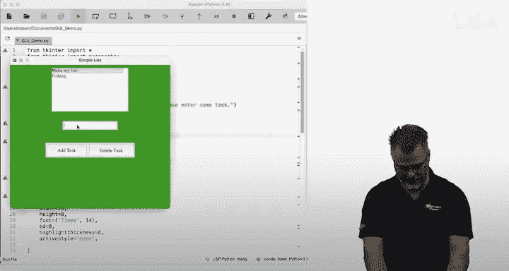

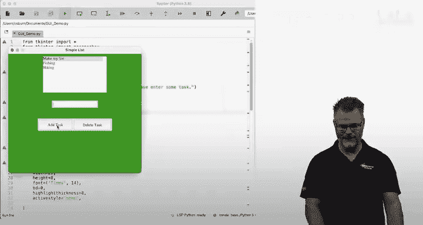

---

## 总结

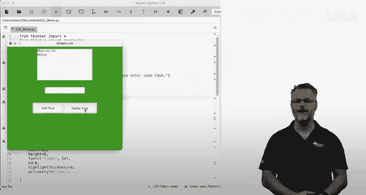


本节课中我们一起学习了如何使用 Tkinter 构建一个功能完整的图形界面应用。我们创建了主窗口、框架、列表框、滚动条、输入框和按钮，并通过定义函数实现了添加和删除任务的交互逻辑。这个待办事项列表应用涵盖了 GUI 开发的基本要素，是进一步学习更复杂界面设计的基础。