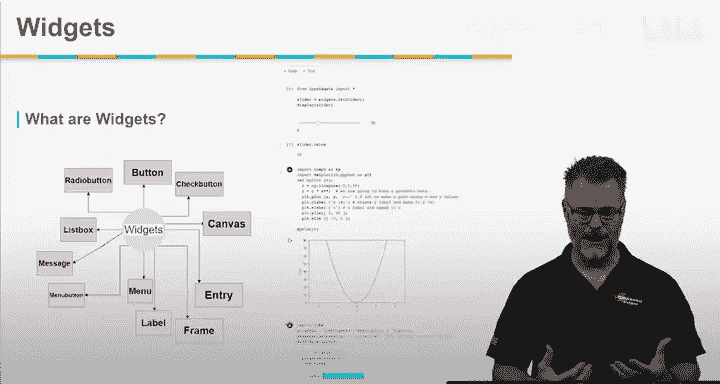

# 49：Python控件创建技术 🎛️


## 课程概述


在本节课中，我们将要学习Python中的控件（Widgets）。控件是Python图形用户界面（GUI）编程的核心组成部分，它们允许我们以可视化的方式与程序交互、展示或操作数据。我们将探讨控件的本质、常见类型，并通过具体示例理解其工作原理。


---

## 什么是控件？🤔


控件本质上是对象。在本课程中，我们已经多次使用过各种对象，但并未明确地将它们标识为“控件”。控件是内置在特定类中的图形化元素。


以下是几种常见的控件类型：
*   单选按钮
*   按钮
*   复选框
*   画布
*   列表框
*   消息框
*   菜单按钮
*   菜单项
*   标签框架

---


## 控件的类别与示例

上一节我们介绍了控件的基本概念，本节中我们来看看不同类库中的具体控件示例。

### IPY Widgets 示例


我们将要查看的另一个类是IPY Widgets。在以下示例中，我们使用了一个滑块控件。


```python
# 这是一个滑块控件的示例
slider = widgets.IntSlider()
display(slider)
```


这个滑块是一个控件。它允许我前后移动滑块。当我前后移动它时，它会改变滑块的值。我可以使用 `slider.value` 来获取这个值。


### 结合图形库的控件

这里我将使用另一个类库，我导入了 `numpy`。同时，我也使用了来自 `matplotlib` 库的 `pyplot` 来显示数据。


```python
import numpy as np
import matplotlib.pyplot as plt
```


由此可见，许多控件本质上是我们可视化查看或操作数据的方式。


在这个例子中，我能够绘制一个图表。


### 进度控件示例

另一个例子是，我将导入 `time` 模块。`time` 模块有它自己的进度控件。


```python
import time
from ipywidgets import IntProgress
```


当我执行这段代码时，我可以让它从一个范围运行到100，然后它开始加载这里的菜单项。当它到达终点时，就会停止。


---


## 控件的本质总结


回到控件是什么这个问题。基本上，它们是数据的图形化表示。我们在整个Python和图形用户界面中都会使用到它们。让我们去看看演示。


---

## 课程总结



本节课中我们一起学习了Python控件的核心概念。我们明确了控件是图形化表示数据的对象，回顾了多种常见控件类型，并通过IPY Widgets滑块、图形绘制以及进度条等具体示例，了解了控件在交互和数据可视化中的应用。理解控件是构建直观、易用的Python图形界面的基础。