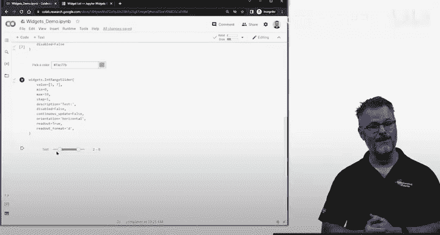

# 50：Python界面控件功能演示 🎛️


在本节课中，我们将学习Python中几种常用界面控件的功能与使用方法。这些控件能够帮助我们创建交互式的图形用户界面，实现数据输入和用户交互。

上一节我们介绍了界面控件的基本概念，本节中我们来看看几种具体控件的功能演示。

## 控件功能概览


首先，我想引导大家访问一个网站，那里展示了多种不同的控件。这能让你了解利用不同功能可以实现的效果，例如各种滑块和浮动范围选择器。


以下是几种我认为有趣且实用的控件示例。


## 密码输入框


第一个非常常见的控件是密码输入框。

这里，我使用了 `widgets.Password` 控件。它的作用是提供一个用于输入密码的区域。


```python
import ipywidgets as widgets
password = widgets.Password()
display(password)
```


运行这段代码，它会给我一个密码输入区域。如果我输入“Bob”，它会自动为我显示星号 `****`。这是一个非常简洁好用的控件。


## 按钮控件


我们还有另一个控件——按钮。


以下是按钮控件的示例。运行这段代码，你会看到一个写着“Click Me”的按钮。


```python
button = widgets.Button(description='Click Me', button_style='danger')
display(button)
```

我可以将按钮样式从“danger”（危险/红色）改为“success”（成功/绿色）。


再次运行代码，观察发生的变化。它给了我一个漂亮的绿色按钮。


我还可以将其从“success”改为“info”（信息/蓝色），这会给我一个蓝色的警告样式按钮。

或者，我可以使用“warning”（警告/橙色）样式。


运行它，会得到一个橙色的按钮，这是一种有趣且友好的交互按钮。


## 颜色选择器


另一个总是很有用的控件是颜色选择器。

这样，用户可以识别或选择他们想要添加的颜色。


```python
color_picker = widgets.ColorPicker(concise=False, description='Pick a color', value='blue')
display(color_picker)
```


运行这段代码，你会得到一个简单的颜色选择器，默认显示蓝色。如果我打开它，可以选择绿色并点击。


然后，它会给出该颜色对应的十六进制值。


## 滑块控件

当然，另一个你会发现有用的控件是滑块。

```python
int_range_slider = widgets.IntRangeSlider(value=[5, 15], min=0, max=30, step=1, description='Range:')
display(int_range_slider)
```


运行它。我得到了一个多范围滑块，在这种情况下，我可以选择高值和低值。

如果我愿意，也可以使用一个单值范围滑块，只获取一个值，让它从0滑动到我想要设置的任何值。


```python
int_slider = widgets.IntSlider(value=10, min=0, max=30, step=1, description='Value:')
display(int_slider)
```


## 课程总结

本节课中我们一起学习了几种Python界面控件的基本用法。


希望这能让你对一些简单控件及其使用方式有所了解。正如我在课程中提到的，它们基本上用于图形化的数据输入和输出。


正如我们在这里看到的：
*   我们有用于密码输入的 `Password` 控件。
*   我们有显示不同颜色的“Click Me”按钮。
*   我们能够选择不同的颜色并获取其十六进制值。
*   然后我们有一个允许我们创建滑块的控件。



我期待在下一个视频中与大家再见。