# 51：Python 几何图形绘制方法 🐢

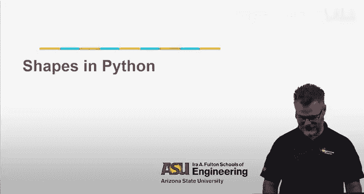

在本节课中，我们将学习如何使用 Python 的 `turtle` 库来绘制各种几何图形。我们将从绘制简单的直线开始，逐步学习如何绘制正方形、圆形，并探索一些更复杂的图形。

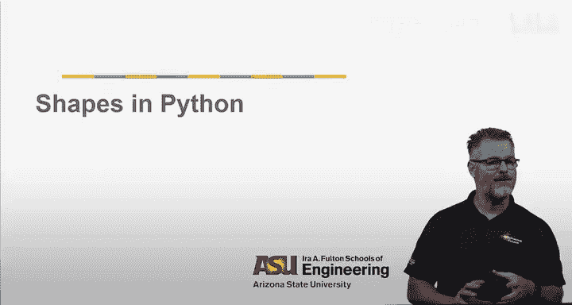

---

## 概述与准备工作

`turtle` 是 Python 的一个内置图形库，它允许我们通过控制一个“海龟”对象在屏幕上移动来绘制图形。这个对象可以前进、后退、转向，并且可以控制画笔的抬起和落下，就像在纸上画画一样。我们还可以控制画笔的颜色和粗细。

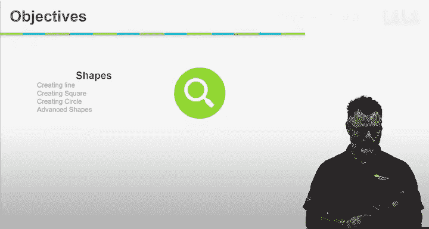

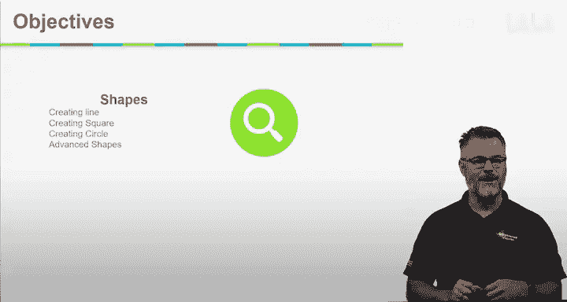

需要注意的是，`turtle` 库在 Colab 等在线环境中可能无法正常工作，因此建议在本地的 IDE（如 PyCharm, VSCode）中运行相关代码。

在 `turtle` 的绘图窗口中，坐标系统被分为四个象限。原点 `(0, 0)` 位于屏幕中心。第一象限是 `(正X, 正Y)`，第二象限是 `(负X, 正Y)`，第三象限是 `(负X, 负Y)`，第四象限是 `(正X, 负Y)`。

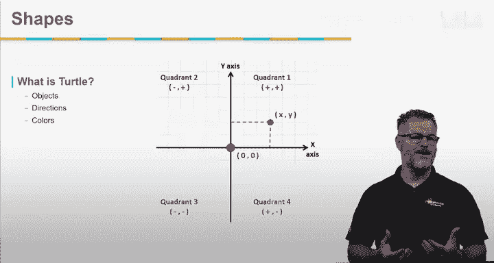

---

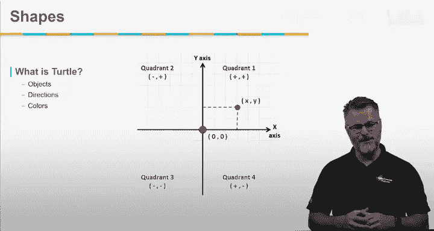

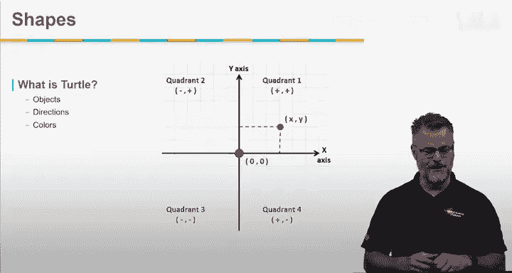

## 绘制基本图形

上一节我们介绍了 `turtle` 的基本概念和坐标系统。本节中，我们来看看如何使用它绘制具体的图形。

### 绘制直线

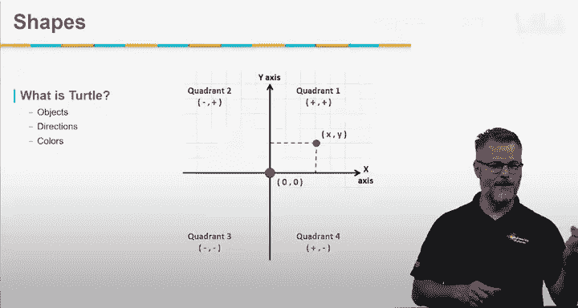

绘制直线是最简单的操作。我们只需要让海龟朝一个方向前进指定的距离即可。

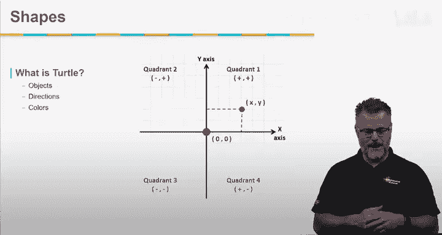

以下是绘制一条长度为 200 像素的直线的代码：

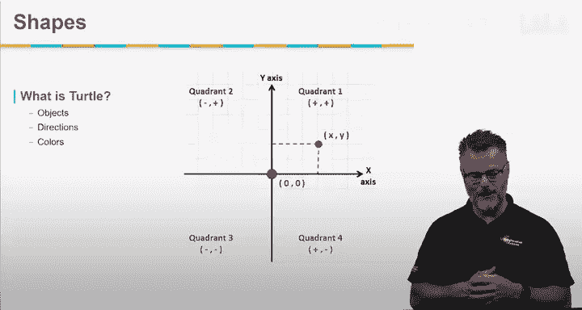

```python
import turtle

# 创建一个海龟对象
t = turtle.Turtle()
# 前进 200 像素
t.forward(200)

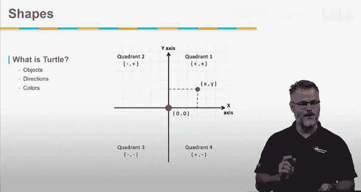

# 保持窗口打开
turtle.done()
```

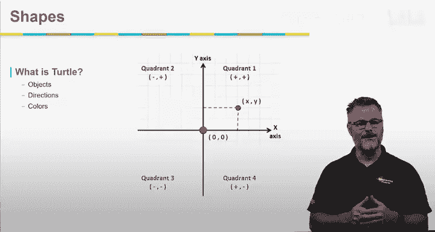

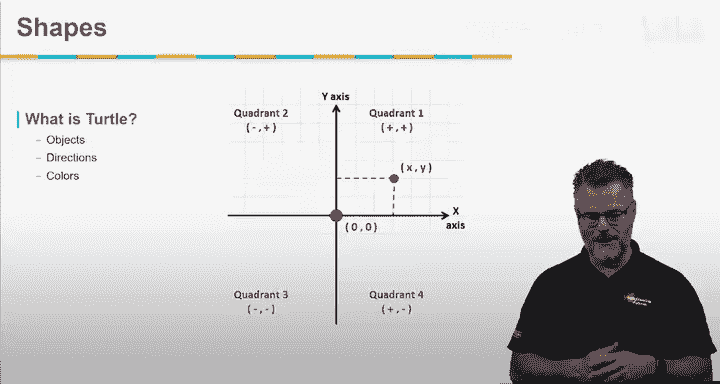

### 绘制正方形

绘制正方形需要重复“前进”和“转向”的动作。一个正方形的内角是 90 度，因此每次画完一条边后，需要左转或右转 90 度。

以下是绘制一个边长为 100 像素的正方形的代码：

```python
import turtle

t = turtle.Turtle()
t.pensize(4)  # 设置画笔粗细

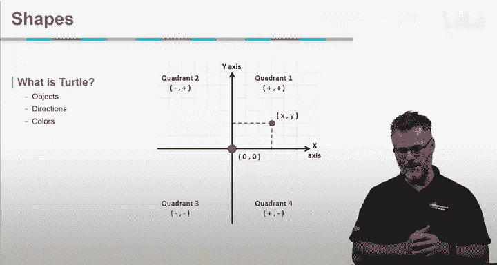

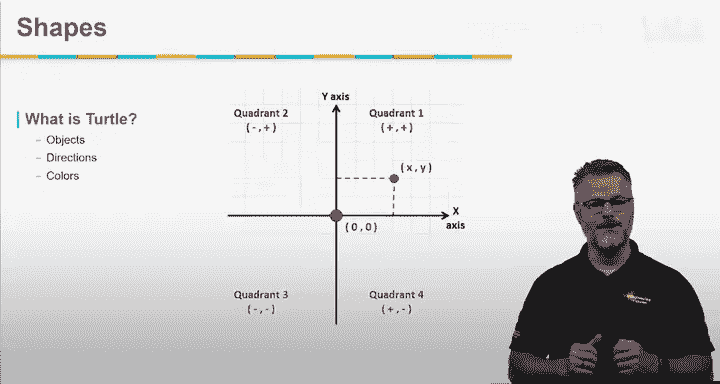

for _ in range(4):
    t.forward(100)
    t.left(90)  # 左转 90 度

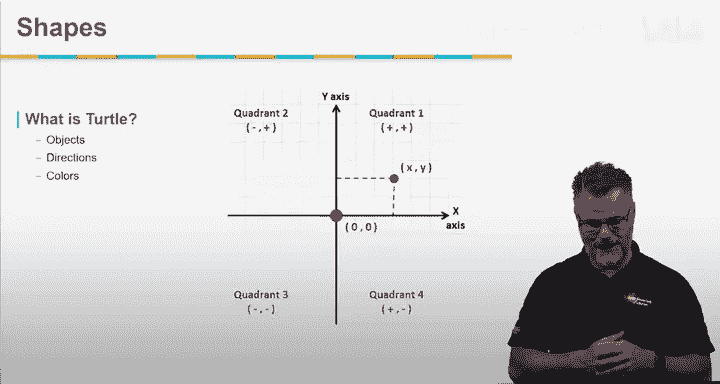

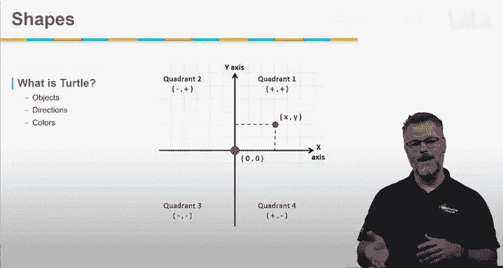

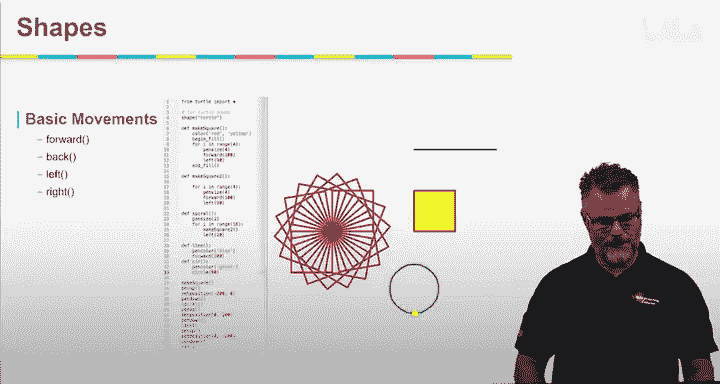

turtle.done()
```

### 填充颜色

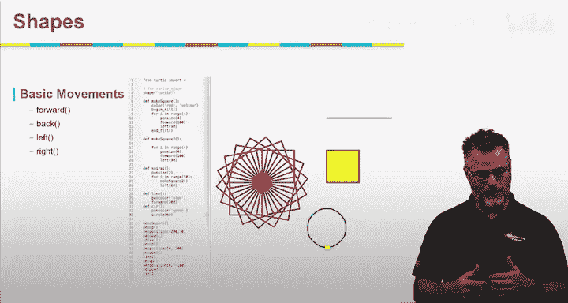

我们可以为绘制的封闭图形填充颜色。使用 `begin_fill()` 开始填充，绘制完图形后使用 `end_fill()` 结束填充。

以下是绘制一个红色边框、黄色填充的正方形的代码：

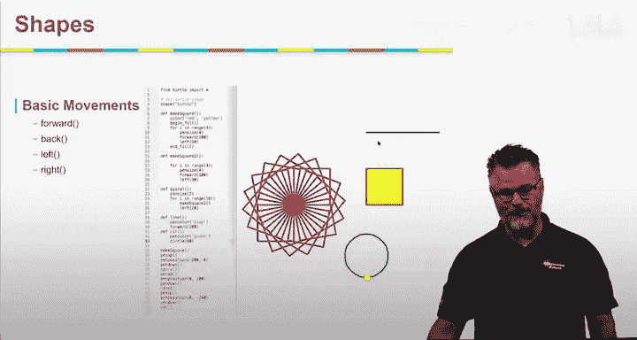

```python
import turtle

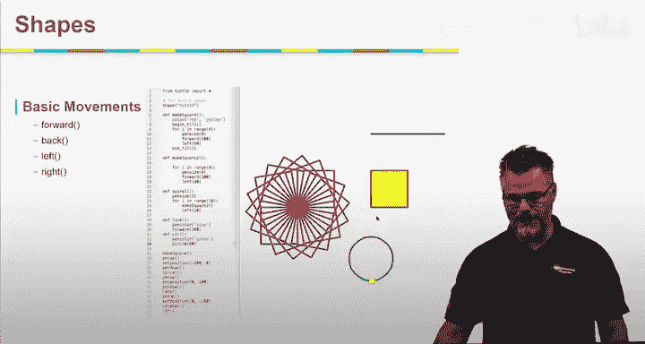

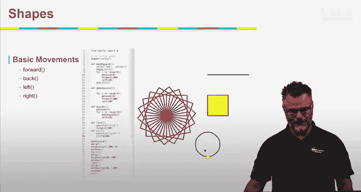

t = turtle.Turtle()
t.pensize(4)
t.color("red", "yellow")  # 设置边框色和填充色

t.begin_fill()
for _ in range(4):
    t.forward(100)
    t.left(90)
t.end_fill()

turtle.done()
```

### 绘制圆形

`turtle` 库提供了直接绘制圆形的方法 `circle()`，只需指定半径即可。


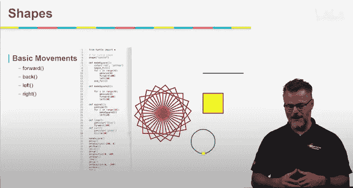

以下是绘制一个半径为 60 像素的绿色圆形的代码：

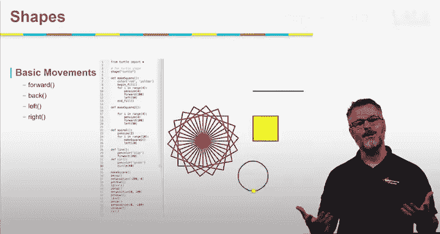

```python
import turtle

t = turtle.Turtle()
t.color("green")
t.circle(60)

turtle.done()
```

---

## 创建复杂图形与移动画笔

上一节我们学习了基本图形的绘制。本节中，我们将结合移动画笔的技巧，创建更复杂的图案。

### 移动画笔位置

在绘制多个图形时，我们经常需要在不画线的情况下将海龟移动到新的起点。这时可以使用 `penup()` 抬起画笔，移动后再用 `pendown()` 落下画笔。

以下是相关指令：
*   `penup()` 或 `pu()`：抬起画笔，移动时不画线。
*   `pendown()` 或 `pd()`：落下画笔，移动时画线。
*   `goto(x, y)`：将海龟移动到指定坐标 `(x, y)`。

### 绘制螺旋正方形图案

通过循环绘制多个正方形，并在每次绘制后将海龟旋转一个角度，可以创造出螺旋效果。

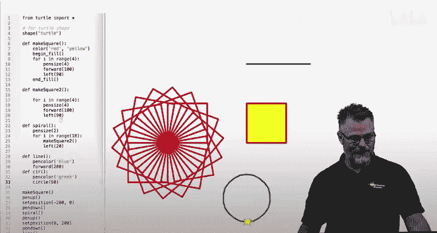

以下是创建一个由 18 个正方形组成的螺旋图案的代码：

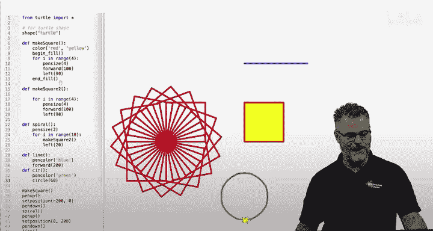

```python
import turtle

t = turtle.Turtle()
t.speed(0)  # 设置最快绘制速度
t.pensize(2)

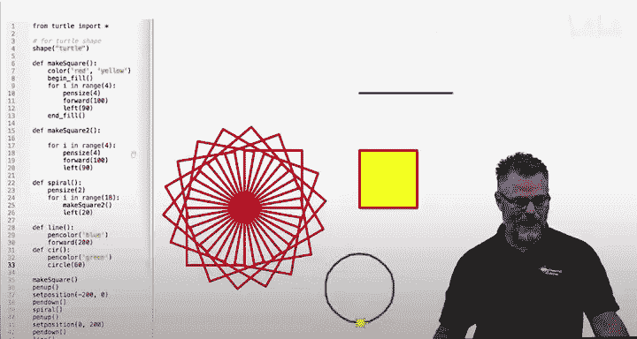

for i in range(18):
    # 绘制一个正方形
    for _ in range(4):
        t.forward(100)
        t.left(90)
    # 绘制完一个正方形后，整体旋转 20 度
    t.left(20)

turtle.done()
```

### 组合应用示例

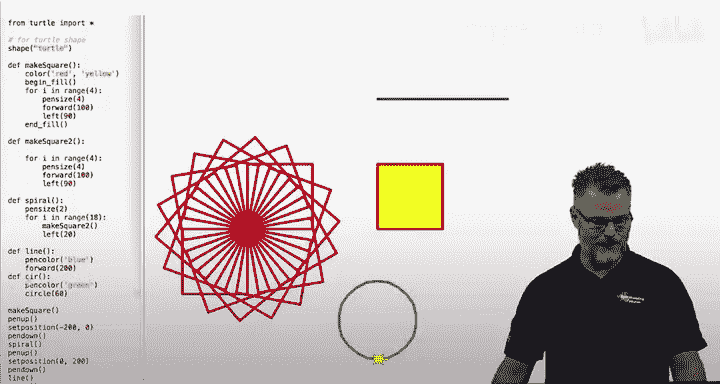

以下代码综合运用了以上所有技巧，在屏幕的不同位置绘制了多个图形：

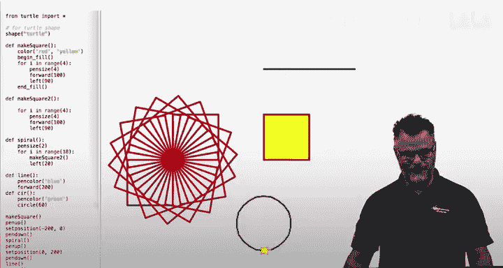

```python
import turtle

t = turtle.Turtle()
t.speed(5)
t.shape("turtle")  # 将光标形状设置为海龟

# 1. 在原点绘制一个带填充的正方形
t.pensize(4)
t.color("red", "yellow")
t.begin_fill()
for _ in range(4):
    t.forward(100)
    t.left(90)
t.end_fill()

# 2. 移动到 (-200, 0) 绘制螺旋图案
t.penup()
t.goto(-200, 0)
t.pendown()
t.color("blue")
for i in range(18):
    for _ in range(4):
        t.forward(50)
        t.left(90)
    t.left(20)

# 3. 移动到 (0, 200) 绘制一条直线
t.penup()
t.goto(0, 200)
t.pendown()
t.color("black")
t.forward(200)

# 4. 移动到 (0, -200) 绘制一个圆形
t.penup()
t.goto(0, -200)
t.pendown()
t.color("green")
t.circle(60)

turtle.done()
```

---

## 总结

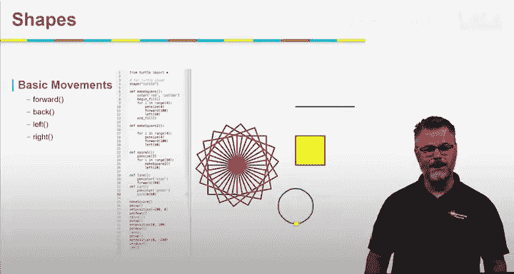

本节课中，我们一起学习了 Python `turtle` 库的基本用法。我们掌握了如何绘制**直线**、**正方形**和**圆形**，并学会了使用 `begin_fill()` 和 `end_fill()` 为图形**填充颜色**。此外，我们还了解了如何通过 `penup()`、`pendown()` 和 `goto()` **移动画笔**到指定位置，从而组合绘制出更复杂的图案。

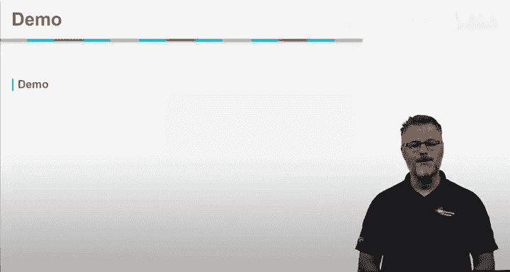

`turtle` 库是一个非常适合图形编程入门的工具，它用直观的方式将代码与视觉输出联系起来。希望你能运用这些知识，创造出更多有趣的图形！