# 52：Python 事件处理机制 🖱️⌨️

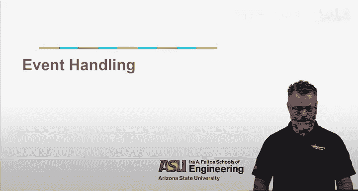

在本节课中，我们将要学习什么是事件处理机制，以及它如何与 Python 编程相关联。

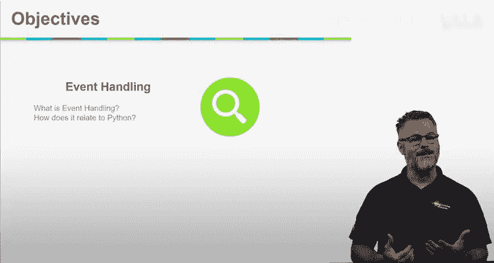

## 概述

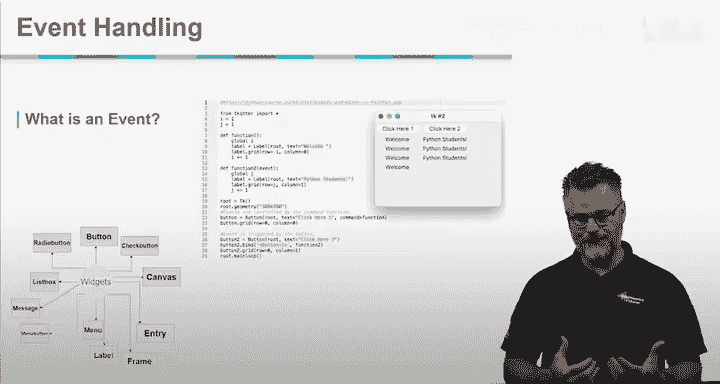

到目前为止，我们实际上一直在与事件打交道。我们已经学习了如何与按钮交互，使用了画布、输入框、框架、标签、消息框和列表框等组件。我们一直在创建各种不同的事件。本质上，一个事件就是等待用户响应的某种操作。

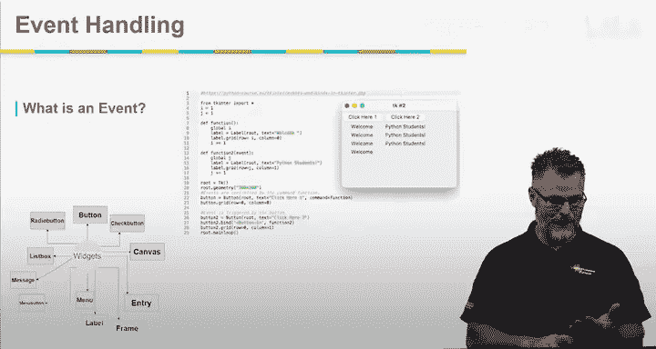

## 什么是事件处理？

事件处理的核心是等待用户执行某个操作。一旦用户触发了该事件，无论是鼠标点击还是键盘输入，应用程序就会执行相应的动作。

让我们通过一个简单的应用来理解。这个应用有两个按钮：“点击这里”和“点击这里”。点击第一个按钮，它会显示“欢迎”。点击第二个按钮，它会显示“Python 学生”。


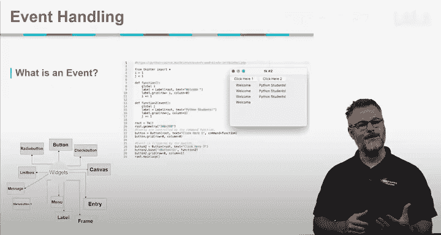

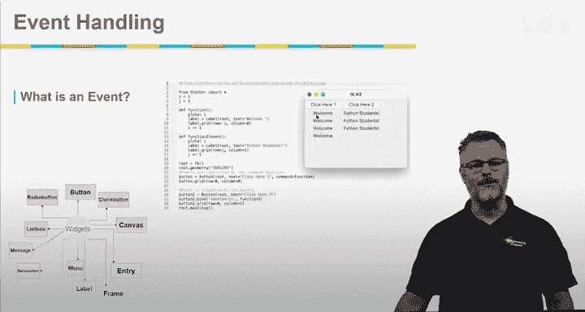

如上图所示，第一个按钮被点击了四次，显示了四次“欢迎”。然后点击第二个按钮，它显示了“Python 学生”。所以，事件处理就是等待你执行操作，并在你执行后做出响应。

## 代码解析

上一节我们介绍了事件处理的概念，本节中我们来看看实现它的代码。

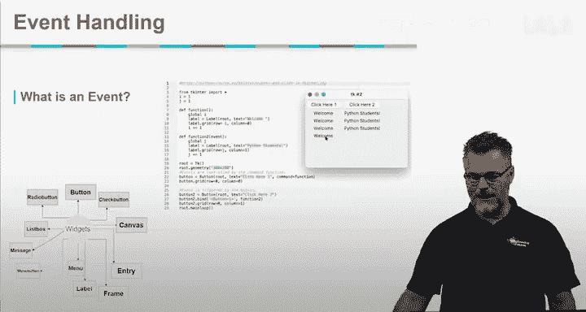

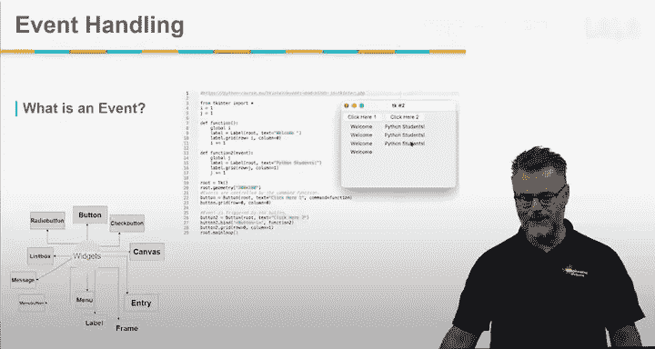

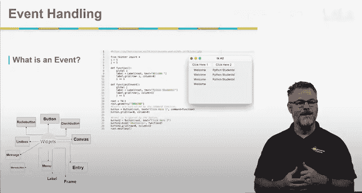

以下是实现上述功能的代码：

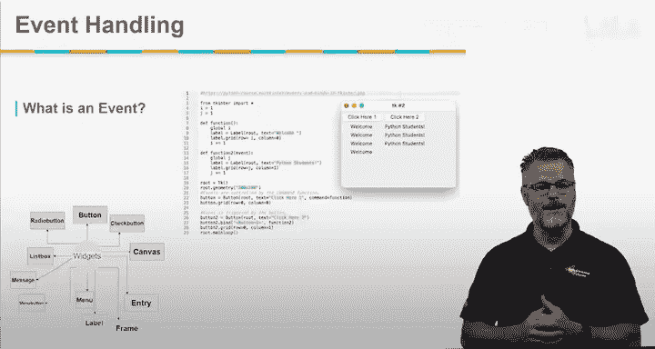

```python
import tkinter as tk

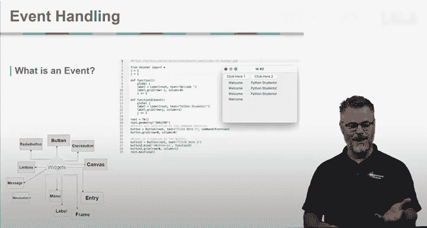

i = 1
j = 1

def function1():
    global i
    label = tk.Label(window, text="Welcome")
    label.grid(row=i, column=0)
    i += 1

def function2(event):
    global j
    label = tk.Label(window, text="Python students")
    label.grid(row=j, column=1)
    j += 1

window = tk.Tk()
window.geometry("400x300")

button1 = tk.Button(window, text="Click here", command=function1)
button1.grid(row=0, column=0)

button2 = tk.Button(window, text="Click here")
button2.grid(row=0, column=1)
button2.bind("<Button-1>", function2)

window.mainloop()
```

### 代码详解

以下是代码各部分的解释：

1.  **导入与全局变量**：首先导入 `tkinter` 模块，并设置两个全局变量 `i` 和 `j`，初始值都为 1。它们用于跟踪标签显示的行数。
2.  **函数定义**：
    *   `function1()`：这个函数用于处理第一个按钮的点击。它使用 `global i` 声明来修改全局变量 `i`。每次调用时，它创建一个显示“Welcome”的标签，并将其放置在网格的第 `i` 行、第 0 列，然后将 `i` 的值加 1。
    *   `function2(event)`：这个函数用于处理第二个按钮的点击。注意，它接受一个 `event` 参数。函数内部同样使用 `global j`，创建一个显示“Python students”的标签，并将其放置在第 `j` 行、第 1 列，然后将 `j` 的值加 1。
3.  **创建窗口与组件**：创建主窗口并设置其大小。然后创建两个按钮。
4.  **事件绑定方式对比**：
    *   对于 `button1`，我们使用 `command=function1` 参数。这意味着任何时候点击这个按钮，都会直接调用 `function1` 函数。
    *   对于 `button2`，我们没有使用 `command` 参数。相反，我们使用了 `bind` 方法：`button2.bind(“<Button-1>”, function2)`。这行代码将物理上的按钮 (`button2`) 与鼠标左键点击事件 (`<Button-1>`) 绑定。当这个事件发生时，会调用 `function2` 函数，并将事件对象传递给它。
5.  **主循环**：最后，启动 `window.mainloop()` 来监听和处理所有事件。

## 事件类型

正如之前提到的，事件可以由不同的用户操作触发。除了鼠标点击，常见的还有键盘事件。

以下是几种常见的事件类型：

*   `<Button-1>`：鼠标左键点击。
*   `<KeyPress-A>`：按下键盘上的 A 键。
*   `<Return>`：按下回车键。
*   `<Motion>`：鼠标移动。

你可以将这些事件字符串与 `bind` 方法结合使用，来捕获各种用户交互。

## 总结

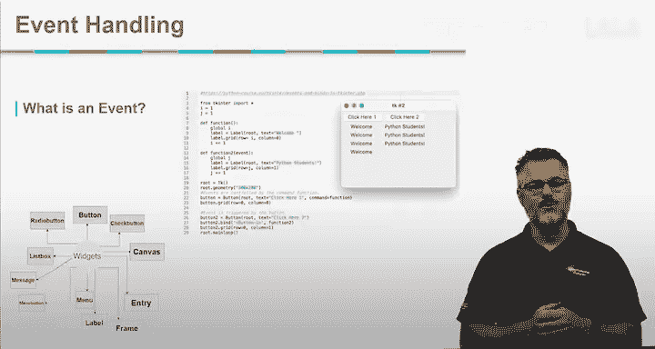

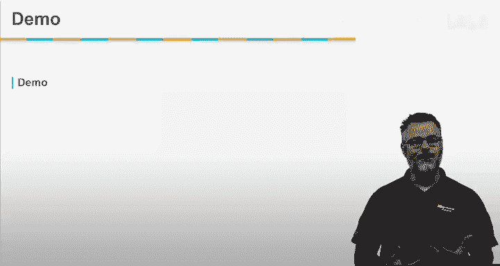

本节课中我们一起学习了 Python 中的事件处理机制。我们了解到，事件处理是 GUI 编程的核心，它让程序能够响应用户的输入，如鼠标点击和键盘操作。我们通过一个示例程序，对比了使用 `command` 参数和 `bind` 方法来绑定事件的不同方式。理解事件处理是创建交互式应用程序的关键一步。