# 53：Python 事件处理功能演示 🎮

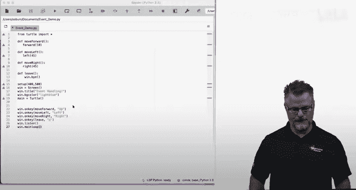

在本节课中，我们将学习如何使用 Python 的 `Turtle` 图形库，通过键盘事件来控制屏幕上的光标移动和绘图。我们将创建一个简单的应用程序，通过按下键盘上的特定按键（如上、左、右、Q）来触发不同的动作。

---

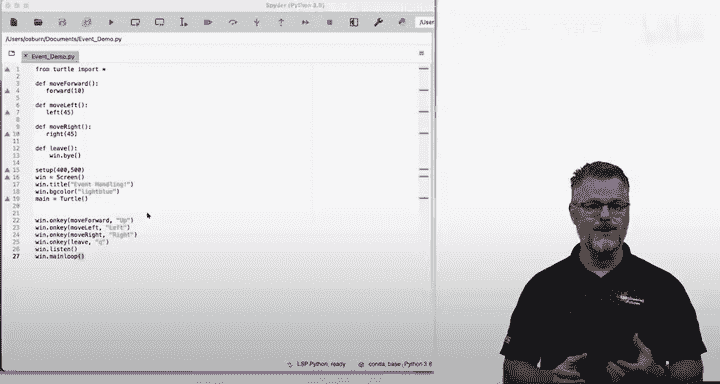

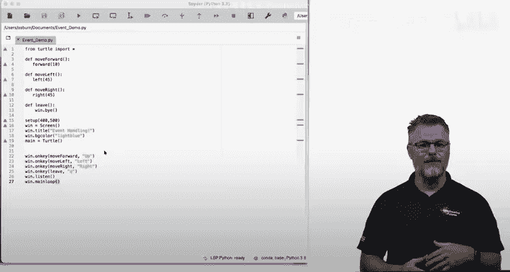

## 概述与目标 🎯

本节课的目标是演示如何为应用程序绑定键盘事件，并让这些事件触发我们定义的功能。我们将使用 `Turtle` 库创建一个绘图窗口，并通过键盘按键控制一个“光标”（即海龟）的移动和退出程序。

上一节我们介绍了事件处理的基本概念，本节中我们来看看如何用代码具体实现键盘事件响应。

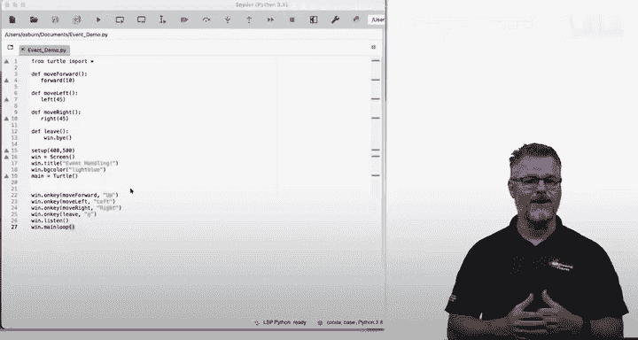

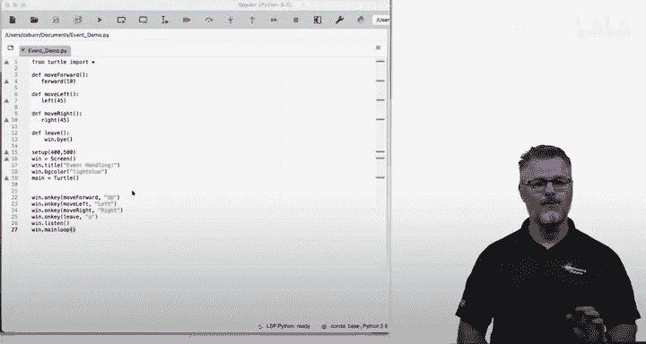

---

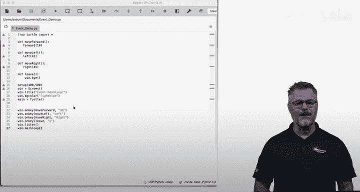

## 设置绘图窗口 🖼️

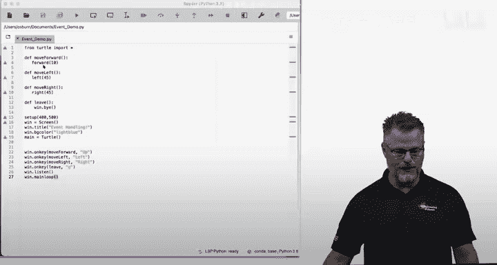

首先，我们需要初始化 `Turtle` 环境并设置绘图窗口。以下是设置窗口的代码：

```python
import turtle

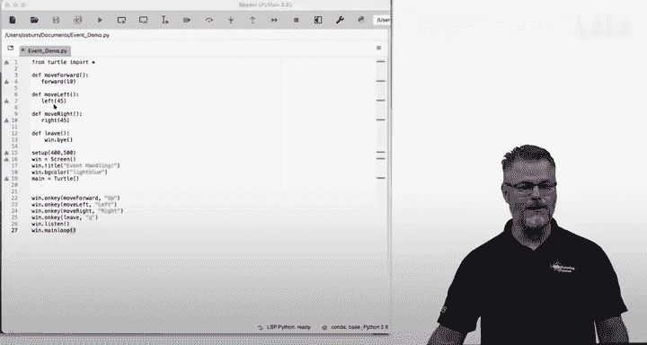

# 设置窗口大小和标题
window = turtle.Screen()
window.setup(width=400, height=500)
window.title("事件处理")
window.bgcolor("light blue")
```

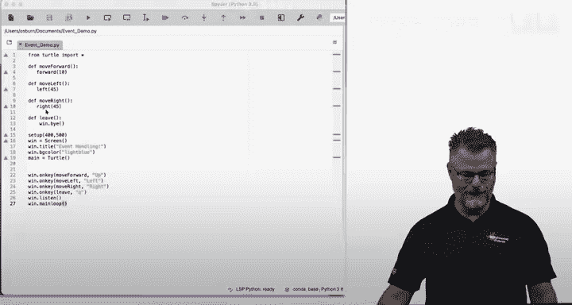

这段代码创建了一个宽400像素、高500像素的窗口，标题为“事件处理”，并将背景色设置为浅蓝色。

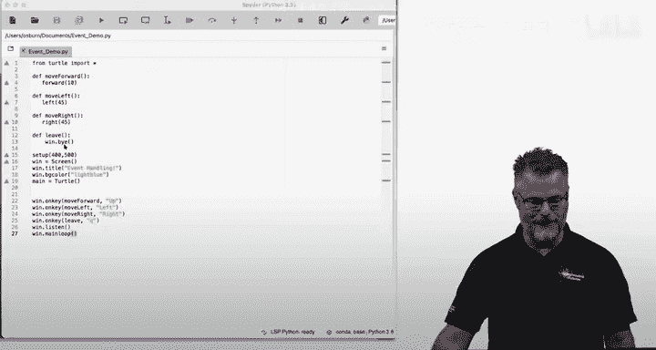

---

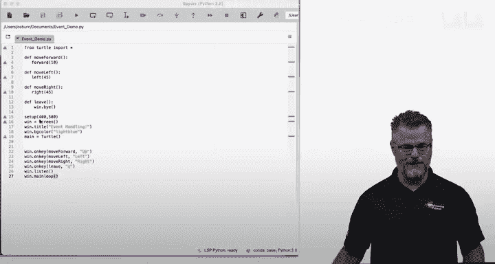

## 定义键盘事件处理函数 ⌨️

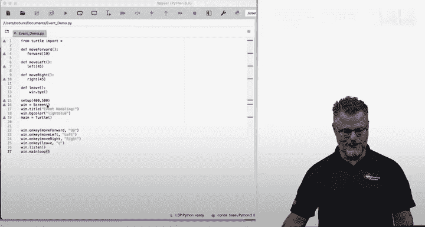

接下来，我们需要定义当按下特定按键时应执行的动作。我们将为“上”、“左”、“右”和“Q”键分别绑定函数。

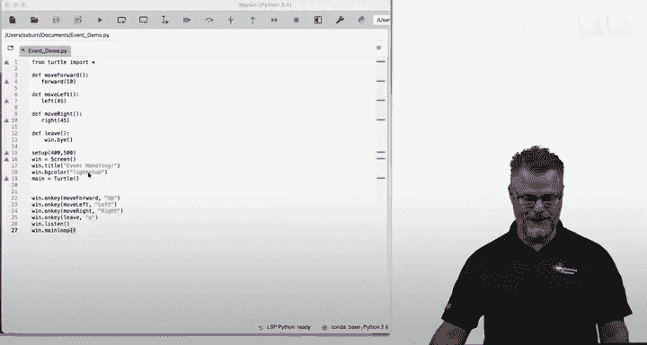

以下是定义这些函数的代码：

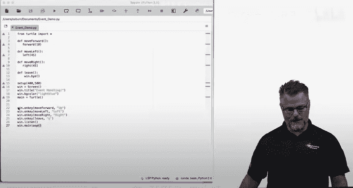

```python
# 创建海龟对象
cursor = turtle.Turtle()

def move_forward():
    """按下‘上’键时，海龟向前移动10个单位"""
    cursor.forward(10)

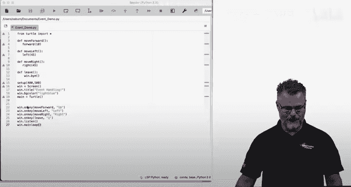

def turn_left():
    """按下‘左’键时，海龟左转45度"""
    cursor.left(45)

def turn_right():
    """按下‘右’键时，海龟右转45度"""
    cursor.right(45)

def quit_program():
    """按下‘Q’键时，退出程序"""
    window.bye()
```

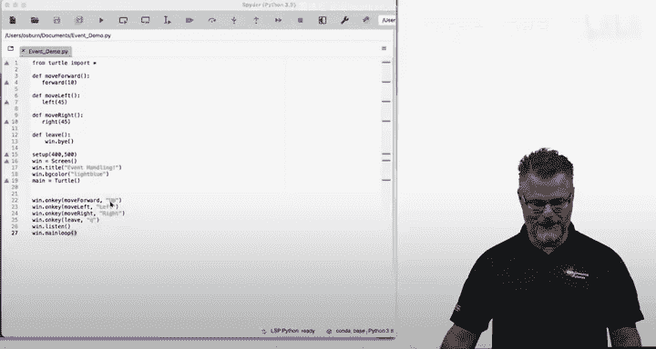

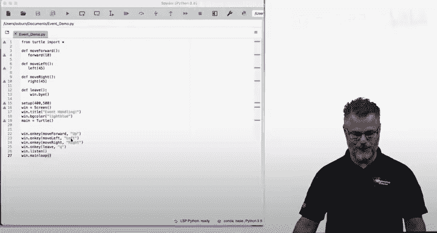

---

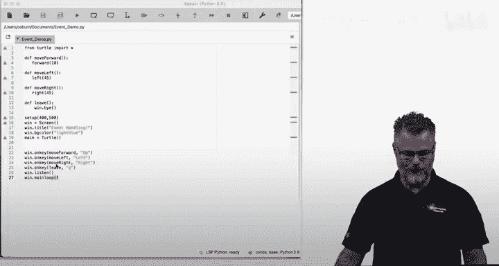

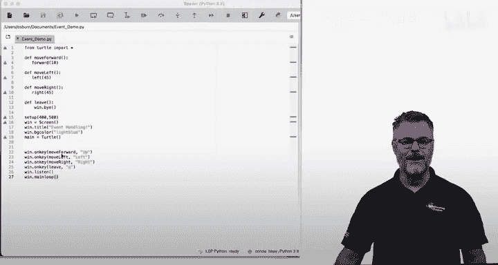

## 绑定事件与监听 🎧

定义了函数后，我们需要将这些函数与具体的键盘按键绑定，并启动事件监听。

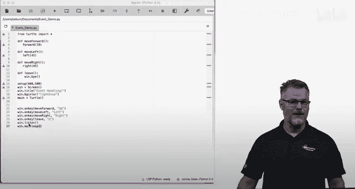

以下是绑定事件并启动监听的代码：

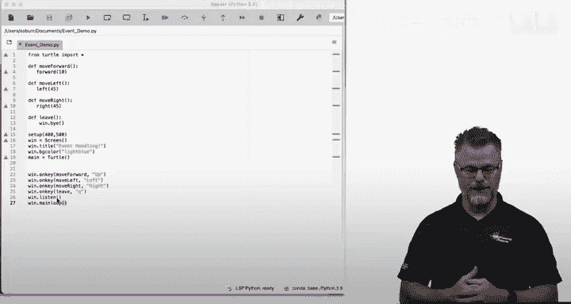

```python
# 将按键与函数绑定
window.onkeypress(move_forward, "Up")
window.onkeypress(turn_left, "Left")
window.onkeypress(turn_right, "Right")
window.onkeypress(quit_program, "q")

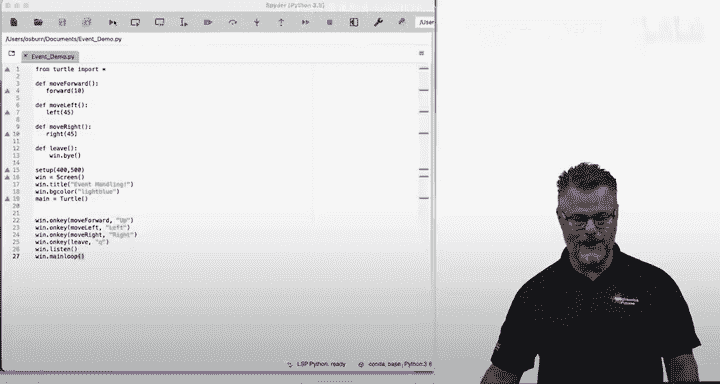

# 启动监听，这是关键步骤
window.listen()
```

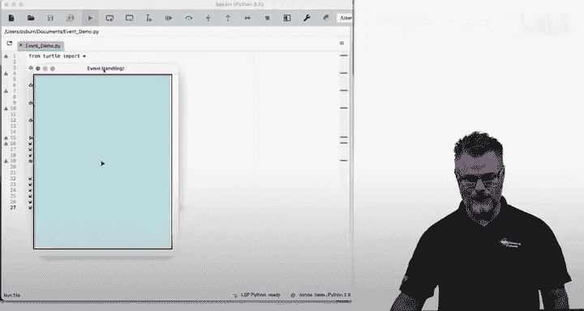

**核心概念**：`window.listen()` 方法至关重要。没有它，程序将无法检测到任何键盘输入。

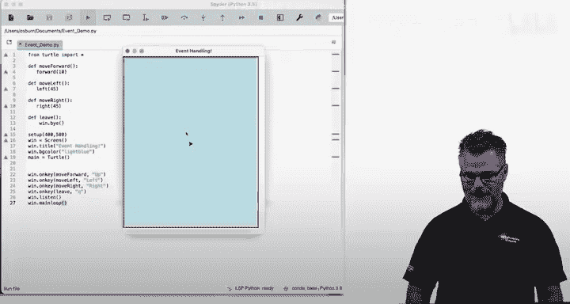

---

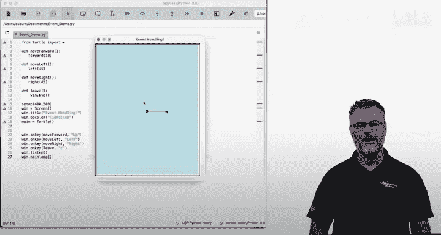

## 运行与演示 🚀

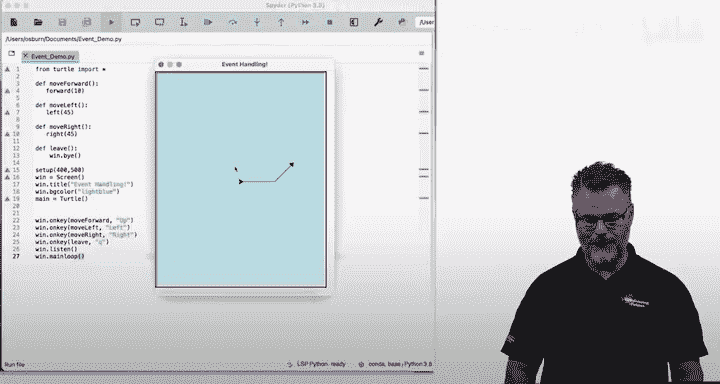

完成代码编写后，运行程序。你将看到一个浅蓝色的窗口，中间有一个箭头形状的海龟。

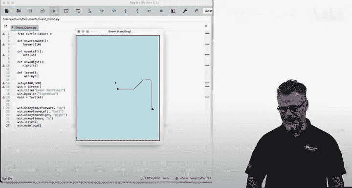

以下是操作演示：

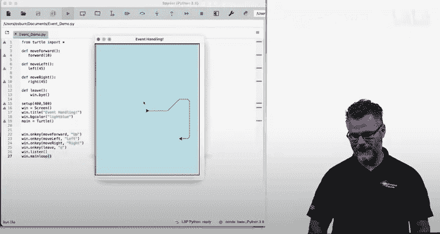

*   按下 **上箭头键**：海龟向前移动，画出一条直线。
*   按下 **左箭头键**：海龟向左旋转45度。
*   按下 **右箭头键**：海龟向右旋转45度。
*   按下 **Q 键**：程序退出。

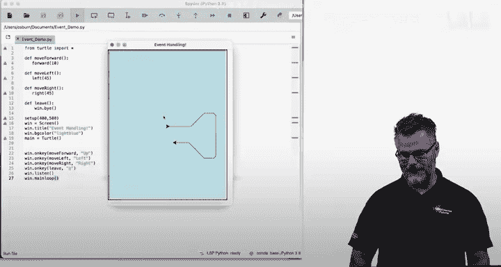

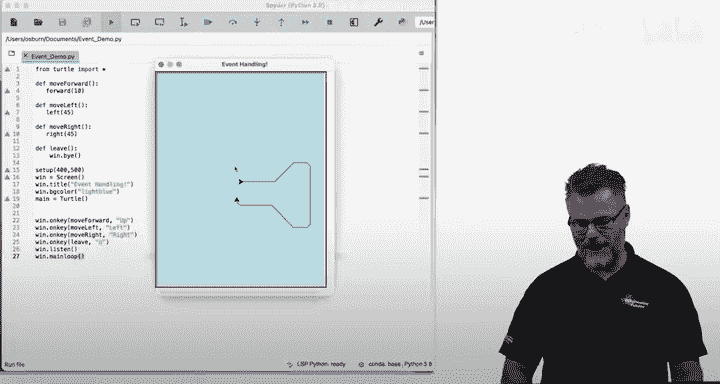

通过组合使用这些按键，你可以控制海龟在屏幕上绘制出各种图形。例如，按几次“上”键画线，然后按“左”或“右”键改变方向，再继续画线，最终可以绘制出简单的图形。

---

## 总结 📝

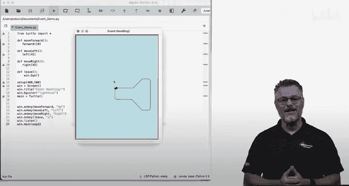

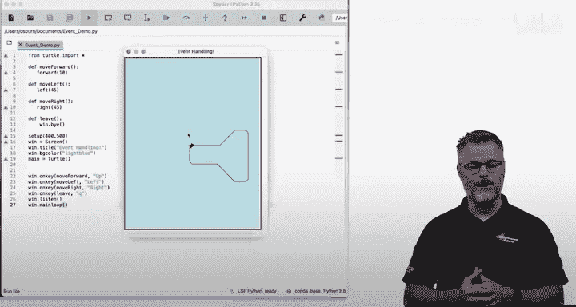

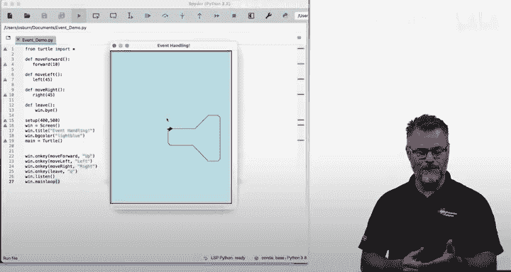

本节课中我们一起学习了如何使用 Python `Turtle` 库实现键盘事件处理。我们掌握了以下关键步骤：

1.  **设置环境**：创建并配置 `Turtle` 绘图窗口。
2.  **定义动作**：编写响应特定事件的函数（移动、转向、退出）。
3.  **事件绑定**：使用 `onkeypress()` 方法将按键与函数关联。
4.  **启动监听**：调用 `listen()` 方法使程序开始接收键盘输入。

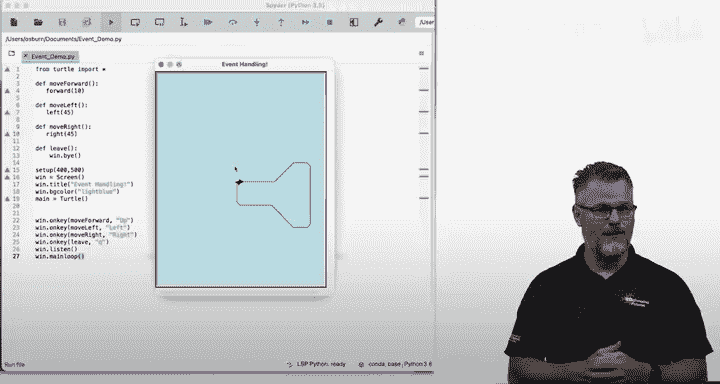

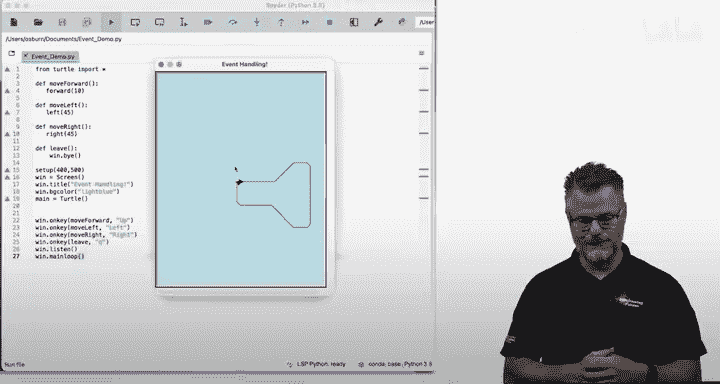

通过这个演示，你看到了如何通过外部输入（键盘事件）来动态控制程序的行为，这是创建交互式应用的基础。希望本节课对你理解事件驱动编程有所帮助。我们下节课再见！