# 54：第15课 课程总结 🐍

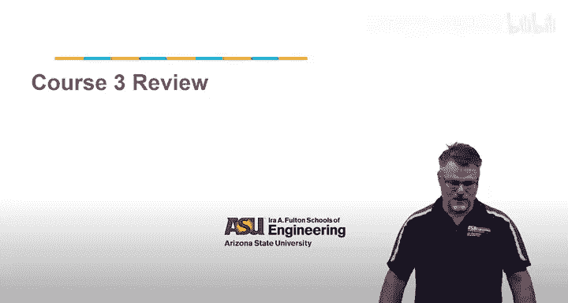

在本节课中，我们将回顾并总结本模块所涵盖的核心内容，包括面向对象编程的基础概念以及图形用户界面的初步应用。

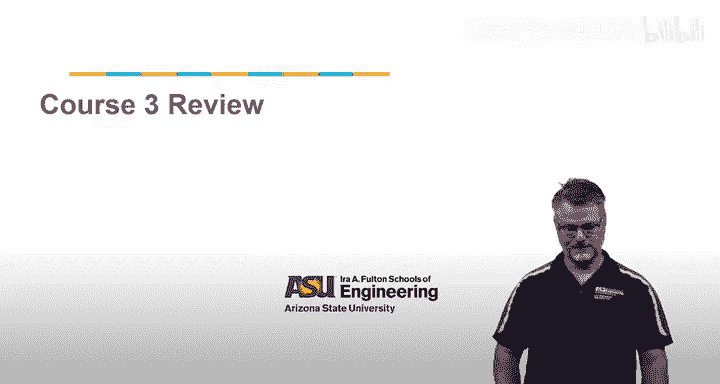

上一节我们介绍了面向对象编程和GUI设计的具体实践，本节中我们来看看本模块的整体回顾。

## 📚 面向对象编程基础回顾

我们探讨了面向对象编程的基础知识。

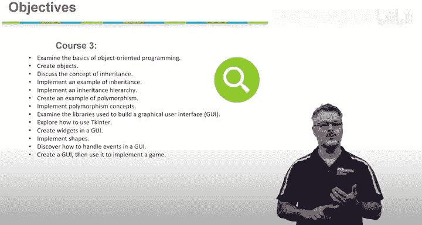

以下是本部分涵盖的核心概念：

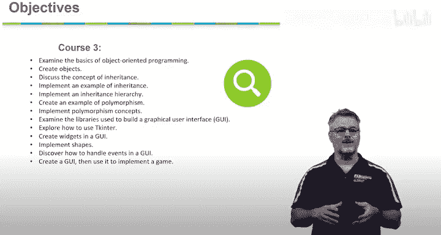

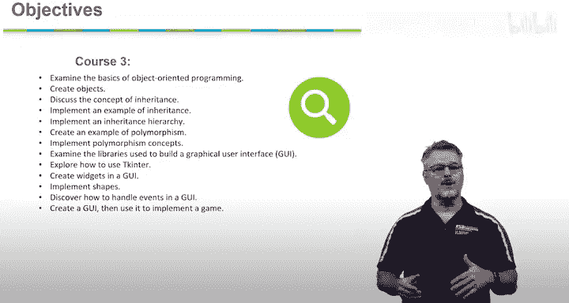

*   **创建对象**：学习了如何定义一个类并使用它来创建对象实例。核心代码是 `class MyClass:` 和 `obj = MyClass()`。
*   **继承概念**：讨论了继承的概念，它允许一个类（子类）获取另一个类（父类）的属性和方法。
*   **继承的应用**：演示了如何在类层次结构中使用和利用继承，以实现代码的复用和扩展。
*   **多态性**：讲解了多态性，并展示了如何在Python中应用多态，使不同类的对象对同一消息做出不同的响应。

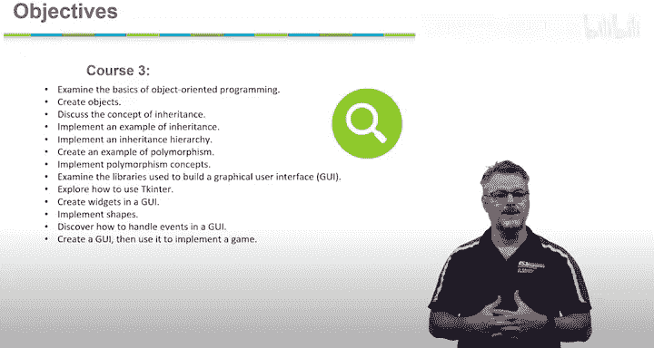

## 🖥️ 图形用户界面入门

我们也初步涉足了图形用户界面的使用。

以下是本部分的主要实践内容：

*   **使用Tkinter**：我们使用了一些简单的工具，例如Tkinter，它是Python的标准GUI工具包。
*   **使用GUI部件**：在GUI中使用了按钮、标签等其他部件。
*   **创建简单界面**：你得以创建一个非常简单的GUI界面。
*   **设计与创建游戏**：基于所学，你能够设计和创建属于自己的小游戏。

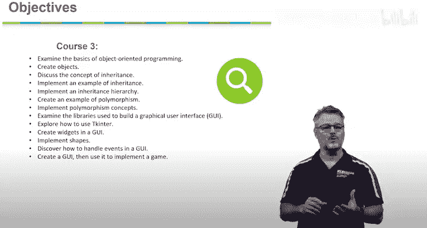

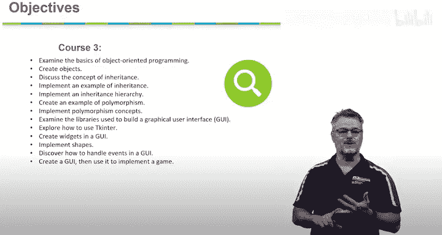

希望你能以此为基础，继续前进到下一个模块的学习。我们下个模块再见。

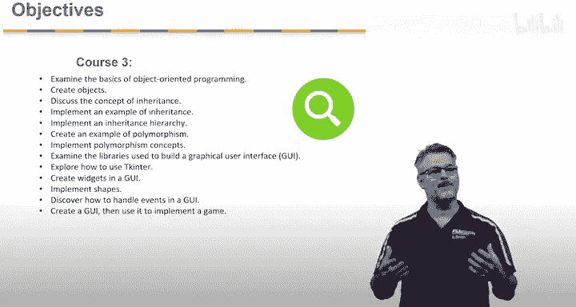

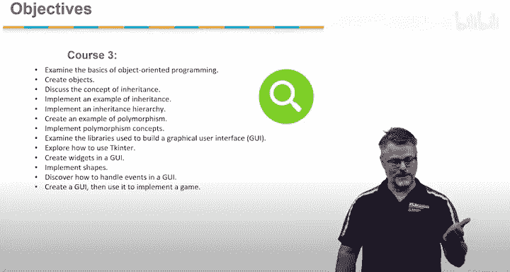

---

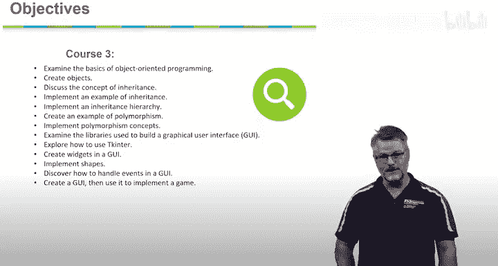

本节课中我们一起学习了面向对象编程的核心概念（类、对象、继承、多态）以及如何使用Tkinter库创建基础的图形用户界面。这些知识为构建更复杂、结构化的Python应用程序奠定了重要基础。