# 55：课程介绍：机器学习入门 🧠

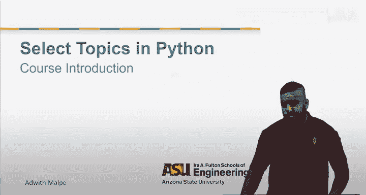

在本节课中，我们将学习一门关于机器学习入门的课程介绍。我们将了解课程的核心内容、学习目标以及将要涵盖的主要主题。

## 课程概述

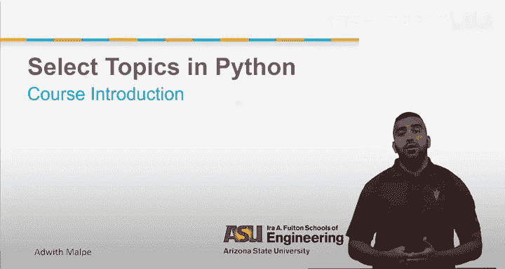

本节课将介绍一门机器学习入门课程。我们将了解你将在本课程中学到的内容。

## 今日议程

今天的议程将简要介绍你将在本课程中学到的几个主题。

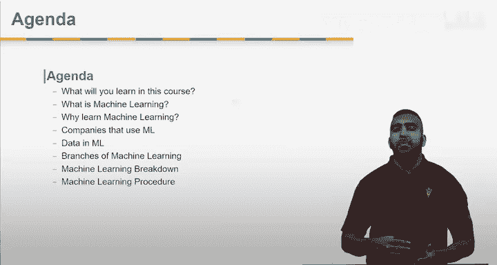

以下是本课程将涵盖的核心主题列表：

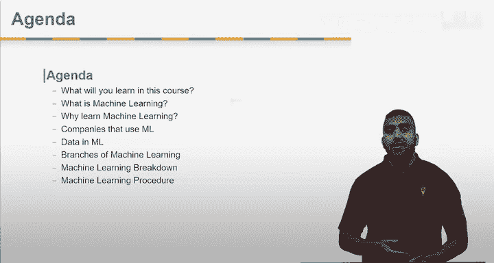

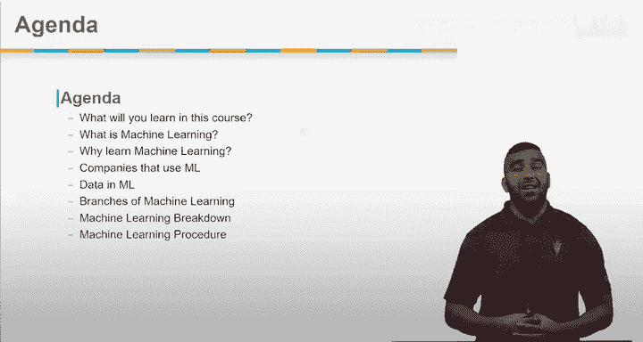

*   **什么是机器学习**
*   **为何学习机器学习**
*   **哪些公司使用机器学习**
*   **数据与机器学习**
*   **机器学习的几个分支**

## 你将学到什么？

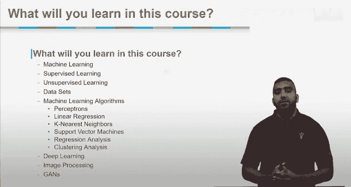

本课程的所有内容都与机器学习的研究相关。我们将学习如何用Python编写代码来实现相关概念。

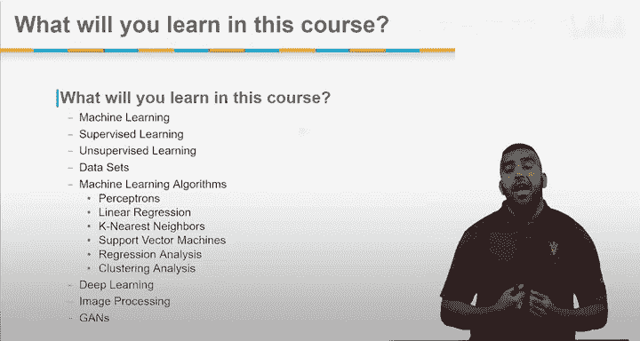

上一节我们列出了课程主题，本节中我们来看看具体的学习内容。

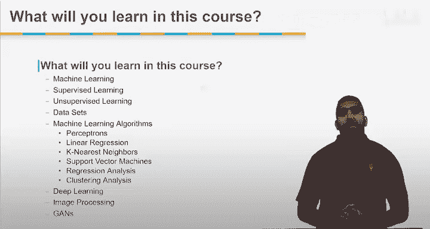

你将学习到机器学习背后的一些理论，以及这些机器学习分支是如何工作的。

以下是本课程将涉及的两个主要机器学习分支：

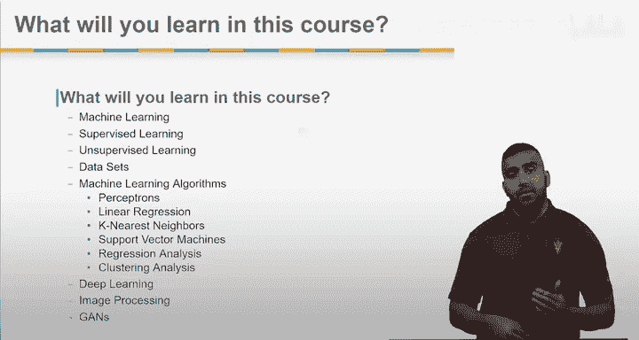

*   **监督式机器学习**
*   **非监督式机器学习**

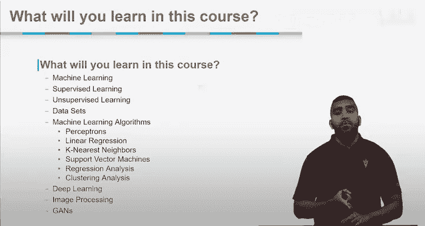

你还会学习如何使用Python处理数据，以及如何用Python加载数据集。

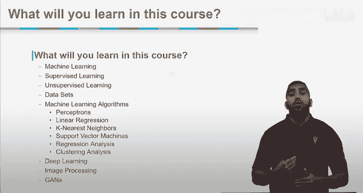

此外，你将学习如何在Python中实现特定的机器学习算法。

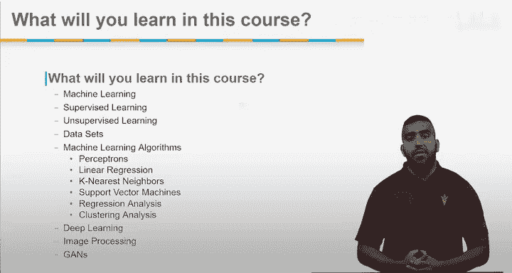

以下是本课程将涵盖的部分算法：

*   **感知器**
*   **线性回归**
*   **K近邻算法**
*   **支持向量机**
*   **回归分析**
*   **聚类分析**

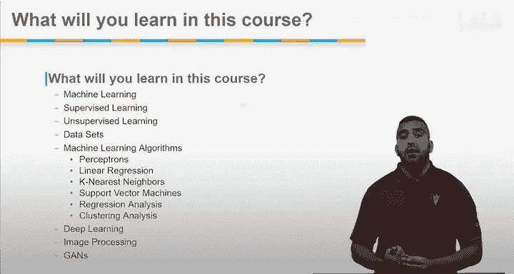

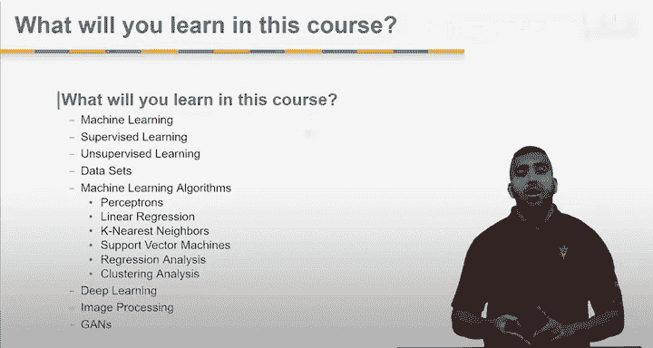

最后，我们将通过简要概述三个高级主题来结束本课程。

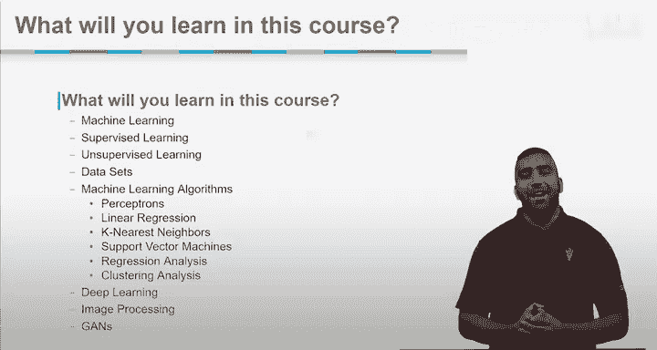

课程结尾将简要介绍的三个主题包括：

*   **深度学习**
*   **图像处理**
*   **生成对抗网络**

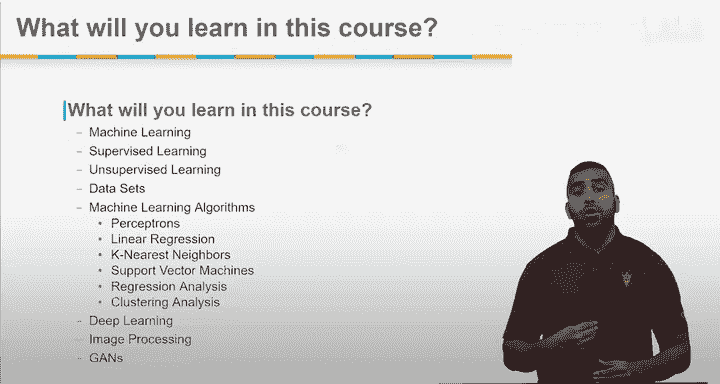

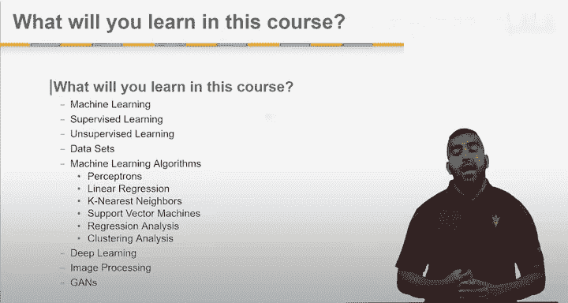

## 总结

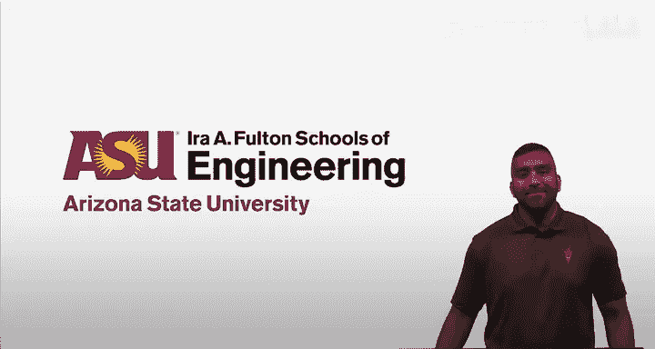

本节课中，我们一起学习了机器学习入门课程的介绍。我们了解了课程的学习目标、核心主题，包括机器学习的定义、应用、数据处理方法、主要分支（监督学习与非监督学习）以及将用Python实现的具体算法。课程最后还会对深度学习等高级主题进行概览。