# 56：机器学习概述 🤖

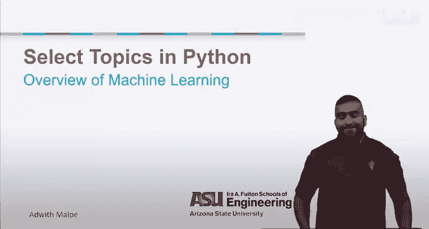

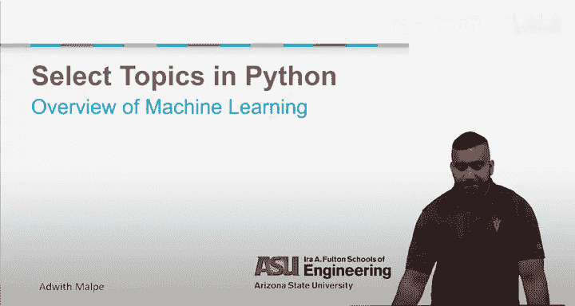

在本节课中，我们将学习机器学习的基本概念，包括其定义、重要性、应用领域、数据构成、主要分支以及实施步骤。

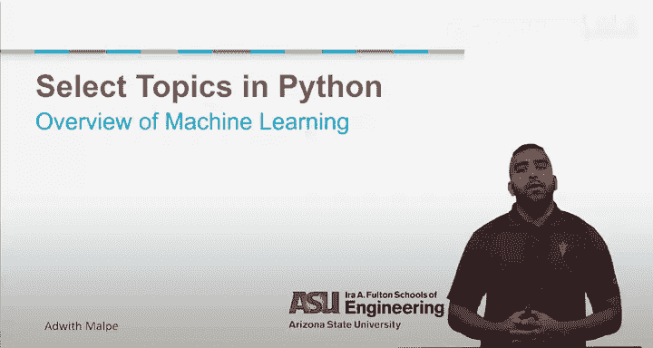

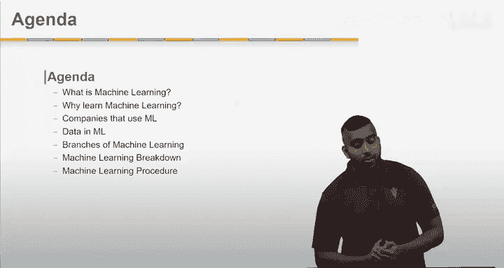

---

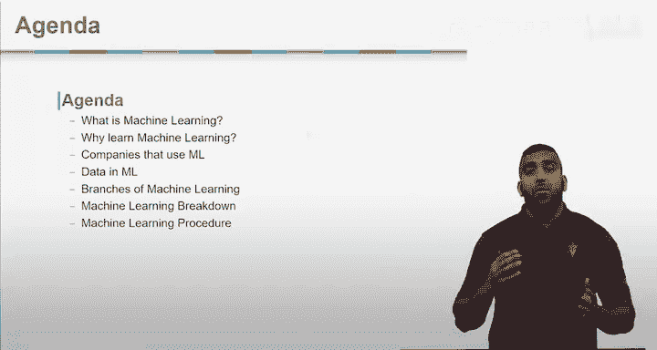

## 什么是机器学习？🤔

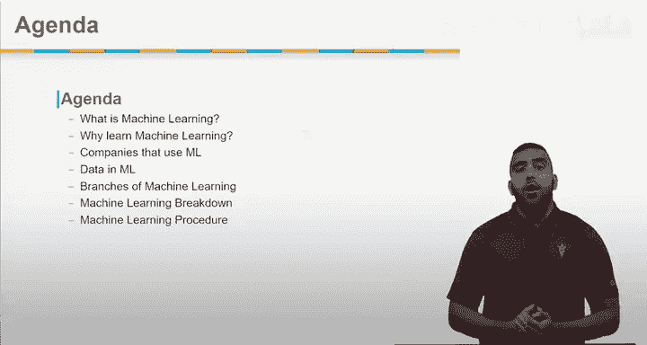

机器学习是数据科学的一个分支。它是一个研究领域，专注于创建用于决策的数学模型。

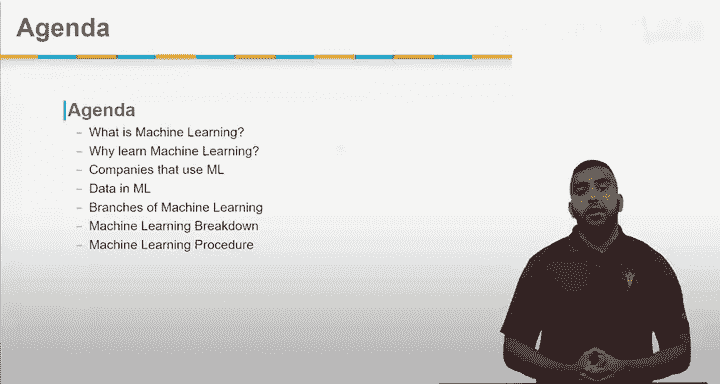

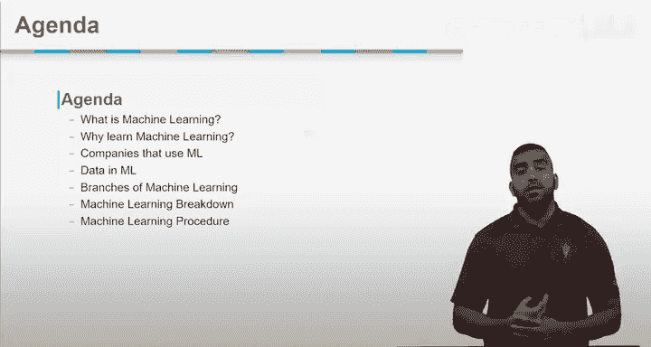

机器学习需要大量数据进行开发，并且计算成本高昂。它不同于人工智能，这一点需要牢记。

机器学习与人工智能的区别在于：机器学习基于训练进行决策；而人工智能旨在应对新情况并成功达成目标。

---

## 为何学习机器学习？🚀

机器学习是一个广泛应用的热门概念。它被用于推荐系统、异常检测、视频监控、社交媒体功能、在线客户支持、搜索引擎优化，甚至自动驾驶。在当今社会，机器学习几乎无处不在。

---

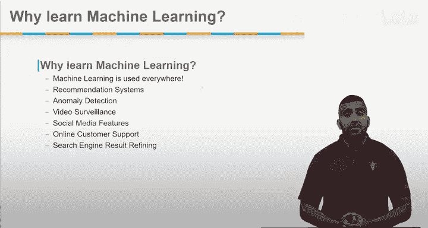

## 哪些公司使用机器学习？🏢

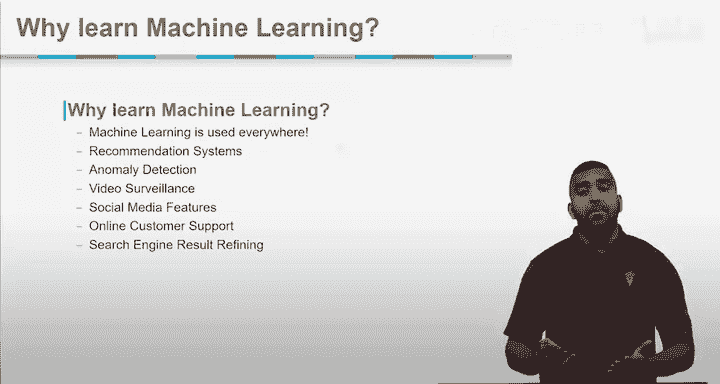

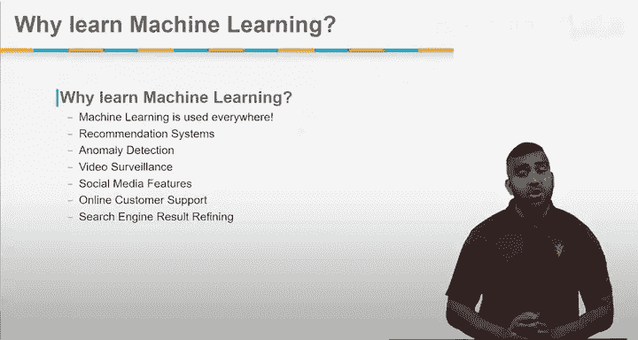

一些广泛使用机器学习的知名公司包括特斯拉、谷歌、Meta和亚马逊。例如，特斯拉的自动驾驶、谷歌、Meta和亚马逊开发的推荐系统都频繁应用机器学习。这是一个被广泛使用的强大概念，掌握它是一项非常有用的技能，对未来在这些公司工作大有裨益。

---

## 机器学习中的数据是什么？📊

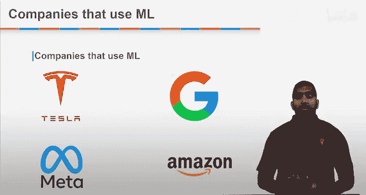

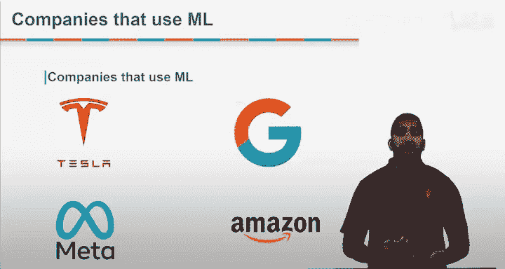

在机器学习中，数据被分解为几个术语。

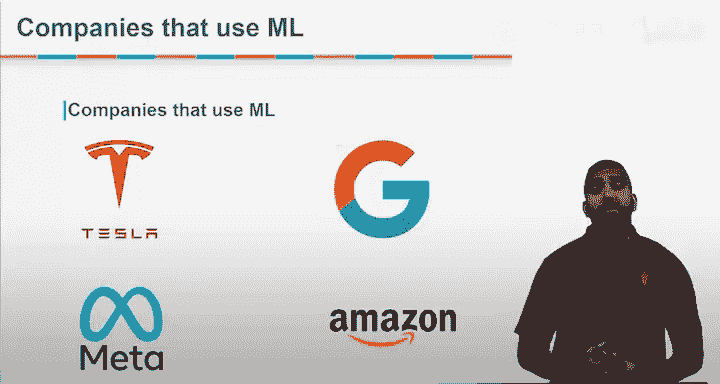

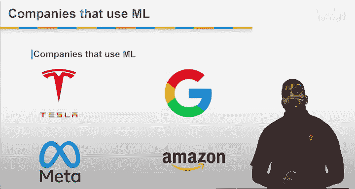

**样本** 是数据的单个项目。

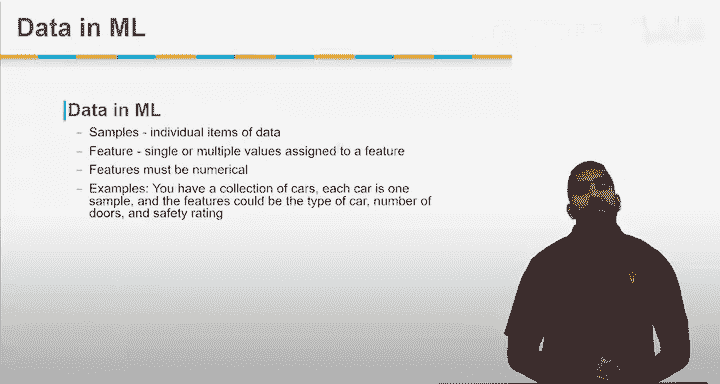

**特征** 是分配给一个属性的单个或多个值。特征通常描述样本的某个方面。例如，如果样本是一个人，其特征可以是眉毛形状、发型或肤色。特征必须是数值型的。

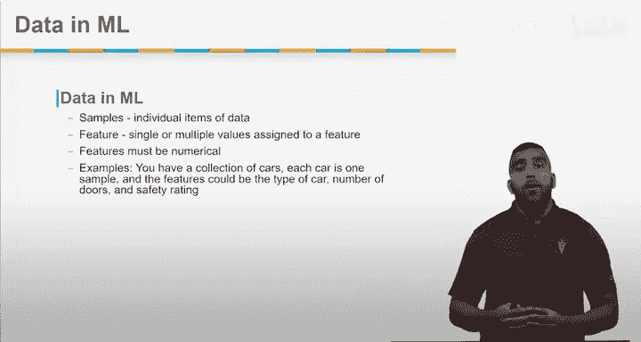

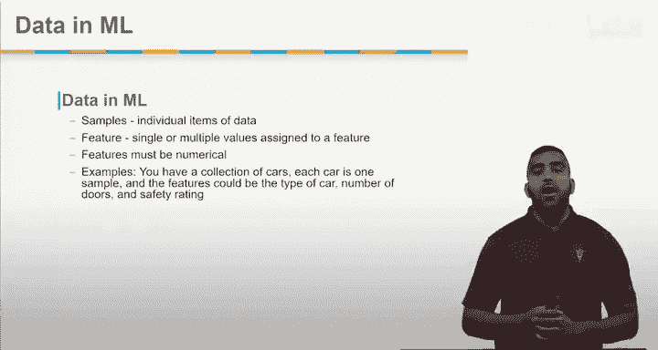

以下是另一个例子：假设你有一个汽车集合，每辆汽车是一个样本，其特征可以是车型、车门数量和安全评级。

---

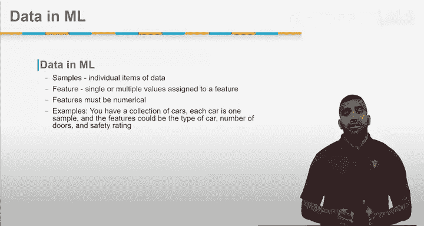

## 机器学习有哪些分支？🌳

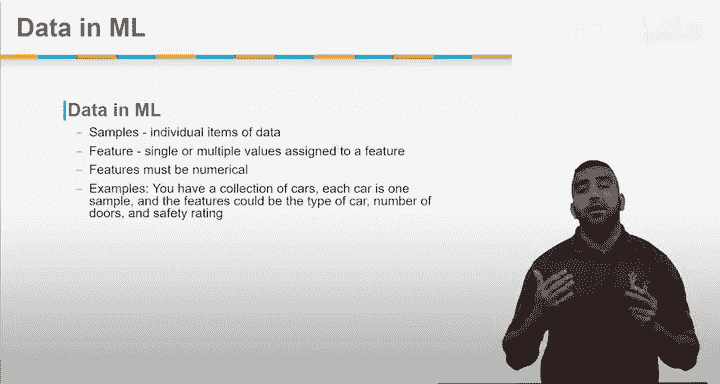

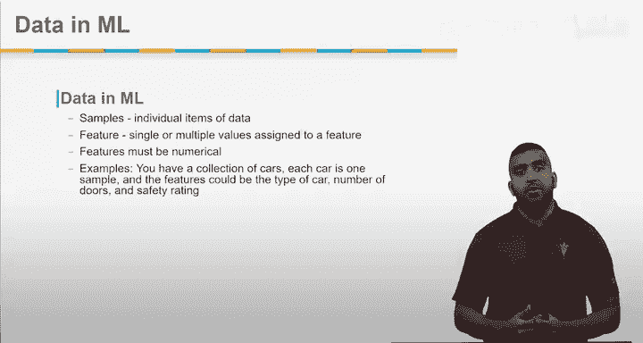

机器学习有三个主要分支：**监督学习**、**无监督学习** 和 **强化学习**。

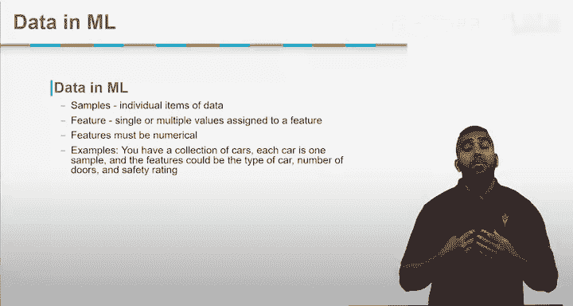

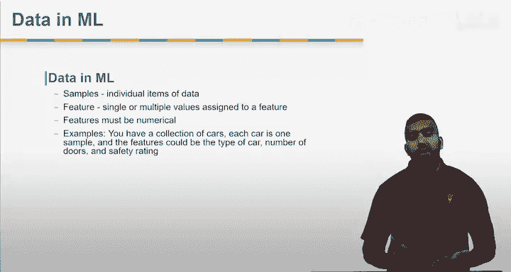

在本课程中，你将学习前两者：监督学习和无监督学习。强化学习是机器学习的另一个有趣分支，但需要更多时间学习，为简化起见，本课程将优先介绍监督学习和无监督学习。

---

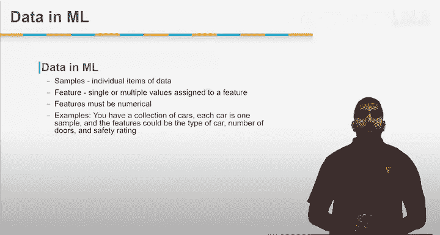

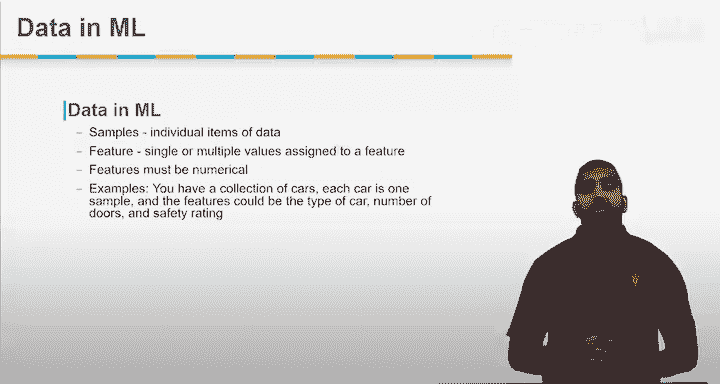

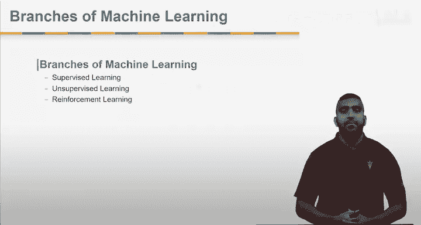

## 机器学习的工作原理 📈

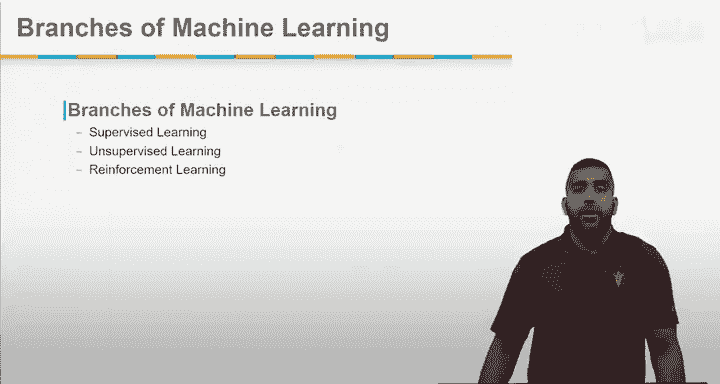

分类和回归是机器学习的两种类型。

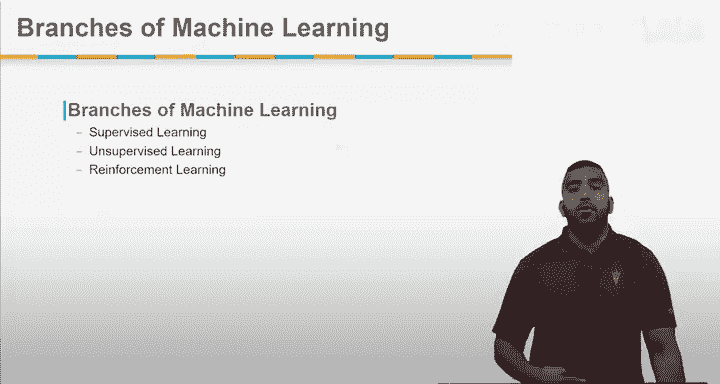

**分类** 将样本划分为不同的类别，这包括监督学习和无监督学习。

*   **监督学习** 存在“真实情况”，意味着我们拥有**带标签的数据**，即我们知道描述数据的特征及其含义。
*   **无监督学习** 不存在“真实情况”，意味着我们处理的是**无标签的数据**，没有描述数据类型的特征。无监督学习的处理方式与监督学习非常不同，你将在后续课程中学习到。

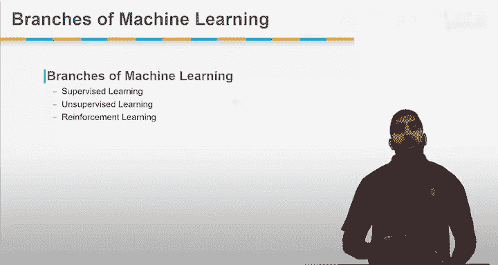

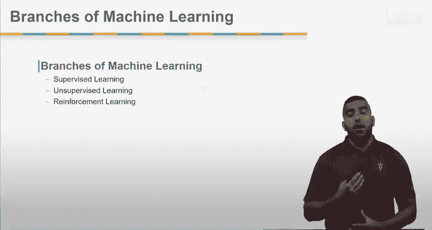

**回归** 则产生一个数值，使用连续值而非类别，这是在后续学习回归分析时需要记住的另一点。

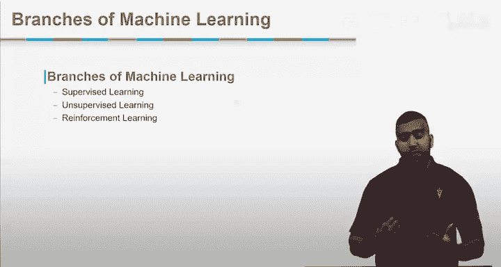

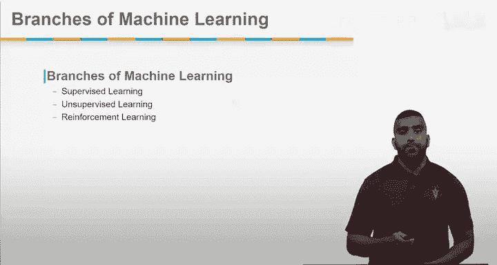

---

## 实施机器学习的步骤 🛠️

以下是实施机器学习的一般步骤概述。

第一步是从数据集中收集所有样本。你需要收集一个数据集。网上有许多著名的数据仓库，例如UCI机器学习仓库，那里有干净、预处理过的数据集可供使用。本课程将使用来自该站点的数据集。

收集完所有样本后，第二步是将样本分割为**训练集**和**测试集**。

第三步，如果需要，将特征**缩放**以适配训练集，并将同样的缩放应用于测试集。

第四步是执行**主成分分析**，这是一种优化模型、剔除冗余信息的方法。

第五步是使用训练集**训练**你的模型。

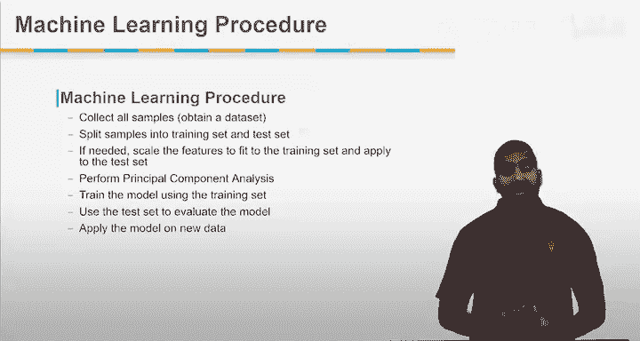

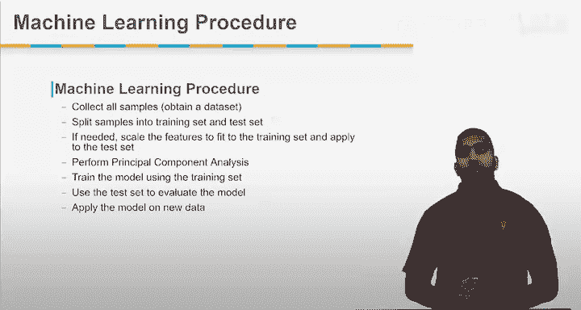

第六步是使用测试集**测试**你的模型。

最后，将模型应用于新数据，以评估模型的有效性。

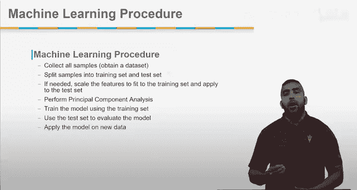

---

## 总结 📝

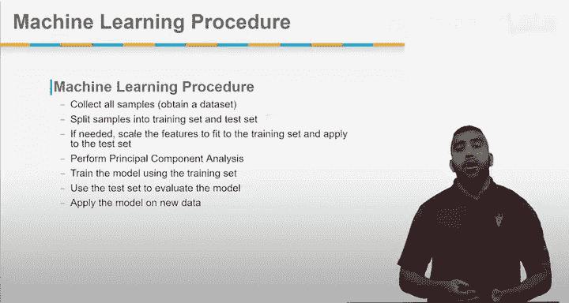

本节课我们一起学习了机器学习的基本概述。我们了解了机器学习的定义及其与人工智能的区别，探讨了学习机器学习的重要性及其在各行各业的应用。我们还学习了数据在机器学习中的构成（样本和特征），认识了机器学习的三个主要分支（监督学习、无监督学习和强化学习），并梳理了实施机器学习项目的一般步骤。