# 57：监督学习导论 🧠

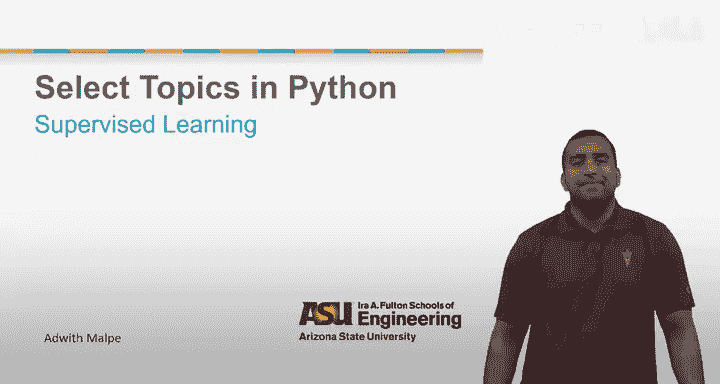

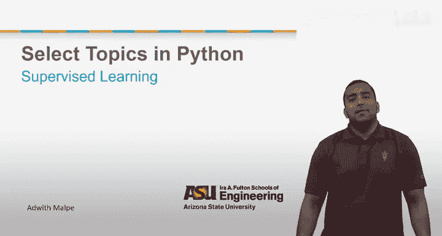

在本节课中，我们将学习监督学习的基本概念、流程、常用算法及其应用场景。

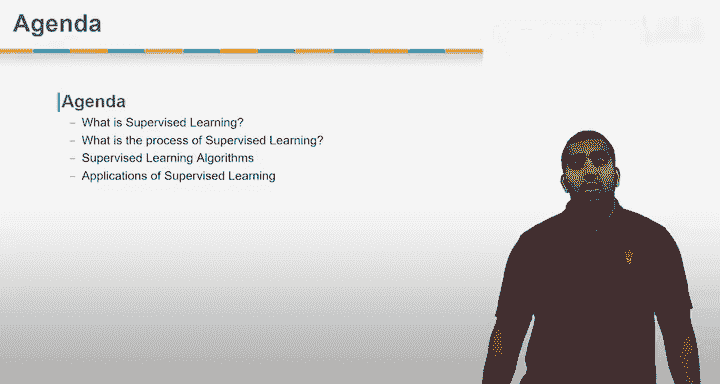

---

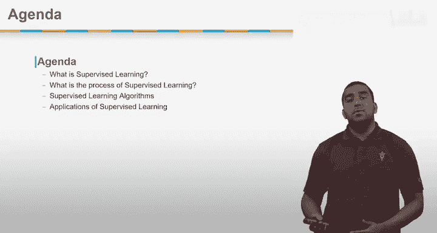

## 什么是监督学习？ 🤔

监督学习是机器学习的一个分支。它指的是一类使用已知结果的数据样本来构建预测模型的系统和算法，这些数据样本也被称为**带标签数据**。

监督学习的基本工作原理是：使用带标签的输入和输出数据来训练模型。输入数据包含描述性特征，输出数据则是已知的结果。训练完成后，模型可以利用这些数据来预测新的、未知的数据。这些已知的带标签数据也被称为**真实值**。

监督学习主要可以分为两类问题：
*   **分类问题**：输出变量是一个类别。
*   **回归问题**：输出变量是一个连续的真实数值。

---

## 监督学习的工作流程 🔄

上一节我们介绍了监督学习的定义和分类，本节中我们来看看一个典型的监督学习项目是如何进行的。

以下是监督学习的通用流程：

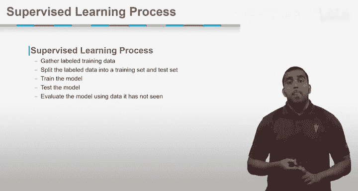

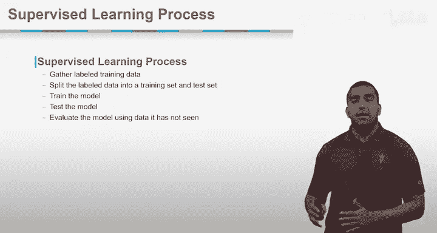

1.  **收集数据**：首先，收集所有带标签的训练数据。
2.  **划分数据集**：将带标签的数据划分为**训练集**和**测试集**。
3.  **训练模型**：使用训练集来训练模型，使其理解数据模式并能够做出准确预测。
4.  **测试模型**：将训练好的模型应用于测试集，这个过程称为模型测试。这可以评估模型在面对从未见过的数据时的表现。
5.  **评估模型**：使用模型未见过的数据（测试集）来评估其性能。通常会使用一些指标，例如**准确率**，来衡量模型在新数据上的预测准确度。

---

## 常见的监督学习算法 📊

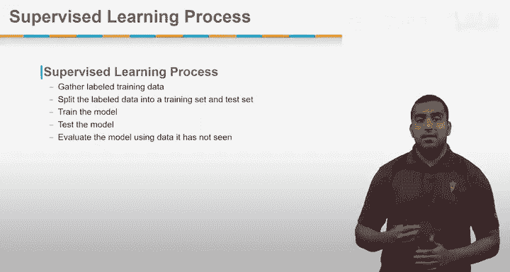

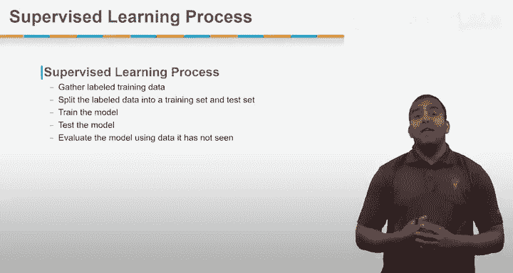

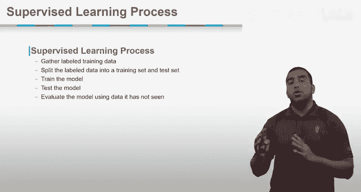

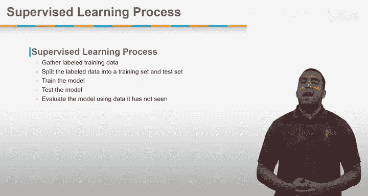

了解了监督学习的流程后，我们来看看一些核心的算法。以下是本课程中将学习到的主要监督学习算法：

*   **感知机**
*   **逻辑回归**
*   **支持向量机**
*   **决策树**
*   **K最近邻算法**

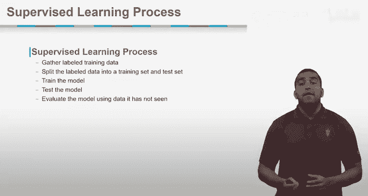

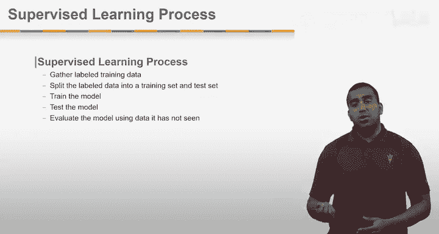

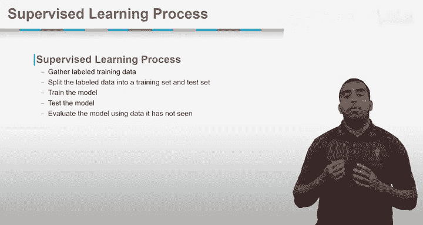

我们不仅会学习这些算法的工作原理，还会学习如何用代码实现它们，从而构建我们自己的监督学习模型，并将其应用于新的数据。

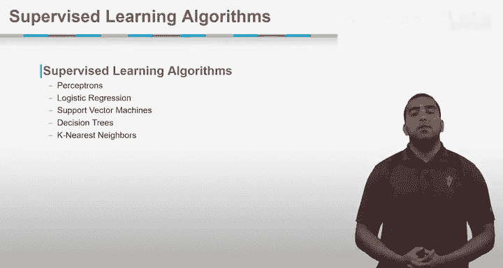

---

## 监督学习的应用实例 🌍

监督学习算法在现实世界中有广泛的应用。以下是一些具体的例子：

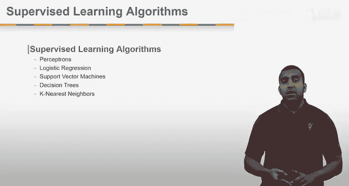

*   **自动驾驶汽车**（如谷歌汽车）
*   **网络搜索结果排序**
*   **市场价格预测模型**

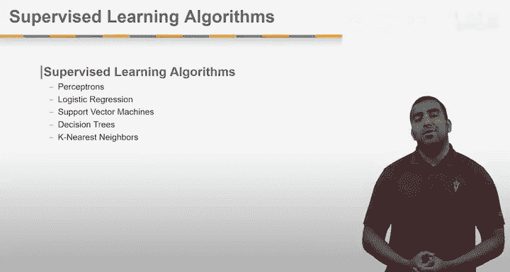

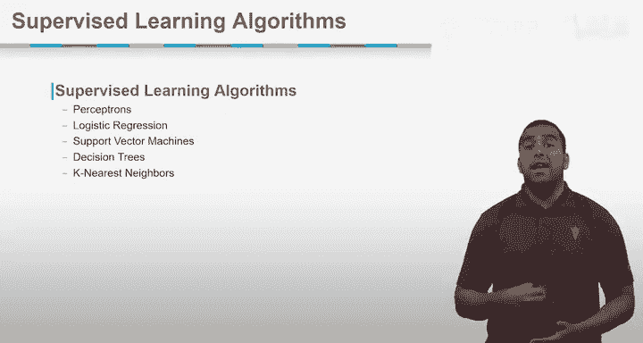

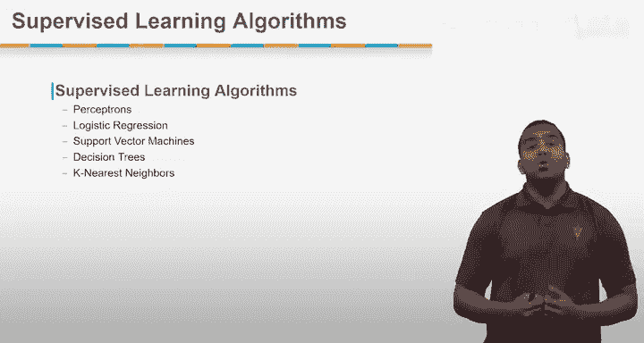

此外，监督学习的应用还可以按分类和回归进一步细分：

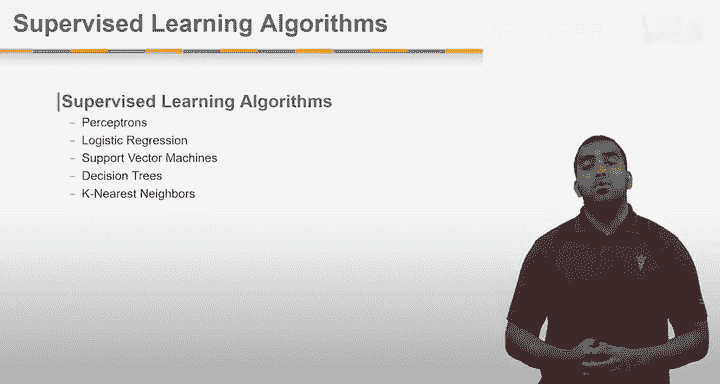

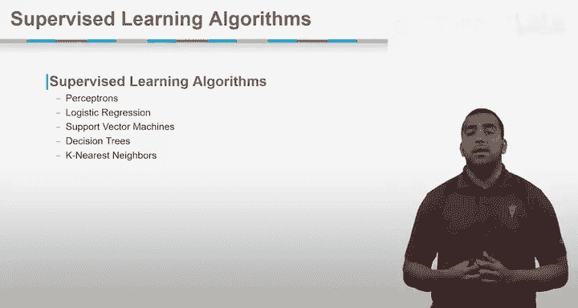

**分类应用示例：**
*   **医疗诊断**
*   **客户留存分析**
*   **图像分类**

**回归应用示例：**
*   **广告效果预测**
*   **流行度预测**
*   任何用于预测连续数值的项目

---

## 总结 📝

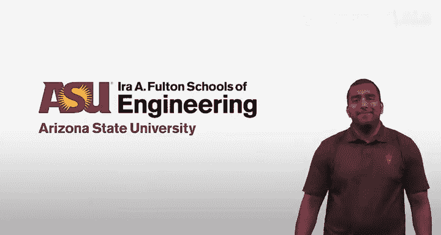

本节课中，我们一起学习了监督学习的基础知识。我们了解了监督学习是使用带标签数据构建预测模型的机器学习方法，它可以分为**分类**和**回归**两大类。我们梳理了从数据收集、划分、训练、测试到评估的标准工作流程，并列举了感知机、逻辑回归等核心算法。最后，我们看到了监督学习在自动驾驶、医疗诊断等多个领域的实际应用。