# 58：无监督学习导论 🧠

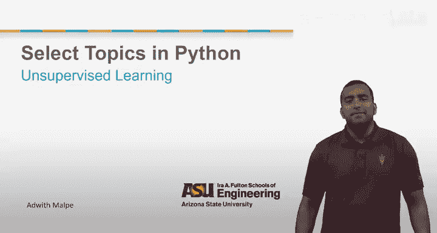

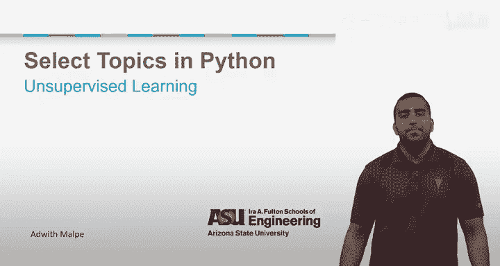

在本节课中，我们将学习机器学习的一个重要分支——无监督学习。我们将了解其定义、工作原理、核心算法以及实际应用。

## 什么是无监督学习？🤔

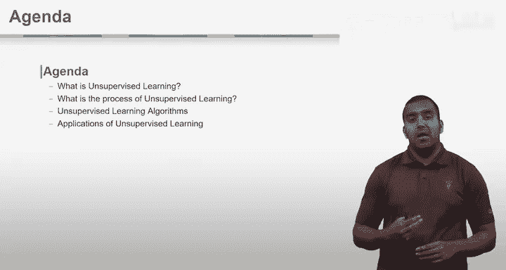

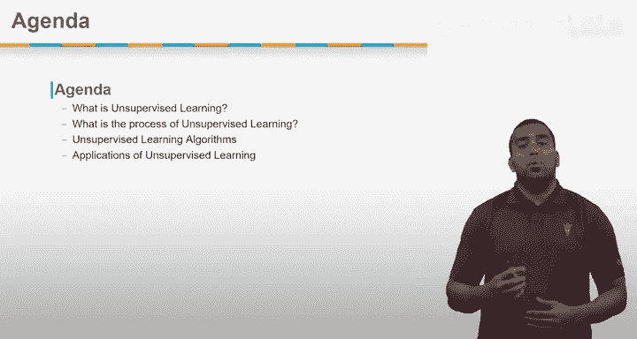

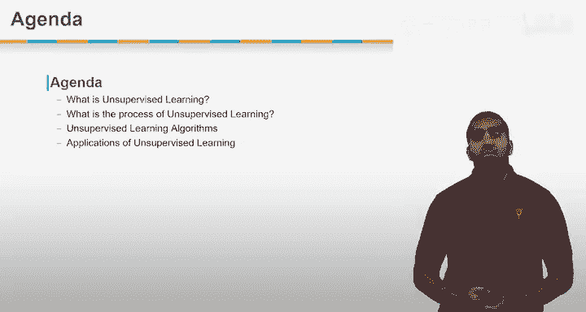

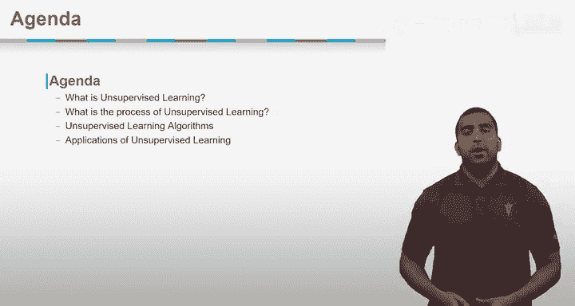

无监督学习是机器学习的另一个分支，它指的是一类**不使用任何带标签数据**或**没有已知真实结果**来创建预测模型的系统和算法。

本质上，我们向机器学习模型输入一堆**没有描述信息**的数据。数据本身没有说明它是什么。无监督机器学习模型的工作方式是，我们使用未标记的输入和输出数据来训练模型，然后将该模型应用于新数据以进行某些预测。

未知的真实结果和对大量样本的利用，帮助我们理解并尝试识别数据中的任何模式。我们希望查看数据中是否存在某些**聚类**，以便根据模式判断数据内部是否存在相似性。当我们将数据可视化并绘制在图表上时，这非常有用，可以看到某些数据是否在特定区域聚集，我们可以区分它们，并可能论证这些数据是相似的。

无监督机器学习的全部目的是确保存在一种模式，并在数据未被标记的情况下识别出这种模式。我们还可以确保分析和聚类未标记的数据集，这是我们的主要目标。

## 无监督机器学习的过程与原理 🔄

上一节我们介绍了无监督学习的定义，本节中我们来看看它的工作流程。其过程与监督机器学习非常相似，但我们使用的是**未标记数据**，即我们的数据没有描述数据是什么的特征。

以下是其核心步骤：

1.  **收集数据**：首先，收集所有没有任何特征或标签的训练数据。
2.  **划分数据集**：然后将未标记数据拆分为训练集和测试集。
3.  **训练模型**：在未标记数据上训练模型，确保其达到足够高的准确度，以便能够对未见过的数据进行测试。
4.  **测试与评估**：在未见过的数据上测试模型后，使用这些数据评估模型，并采用准确度等特定指标来衡量模型的性能和优化程度。

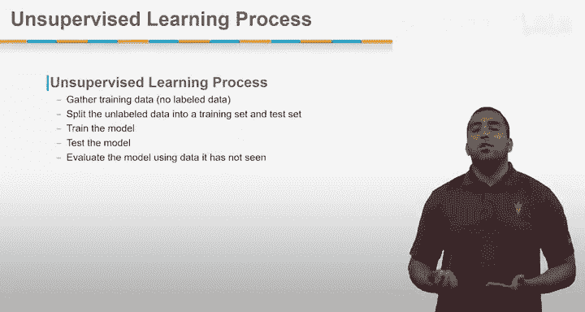

## 核心算法简介 ⚙️

了解了基本流程后，我们来看看本课程将涉及的一些无监督机器学习算法。这些算法是发现数据内在结构的关键工具。

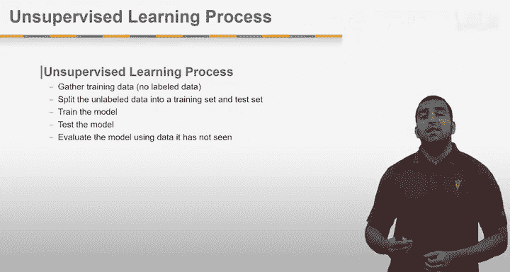

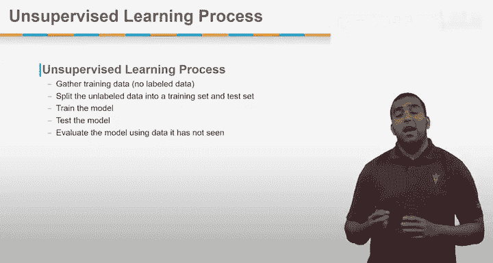

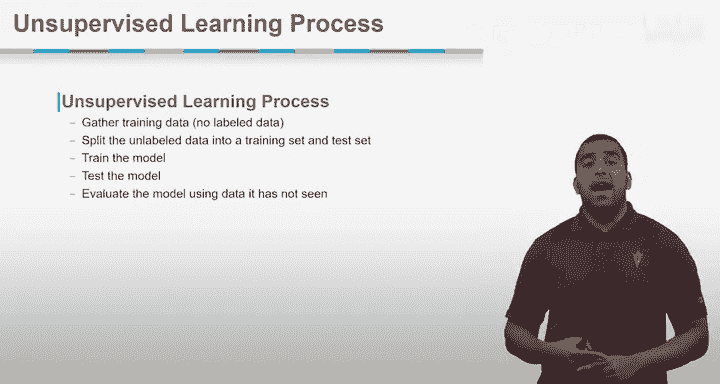

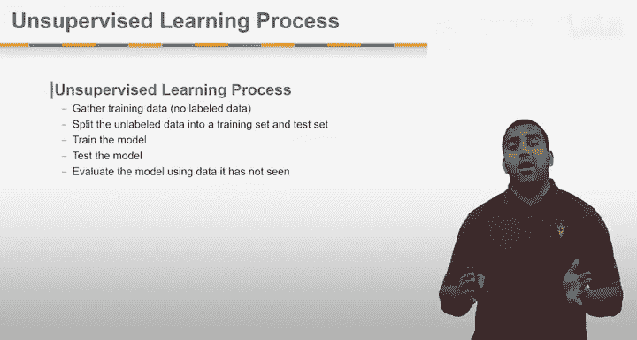

以下是本课程将涵盖的两种主要算法：

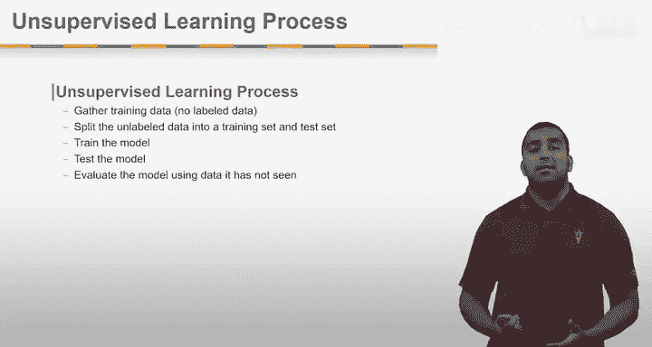

*   **K均值聚类**：一种将数据划分为K个簇的经典聚类算法。
*   **DBSCAN**：一种基于密度的聚类算法，能有效识别噪声点。

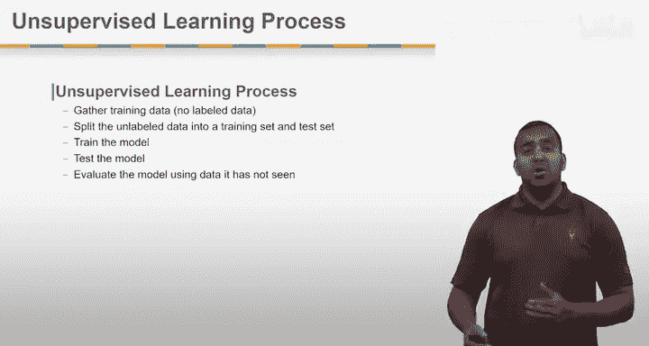

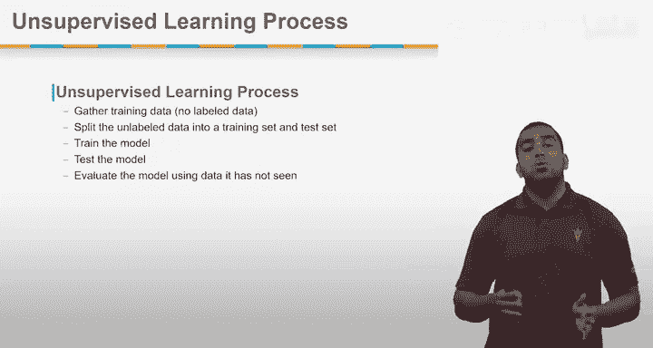

我们将在各自的课程中对它们进行更深入的讨论。

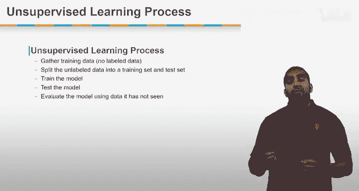

## 无监督学习的应用场景 🌍

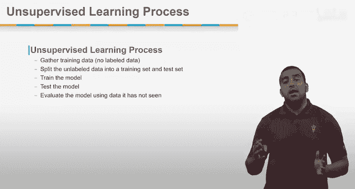

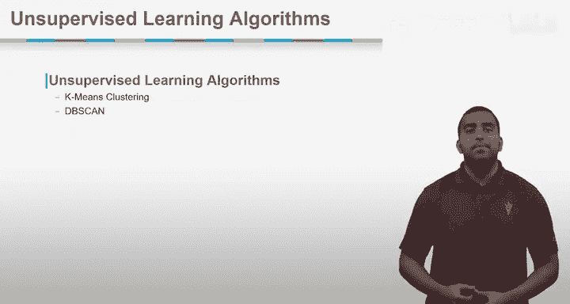

上一节我们介绍了核心算法，本节中我们来看看无监督学习在实际中的广泛应用。它为解决许多现实问题提供了强大工具。

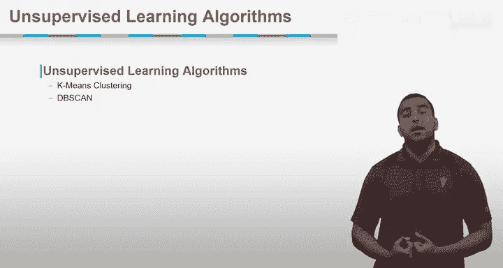

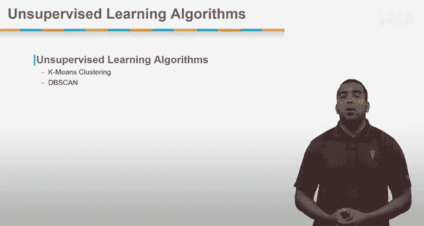

以下是一些应用无监督机器学习的例子：

*   **自动驾驶汽车**：用于环境感知和场景理解。
*   **欺诈检测**：识别异常交易模式。
*   **信用评分**：对客户进行风险分级。
*   **模式识别**：在图像、声音等数据中发现规律。
*   **推荐系统**：Netflix等平台频繁使用此技术。
*   **客户细分与营销**：分析人们如何使用某些社交媒体网站。
*   **大数据可视化与特征提取**：从海量数据中提炼关键信息。

## 总结 📝

本节课中，我们一起学习了无监督学习。我们明确了其作为机器学习分支，**不使用标签数据**的核心特点。我们梳理了从数据收集、划分、训练到评估的完整流程。我们简要介绍了**K均值聚类**和**DBSCAN**等关键算法。最后，我们探讨了其在自动驾驶、欺诈检测、推荐系统等多个领域的广泛应用。无监督学习是探索未知数据、发现内在模式的强大工具。