# 60：感知机原理 🧠

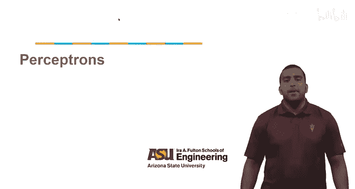

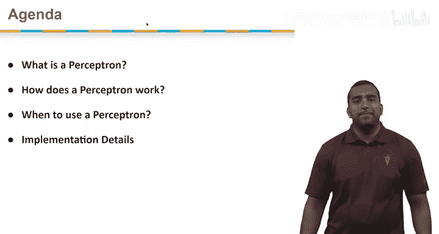

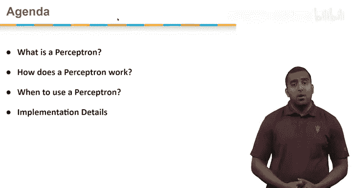

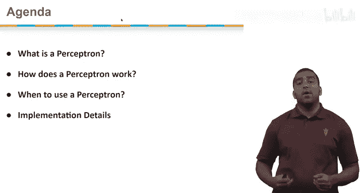

在本节课中，我们将学习感知机的基本概念、工作原理、适用场景，并通过一个实际演示来学习如何构建自己的感知机模型。

---

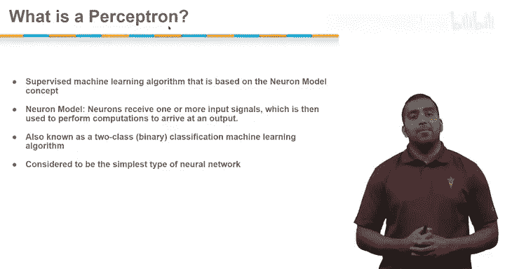

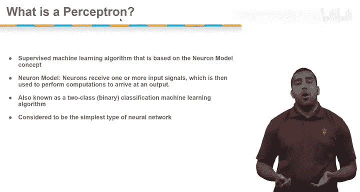

## 什么是感知机？

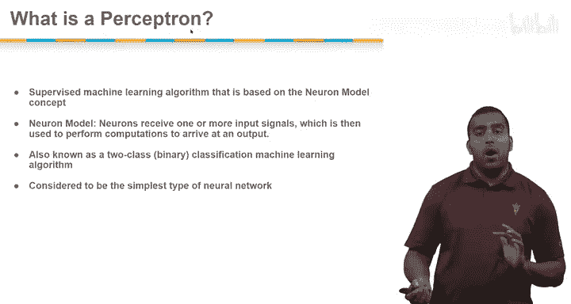

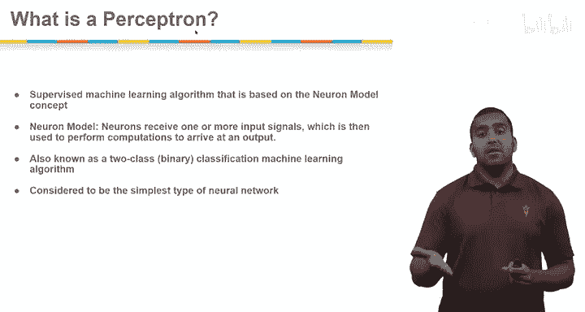

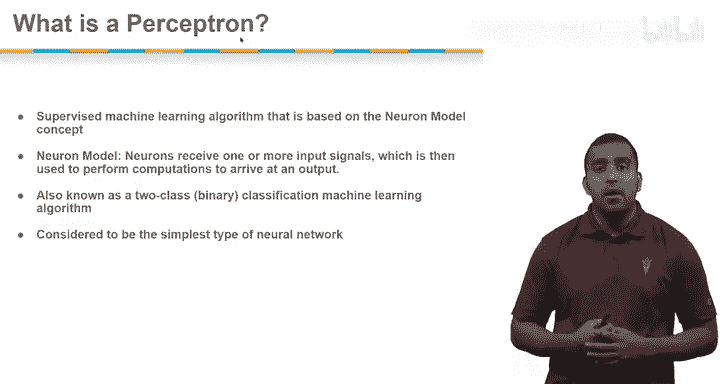

感知机是一种基于神经元模型的监督机器学习算法。在神经元模型中，神经元接收一个或多个输入信号（刺激），通过计算产生输出。例如，给婴儿看一张狗的图片（刺激），婴儿能识别并说出“这是一只狗”。

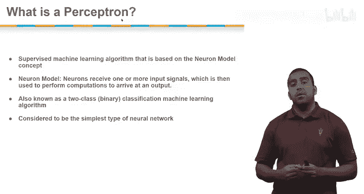

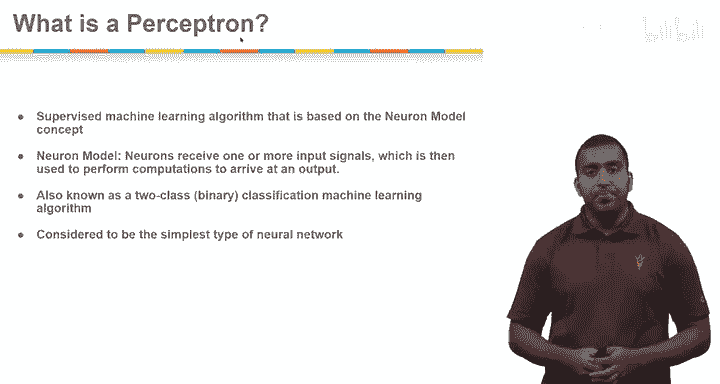

感知机也被称为**二分类机器学习算法**，这意味着它能将数据分为两类，例如+1或-1，狗或猫。它是神经网络中最简单的类型。

---

## 感知机如何工作？

上一节我们介绍了感知机的基本概念，本节中我们来看看它的具体工作原理。

感知机接收多个特征作为输入，特征数量存储在变量 **M** 中。每个特征乘以相应的权重，权重表示特征的重要性。所有乘积之和计算得到值 **Z**，Z 用于确定数据属于哪一类（如+1或-1）。

Z 被传递到一个函数中，该函数决定分类输出。初始时，结果可能不正确，误差函数会调整权重，并多次迭代算法，直到达到指定的迭代次数，从而优化权重值以改进预测。

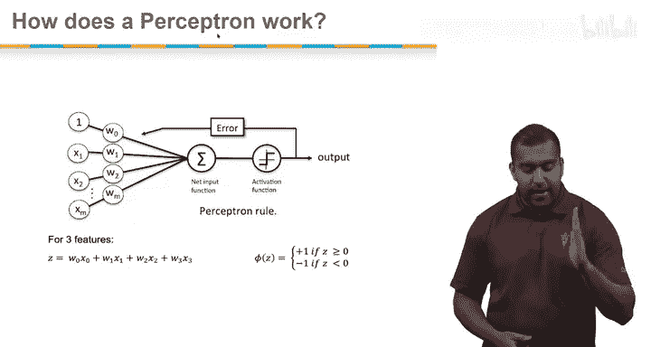

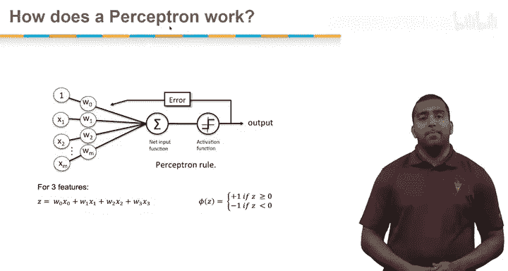

以下是感知机的工作流程：

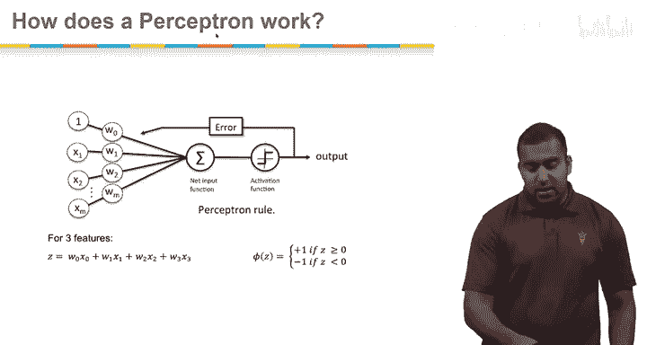

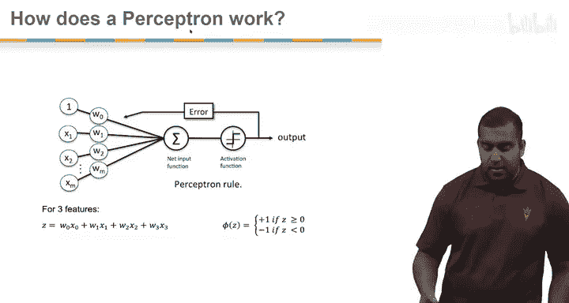

1.  输入特征列表（例如三个特征）。
2.  每个特征乘以相应的权重（W₀ 到 Wₘ）。
3.  计算乘积之和，得到 **Z**。
4.  Z 传递到激活函数，决定分类（+1 或 -1）。
5.  输出传递到误差函数，评估准确性。
6.  若不准确，误差函数调整权重，重复迭代。

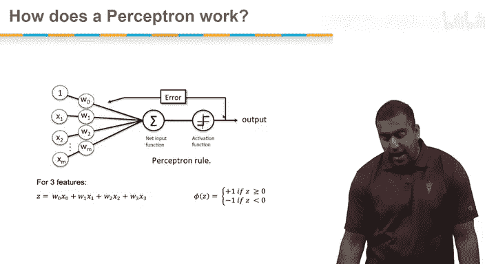

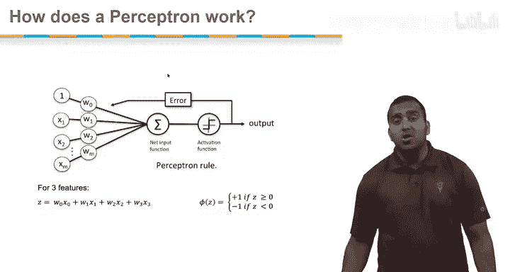

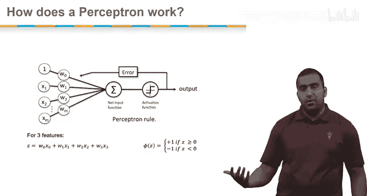

具体公式如下：

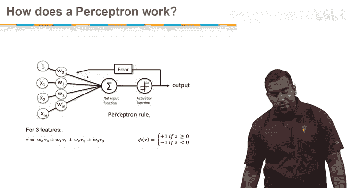

**Z = Σ (特征ᵢ × 权重ᵢ)**

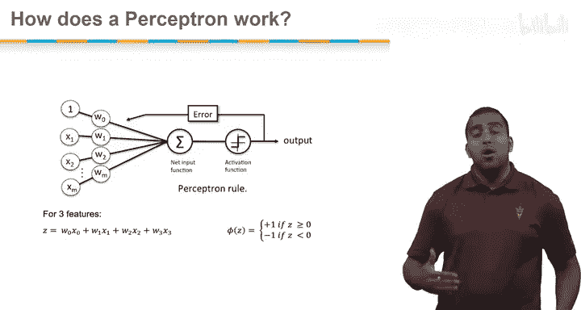

如果 **Z ≥ 0**，分类为 +1；如果 **Z < 0**，分类为 -1。

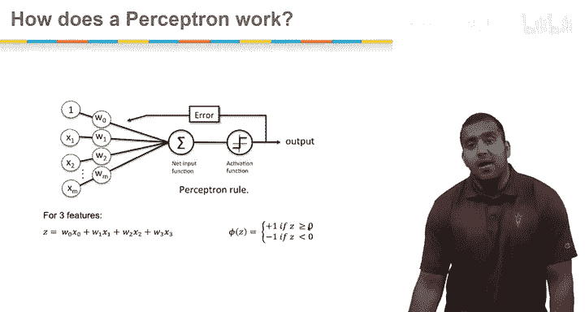

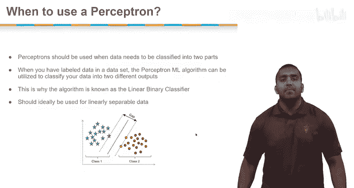

---

## 何时使用感知机？

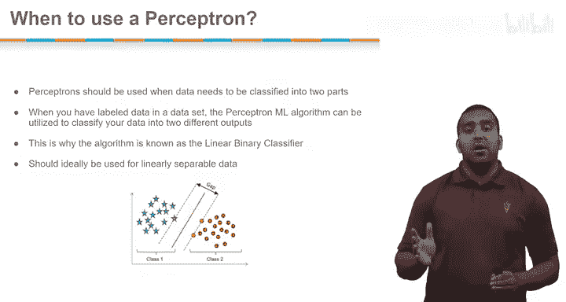

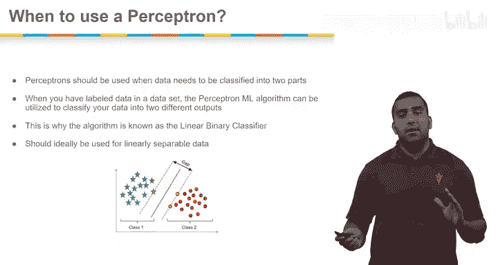

感知机适用于需要将数据分为两部分的场景，特别是当数据线性可分时。例如，可以将数据点分为星形和圆形两类，并通过一条直线（或超平面）分隔。

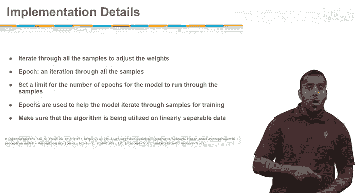

感知机是线性二分类器，最适合处理线性可分的数据。

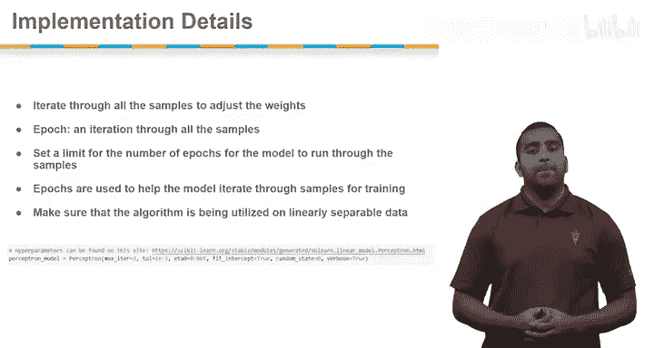

---

## 如何实现感知机？

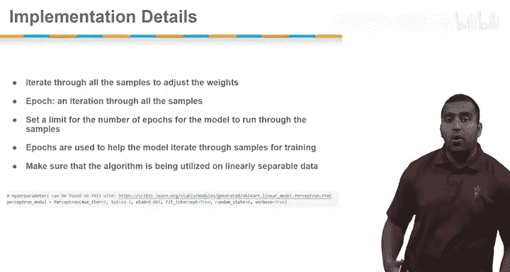

在实现感知机时，我们需要迭代所有样本以调整权重。一个“周期”是指遍历所有样本一次。我们设置模型运行的周期数，帮助模型通过多次迭代训练数据。


以下是实现感知机的关键步骤：

1.  导入必要的库。
2.  加载数据，将特征存储在变量 X 中，目标存储在变量 Y 中。
3.  将数据集分为训练数据和测试数据。
4.  创建感知机模型，设置超参数。
5.  使用训练数据训练模型。
6.  使用测试数据测试模型，评估准确性。

在代码中，创建感知机模型的单行示例如下：

```python
model = Perceptron(max_iter=3, tol=1e-3, fit_intercept=True, eta0=0.001, random_state=0, verbose=True)
```

超参数是模型的特性，通过调整它们可以改善模型性能。

---

## 演示：构建感知机模型

现在，让我们通过一个实际演示来构建感知机模型。

首先，导入所需的库：

```python
from sklearn import datasets
from sklearn.model_selection import train_test_split
from sklearn.linear_model import Perceptron
from sklearn.metrics import accuracy_score
```

接下来，加载数据并分割数据集：

```python
# 加载数据
iris_dataset = datasets.load_iris()
X = iris_dataset.data  # 特征
Y = iris_dataset.target  # 目标

# 分割数据
X_train, X_test, Y_train, Y_test = train_test_split(X, Y, test_size=0.3, random_state=0)
```

然后，创建并训练模型：

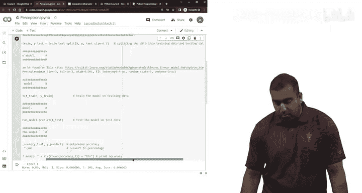

```python
# 创建模型
model = Perceptron(max_iter=3, tol=1e-3, fit_intercept=True, eta0=0.001, random_state=0, verbose=True)

# 训练模型
model.fit(X_train, Y_train)

# 测试模型
Y_predict = model.predict(X_test)

# 评估模型
accuracy = accuracy_score(Y_test, Y_predict) * 100
print(f"模型准确率: {accuracy:.2f}%")
```

在演示中，模型准确率为 31.11%，这可能不理想。为了提高准确性，可以调整超参数，例如增加迭代次数或更改学习率。

---

## 总结

本节课中，我们一起学习了感知机的基本原理、工作方式、适用场景以及如何通过代码实现一个简单的感知机模型。感知机是机器学习中最基础的算法之一，适用于线性可分的二分类问题。通过调整超参数，可以进一步优化模型性能。虽然初始结果可能不完美，但通过不断学习和调整，模型的准确性会逐步提高。