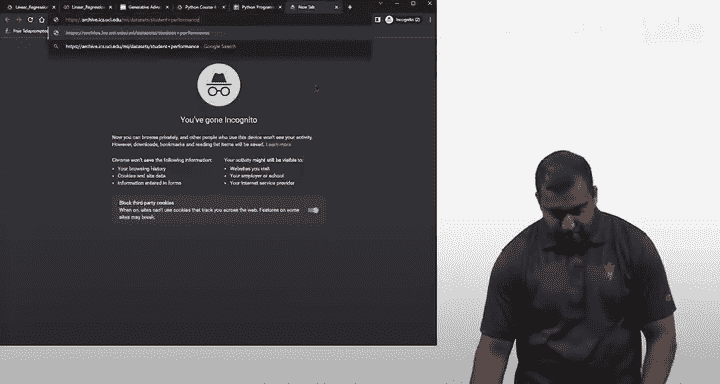
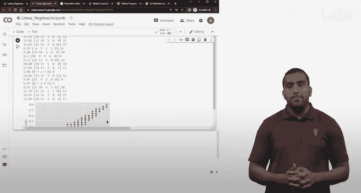

# 61：线性回归原理 📈

在本节课中，我们将学习线性回归。这是一种基础的机器学习算法，用于预测连续数值。我们将了解它的定义、工作原理、适用场景，并通过一个实际案例演示如何用 Python 实现它。

## 什么是线性回归？

线性回归是一种监督式机器学习算法。它用于寻找自变量和因变量之间的最佳拟合直线。

你可能在代数中学过公式 **y = Mx + B**。线性回归遵循这一概念，并在机器学习中利用它进行预测。

换句话说，该算法识别因变量和自变量之间的线性关系。自变量是我们控制的变量，因变量是基于自变量调整后的实际结果。

线性回归主要有两种类型：
*   **简单线性回归**：模型中只使用一个自变量来识别关系。
*   **多元线性回归**：模型中使用多个自变量来识别关系。

## 线性回归如何工作？

线性回归的目标是找到最佳拟合直线，以及使误差最小化的截距和系数最优值。

我们希望在图表中找到最贴合数据的最佳拟合线。图中，自变量是 X，因变量是 Y。我们希望找到一条最佳拟合线，以展示这两个变量之间的理想关系。

给定 X 轴上的自变量和 Y 轴上的因变量，模型会预测并拟合出最佳拟合线。

线性回归模型将在测试数据上拟合预测的最佳拟合线，并在训练后进行评估。

## 何时使用线性回归？


当我们获得带有标签的数据集时，可以使用线性回归来预测给定某个（或多个）自变量的因变量值。

当我们试图预测一个连续值，而不是一个类别时，使用线性回归。

使用一个自变量时，我们使用简单线性回归。使用多个自变量时，我们使用多元回归。

以下是我们用于创建线性回归模型的代码。我们从 `sklearn` 的 `linear_model` 库中调用 `LinearRegression` 函数，它将创建我们的线性回归模型，并将其存储在一个名为 `linear_regression_model` 的变量中。

```python
from sklearn.linear_model import LinearRegression
linear_regression_model = LinearRegression()
```

## 实战演示

现在，让我们开始进行演示。


首先，需要确保导入项目中将用到的库。

以下是需要导入的库：
*   `pandas`：用于处理数据框。数据框用于结构化数据，以便以表格形式直观查看数据。
*   `numpy`：用于数组操作，这是之前学过的主题，将用于拆分数据。
*   `matplotlib`：用于绘图或可视化数据。
*   `sklearn`：需要从 `sklearn` 导入 `linear_model` 来创建线性回归模型，并从 `sklearn.model_selection` 导入 `train_test_split` 来拆分数据。

这次我们使用 CSV 文件来加载和训练模型。要在 Google Colab 中加载 CSV 文件，需要点击文件资源管理器图标，点击上方的上传按钮，找到并上传 `studentmat.csv` 文件。这会将你的 CSV 或 Excel 文件临时上传到云端硬盘，以便在其上执行 Python 脚本。

如果使用其他本地 IDE（如 Microsoft Visual Studio Code），需要确保 CSV 或 Excel 文件与 Python 脚本位于同一目录下，否则很难定位该文件。

导入所有库后，创建模型的第一步是加载数据，并将特征存储在变量 X 中，将目标存储在变量 Y 中。

我们将调用 `pandas` 库（别名为 `pd`）的 `read_csv` 函数。这表示我们要访问 `studentmat.csv` 文件，并指定分隔符为分号。在我们的 CSV 文件中，每个数据样本由分号分隔。我们将数据存储在名为 `data` 的变量中。

如果想查看处理前的数据，可以打印 `data.head()`。`head` 函数显示数据框中前五行的数据。

接下来，我们要提取用于训练模型的特征。在本例中，我们使用的特征是 `G1`、`G2`、`G3`（三个成绩阶段）、`studytime`（学生学习时间）、`failures`（不及格次数）和 `absences`（缺勤次数）。

之后，可以再次打印 `data.head()`，查看在这些属性或特征下，前五行的数据是什么样子。



如果想了解更多关于这些基本特征及其所包含数据类型的信息，需要访问 UCI 机器学习仓库网站。这个网站包含许多非常有用的、干净的预处理数据，可用于训练你自己的机器学习模型。它包含描述特征的描述符和数据用途。


进入网站后，可以看到学生表现数据集。你可以从我们的课程中访问 CSV 文件，但如果想从这里访问，只需进入数据文件夹，点击 `student.zip`，然后解压文件夹，即可找到 `studentmat.csv` 文件。

在这个网站上，你可以看到数据集特征，这非常有用，它描述了数据、用于描述数据的属性或特征数量以及样本数量（本例为 649 个）。如果你好奇想了解更多，可以在这里找到所有特征的描述。我已将链接放在代码的注释中，请确保导航到该链接以了解更多信息。

继续，我指定我的目标变量为 `G3`，这是我们试图预测的变量。最后，我将数据拆分为 X 和 Y 数据，其中 Y 是我们的目标，X 数据是我们用来预测目标的所有特征。

注意，这里我调用 `data.drop`，基本上是说所有数据都应该用于 X，除了我们的目标变量 `G3`，即我们试图预测的学生最终成绩。

现在我们已经分别拆分好数据，接下来要训练模型。实际上，在训练模型之前，我们需要将数据拆分为测试集和训练集。

和之前一样，我们调用 `train_test_split` 函数，指定测试集大小为 0.3（即 30% 用于测试集，70% 用于训练集），依此类推。

第三步，创建模型。使用 `sklearn` 中的 `linear_model` 库，调用 `LinearRegression()`，这将创建我们的线性回归模型。

第四步，训练模型。我们调用 `fit` 函数来训练模型。这里，我们是在训练数据（即 `x_train` 和 `y_train`）上拟合模型。

第五步，测试模型。我们让模型对 `X_test` 数据进行预测，这将生成我们的 `y_pred` 值，即我们的预测值。

然后进入第六步，评估模型。我们调用线性回归模型的 `score` 函数，并传入 `X_test` 和 `y_test` 参数。这基本上是用来评估我们结果的准确性。

之后，我将其乘以 100 并四舍五入到两位小数，然后可以打印出模型的准确率，看看它的准确性以及是否达到最佳效果。

在接下来的两段代码中，如果你好奇想看看你的预测结果与预期结果的对比，可以创建一个 `for` 循环，遍历模型所做的所有预测，然后打印出你的预测值，接着是用于测试的输入参数，最后是实际结果（在 `y_test` 中表示）。格式是：预测值在这里，预期值在这里。

最后，如果你好奇想绘制结果图表，那就是 `matplotlib` 的用武之地了。我们的自变量是 `G2`（第二阶段成绩），如果我们想看看它与 `G3`（我们试图预测的最终成绩）的关系，可以将其绘制在散点图上。可以看到，我在绘制散点图时使用了 `data_x` 和 `data_y`。

我指定 X 轴标签为 `G2`，Y 轴标签应为 `final grade`。最后，我为 `plt` 调用 `show` 函数，这将显示你的图表。

运行代码后，可以看到我的模型准确率为 85.7%，这相当不错。😊

你还可以看到我的实际预测值与预期结果的对比，以及输入参数是什么。你可以浏览这些信息，看看你的模型有多准确。

有些预测会有偏差，因为我们没有 100% 的准确率。这没关系，这正是你需要努力改进模型的地方，调整超参数，确保它以更高的准确率改进。你会看到类似、更接近的结果。例如，这里我们的预测值是 8.14，而预期值是 8。

如果你想看看图表是什么样子，在本例中，我们正在可视化用 `G2` 进行预测的情况。我们将 `G2` 放在 X 轴，最终成绩放在 Y 轴。可以看到这里存在线性关系，这就是为什么线性回归最适合这个项目。

如果你有任何问题或仍然不理解某些内容，我强烈建议你回到模型中，尝试调整超参数，努力理解它并多加练习。



## 总结


本节课我们一起学习了线性回归。我们了解了它的定义、两种主要类型（简单和多元），以及它通过寻找最佳拟合线来最小化误差的工作原理。我们明确了线性回归适用于预测连续数值的场景。最后，通过一个学生成绩预测的实战演示，我们完整地走了一遍使用 Python 和 `sklearn` 库实现线性回归模型的流程，包括数据加载、预处理、模型训练、评估和结果可视化。