# 63：支持向量机原理 🧠

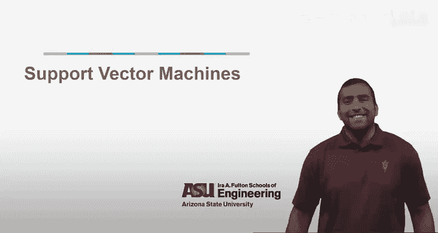

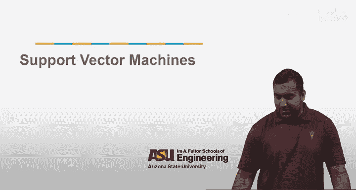


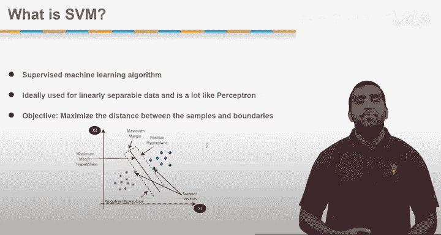

在本节课中，我们将要学习支持向量机。这是一种监督式机器学习算法，特别适用于处理线性可分的数据。我们将了解它的工作原理、适用场景，并通过一个实战案例来掌握其应用。

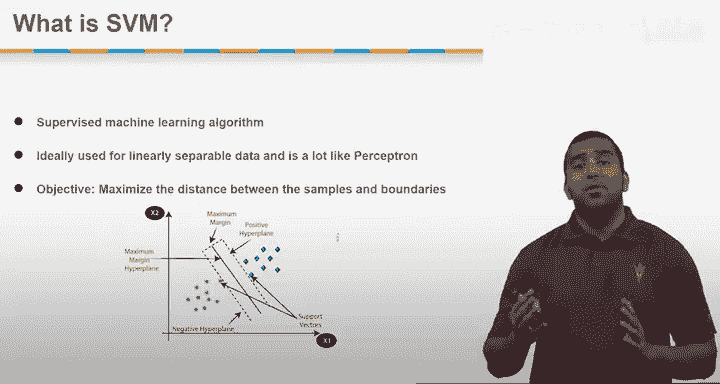

## 什么是支持向量机？🤔

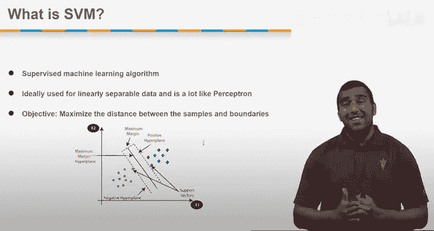

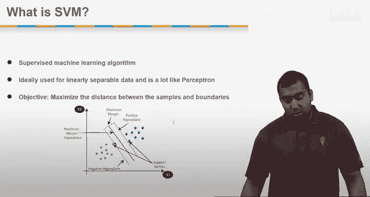

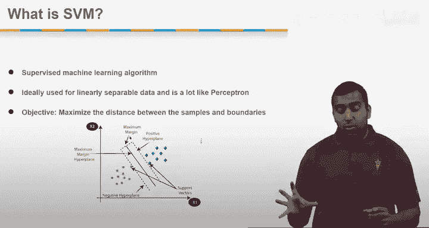

支持向量机是一种监督式机器学习算法，它最理想的应用场景是处理**线性可分**的数据，其工作原理与感知机类似。

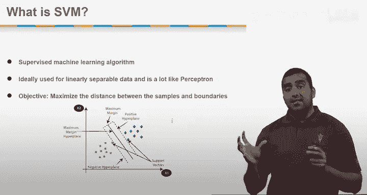

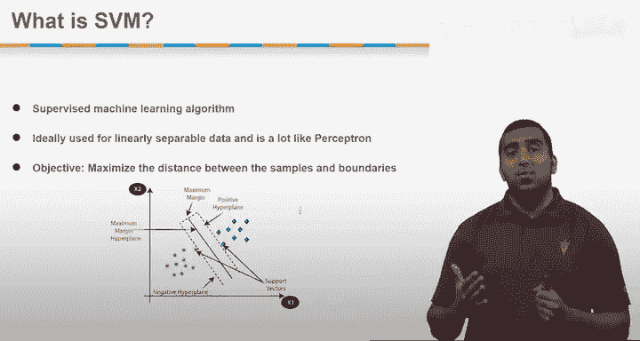

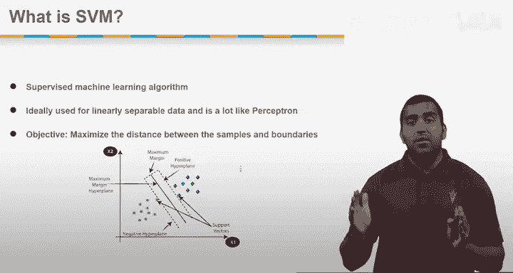

所谓线性可分，可以这样理解：我们有一条**超平面**（在二维空间中就是一条直线），这条线可以用来分隔不同类别的数据点。这些被分隔开的数据组可以被分类为特定的数据类型。支持向量机的核心就是插入一个超平面，将数据分割成不同的组。

## 支持向量机如何工作？⚙️

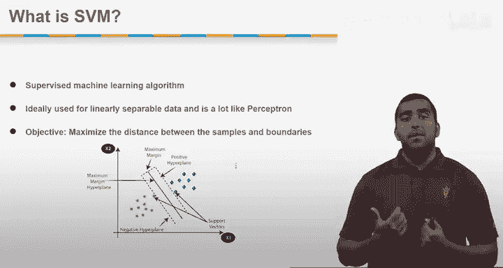

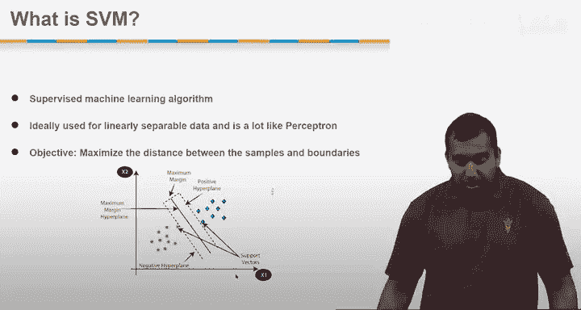

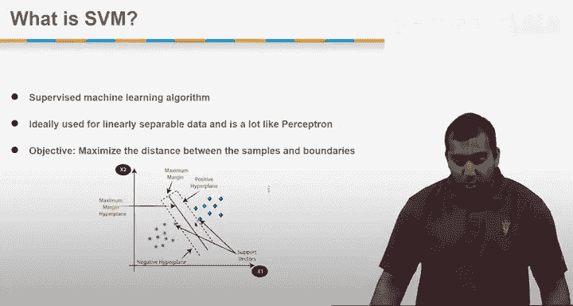

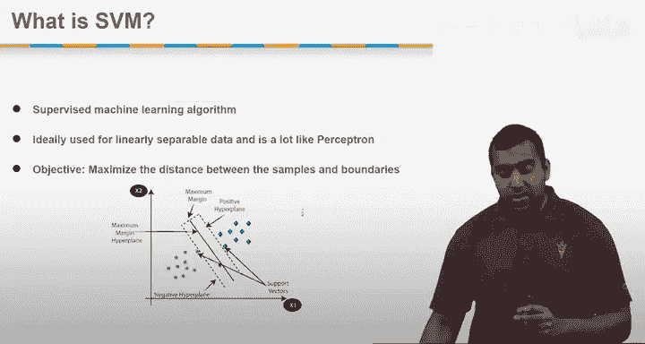

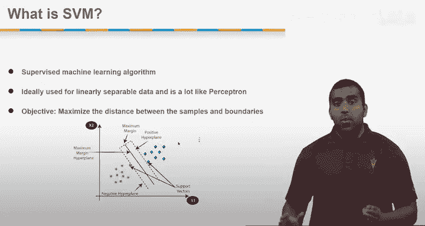

我们的目标或任务是**最大化样本与决策边界之间的距离**。这意味着，我们有一个超平面，我们希望确保这个距离尽可能大，以使不同类别的数据点（例如图中的绿点和蓝点）能够被尽可能清晰地区分开。

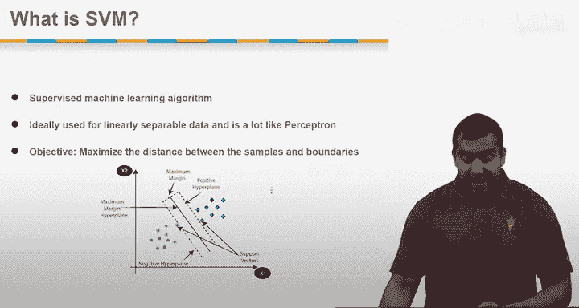

每个数据点被称为一个**支持向量**。

该算法的工作原理是创建一个超平面（即**决策边界**）来将数据分隔成不同的类别。决策边界决定了数据的分类方式：落在超平面一侧的数据被归为一个类别，而落在另一侧的数据则被归为另一个类别。

支持向量机算法优先寻找**最佳超平面**，即能够最大化分类间隔的那个超平面。

以下是在Python中创建支持向量机模型的一行核心代码：

```python
from sklearn.svm import SVC
model = SVC(kernel='linear')
```

我们指定核函数为`linear`，因为我们的数据是线性可分的。

## 何时使用支持向量机？📊


由于它是一种监督式机器学习算法，我们通常在拥有**带标签的数据集**时使用它。


在以下情况下，支持向量机比其他算法更有效：**数据集中特征的数量大于样本的数量**。这是使用该算法时需要记住的一个关键点。当特征多于数据样本，且数据已标记时，通常应使用支持向量机。


当然，你可以尝试所有已学过的监督式机器学习算法，并通过比较执行后的性能（例如使用**准确率**作为指标）来确定哪种算法对你的数据效果最好。


上一节我们介绍了支持向量机的基本概念和适用场景，本节中我们来看看如何通过一个具体的例子来应用它。


## 实战演示：肿瘤分类 🩺

在本演示中，我们将使用支持向量机算法，根据肿瘤的特征将其分类为**恶性**或**良性**。


### 第一步：加载库


首先，我们需要导入必要的Python库。


```python
from sklearn import datasets
from sklearn import svm
from sklearn.metrics import accuracy_score
from sklearn.model_selection import train_test_split
```


### 第二步：加载与理解数据


我们将使用Scikit-learn内置的乳腺癌数据集。该数据集包含许多特征，例如肿瘤的平均半径、纹理、周长、面积、平滑度等。目标类别是“恶性”（0）或“良性”（1）。


以下是加载数据的代码：


```python
cancer_data = datasets.load_breast_cancer()
```


你可以打印出`cancer_data.feature_names`和`cancer_data.target_names`来查看所有特征和类别名称。

### 第三步：准备数据


接下来，我们将特征数据与目标标签分开，并将数据集划分为训练集和测试集。


```python
X = cancer_data.data  # 特征
y = cancer_data.target  # 目标标签


X_train, X_test, y_train, y_test = train_test_split(X, y, test_size=0.3, random_state=42)
```

我们将70%的数据用于训练，30%用于测试。


### 第四步：创建与训练模型


现在，我们创建支持向量机分类器模型并对其进行训练。


```python
svm_model = svm.SVC(kernel='linear')  # 创建模型，指定线性核
svm_model.fit(X_train, y_train)       # 训练模型
```


### 第五步：进行预测与评估


使用训练好的模型对测试集进行预测，并计算模型的准确率。


```python
y_pred = svm_model.predict(X_test)  # 预测


accuracy = accuracy_score(y_test, y_pred)  # 计算准确率
print(f"模型准确率: {accuracy:.2%}")
```


运行上述脚本后，我们得到了约96.49%的准确率，这表明我们的线性核函数在这个线性可分数据集上表现良好。


### 第六步：分析结果


我们可以通过一个循环来查看部分预测结果与实际值的对比：


```python
for i in range(10):
    print(f"样本 {i}: 预测 = {y_pred[i]}, 实际 = {y_test[i]}")
```


输出会显示，大多数预测是正确的，但也存在少数预测错误的情况（例如预测为良性但实际是恶性），这对应了那约4%的错误率。


## 总结与优化 🎯


本节课中我们一起学习了支持向量机。我们了解到它是一种用于线性可分数据的强大分类器，其核心思想是寻找最大化间隔的超平面。通过乳腺癌分类的实战，我们掌握了使用Scikit-learn库构建、训练和评估SVM模型的完整流程。


模型的性能（96.49%的准确率）已经很好，但并非完美。为了获得更优的预测性能，我们可以：
*   **调整超参数**：尝试不同的核函数（如`rbf`、`poly`）或调整其他参数（如`C`值）。
*   **进一步清理和预处理数据**：确保输入模型的数据质量更高。


通过不断迭代和优化，我们可以使模型达到更好的状态。