# 64：回归分析基础 📈

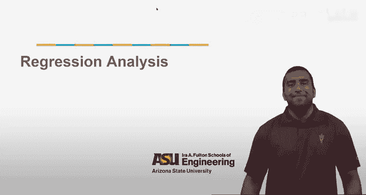

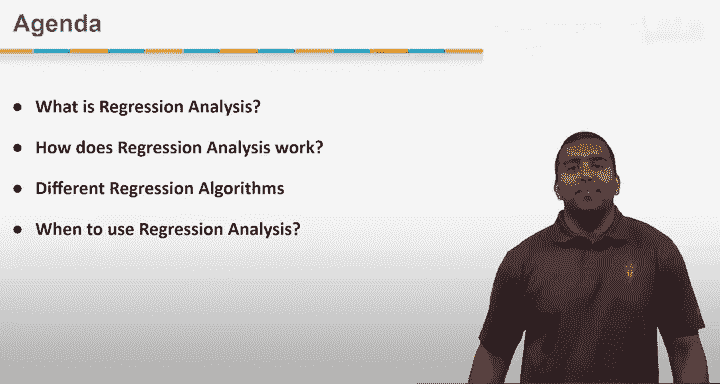

在本节课中，我们将学习回归分析。我们将介绍回归分析的定义、工作原理、几种不同的回归算法，并明确何时应使用回归分析。

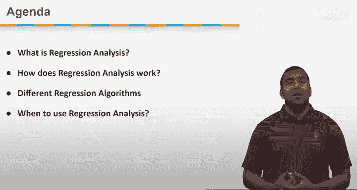

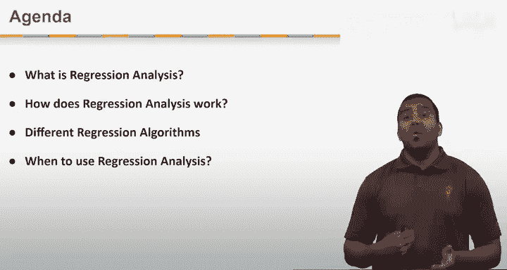

## 什么是回归分析？🤔

回归分析是一种机器学习方法，用于预测连续变量，而不是进行分类或识别类别。在之前的例子中，我们学习了如何识别类别。然而，回归分析用于预测连续变量，我们不再预测类别。你已经见过的一个回归分析例子是线性回归，我们看到模型预测的是一个数值，而不是一个类别。

回归分析可以基于多个自变量进行预测，即X轴上的所有变量。我们的目标是创建一个数学模型，将因变量（即Y轴上的变量）表示为自变量X的函数。本质上，我们希望创建一个能够最小化误差数量并准确预测连续值的模型。

## 回归分析如何工作？⚙️

回归分析是一个为识别自变量和因变量之间关系而创建的数学模型。当这个数学模型应用于数据集时，可以识别出因变量与自变量之间的关系，这种关系将用于新数据以进行预测。

不同的回归算法可用于寻找因变量和自变量之间的最佳关系。目标是最大限度地减少预测因变量连续值时的误差。

## 不同的回归算法 📊

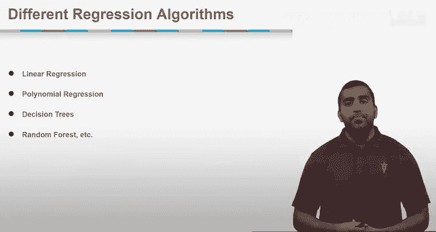

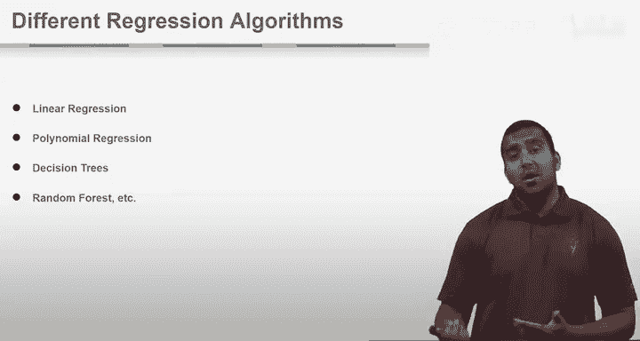

有多种回归算法可供使用，其中一种你已经见过，即线性回归。

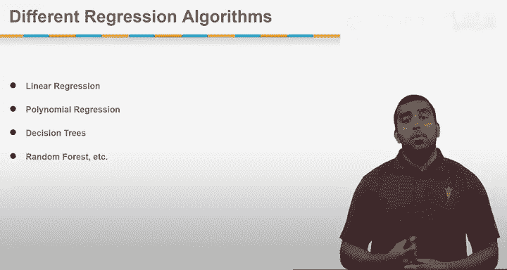

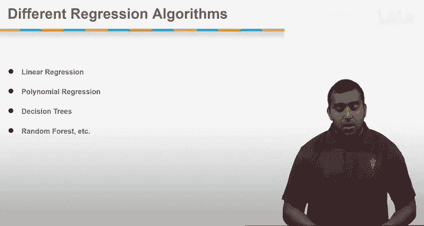

以下是其他一些回归算法：
*   多项式回归
*   决策树
*   随机森林

我们不会深入讲解这些其他机器学习算法，因为它们更偏向高级内容。然而，如果你有兴趣了解更多关于这些回归算法的知识，强烈建议你查阅Python官方网站的一些在线资源或相关论坛，这些地方会详细讨论这些算法的工作原理及其典型应用场景。

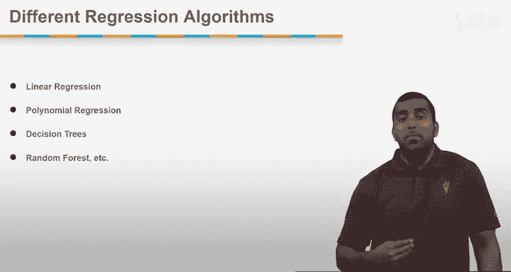

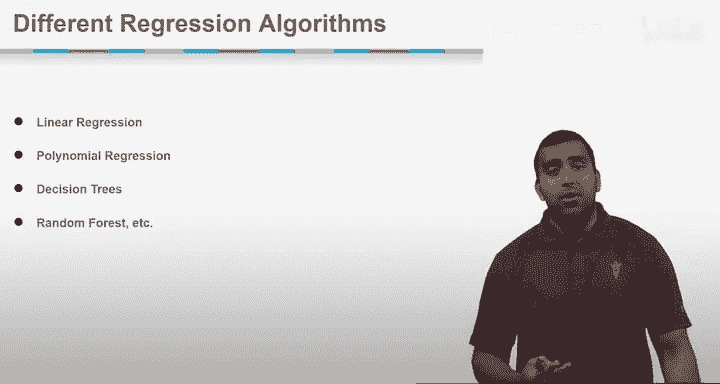

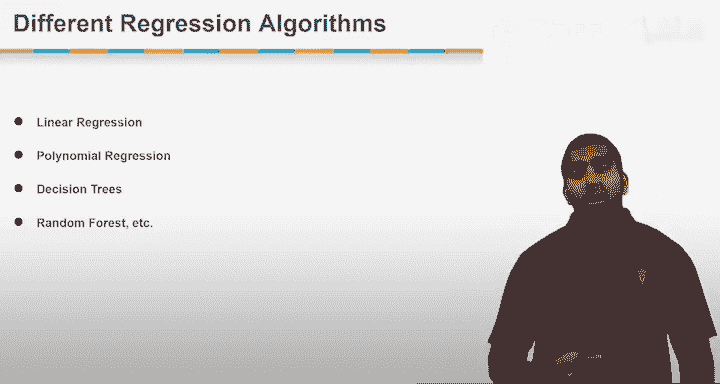

## 何时使用回归分析？🎯

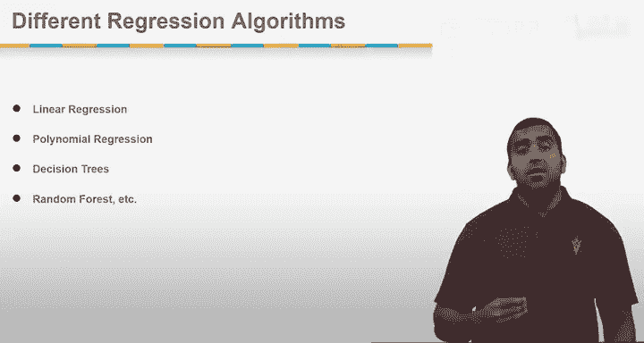

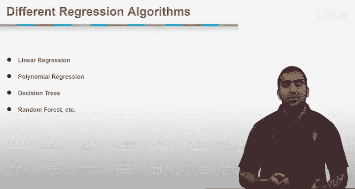

当目标是基于一个或多个自变量来识别或预测一个连续的因变量时，就应该使用回归分析。简单来说，如果你想基于变量X来预测一个连续的变量Y，请确保使用回归分析。

这里有一些很好的例子：自变量在X轴上，因变量（即我们试图预测的变量）在Y轴上。我们将最佳拟合线应用于数据点，这是线性回归的常见做法。你可以看到它与分类不同：在分类中，我们试图对数据进行分类和分隔；而在线性回归中，我们试图预测一个连续值。这就是回归与分类的区别。

## 总结 📝

本节课我们一起学习了回归分析的基础知识。我们了解了回归分析是一种用于预测连续变量的方法，其核心是建立数学模型来描述自变量与因变量之间的关系。我们回顾了线性回归，并简要提及了多项式回归、决策树和随机森林等其他算法。最后，我们明确了回归分析适用于预测连续结果的场景，并将其与分类任务进行了区分。