# 66：深度学习概述 🧠

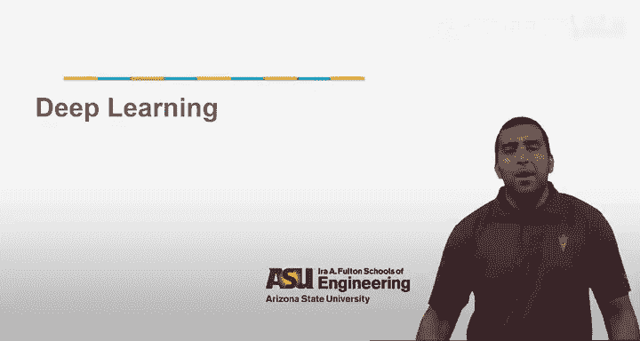

在本节课中，我们将学习深度学习的基本概念。我们将涵盖什么是深度学习、神经网络如何工作以及深度学习的应用。请注意，这是一个入门级的概念介绍，我们不会深入细节，仅对深度学习进行简要概述。

---

## 什么是深度学习？🤔

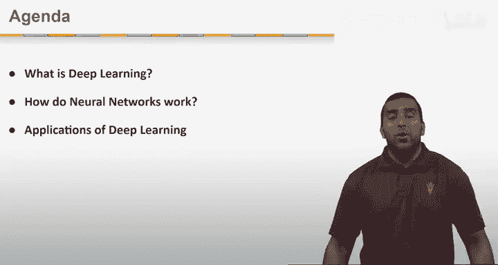

深度学习是机器学习的一个子集，其算法结构基于大脑的功能原理。

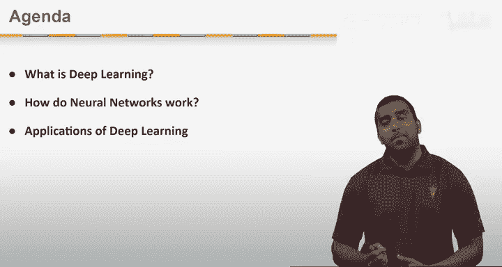

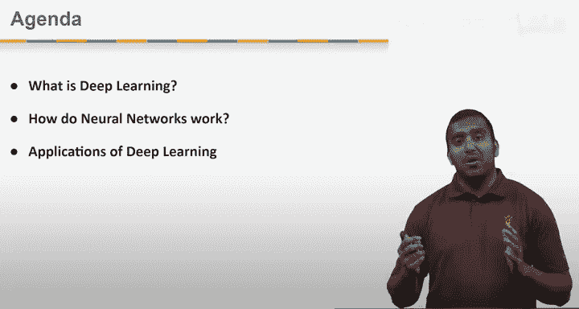

基本概念是：在大脑中，当检测到物体的某些特征时，神经元会激活。例如，当我们看到铅笔尖时，我们的神经元会激活，从而识别出那是铅笔尖。

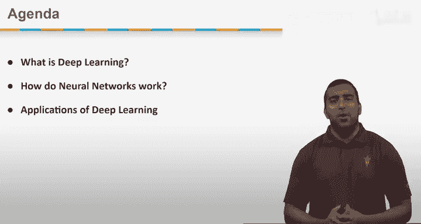

这个概念催生了人工神经网络的开发。神经网络被构建来模拟大脑在接收到刺激时如何处理数据并从新信息中学习。神经网络可以利用单层进行预测，也可以利用额外的层来优化和提高模型的性能。

从视觉上看，深度学习是这样的：我们有一系列相互连接的人工神经网络，它们会在检测到某种刺激时激活。

下图展示了简单神经网络与深度神经网络的区别。

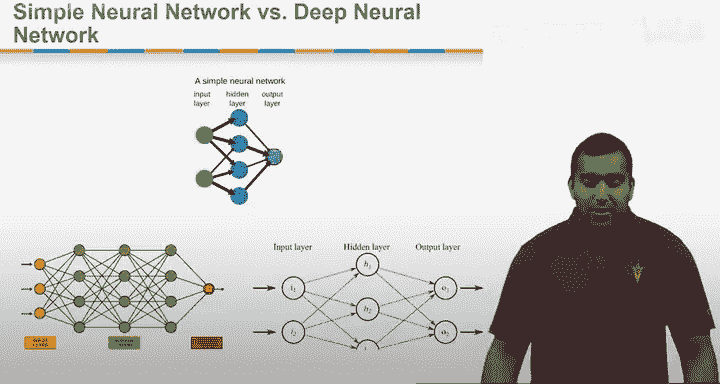

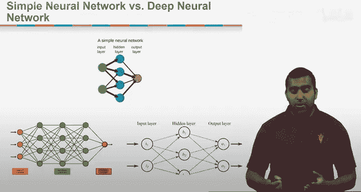

在简单神经网络中，我们有一个隐藏层。这个单一的隐藏层接收输入层，并将其传递到输出层。

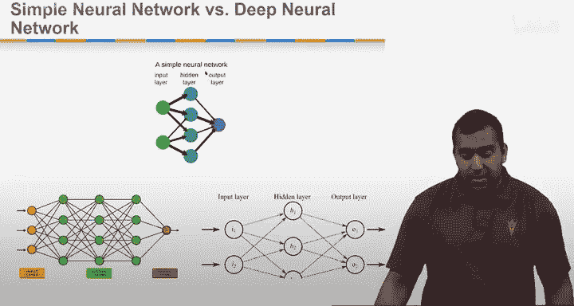

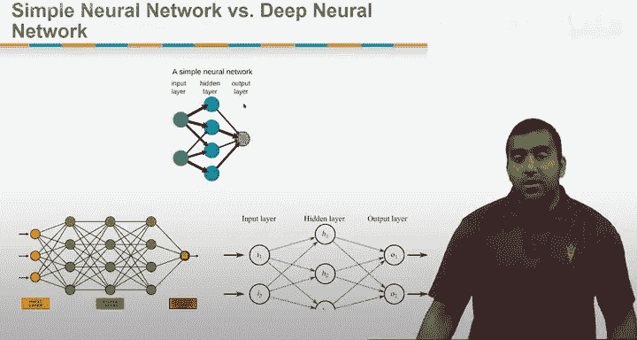

而深度神经网络则如下图所示，它有多个隐藏层。输入层被传递到一系列多个隐藏层中，然后才传递到输出层。

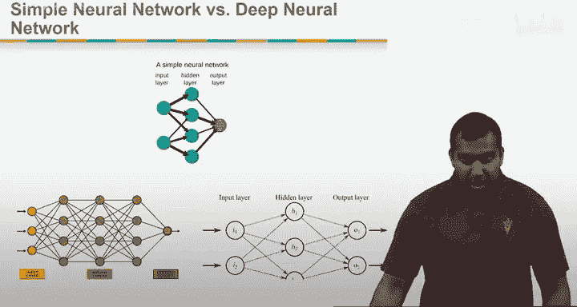

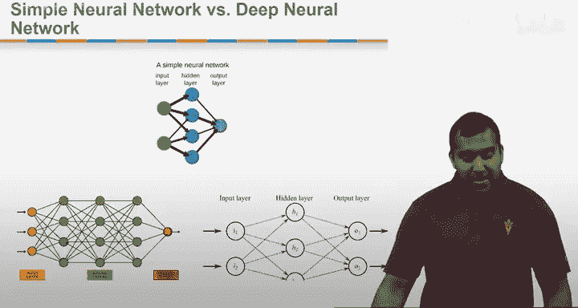

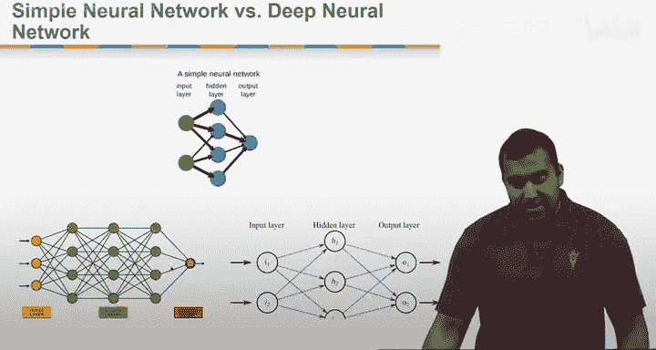

在这里，每个隐藏层用 H₁、H₂ 等表示，具体取决于我们有多少层。然后是我们的输入层。连接每个输入层和每个隐藏层的是我们各自的权重。

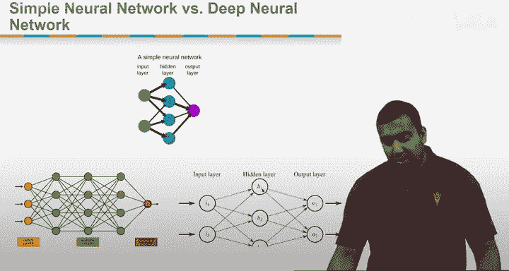

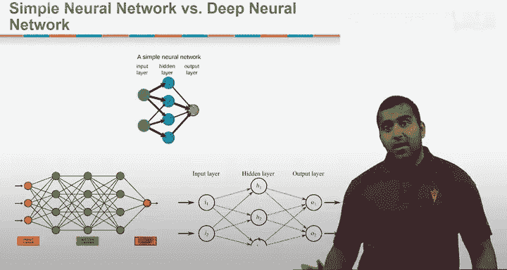

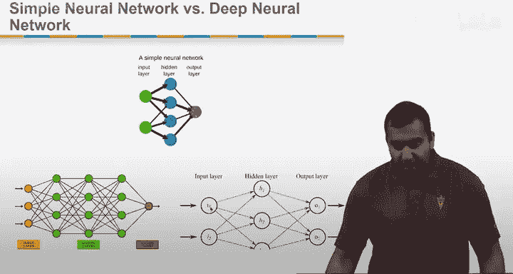

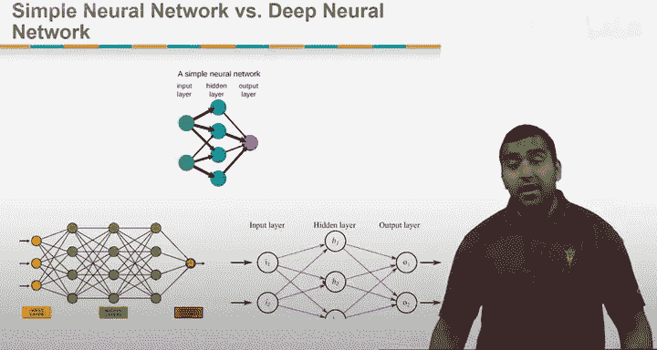

最后，我们的隐藏层会连接到某个输出层。

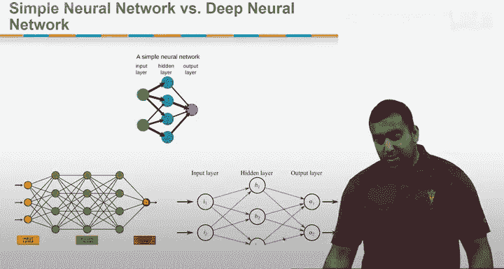

---

## 神经网络如何工作？⚙️

上一节我们介绍了神经网络的结构，本节我们来看看它的工作原理。

在神经网络中，层被分类如下：输入层、隐藏层和输出层，如前所述。

神经网络利用激活单元对输入进行加权求和以处理数据。网络中的每一层可以拥有不同数量的激活单元。激活函数和单元控制着模型学习训练数据集的效果。

以下是其工作原理的简化表示：

1.  **输入**：接收数据。
2.  **加权求和**：每个输入乘以一个对应的权重，然后加上一个偏置项。
    *   公式可以表示为：`z = (w₁ * x₁) + (w₂ * x₂) + ... + b`
3.  **激活函数**：将加权求和的结果传递给一个激活函数（如 Sigmoid、ReLU）。
    *   例如：`output = activation_function(z)`
4.  **输出**：产生最终的预测或结果。

所以流程是：输入与其各自的权重相乘，然后求和，加上偏置，最后传递给激活函数，从而产生输出。

---

## 深度学习的应用有哪些？🌍

了解了基本原理后，我们来看看深度学习在现实世界中的应用。如今，深度学习几乎无处不在。

以下是其主要应用领域：

*   **虚拟助手**：例如 Alexa。
*   **社交媒体**：包括 Facebook、Messenger、Instagram、WhatsApp 等。
*   **自动驾驶汽车**：像特斯拉、Lucid 这样的汽车正在逐步集成深度学习，以开发某种程度的自主性，实现自动驾驶。
*   **医疗保健**：用于进行预测，在健康问题发展到更严重阶段之前识别它们。

---

## 总结 📝

在本节课中，我们一起学习了深度学习的基础知识。我们了解到深度学习是受大脑启发的一种机器学习方法，其核心是包含多个隐藏层的神经网络。神经网络通过输入层、隐藏层和输出层，利用加权求和与激活函数来处理信息并学习。最后，我们看到了深度学习在虚拟助手、社交媒体、自动驾驶和医疗等领域的广泛应用。

希望这个概述能帮助你建立起对深度学习的基本理解。