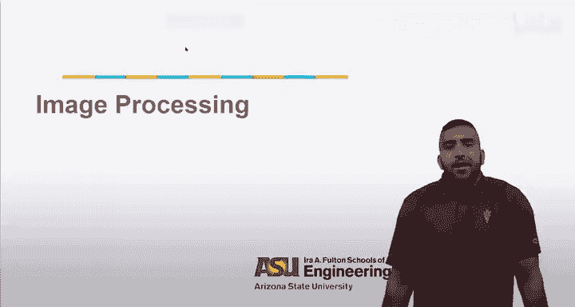
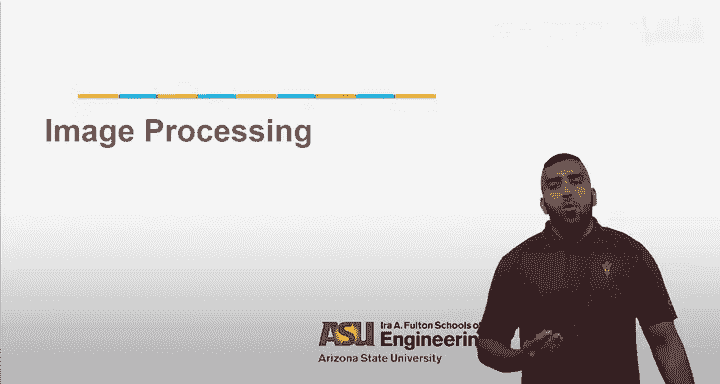
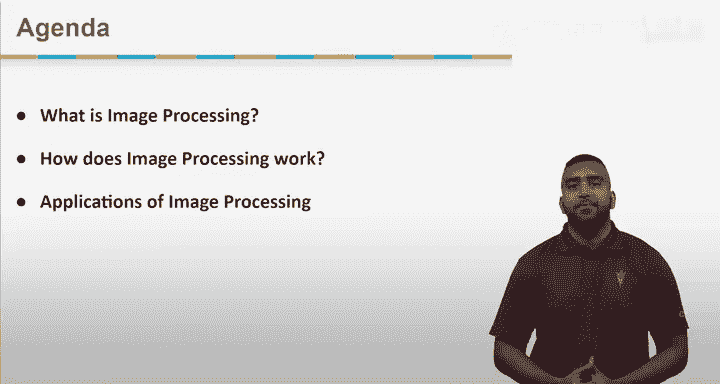
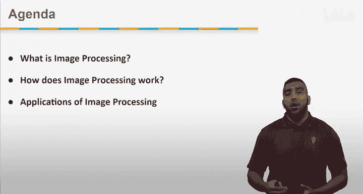
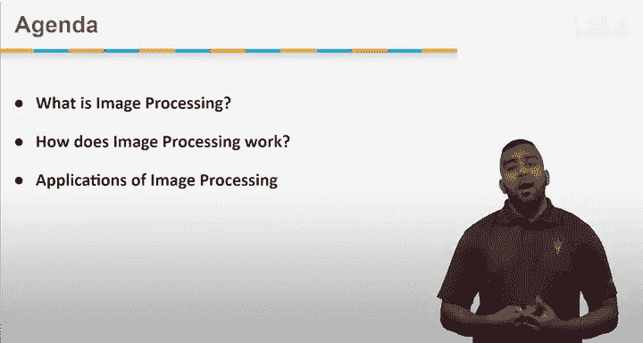
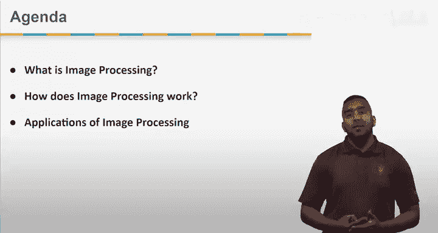
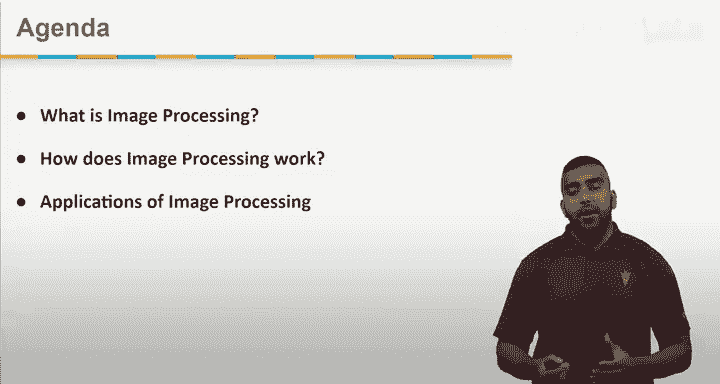

# 67：图像处理概述 📸

在本节课中，我们将学习图像处理的基本概念、工作原理及其应用领域。这是一个高层次的概述，旨在帮助初学者理解图像处理的核心思想。

---

## 什么是图像处理？

图像处理是一种通过操作图像来提升其质量或从中提取有用信息的方法。你可以通过处理图像来观察或提取所需的数据。

图像处理在工业中常用于可视化、信息提取、模式识别、分类、分割等多种任务。它还可以通过数学算法分析图像的像素阵列，并将数据与已知的特征向量进行比较，从而对物体进行分类。

以下是图像处理中几个核心任务的示例：

*   **物体检测**：识别图像中是否存在物体，并用边界框标出。
*   **图像分割**：将图像中的特定物体从背景中分离出来。
*   **图像分类**：识别并标注图像中的物体是什么（例如，一只狗）。

---

## 图像处理如何工作？

上一节我们介绍了图像处理是什么，本节中我们来看看它的典型工作流程。图像处理通常遵循一系列步骤，以下是这些步骤的概述：

1.  **图像获取**：传感器捕获图像并将其数字化。
2.  **图像增强**：突出图像细节，以强化我们想要的特定效果。
3.  **图像复原**：改善图像外观，以便更好地收集数据。
4.  **彩色图像处理**：利用颜色信息提取感兴趣的特征。
5.  **小波与多分辨率处理**：以多种分辨率表示图像。
6.  **图像压缩**：减少存储图像所需的空间。
7.  **形态学处理**：提取对形状表示有用的图像特征。
8.  **图像分割**：将图像分割成特定的对象区域。
9.  **表示与描述**：根据描述为对象分配标签。
10. **知识库**：基于图像处理系统中编码的知识，最终创建知识数据库。

---

## 图像处理的应用

了解了基本流程后，我们来看看图像处理的一些实际应用。它在许多前沿领域都发挥着关键作用。

以下是图像处理的两个主要应用场景：

*   **自动驾驶汽车**：摄像头系统能够识别前方的物体，例如区分不同的车辆、识别行人、交通信号灯等。这对于实现自动驾驶至关重要。
*   **物体分类**：系统可以准确识别图像中的物体类别，例如识别出狗、人等。

---

## 总结

本节课中，我们一起学习了图像处理的基础知识。我们了解了图像处理是通过操作图像来增强质量或提取信息的技术，探讨了其从获取到知识库构建的典型工作流程，并看到了它在自动驾驶和物体识别等领域的重要应用。这是一个广阔的领域，本概述为你进一步探索提供了起点。