# 68：生成对抗网络（GANs）概述 🤖

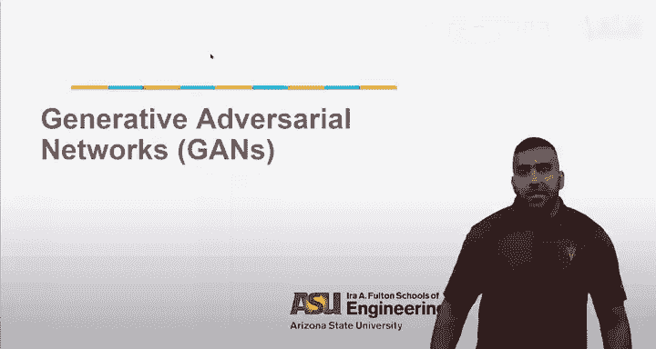

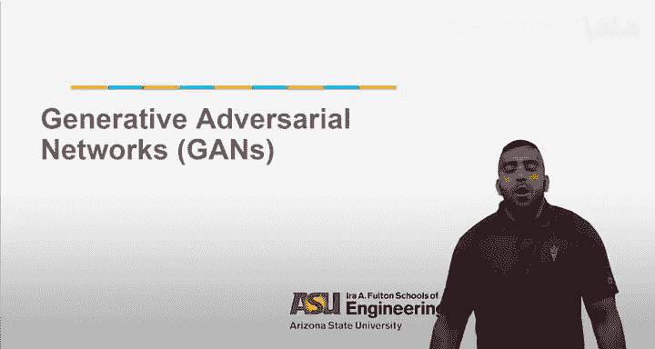

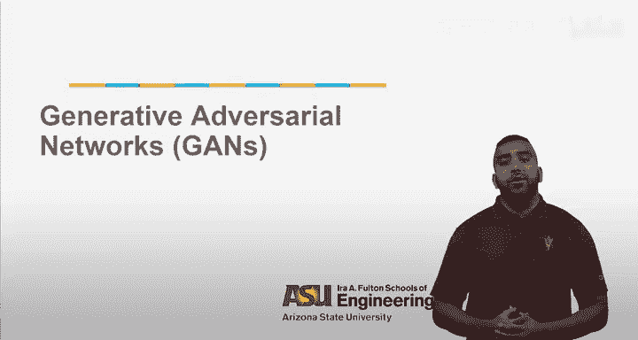

在本节课中，我们将学习生成对抗网络（GANs）。我们将了解GANs是什么、它们如何工作，以及它们在当今行业中的一些应用。

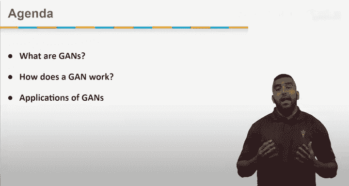

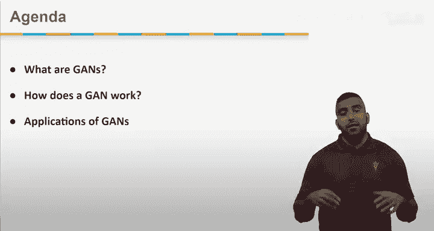

---

## 什么是生成对抗网络（GANs）？

生成对抗网络（GANs）是一种用于生成图像的深度学习方法，其目标是生成无法与真实图像区分的图像。本质上，我们希望创造出看起来与真实图像极其相似或相同的图像。

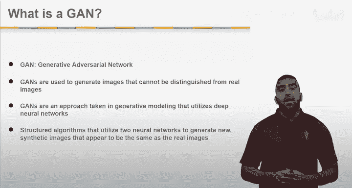

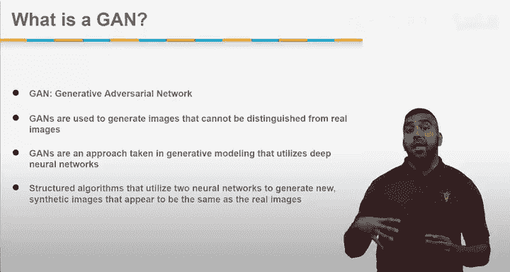

GANs采用一种生成建模方法，利用两个相互竞争的神经网络来生成新的合成图像。这些合成图像的目标是与真实图像看起来一模一样。

---

## GANs如何工作？ ⚙️

上一节我们介绍了GANs的基本概念，本节中我们来看看它们具体是如何工作的。

GANs利用两个机器学习模型进行工作：

1.  **生成器**：根据提供的参数创建图像。生成器从以范围形式输入的参数中随机选择数值，并通过训练学习如何选择恰当的数值来生成逼真的图像。
2.  **判别器**：判断图像是真实的还是伪造的。判别器使用真实图像和人工生成的图像进行训练。起初它的判断会出错，但随着提供更多高质量的样本，其性能会得到提升。

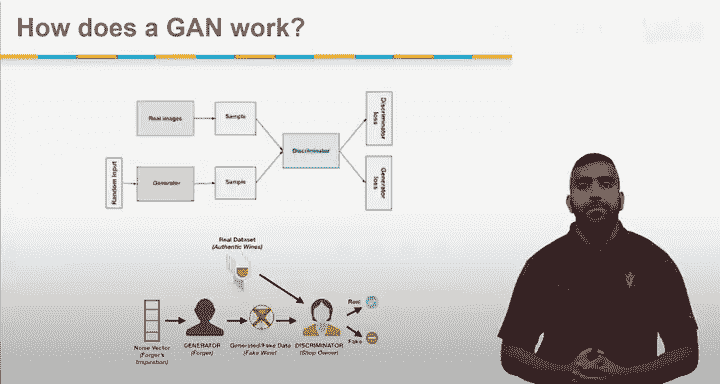

这两个模型相互竞争，因此被称为“对抗”。生成器试图生成足以“欺骗”判别器的伪造图像，而判别器则努力准确区分真伪。这就是GANs的核心工作原理。

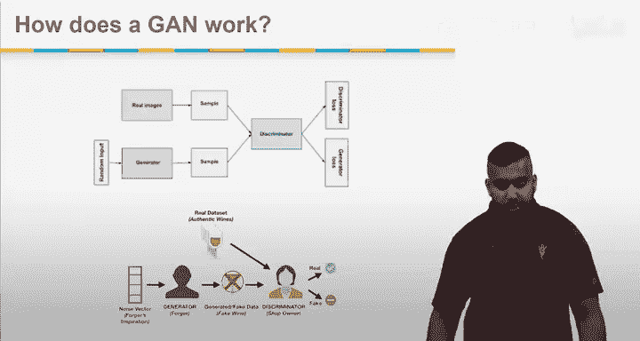

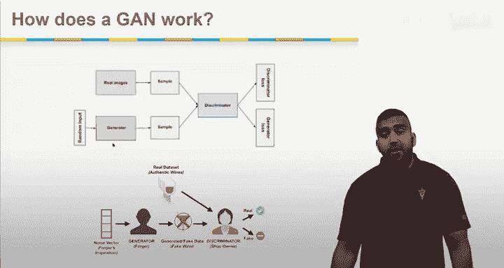

以下是GAN工作流程的简要说明：

*   首先，将随机输入传递给**生成器**，生成器据此生成样本（伪造图像）。
*   同时，从数据集中获取的真实图像样本也会传递给**判别器**。
*   判别器需要判断哪些图像是生成器创造的（伪造的），哪些是来自数据集的（真实的）。
*   如果判别器判断正确，生成器就“失败”并需要改进；如果判别器判断错误，则判别器“失败”并需要调整。

另一种常见的图示展示了类似的过程：一个噪声向量被输入**生成器**，生成器输出伪造图像。这些伪造图像与数据集中的真实图像一同输入**判别器**，由判别器进行真伪判断。

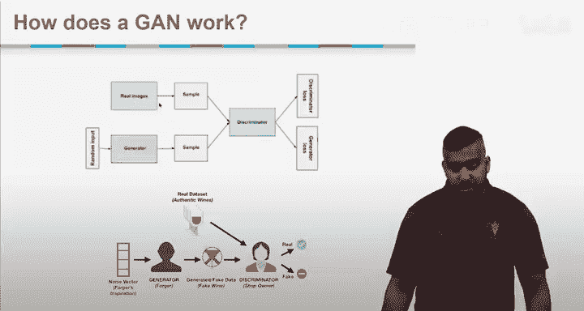

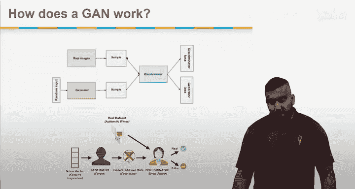

---

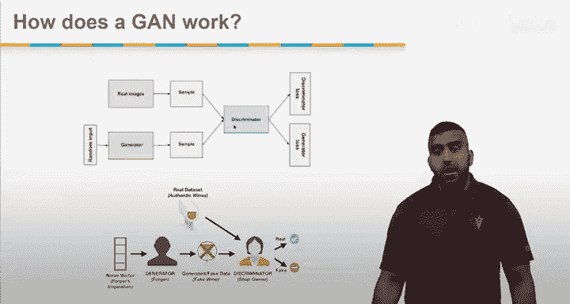

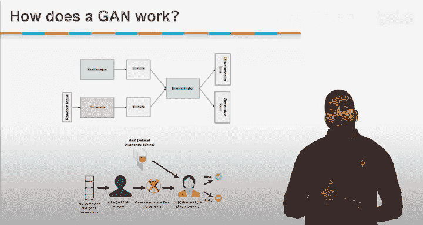

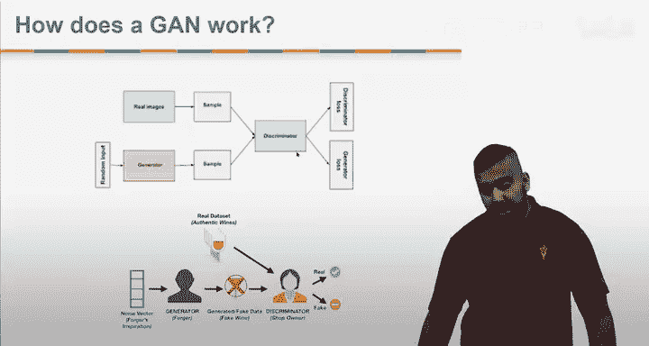

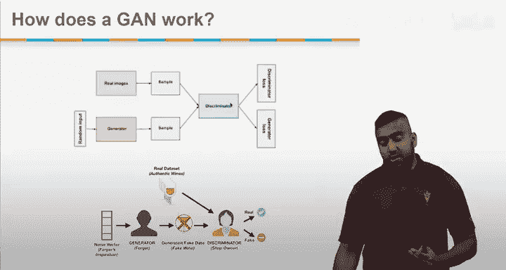

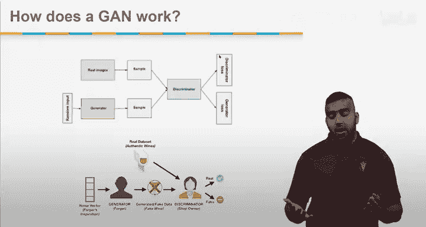

## GANs的应用有哪些？ 💡

了解了GANs的原理后，我们来看看它们在现实世界中的应用。

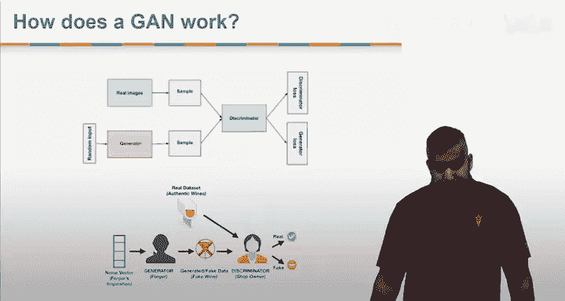

以下是生成对抗网络在当今行业中的一些主要应用：

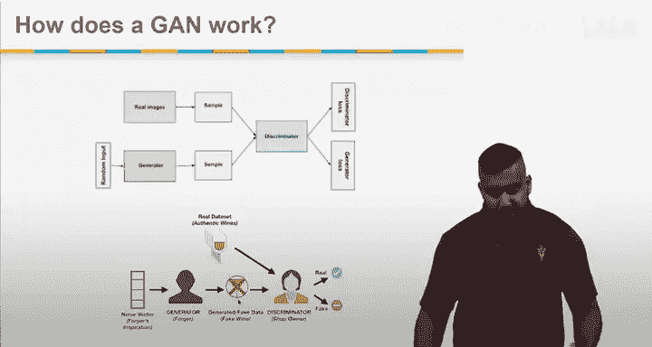

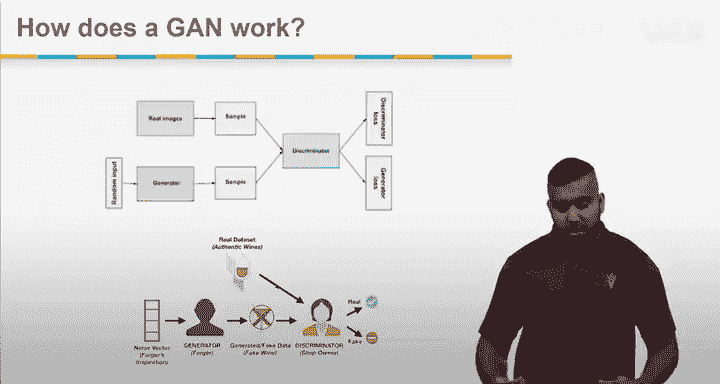

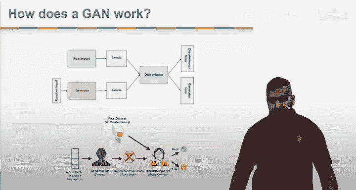

*   **创建深度伪造内容**：GANs可用于生成或修改图像和视频，制造出以假乱真的“深度伪造”内容。
*   **实时视频处理**：基于GANs的机器学习算法可以实时处理视频，例如，将一位演员的口型映射到另一个人脸上，从而改变后者在视频中所说的话。
*   **鉴别深度伪造内容**：GANs也被用于识别深度伪造内容，将伪造的图像或视频与真实的区分开来。这在需要辨别真伪的场景中至关重要。

正因如此，GANs在当今的工业界和研究中被广泛使用。

---

## 总结 📝

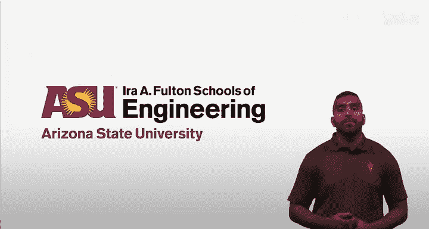

本节课中，我们一起学习了生成对抗网络（GANs）。我们了解了GANs是一种通过生成器和判别器两个神经网络相互对抗来生成逼真合成图像的方法。我们还探讨了GANs的工作原理及其在创建和鉴别深度伪造内容等方面的重要应用。