# 69：课程回顾：机器学习核心概念与应用 🎓

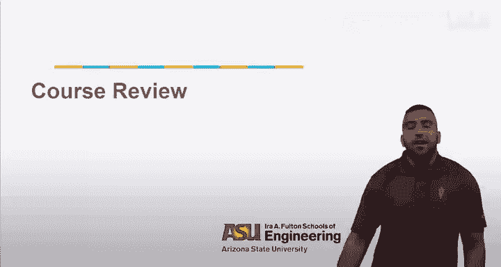

在本节课中，我们将回顾整个课程所涵盖的机器学习核心概念、算法及其应用。通过本次回顾，你将巩固对机器学习两大分支、关键算法以及实际应用场景的理解。

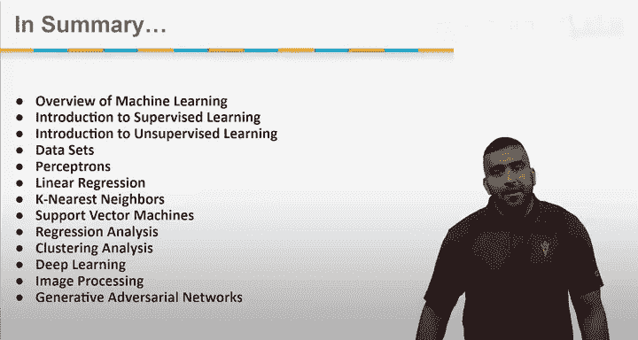

---

## 课程内容概览 📚

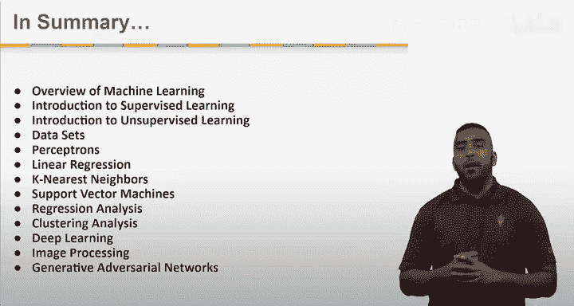

上一节我们完成了对生成对抗网络等高级应用的介绍。本节中，我们将系统回顾整个课程的知识体系。

你已成功完成整个课程的学习。我们共同探讨了众多机器学习相关主题。

我们首先概述了机器学习的基本概念，随后分别介绍了监督学习与无监督学习。你学习了机器学习中两个最重要的分支。

## 核心机器学习算法 ⚙️

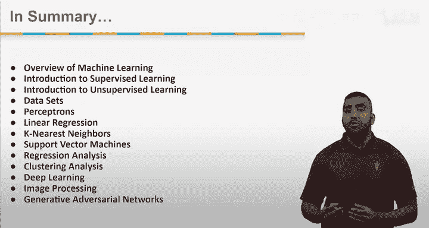

在掌握了机器学习的基本分类后，我们深入探讨了具体的算法。以下是本课程介绍的关键机器学习算法：

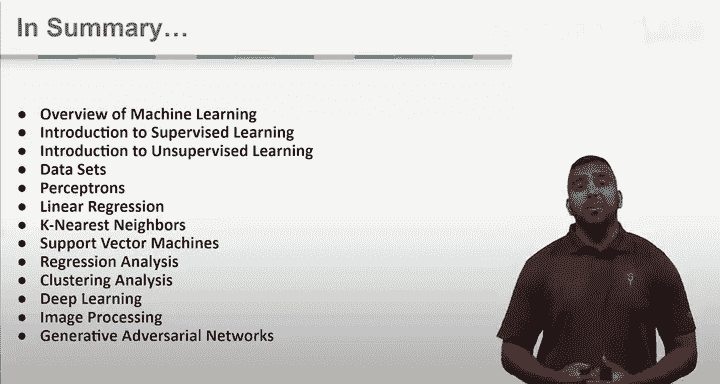

*   **感知机**：一种基础的线性二分类模型。
*   **线性回归**：用于预测连续值的算法，其核心是找到最佳拟合直线，公式可表示为 `y = wx + b`。
*   **K近邻**：一种基于实例的学习方法，通过测量不同样本特征值之间的距离进行分类或回归。
*   **支持向量机**：一种强大的分类算法，旨在找到一个最优超平面来划分不同类别的数据。

## 数据分析方法 📊

除了具体算法，你还学习了两种核心的数据分析方法：

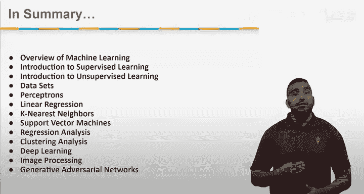

1.  **回归分析**：主要用于预测连续型目标变量。
2.  **聚类分析**：一种无监督学习方法，用于将数据分组到不同的类别中。

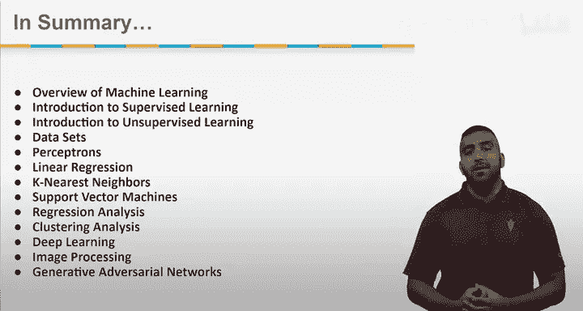

## 行业应用前沿 🚀

理论学习之后，我们展望了机器学习的实际应用。你简要了解了当前行业中应用的一些机器学习技术：

*   **深度学习**：基于神经网络的技术，在图像识别、自然语言处理等领域表现卓越。
*   **图像处理**：利用机器学习算法对图像进行分析、理解和编辑。
*   **生成对抗网络**：一种由生成器和判别器组成的框架，能够生成高度逼真的新数据。

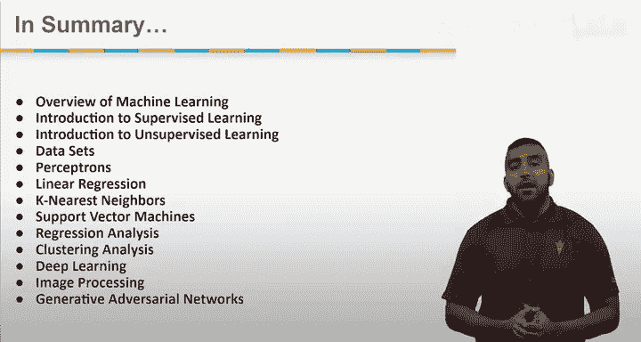

---

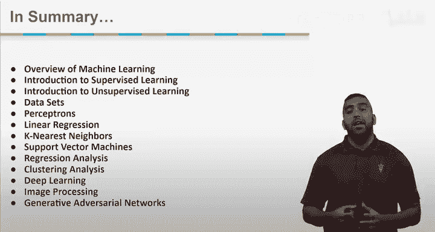

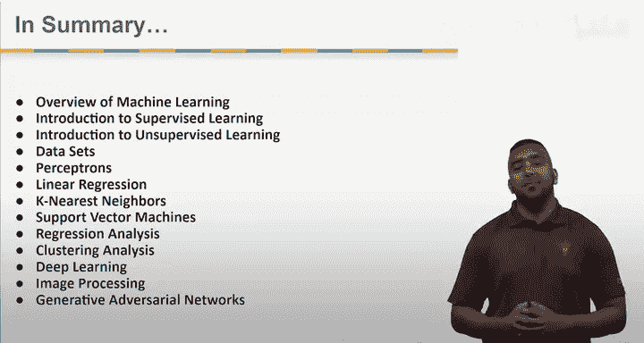

## 总结与祝贺 🏆

本节课中，我们一起回顾了机器学习的核心脉络：从**监督学习**与**无监督学习**两大分支，到**感知机、线性回归、K近邻、支持向量机**等关键算法，再到**回归与聚类分析**方法，最后探讨了**深度学习、图像处理和生成对抗网络**等前沿应用。

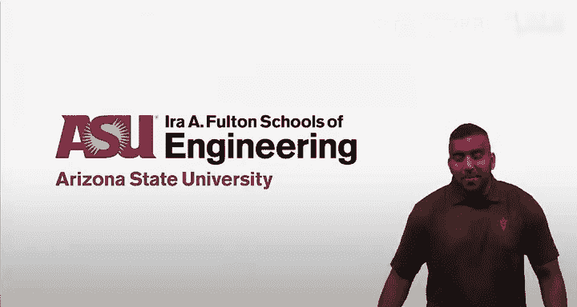

祝贺你完成本课程的学习！感谢你的观看与坚持。