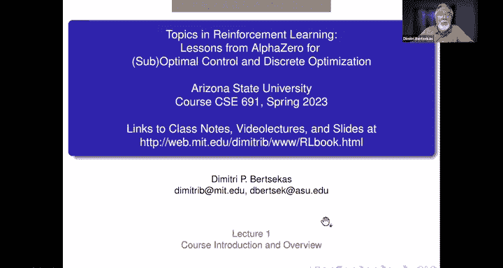
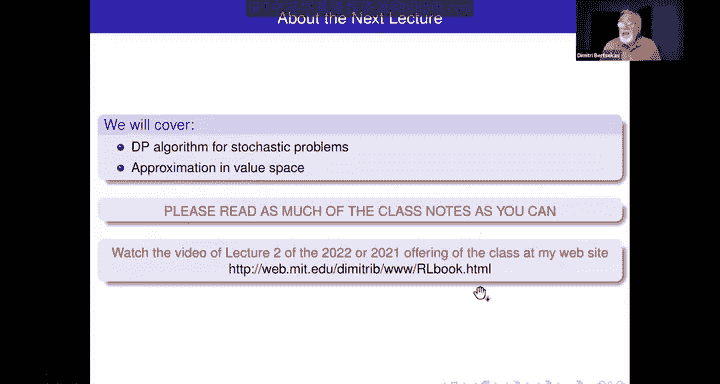

# 1：强化学习与动态规划概述 🚀

在本节课中，我们将学习强化学习的基本概念，特别是其与动态规划的核心联系。我们将通过分析AlphaZero和TD-Gammon等著名程序，了解其算法架构，并介绍确定性问题的动态规划基础。

***

## 1. 引言与课程概览 📚

欢迎来到强化学习专题课程。本课程的所有信息，包括讲义、视频和幻灯片，都可以通过提供的链接访问。这是我在ASU第五次讲授此课程，每次内容都有所不同，今年也将如此。

今天的讲座是一个概述和课程介绍，后半部分会包含一些技术内容。

***

## 2. 课程大纲与核心程序分析 🎯

以下是本讲的大纲：
1.  从AlphaZero等程序开始，分析其算法设计。
2.  简要讨论该学科的历史并概述一些通用概念。
3.  探讨本课程与人工智能、决策控制、运筹学等领域的联系。
4.  在技术部分，重点讨论动态规划，特别是确定性问题的动态规划。

### 2.1 AlphaZero与TD-Gammon：两个卓越的程序

AlphaZero下国际象棋，TD-Gammon下西洋双陆棋，两者相隔25年，但采用了非常相似的架构。AlphaZero于2017年问世，以其卓越的棋艺推动了强化学习领域的发展。TD-Gammon同样令人印象深刻，是同类程序中的先驱。

这两个程序都包含两个核心算法：
*   **离线训练算法**：使用神经网络和自生成数据来构建评估棋局的价值函数和生成行棋的策略。
*   **在线对弈算法**：利用离线训练的结果，通过多步前瞻搜索来在线对弈。

这些算法与动态规划、策略迭代等经典方法以及涉及神经网络训练的机器学习近似方法有着紧密联系。

***

## 3. 在线对弈算法：近似值空间法 🔍

在线对弈算法，有时也称为在决策时间范围内的树搜索，其核心思想是**近似值空间法**。

给定一个棋局或决策问题的状态，算法的工作原理如下：
1.  **前瞻搜索**：从当前状态出发，生成未来若干步所有可能的走法，形成一个搜索树。
2.  **模拟基策略**：在搜索树的叶子节点，使用离线训练得到的**基策略**继续模拟若干步。
3.  **终端评估**：在模拟结束后，使用离线训练得到的**位置评估器**（价值网络）来近似评估最终局面的优劣。
4.  **反向计算与决策**：将终端评估值反向传播回根节点，计算当前每个可选走法的价值，并选择价值最高的走法。

执行完一步决策后，到达新的状态，重复上述过程。

这种架构不仅用于游戏程序，也与现代**模型预测控制**的架构非常相似。主要区别在于，MPC通常处理连续状态空间（如车辆动力学），而游戏通常是有限状态空间。

***

## 4. 离线训练算法：近似策略迭代 🔄

AlphaZero的离线训练采用了一种**近似策略迭代**算法，这是动态规划中的经典算法。

该算法循环生成一系列不断改进的策略（玩家）：
1.  **策略评估**：让当前策略进行大量自我对弈，根据胜负结果评估其性能。这个评估函数通过训练一个**价值网络**来表示。
2.  **策略改进**：利用上一步得到的价值函数，通过某种形式的多步前瞻最小化（在AlphaZero中是一种称为蒙特卡洛树搜索的近似版本）来生成一个改进的新策略。这个新策略通过训练一个**策略网络**来表示。
3.  **迭代**：用改进后的策略取代当前策略，重复上述过程。

TD-Gammon也使用类似的策略迭代进行离线训练，但方法不同（使用TD(λ)），且不依赖蒙特卡洛树搜索或独立的策略网络。

***

## 5. 关键经验观察与历史脉络 📈

以下是两个重要的经验观察：
1.  AlphaZero的**在线对弈玩家**性能远优于其**离线训练玩家**。这表明在线对弈可以显著提升离线训练的结果。
2.  TD-Gammon在引入**截断式模拟**后，性能得到巨大提升。这通过使用基策略延长了前瞻深度，却没有显著增加搜索树的宽度。

强化学习的当前发展是人工智能思想与决策控制思想富有成果的融合。动态规划是一门古老的方法论，而强化学习在人工智能领域一度进展缓慢，直到研究者意识到其与动态规划的联系。TD-Gammon的成功吸引了广泛关注，并促进了该领域在2000年代后的蓬勃发展，特别是随着机器学习、大数据和深度神经网络的进步，最终催生了AlphaGo和AlphaZero，将强化学习推向高潮。

***

## 6. 当前技术状态与挑战 ⚖️

近似动态规划/强化学习方法现在具有**普适性**，因为它继承了精确动态规划广泛的应用范围（确定性、随机性、连续、离散、博弈等）。然而，该方法也**不可靠**，没有保证对所有问题都有效的通用方法。

其优势在于用**近似架构**（如神经网络）克服维数灾难，并用**仿真模型**替代精确数学模型。理论的作用在于构建方法论、指导实践，并区分扎实的算法思想与不靠谱的想法。

***

## 7. 确定性动态规划基础 🧮

现在，我们进入本节课的技术部分：确定性问题的动态规划。

### 7.1 问题表述

考虑一个有限阶段的确定性决策问题：
*   从初始状态 \(x_0\) 开始。
*   在阶段 \(k\)，处于状态 \(x_k\)，施加控制 \(u_k\)。
*   系统根据状态方程 \(x_{k+1} = f_k(x_k, u_k)\) 演化到下一状态。
*   每次转移产生阶段代价 \(g_k(x_k, u_k)\)，最终状态有终端代价 \(g_N(x_N)\)。
*   总代价是阶段代价与终端代价之和：\(J(u_0, ..., u_{N-1}) = g_N(x_N) + \sum_{k=0}^{N-1} g_k(x_k, u_k)\)。
*   目标是找到控制序列，最小化总代价。最优值记为 \(J^*(x_0)\)。

对于有限状态和有限控制的问题，可以用**有向无环图**表示，其中节点是状态，弧代表控制选择并附有代价。这等价于一个**最短路径问题**。

### 7.2 最优性原理

动态规划的核心是**最优性原理**：一个最优策略具有这样的性质，即无论初始状态和初始决策是什么，剩余的决策对于由第一个决策导致的状态来说，必须构成一个最优策略。

换言之，最优序列的任意尾部子序列，对于其对应的尾部子问题也是最优的。

### 7.3 动态规划算法

利用最优性原理，我们可以从最后阶段开始，逆向递推地求解所有尾部子问题。

定义 \(J_k^*(x_k)\) 为从状态 \(x_k\) 开始到过程结束的**最优代价**。

动态规划递推方程如下：
1.  **终端条件**：\(J_N^*(x_N) = g_N(x_N)\)
2.  **逆向递推**：对于 \(k = N-1, ..., 0\)，
    \[
    J_k^*(x_k) = \min_{u_k \in U_k(x_k)} \left[ g_k(x_k, u_k) + J_{k+1}^*(f_k(x_k, u_k)) \right]
    \]

计算完所有 \(J_k^*\) 后，通过**前向计算**构造最优控制序列：从 \(x_0\) 开始，在每个阶段 \(k\)，选择使上述递推方程取最小值的控制 \(u_k^*\)，并计算下一个状态 \(x_{k+1}^* = f_k(x_k^*, u_k^*)\)。

***

## 8. 示例：调度问题与旅行商问题 🗺️

以下是两个动态规划应用的例子：

**调度问题**：需要以特定顺序（A在B前，C在D前）安排四个操作，每个操作间有转换成本。通过将“部分调度”定义为状态，将“选择下一个操作”定义为控制，可以构建一个DP图，并应用上述逆向递推和前向计算找到最优调度序列和最小成本。

**旅行商问题**：访问四个城市各一次并返回起点，城市间有旅行成本。通过将“已访问的城市集合和当前所在城市”定义为状态，同样可以构建DP图并求解。该例子展示了可能存在多个最优解的情况。

***

## 9. 从精确动态规划到近似动态规划 🔗

精确动态规划在状态空间很大时计算量无法承受。**近似动态规划**，特别是**近似值空间法**，提供了可行的替代方案。

其核心思想是：
*   **离线训练**：通过某种方法（如神经网络训练）获得一个近似的价值函数 \(\tilde{J}\)，以替代难以计算的最优价值函数 \(J^*\)。
*   **在线对弈**：在前向计算中，使用 \(\tilde{J}\) 来指导决策：
    \[
    \tilde{u}_k = \arg \min_{u_k} \left[ g_k(\tilde{x}_k, u_k) + \tilde{J}_{k+1}(f_k(\tilde{x}_k, u_k)) \right]
    \]
    然后状态按 \(\tilde{x}_{k+1} = f_k(\tilde{x}_k, \tilde{u}_k)\) 更新。

这就是强化学习中在线对弈算法的本质。对于随机性问题，计算中还需要考虑期望值，我们将在下节课讨论。

***

## 10. 课程组织与要求 📝

本课程是研究导向的研究生级别课程。
*   **目标**：探索近似动态规划与强化学习的前沿，并提供研究机会。
*   **主要资源**：课程网站提供的讲义、幻灯片、视频和参考书籍。
*   **评分**：作业（25%）和研究型学期论文（75%）。学期论文可以是小型研究项目或对2-3篇研究论文的批判性综述。
*   **数学基础**：需要微积分和概率论的基础知识。课程强调通过数学方程来理解和获得算法洞察力。
*   **符号与术语**：课程将统一使用特定的符号系统（结合概率转移和系统方程两种表示法），以促进清晰沟通。

***

## 11. 总结与下节预告 🎬

本节课我们一起学习了：
1.  强化学习的概览及其与动态规划的深刻联系。
2.  通过AlphaZero和TD-Gammon分析了离线训练与在线对弈的算法架构。
3.  学习了确定性动态规划的基本原理、算法和示例。
4.  了解了从精确动态规划到近似动态规划（近似值空间法）的过渡思路。

下节课我们将深入探讨**随机性问题的动态规划**，并介绍相应的近似值空间方法。请提前阅读课程讲义的相关部分。