# 2：随机有限与无限时域动态规划 🎯

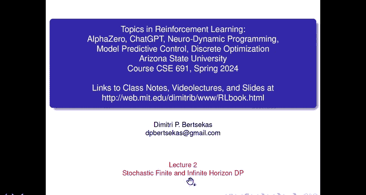

在本节课中，我们将学习随机有限时域和无限时域动态规划问题。我们将从回顾确定性情况开始，然后介绍近似值空间方法，接着深入探讨随机动态规划算法，并以线性二次问题为例进行说明。最后，我们将讨论无限时域问题的理论与算法。

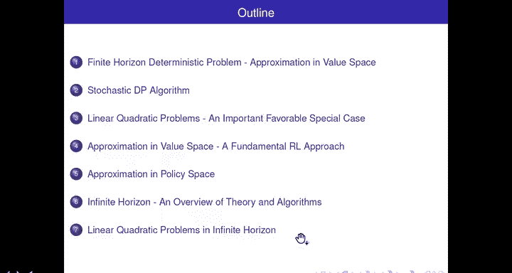

## 确定性有限时域动态规划回顾 🔄

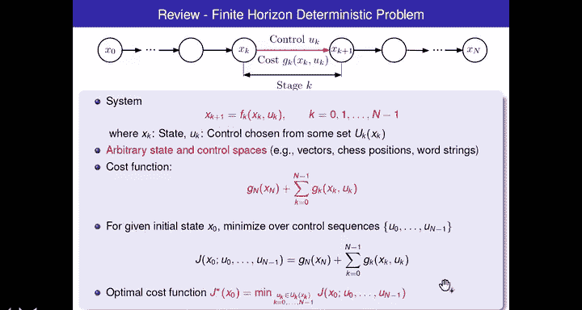

上一节我们介绍了确定性有限时域动态规划问题。本节中，我们先简要回顾其核心概念，为后续的随机问题学习打下基础。

我们有一个系统，在有限时域 N 内生成一系列状态：x₀, x₁, ..., x_N。下一个状态 x_{k+1} 由系统方程 f_k(x_k, u_k) 根据当前状态和控制生成。控制 u_k 从依赖于当前状态的某个集合中选择。每个状态转移都会产生一个依赖于状态和控制的成本 g_k(x_k, u_k)。总成本函数是各阶段转移成本之和，再加上一个依赖于最终状态的终端成本 G_N(x_N)。

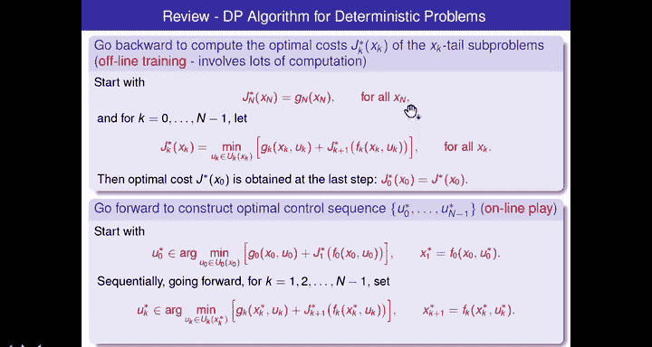

给定初始状态 x₀ 和一个可行的控制序列，成本是一个由上述表达式给出的数值。我们的目标是找到最优成本函数，即对所有可行控制序列进行最小化后，仅依赖于 x₀ 的标量函数 J*(x₀)。

我们讨论了动态规划算法和最优性原理。该算法计算从给定阶段 k 的状态 x_k 开始的所有尾部子问题的最优成本，记作 J*_k(x_k)。动态规划从终端阶段开始，仅使用终端成本函数，然后根据以下方程向后递推一步：

**J*_k(x_k) = min_{u_k ∈ U_k(x_k)} [ g_k(x_k, u_k) + J*_{k+1}( f_k(x_k, u_k) ) ]**

通过从 J*_N 向后计算到 J*_0，我们就得到了原始问题的最优成本函数。在完成所有 J* 的计算后，我们可以通过在线方式向前生成最优解：从初始状态开始，利用上述最小化方程依次获得最优控制和下一个状态。

然而，当状态空间非常大时，这种计算量是指数级增长的，这正是我们需要强化学习来简化计算的原因。

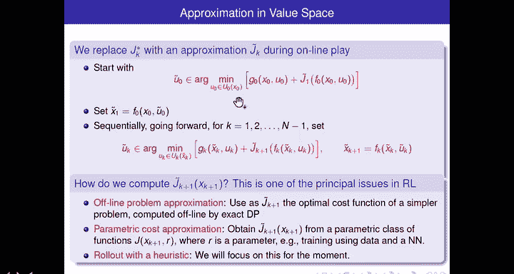

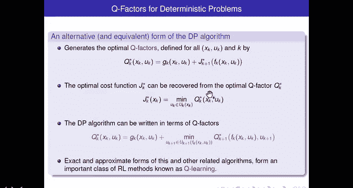

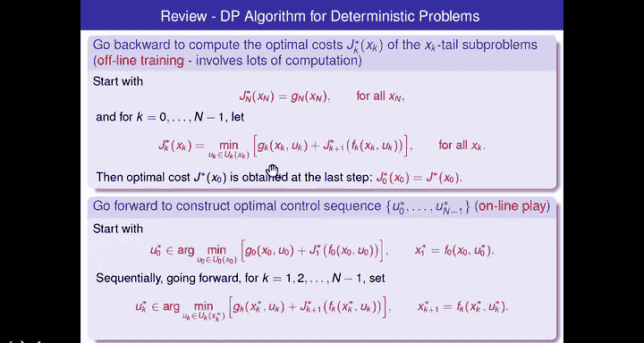

## Q因子与近似值空间简介 📊

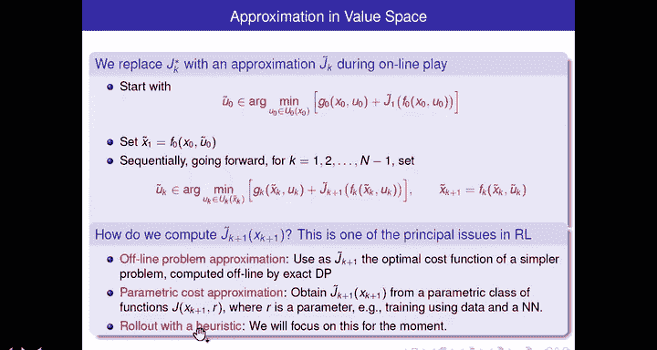

在深入强化学习之前，让我们先了解另一个概念：Q因子。

Q因子是状态-控制对 (x_k, u_k) 的函数。对于阶段 k 的 x_k 和 u_k，其形式如下：

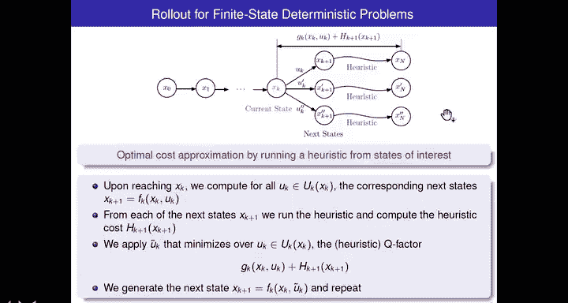

**Q*_k(x_k, u_k) = g_k(x_k, u_k) + J*_{k+1}( f_k(x_k, u_k) )**

它可以理解为：如果在状态 x_k 使用控制 u_k，然后在此之后采取最优行动，将会获得的成本。如果已知 J*，就可以计算 Q*；反之，如果已知 Q*，也可以通过最小化 Q* 来恢复 J*。动态规划算法也可以用 Q 因子等价地表示。

基于 Q 因子的算法在强化学习中出现在多种不同的设置中，统称为 Q学习。

现在，让我们进入近似值空间。由于计算 J* 非常耗时，我们用一个近似值 J̃_k 来替代每个阶段的最优成本 J*_k，这个近似值是状态 x_k 的函数。然后，我们可以在在线游戏过程中，通过最小化以下表达式来生成一系列次优控制：

**min_{u_k ∈ U_k(x_k)} [ g_k(x_k, u_k) + J̃_{k+1}( f_k(x_k, u_k) ) ]**

这比涉及 J* 的计算要容易得多，因此它是近似动态规划中的主要方法。当然，关键问题是如何获得这些 J̃，这是强化学习中的一个核心议题。

以下是获取 J̃ 的一些思路：
*   **离线问题近似**：解决一个更简单的、但看起来相似的问题，并使用其解作为原始问题最优成本函数的近似。
*   **参数化函数类**：使用带有参数 r 的函数（如神经网络）来参数化 J̃，并通过数据训练来获得好的参数值。
*   **基于启发式的 rollout 方法**：我们将在下一张幻灯片中说明。

## 基于启发式的 Rollout 方法 🚀

上一节我们介绍了近似值空间的概念。本节中，我们来看一种具体的近似方法：基于启发式的 Rollout。

我们处理的是离散控制空间（有限个控制选项）。我们将用某个启发式方法的成本函数来近似最优成本函数。这个启发式方法本身不一定是最优的。

以下是 Rollout 的工作方式：到达状态 x_k 后，我们考虑所有可能在该状态使用的控制。对于每个控制，我们运行某个启发式方法（称为基启发式），从下一个状态 x_{k+1} 开始生成直到结束的轨迹，并计算其总成本 H_{k+1}(x_{k+1})。我们将这个启发式成本作为最优成本的替代，即我们的近似 J̃_{k+1}。然后，我们选择使“当前阶段成本 + 启发式成本”最小的控制 ũ_k 来应用。接着，我们转移到下一个状态，并重复此过程。

让我们用一个类似作业中的四城市旅行商问题（ABCD）来举例说明。城市间的旅行成本由矩阵给出。假设我们使用“最近邻”启发式作为基启发式：从给定城市出发，总是前往尚未访问过的、距离最近的城市。

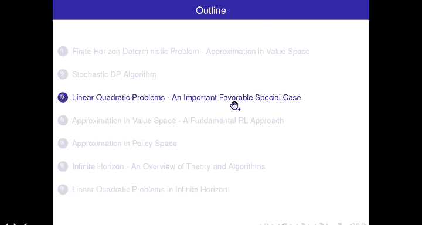

在 Rollout 算法中，我们从城市 A 开始。对于每个可能的下一城市（B, C, D），我们运行最近邻启发式来完成整个旅程，并计算总成本（即近似的 Q 因子）。比较这些成本后，Rollout 选择成本最低的路径（例如 A->B）。到达 B 后，我们再次对剩余的可能城市运行最近邻启发式，选择最佳路径，依此类推。

在这个例子中，Rollout 算法通过比寻找全局最优解简单得多的计算（多项式复杂度），生成了一条轨迹，其性能优于单纯的基启发式，并且在这个特定例子中恰好也是最优的。Rollout 方法通常能有效改进任何启发式方法，无论其好坏，且计算相对简单。

## 随机动态规划算法 🎲

现在，让我们进入随机动态规划。

我们将问题推广到包含随机不确定性。系统在 n 个阶段内生成状态 x₀ 到 x_N。从状态 x_k 到下一个状态 x_{k+1} 的转移由一个方程控制，该方程依赖于控制 u_k 和一个随机扰动 w_k。因此，下一个状态并非由控制选择唯一确定，我们只能说在给定当前状态和控制下，下一个状态有一个由 w_k 的概率分布决定的条件概率分布。

同样存在成本函数 g_k(x_k, u_k, w_k)。总成本是各阶段成本（现在是随机变量）的累积和加上终端成本。为了得到一个表征控制序列性能的数值，我们需要取期望值。因此，我们的成本函数是期望总成本。

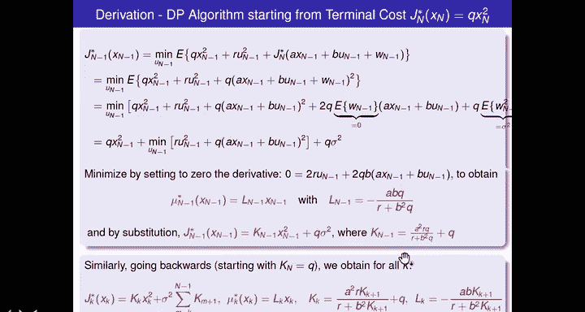

在随机问题中，我们必须考虑策略。策略不是控制序列，而是一系列控制函数 μ₀, μ₁, ..., μ_{N-1}。这些函数决定了在给定阶段对给定状态应用何种控制。这是因为系统演进中，我们会到达不同的状态，根据观察到的状态选择控制是有益的，这被称为反馈策略或闭环控制律。对于随机问题，反馈策略比开环控制序列有实质性的优势。

给定初始状态 x₀ 和一个策略 π，成本是一个随机变量，取其期望值就得到从 x₀ 开始执行该策略的期望成本 J_π(x₀)。最优成本 J*(x₀) 是通过对所有策略最小化 J_π(x₀) 得到的。

动态规划算法可以扩展到这种设置。它生成从阶段 k 的状态 x_k 开始的最优尾部子问题成本 J*_k(x_k)。算法从终端成本开始，向后递推，公式与确定性情况类似，但增加了对随机扰动 w_k 的期望：

**J*_k(x_k) = min_{u_k ∈ U_k(x_k)} E_{w_k} [ g_k(x_k, u_k, w_k) + J*_{k+1}( f_k(x_k, u_k, w_k) ) ]**

其直观理解和数学推导与确定性情况相似。算法以类似方式工作：从末端开始，向后计算到阶段 0，得到最优成本函数。在反向计算过程中，我们可以为每个可能遇到的状态计算最优控制，从而构造出最优策略。或者，我们也可以在线向前实施最优策略。

这里存在一些重大问题：计算 J*_k 是一项艰巨的任务，特别是对于连续状态空间或大规模离散状态空间，因为我们需要计算期望并进行最小化，这通常非常困难。这就是强化学习试图简化这些计算的地方。

## 线性二次问题示例 📉

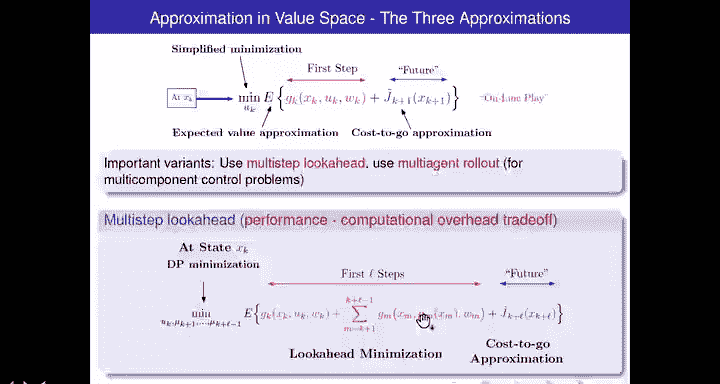

在深入近似值空间和强化学习之前，让我们看一个例子。在这个例子中，问题结构非常有利，我们可以解析地获得最优解。

这是一个重要的问题，涉及线性系统和二次成本函数。我们考虑一维情况（状态为标量）。系统是线性的：x_{k+1} = a x_k + b u_k + w_k，其中 a, b 是已知标量，w_k 是零均值的随机扰动。每个阶段的成本是二次的：g_k = q x_k² + r u_k²，其中 q, r 是给定的正标量，用于惩罚状态和控制偏离零值。终端成本也是二次的：G_N = q x_N²。

动态规划算法从终端成本开始，根据前述公式向后生成 J*_{N-1}, J*_{N-2} 等。主要结论是，该算法可以以封闭形式进行，并且产生以下形式的最优成本函数：J*_k(x_k) = K_k x_k² + 常数，其中 K_k 可以通过递推公式计算。此外，最优策略是线性的：u*_k = L_k x_k，其中 L_k 也可以解析计算。

一个非常有利的结果是，最优策略不依赖于 w_k 的分布（只要其均值为零），它只依赖于均值。这称为确定性等价原理。对于线性二次问题，它精确成立。这个结果可以推广到多维线性二次问题。

## 近似值空间方法全景图 🗺️

现在，让我们回到近似值空间，这是强化学习中的一个非常基础的方法。

其思想很简单。在动态规划中，我们在给定状态最小化“当前阶段成本 + 从下一状态开始的最优未来成本”。在近似值空间中，我们用某个近似成本函数 J̃ 来近似这个最优未来成本 J*。这就是近似值空间。

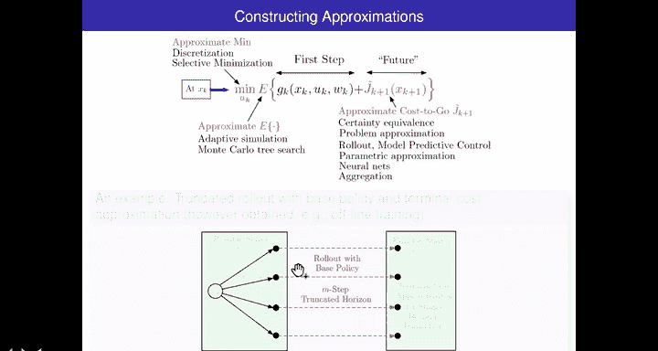

请注意，这是一种适用于在线游戏的方法：一旦有了 J̃，我们就可以通过上述最小化向前推进。除了这种成本近似，还有其他困难需要处理：
1.  **成本近似**：用 J̃ 近似 J*。
2.  **期望值近似**：对于随机问题，计算期望可能非常耗时，可以通过模拟（蒙特卡洛）或使用典型值（某种形式的确定性等价）来近似。
3.  **最小化简化**：最小化本身可能很困难，可以考虑简化最小化过程。

这三种近似可以或多或少独立地组合。强化学习的艺术和实践很大程度上与处理这三种近似的不同方法有关。

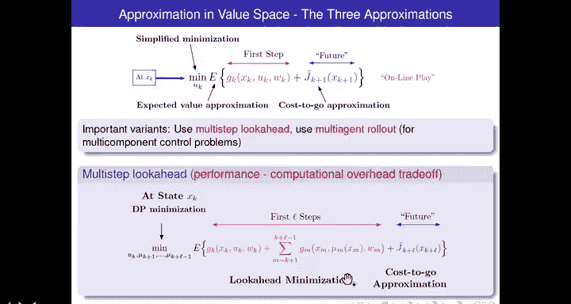

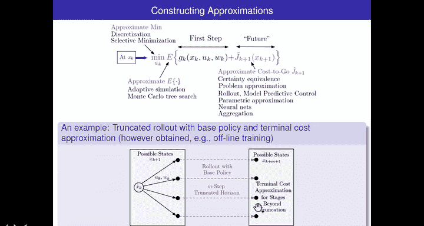

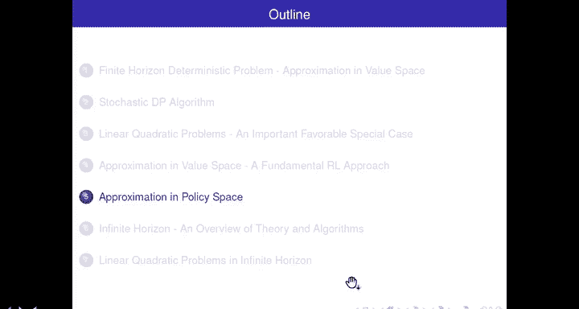

一个重要的变体是多步前瞻。单步前瞻只向前看一步，然后用 J̃ 近似未来。多步前瞻则涉及向前看 L 步，然后用 J̃ 近似更远的未来。这本身是一个更小的动态规划问题（时域 L）。在线实施时，我们求解这个 L 步问题，但只应用第一步的控制，然后转移到新状态并重复此过程。多步前瞻通常能提高性能，但计算量更大，需要在性能和计算预算之间权衡。

在多步前瞻中，我们同样面临成本近似、期望值近似和最小化简化这三种近似。

## 构建近似的方法 🛠️

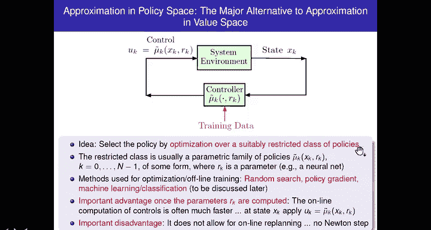

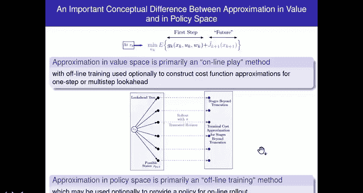

以下是构建近似 J̃ 的不同方法概览：

*   **问题近似**：精确或近似地解决一个更简单的类似问题，并使用其成本函数作为 J̃。
*   **确定性等价**：用确定性（更简单）问题替代随机问题。
*   **聚合**：通过聚合变量，用低维问题替代原始问题，并以其最优成本函数作为 J̃。
*   **Rollout**：如前所述。
*   **模型预测控制**：涉及特殊类型的 J̃。
*   **神经网络参数化近似**：通过神经网络学习成本函数，这是一个主要方法。

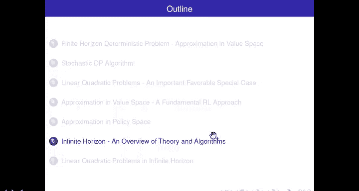

近似期望值的一个重要方法是使用自适应模拟。在许多强化学习情境中，通过蒙特卡洛模拟计算期望，可以根据控制的重要性调整模拟次数。

近似最小化可以通过离散化连续空间、粗化网格、或根据启发式准则精简控制约束集来实现。

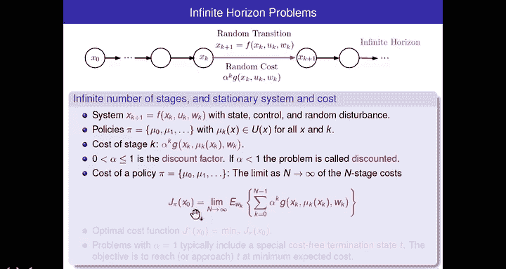

所有这些技巧都是近似值空间方法论的组成部分，可应用于单步和多步前瞻。

Rollout 也可以进行截断：从给定状态，对多个步骤（而非直到结束）运行基策略，然后使用成本函数近似来估计剩余阶段的成本。

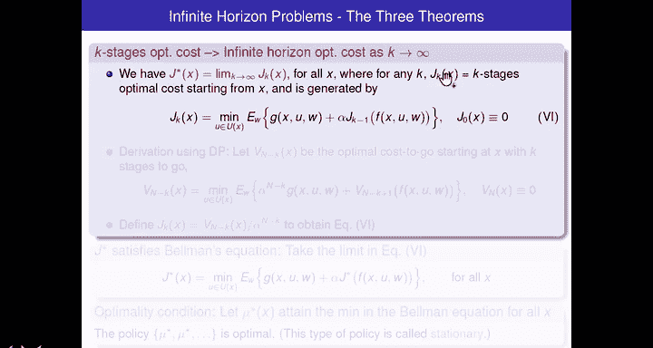

## 策略空间近似 🔧

现在，我们进入策略空间近似，这是近似值空间的主要替代方法。

在近似值空间中，我们近似成本函数（值函数）。在这里，我们近似策略。我们通过在一个适当受限的策略类中进行优化来选择策略。通常，这个类涉及参数化策略族，即策略不仅依赖于状态，还依赖于一个可调参数 r，我们通过数据学习这个参数。

给定一个参数 r，就确定了一个控制器（例如神经网络），形成一个闭环系统。目标是优化参数，以优化该闭环系统的性能。这是一个在参数空间中的最小化问题，可以使用许多不同的优化方法，例如随机搜索、策略梯度方法或基于分类的机器学习算法。

策略空间近似的一个重要优势是，一旦计算出参数，控制器在线响应非常快：观察状态，通过神经网络几乎瞬时计算出控制。相比之下，近似值空间在线需要进行更多计算。

但它也有缺点：一旦选择了参数，就被其固定。如果问题发生变化（例如，系统动态改变），这种离线训练的方法不允许在线重新规划。从理论角度看，它也不涉及我们之前提到的牛顿步长。

## 值空间与策略空间近似的结合 🤝

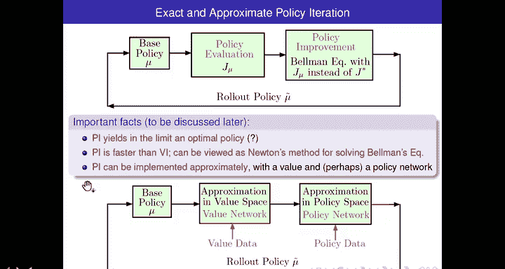

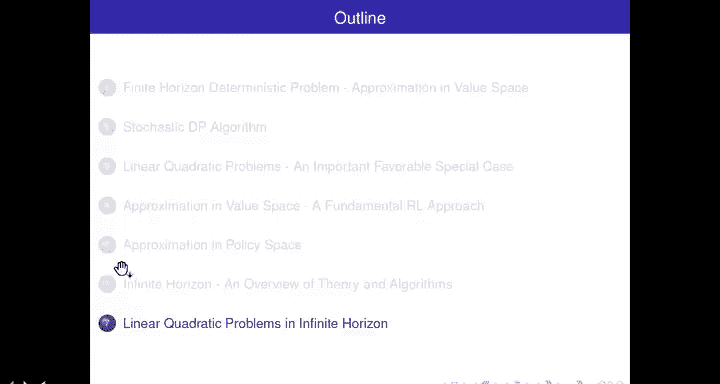

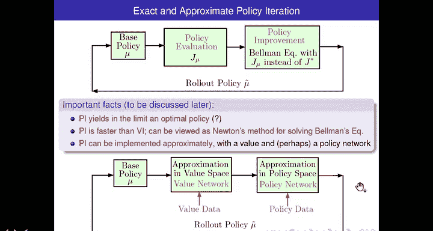

我们可以将两种方法结合。例如，在近似值空间的基础上进行策略空间近似，以获得快速响应的优势。

假设我们已经通过近似值空间获得了近似成本函数 J̃。这些 J̃ 通过单步或多步前瞻最小化定义了一个次优策略。在线实施这个次优策略涉及大量最小化计算。为了简化，我们可以离线学习一个策略 μ̃ 来近似这个次优策略。我们通过生成大量“状态-控制”对训练集（状态来自代表性集合，控制来自前述前瞻策略），然后通过最小二乘拟合等方式，学习一个参数化策略族中的策略来匹配这些对。这样，训练好的策略 μ̃ 在线给出控制的速度比进行最小化快得多。

在我们的课程中，我们将主要关注近似值空间。策略空间近似的方法将在课程后期用大约一讲或一讲半的时间讨论。

## 无限时域问题概述 ♾️

现在，我们简要讨论无限时域问题，概述其理论和算法。

无限时域问题类似于随机有限时域动态规划，但阶段数是无限的。系统是平稳的（f 不依赖于 k）。我们考虑策略，每个阶段一个控制函数。每个阶段的成本由函数 g 决定，但按折扣因子 α (0 < α < 1) 进行折扣。这确保了即使阶段数无限，总成本也是有限的（只要 g 有界）。最优成本函数 J*(x) 是初始状态 x 的函数。

对于无限时域问题，有三个主要的定理：
1.  **值迭代收敛**：有限时域最优成本随着时域增长收敛于无限时域最优成本。即，J*(x) = lim_{K→∞} J_K(x)，其中 J_K 是 K 阶段最优成本，可以通过值迭代算法生成：J_{k+1}(x) = min_{u} E[ g(x,u,w) + α J_k( f(x,u,w) ) ]。
2.  **贝尔曼方程**：最优成本函数 J* 满足贝尔曼方程：J*(x) = min_{u} E[ g(x,u,w) + α J*( f(x,u,w) ) ]。这是一个函数方程，是无限时域动态规划中最基本的对象。
3.  **最优策略**：如果 μ*(x) 在贝尔曼方程右侧达到最小值，则 μ* 是一个最优平稳策略（不依赖于阶段）。

有两种主要算法：
*   **值迭代**：如上所述，通过迭代求解有限时域问题来逼近 J*。
*   **策略迭代**：从一个策略开始，交替进行策略评估（计算该策略的成本函数 J_μ）和策略改进（通过单步前瞻最小化生成新策略 μ'）。策略迭代通常比值迭代快得多，可以看作是求解贝尔曼方程的牛顿法。

在强化学习中，策略迭代可以近似实现（近似策略迭代），例如使用值网络和策略网络，这是 AlphaZero 等算法的基础框架。

## 无限时域线性二次问题 📈

让我们将无限时域理论专门化到线性二次问题，考虑确定性情况（随机情况可通过确定性等价处理）。系统为 x_{k+1} = a x_k + b u_k，阶段成本为 g(x,u) = q x² + r u²，折扣因子为 α。

贝尔曼方程为：J*(x) = min_u [ q x² + r u² + α J*( a x + b u ) ]。

可以证明，J*(x) 是二次的：J*(x) = K* x²，其中 K* 是以下 Riccati 方程的解：
**K = q + α a² K - (α² a² b² K²) / (r + α b² K)**

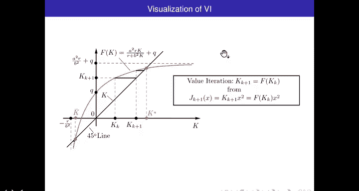

最优策略是线性的：u* = L* x，其中 L* = - (α a b K*) / (r + α b² K*)。

通过绘制函数 F(K) = q + α a² K - (α² a² b² K²)/(r + α b² K) 和直线 y=K 的图形，可以直观地求解 Riccati 方程（交点即 K*）。这个图形还可以用来可视化值迭代（一个阶梯状迭代收敛到 K*）和理解策略迭代（速度更快）。这种可视化对于理解近似值空间方法（如 rollout 作为牛顿步）提供了直观见解，并且其思想可以推广到线性二次问题之外。

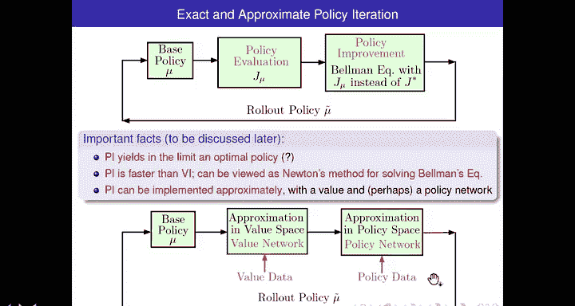

## 总结与下节预告 📚

本节课中，我们一起学习了：
*   随机有限时域动态规划问题的表述和算法。
*   近似值空间的基本思想，包括成本近似、期望近似和最小化简化。
*   基于启发式的 Rollout 方法及其在旅行商问题中的应用。
*   线性二次问题作为可解析求解的典型案例。
*   策略空间近似及其与值空间近似的对比和结合。
*   无限时域问题的基本理论、贝尔曼方程以及值迭代和策略迭代算法。
*   无限时域线性二次问题的求解和图形化理解。

在接下来的课程中，我们将深入探讨牛顿步解释，并将其与 rollout 和策略迭代联系起来。我们还将概述动态规划和强化学习中的其他问题类型，如随机最短路径、状态扩充、部分可观马尔可夫决策过程、多智能体问题、自适应控制和模型预测控制等