# 3：线性二次问题、值空间近似与问题建模艺术 🎯

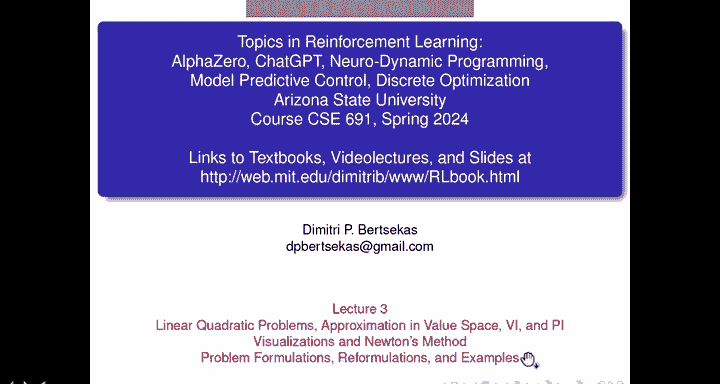

在本节课中，我们将回顾上节课开始的线性二次问题，讨论针对这些问题的值空间近似方法，包括值迭代和策略迭代算法。我们将重点通过可视化来理解这些主题，并探讨它们与牛顿法的联系。在课程的第二部分，我们将讨论如何将实际问题表述为动态规划问题，并通过一些例子来展示这一“建模艺术”。

## 线性二次问题回顾与可视化 📈

上一节我们介绍了动态规划的基本框架。本节中，我们来看看一个经典且可解析求解的特例：无限时域线性二次问题。

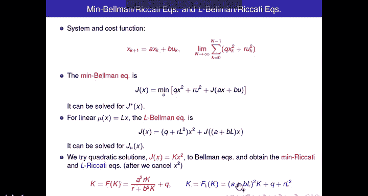

我们有一个线性系统：
`x_{k+1} = A x_k + B u_k`
其中 A 和 B 是已知矩阵。为简化，我们考虑确定性情况（结论同样适用于随机情况）。成本函数是二次型的：
`g(x, u) = Q x^2 + R u^2`
其中 Q 和 R 是给定的正数。我们的目标是最小化从初始状态 x 开始的无限时域总成本 `J*(x)`。

根据贝尔曼方程，最优成本函数 `J*(x)` 满足：
`J*(x) = min_u [ g(x, u) + J*(A x + B u) ]`
我们称之为**最小贝尔曼方程**。

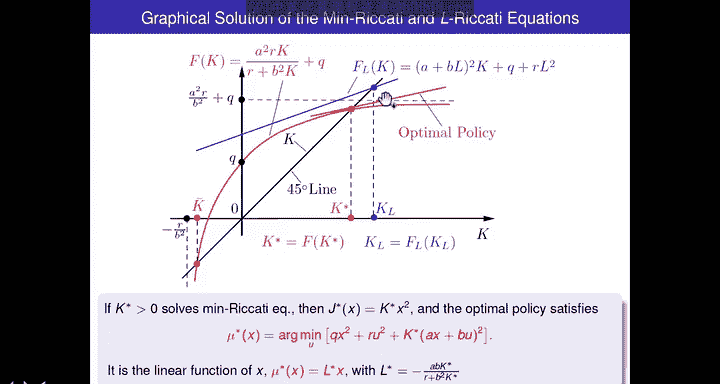

对于一个给定的线性策略 `μ(x) = L x`，其成本函数 `J_μ(x)` 满足**线性贝尔曼方程**：
`J_μ(x) = g(x, Lx) + J_μ(A x + B L x)`

对于线性二次问题，一个关键特性是这些贝尔曼方程的解是二次型的。我们尝试 `J(x) = K x^2` 形式的解。将其代入最小贝尔曼方程，经过化简（消去 `x^2`），我们得到**里卡蒂方程**：
`K = Q + R * (A^2 K) / (R + B^2 K)`
我们定义**里卡蒂算子** `F(K)` 为上述等式的右边部分，因此方程简写为 `K = F(K)`。

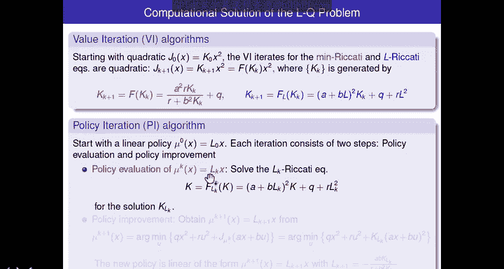

类似地，对于线性策略 `μ(x) = L x`，其成本系数 `K_L` 满足**线性里卡蒂方程**：
`K_L = Q + R L^2 + (A + B L)^2 K_L`
这可以写成 `K_L = F_L(K_L)`，其中 `F_L` 是线性算子。

以下是这些方程的图形化表示：

*   **最小里卡蒂方程**：解 `K*` 是曲线 `F(K)` 与 45 度线 `K` 的交点。
*   **线性里卡蒂方程**：对于给定策略 L，其成本 `K_L` 是直线 `F_L(K)` 与 45 度线的交点。
*   **最优策略**：最优策略系数 `L*` 对应的直线 `F_{L*}(K)` 与曲线 `F(K)` 在 `K*` 处相切，并且是所有策略直线中位置最低的（即下包络）。

## 值迭代与策略迭代 🔄

上一节我们通过图形理解了方程的解。本节中，我们来看看求解这些方程的两种经典算法。

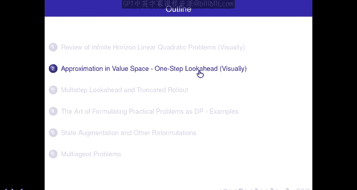

对于无限时域问题，我们有两种主要算法：值迭代和策略迭代。在线性二次问题中，它们可以简化为对成本系数 K 的迭代。

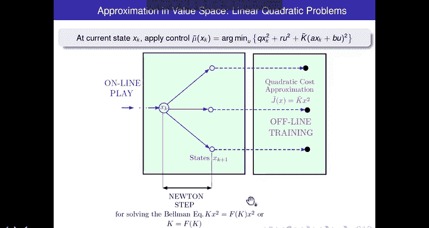

**值迭代** 从某个初始猜测 `K_0` 开始，反复应用里卡蒂算子：
`K_{k+1} = F(K_k)`
在图形上，这表现为一个“阶梯”过程，从 `K_0` 开始，垂直移动到曲线 `F(K)`，再水平移动到 45 度线，如此反复，最终收敛到 `K*`。

**策略迭代** 则迭代于策略之上。它从一个初始（稳定的）线性策略 `L_0` 开始，每次迭代包含两步：
1.  **策略评估**：对于当前策略 `L_k`，求解线性里卡蒂方程 `K_{L_k} = F_{L_k}(K_{L_k})`，得到其成本系数 `K_k`。
2.  **策略改进**：假设未来成本由 `J_k(x) = K_k x^2` 近似，通过一步最小化来改进策略：
    `L_{k+1} = argmin_L [ g(x, Lx) + K_k (A x + B L x)^2 ]`
    这个最小化问题有闭式解，可以得到新的策略系数 `L_{k+1}`。

策略迭代可以看作是重复的“ rollout ”操作，并且收敛速度通常比值迭代快得多。

## 稳定性概念与区域 🛡️

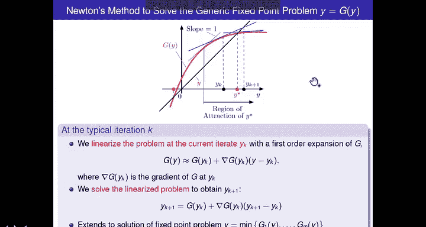

在深入值空间近似之前，我们需要理解一个关键概念：策略的稳定性。

对于一个线性策略 `μ(x) = L x`，其闭环系统为 `x_{k+1} = (A + B L) x_k`。如果 `|A + B L| < 1`，则系统是稳定的，状态会渐近收敛到零。如果 `|A + B L| > 1`，则系统不稳定，状态会发散到无穷大。

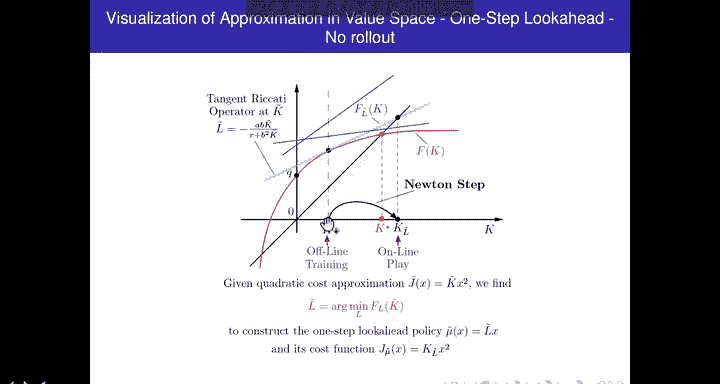

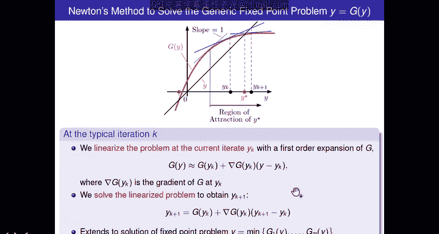

在线性二次问题的图形中：
*   **稳定策略**：其对应的线性里卡蒂算子 `F_L(K)` 的斜率 `(A + B L)^2 < 1`，该直线会与 45 度线相交于一个正的点 `K_L`。
*   **不稳定策略**：其对应的直线斜率 `(A + B L)^2 > 1`，可能不与 45 度线相交于正区域（或根本不相交），其成本在理论上为无穷大。

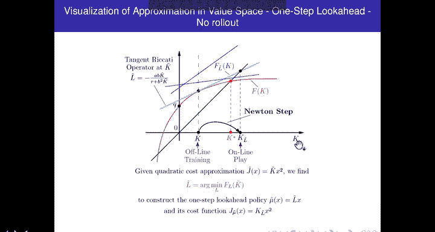

在策略迭代中，我们必须从一个稳定的初始策略开始，以确保算法有效。稳定性在更广泛的强化学习中也至关重要，不稳定的策略或算法可能导致灾难性的失败。

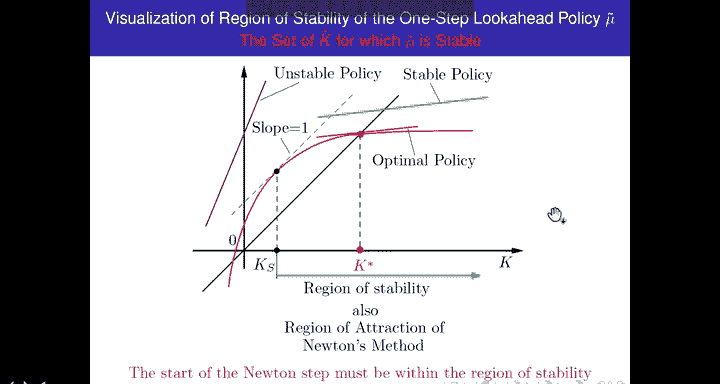

## 值空间近似与牛顿法 ⚙️

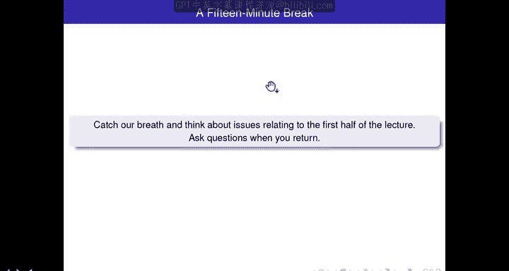

现在，我们进入本节课的核心主题之一：值空间近似，并揭示其与牛顿法的深刻联系。

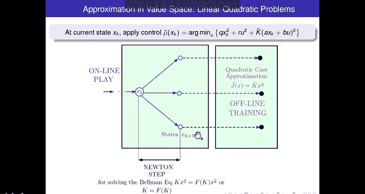

**值空间近似（一步前瞻）** 的基本思想是：在状态 x 处，我们使用一个近似的未来成本函数 `J̃(x) = K̃ x^2`（可能通过离线训练得到）来代替真实的最优成本 `J*(x)`。然后，我们通过求解以下问题来生成当前的控制：
`μ̃(x) = argmin_u [ g(x, u) + J̃(A x + B u) ]`
这个策略 `μ̃` 被称为**一步前瞻策略**。

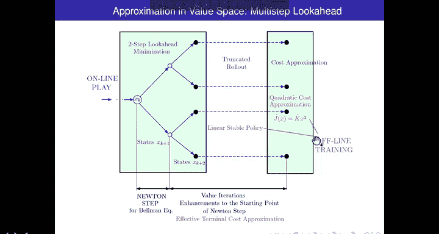

这个过程的图形解释如下：给定近似成本系数 `K̃`，我们寻找一条经过点 `(K̃, F(K̃))` 且与 `F(K)` 曲线相切的直线。这条切线对应的策略就是一步前瞻策略 `L̃`，该直线与 45 度线的交点给出了这个策略的成本系数 `K_{L̃}`。

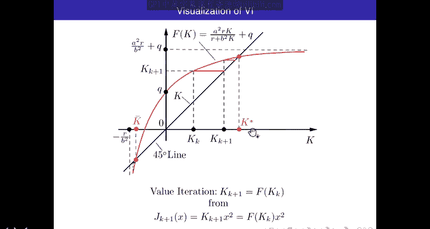

**关键洞察**：从 `K̃` 到 `K_{L̃}` 的这一步，**恰好就是求解里卡蒂方程 `K = F(K)` 的一个牛顿迭代步**。

牛顿法是一种强大的数值方法，用于求解方程 `y = g(y)`。在当前迭代点 `y_k`，它构造 `g` 的线性化（切线），然后求解线性化方程得到下一个迭代点 `y_{k+1}`。当初始点靠近解时，牛顿法收敛极快（超线性收敛）。然而，如果初始点离解太远，它可能发散。

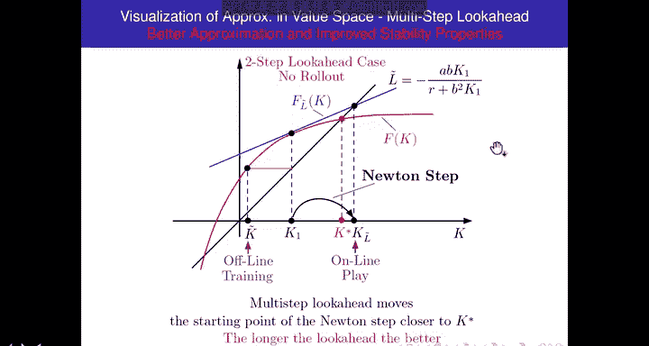

因此，一步前瞻值空间近似的效果强烈依赖于初始近似 `K̃` 的质量。如果 `K̃` 在牛顿法的“吸引域”内（对于里卡蒂方程，通常指 `K̃ > K_s`，其中 `K_s` 是斜率为1的点），则生成的政策是稳定且接近最优的。否则，可能产生不稳定或性能很差的策略。

## 多步前瞻与截断 Rollout 🚀

上一节我们看到，一步前瞻的效果受限于成本近似的质量。本节中，我们通过多步前瞻和截断 Rollout 来增强它。

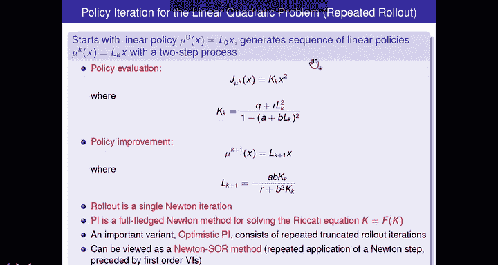

**多步前瞻** 在决策时向前看多个步骤，只在最后一步使用成本函数近似 `J̃`。例如，在两步前瞻中，我们求解一个两阶段的最优化问题，其中第二阶段末的成本用 `J̃` 近似。

图形上，这可以解释为：在应用最终的一步前瞻（牛顿步）之前，我们先对初始近似 `K̃` 执行一次或多次值迭代（`K_1 = F(K̃)`）。值迭代的作用是将 `K̃` 推向 `K*`，从而为后续的牛顿步提供一个更好的起点。因此，多步前瞻等价于从一个“增强”后的起点执行牛顿步。

**截断 Rollout** 是另一种增强方法。它使用一个简单的**基策略** `μ` 来模拟从某个状态开始的一段未来轨迹，并将这段轨迹的成本加上最终状态的成本近似 `J̃` 作为对未来总成本的估计。然后，基于这个估计来选择当前动作。

在线性二次问题中，如果基策略是稳定的线性策略 `L`，其成本为 `K_L`，那么使用 `J_μ` 作为近似的 Rollout 政策，其成本系数可以通过图形上的一个牛顿步从 `K_L` 得到。由于稳定的基策略通常对应 `K_L > K*`，而这个区域的牛顿步非常有效，所以 Rollout 策略通常比基策略好得多，并且也是稳定的。

多步前瞻和截断 Rollout 的核心价值在于：
1.  **提升性能**：通过更深入的搜索或利用基策略的智慧，得到更好的决策。
2.  **改善稳定性**：即使初始的成本近似 `J̃` 很差（例如，位于牛顿法吸引域之外），多步前瞻中的值迭代步骤或一个稳定的 Rollout 基策略，可以将搜索引导至一个更稳定的区域，从而使方法生效。
3.  **计算权衡**：更长的前瞻步数或更长的 Rollout 深度意味着更好的性能潜力，但也伴随着更高的在线计算成本。

## 策略迭代的牛顿法视角 🔬

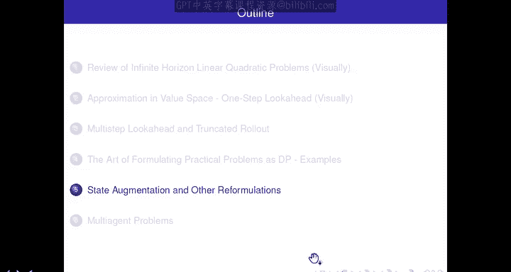

基于上述洞察，我们可以重新审视策略迭代：
*   **一次策略迭代（即 Policy Evaluation + Policy Improvement）** 可以看作是对当前策略成本 `K_{L_k}` 应用了一个完整的牛顿步，得到了新策略的成本 `K_{L_{k+1}}`。
*   **完整的策略迭代算法** 因此就是一个完整的牛顿法，用于求解里卡蒂方程。这解释了为什么策略迭代通常比值迭代（一种一阶收敛方法）收敛得快得多。
*   **乐观策略迭代** 是策略迭代的一个变种，其中策略评估不是精确完成的，而是通过有限次的值迭代来近似。这对应于数值分析中的 **牛顿-SOR 方法**，它在每个牛顿步之前进行几次一阶迭代。

这些将近似动态规划与经典优化方法联系起来的观点，具有高度的普适性，可以推广到非线性、随机甚至非光滑的问题中。

## 实际问题建模：动态规划的艺术 🎨

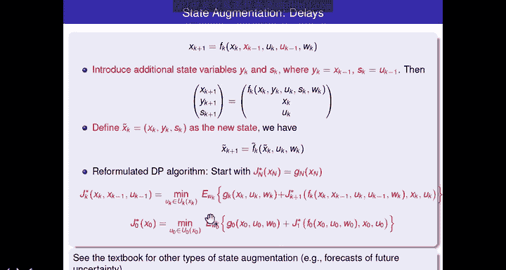

课程的第二部分，我们从理论转向实践，探讨如何将实际问题表述为动态规划或强化学习问题。这是一门“艺术”，因为通常没有唯一的正确答案。

以下是建模的基本步骤和建议：
1.  **定义控制（动作）**：明确在每个阶段可以做出的决策。
2.  **定义阶段**：根据信息到达和决策需要做出的时间点来划分阶段。
3.  **定义状态**：这是最关键也最灵活的一步。状态应**总结过去的所有信息，使得只要知道当前状态，未来的优化问题就与过去的历史独立**。状态是做出决策所需信息的充分统计量。

## 状态扩增：强大的建模工具 🔧

许多实际问题并不直接符合标准动态规划模型。**状态扩增** 是一种通过引入额外状态变量将问题转化为标准形式的强大技术。

**典型例子：带延迟的系统**
假设系统方程包含延迟：`x_{k+1} = f(x_k, x_{k-1}, u_k, u_{k-1}, w_k)`。要应用动态规划，我们需要知道 `x_k`, `x_{k-1}`, `u_{k-1}` 才能决定 `u_k` 并预测 `x_{k+1}`。因此，我们可以定义**扩增状态**为 `s_k = (x_k, x_{k-1}, u_{k-1})`。这样，新的系统方程变为：
```
s_{k+1} = ( x_{k+1}, x_k, u_k ) = ( f(x_k, x_{k-1}, u_k, u_{k-1}, w_k), x_k, u_k )
```
它只依赖于当前扩增状态 `s_k`、当前控制 `u_k` 和扰动 `w_k`，符合标准形式。然后就可以对扩增状态空间应用动态规划算法。代价是状态维数增加，可能导致“维数灾难”。

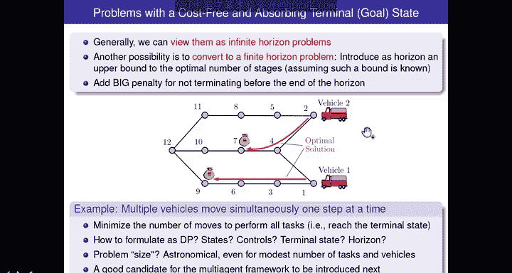

状态扩增的应用非常广泛，例如处理：
*   包含过去状态或控制延迟的系统。
*   包含对未来不确定性（如需求预测）的预测信息的问题。

## 多智能体问题与 Rollout 简化 🤖

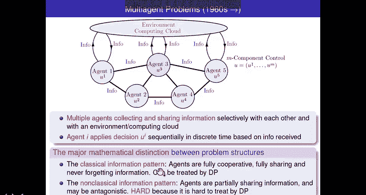

多智能体决策问题是一类重要的难题，其中多个决策者（智能体）协同完成一项任务。如果所有智能体**完全共享信息并协作**（经典信息模式），那么可以将所有智能体的联合控制视为一个整体控制向量 `u = (u^1, u^2, ..., u^M)`，从而将问题转化为一个（控制维数极高的）集中式动态规划问题。

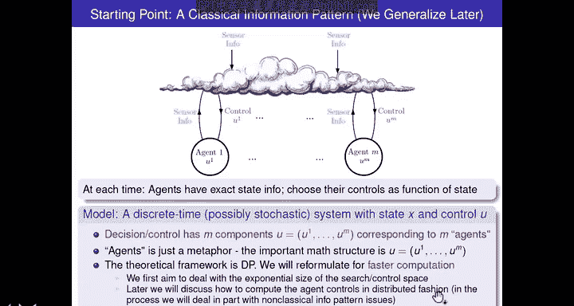

主要挑战在于**联合控制空间是指数级大的**：如果每个智能体有 `n` 种选择，M 个智能体的联合选择有 `n^M` 种。直接进行一步前瞻搜索的计算量无法承受。

**解决方案：基于控制空间展开的多智能体 Rollout**
关键思想是将联合控制 `u` 的选择分解为一系列顺序决策。我们不是同时选择所有 `u^i`，而是：
1.  先为智能体1选择 `u^1`。
2.  在已知 `u^1` 的情况下，为智能体2选择 `u^2`。
3.  依此类推，直到为智能体M选择 `u^M`。

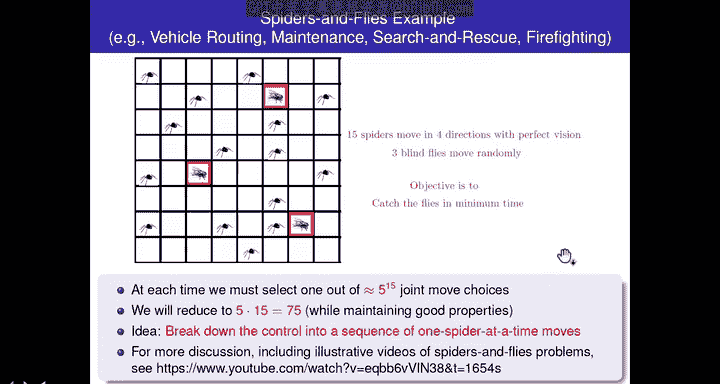

这可以通过状态扩增来实现：将“已做出的部分决策”也纳入状态。这样，在每个子步骤，我们只需要为一个智能体在 `n` 个选项中做出选择。整个顺序决策过程的总分支因子从 `n^M` 降为 `n * M`，计算量大幅减少。

虽然这增加了状态空间的维度，但 **Rollout 算法只关心从当前状态出发的模拟**，而不会遍历所有可能的状态，因此不受状态维数增加的影响。这种“顺序 Rollout”算法仍然保持了牛顿步的特性，在实践中被证明非常有效，能以可接受的计算成本处理大规模多智能体问题。

## 总结 📝

本节课中我们一起学习了：
1.  **线性二次问题的可视化分析**：通过图形理解里卡蒂方程、最优策略以及值迭代和策略迭代的过程。
2.  **值空间近似的牛顿法本质**：认识到一步前瞻策略的生成相当于求解贝尔曼方程的一个牛顿迭代步，其效果和稳定性依赖于初始近似的质量。
3.  **增强策略**：通过多步前瞻和截断 Rollout 可以改善成本近似，提升策略性能并扩大稳定区域，但这需要权衡计算成本。
4.  **动态规划问题建模的艺术**：重点是状态的定义，它需要充分总结历史信息。状态扩增是处理非标准问题（如带延迟系统、部分观测问题）的关键技术。
5.  **多智能体问题的挑战与简化**：针对完全协作的多智能体问题，通过控制空间展开和顺序 Rollout，可以极大地降低在线计算复杂度，使其变得可行。

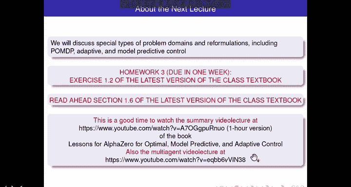

这些概念为后续深入学习更复杂的强化学习算法和应用奠定了坚实的基础。