# 5：确定性Rollout与成本改进 📘

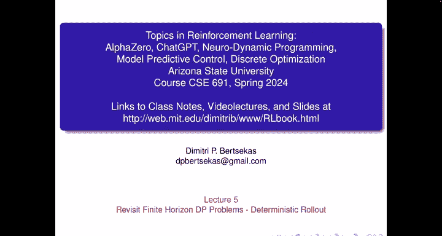

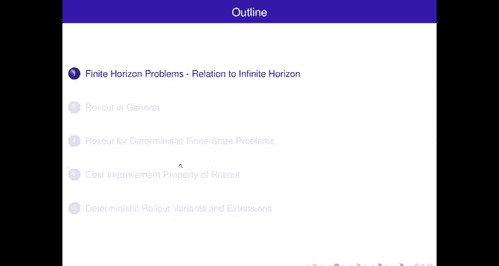

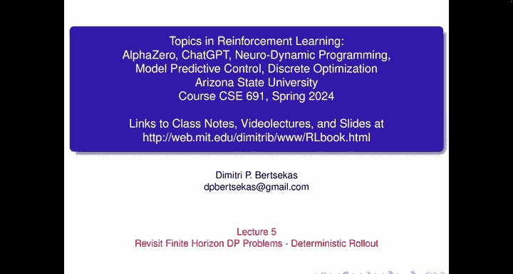

在本节课中，我们将深入学习有限时域动态规划问题，并深入探讨确定性Rollout方法。我们将看到如何将有限时域问题转化为无限时域问题，并详细分析Rollout的工作原理、性能保证及其多种变体。

***

## 🔗 有限时域与无限时域问题的联系

上一节我们介绍了近似值空间方法的基本直觉，这些直觉主要围绕无限时域问题展开。本节中，我们来看看有限时域问题如何继承这些优良特性。

### 有限时域动态规划问题回顾

我们给定状态空间和控制空间。在特定状态 \(X_k\)，系统方程 \(f_k\) 接受状态 \(X_k\)、控制 \(U_k\) 和随机扰动 \(W_k\)，并输出下一个状态 \(X_{k+1}\)。\(W_k\) 可以代表物理噪声、市场不确定性或库存需求等不可预测因素。

成本函数 \(g_k\) 同样依赖于随机扰动 \(W_k\)。对于一个从初始状态开始的给定控制序列，总成本是沿轨迹的所有阶段成本之和，加上终止成本 \(g_N\)，再取其期望值。

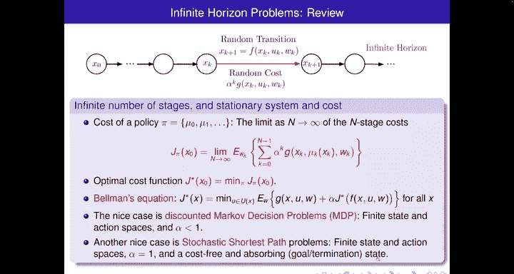

策略 \(\pi\) 是一组函数 \(\mu_0\) 到 \(\mu_{N-1}\)，每个函数根据当前状态输出一个动作。我们的目标是最小化从初始状态 \(x_0\) 出发的策略成本 \(J_\pi(x_0)\)，最优成本记为 \(J^*(x_0)\)。

### 动态规划算法

有限时域动态规划算法通过逆向递推求解。我们从终止成本 \(J_N(x_N) = g_N(x_N)\) 开始，对于每个阶段 \(k\) 和每个状态 \(x_k\)，计算最优“尾部子问题”成本：
\[
J_k^*(x_k) = \min_{u_k \in U_k(x_k)} E\{ g_k(x_k, u_k, w_k) + J_{k+1}^*(f_k(x_k, u_k, w_k)) \}
\]
计算出所有 \(J_k^*\) 后，我们可以通过前向计算得到最优策略。

然而，当状态空间很大时，精确求解是棘手的。因此，我们转向近似值空间方法，只进行前向计算，并使用近似未来成本 \(\tilde{J}_{k+1}\) 来代替 \(J_{k+1}^*\)。

### 与无限时域问题的等价构造

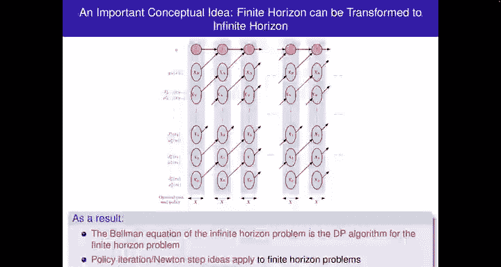

为了将有限时域问题与无限时域问题联系起来，我们可以进行如下构造，将任意有限时域问题转化为一个特定的无限时域问题：

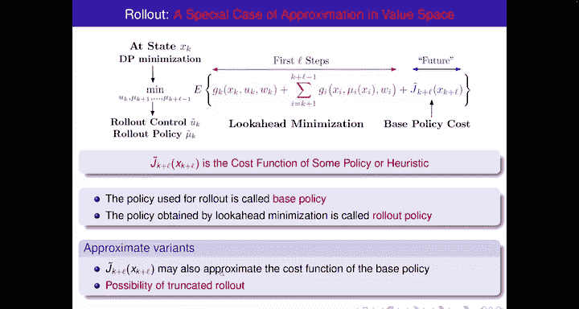

*   **状态空间**：取所有阶段状态的并集 \(\bigcup_{k=0}^{N} X_k\)，并添加一个终止状态 \(t\)。在这个构造中，不同阶段的相同物理状态被视为不同的状态。
*   **控制空间**：取所有阶段可用控制的并集 \(\bigcup_{k=0}^{N-1} U_k\)。
*   **系统动态**：直接采用有限时域问题的系统方程 \(f_k\)。
*   **成本函数**：直接采用有限时域问题的阶段成本 \(g_k\)，并确保从终止状态 \(t\) 出发的所有转移成本为零。

在这个构造中，从初始状态出发的轨迹最多经过 \(N+1\) 步就会到达终止状态 \(t\)，之后成本为零。可以证明，这个无限时域问题的贝尔曼方程与有限时域问题的动态规划递推方程完全等价。这意味着，所有针对无限时域问题（例如牛顿法）的分析和直觉都可以应用于有限时域问题。

***

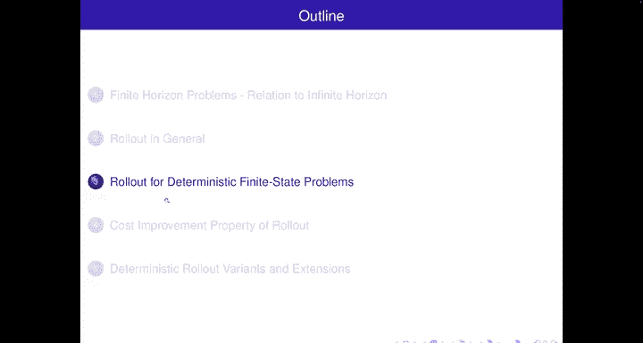

## 🎯 Rollout方法详解

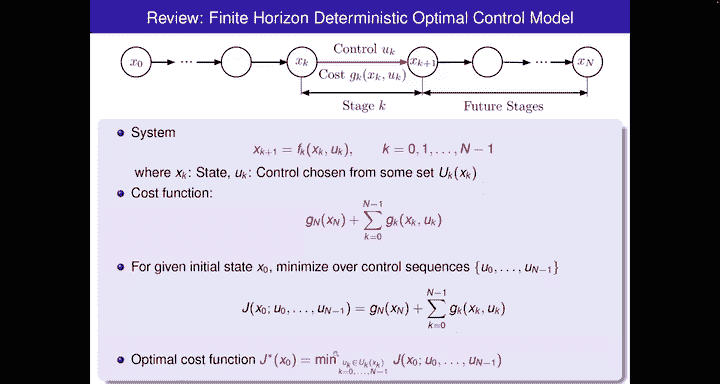

现在，让我们深入探讨Rollout方法，它是近似值空间方法的一个特例。

### 基本概念

在状态 \(X_k\)，Rollout执行以下最小化计算（可能包含 \(L\) 步前瞻）：
\[
\tilde{u}_k \in \arg\min_{u_k \in U_k(x_k)} E\{ g_k(x_k, u_k, w_k) + \tilde{J}_{k+1}(f_k(x_k, u_k, w_k)) \}
\]
其中，近似未来成本 \(\tilde{J}_{k+1}\) 是通过模拟一个**基策略**（base policy）得到的。这个基策略可以是一个启发式方法。通过这种最小化得到的控制 \(\tilde{u}_k\) 称为**Rollout控制**，由此生成的策略称为**Rollout策略**。

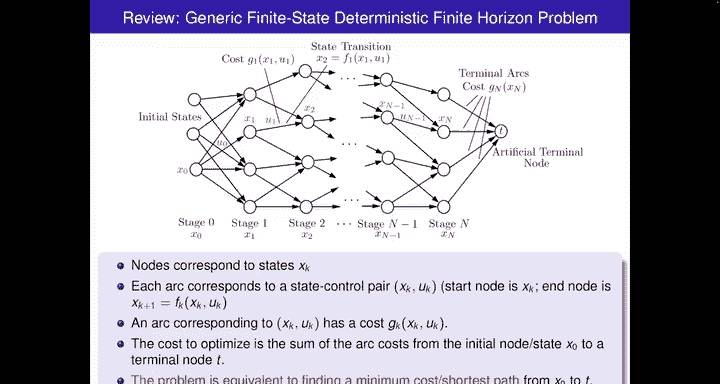

### Rollout的重要性

以下是Rollout方法重要的几个原因：
*   **成本上界近似**：Rollout从上方近似最优成本，这有助于避免稳定性问题。
*   **策略迭代的基础**：单次Rollout迭代等价于策略迭代算法的一次迭代。
*   **在线执行**：完整的轨迹可以在线计算，无需离线预计算。
*   **易于理解和实现**：相比许多复杂的强化学习方法，Rollout更直观、更可靠。
*   **通用性**：适用于确定性和随机性问题，以及有限和无限时域问题。
*   **与牛顿法的联系**：在近似值空间的框架下，从基策略成本到Rollout策略成本的改进可以看作一个牛顿步。

对于课程项目，如果你刚接触强化学习，强烈建议考虑使用Rollout作为核心方法，因为它更容易编码且更可能成功。

***

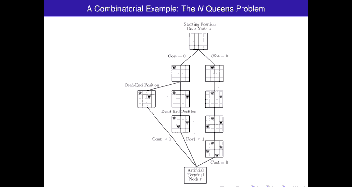

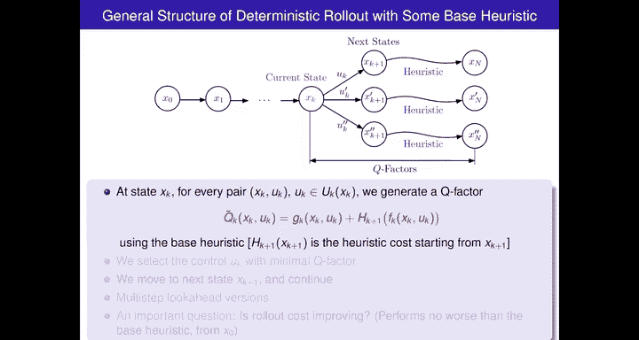

## ⚙️ 确定性有限状态问题的Rollout

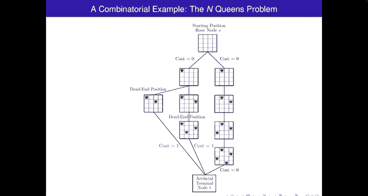

上一节我们介绍了Rollout的一般形式，本节中我们来看看它在确定性有限状态问题中的应用。

### 问题表述与图表示

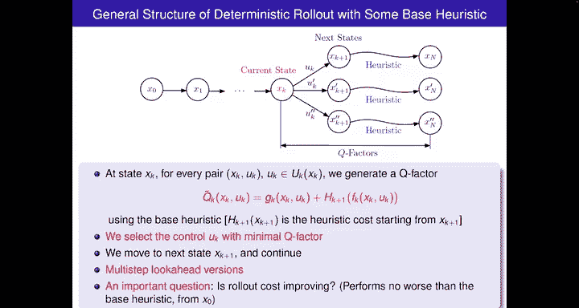

确定性最优控制问题可以表述为：给定状态空间、系统方程 \(x_{k+1} = f_k(x_k, u_k)\) 和成本函数，目标是找到最小化总成本的控制序列。

这类问题可以表示为一个有向无环图。节点对应各阶段的状态，弧对应状态-控制对，并带有成本 \(g_k(x_k, u_k)\)。目标是从初始节点 \(x_0\) 到终止节点 \(t\) 找到一条最短路径。

一个自然的问题是：既然这等价于在图中找最短路径，而我们有高效的最短路径算法（如Dijkstra算法），为什么还需要近似方法？原因在于**图的规模可能极其巨大**。例如，在旅行商问题中，状态是部分排列，数量是阶乘级的。虽然最短路径算法在图的规模上是多项式时间，但图本身的规模是超大的，因此精确求解仍然不可行。

### 组合优化问题示例

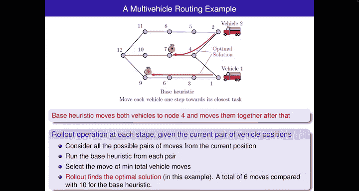

Rollout可以应用于许多组合优化问题。以下是两个例子：

**N皇后问题**：目标是在N×N棋盘上放置N个皇后，使其互不攻击。我们可以将其建模为一个顺序决策过程：状态是部分放置（已放置皇后的行及其位置），控制是为下一行选择一个列。基启发式（例如贪心放置）用于评估完成部分放置的成本。Rollout通过一步前瞻，选择能带来最低预估总成本（基启发式成本+立即成本）的列进行放置。

**多车辆路径问题**：多辆车需要访问一组任务点，目标是总行驶距离最短。可以使用“最近邻”启发式作为基策略（每辆车驶向最近的任务点）。Rollout在每一步会考虑所有车辆下一步可能位置的组合，对每种组合模拟运行基启发式得到未来成本，并选择总成本最低的行动组合。在实际例子中，Rollout策略的成本显著低于单纯的基启发式策略。

**树中搜索N步突破路径**：在一个深度为N的二叉树中搜索一条无阻塞的路径，边以一定概率被阻塞。贪心启发式（优先向右）的复杂度是 \(O(N)\)，但可能很快陷入死路。精确动态规划的复杂度是 \(O(N \cdot 2^N)\)。Rollout的复杂度是 \(O(N^2)\)，它在每一步进行两次启发式模拟。可以证明，在随机生成的树上，Rollout找到突破路径的概率比单纯贪心启发式高出一个线性因子。

***

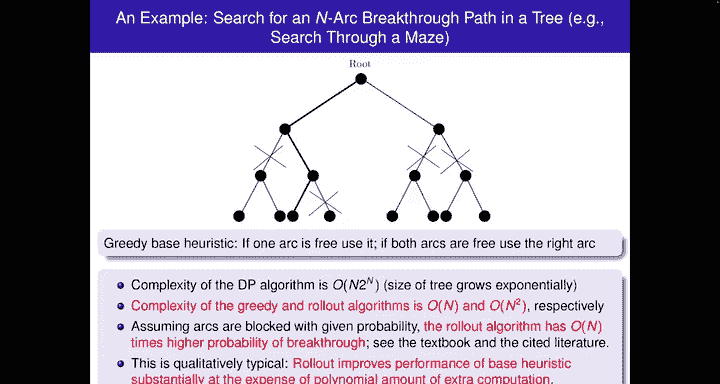

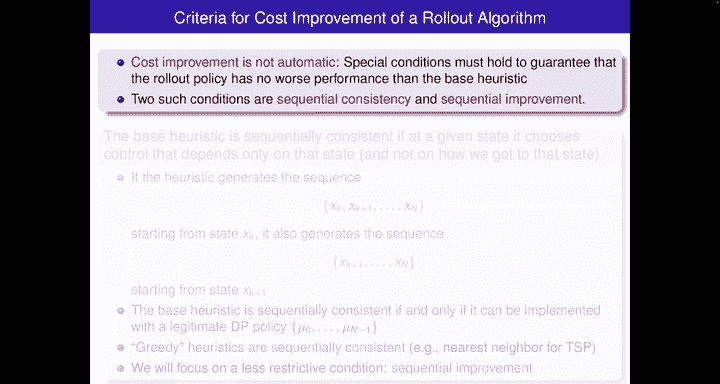

## 📈 Rollout的成本改进性质

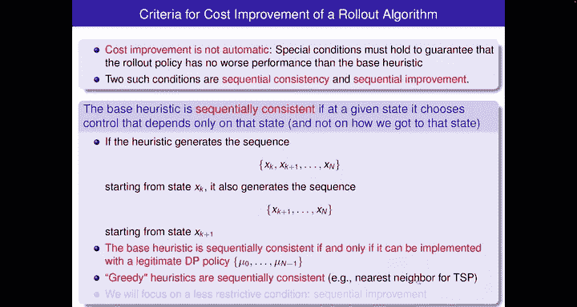

我们自然希望Rollout策略的性能不差于基策略。但这并非自动成立，需要满足特定条件。

### 顺序一致性 vs. 顺序改进

**顺序一致性**：一个启发式是顺序一致的，如果它在给定状态选择的控制仅依赖于该状态，而不依赖于到达该状态的路径。换句话说，从状态 \(x_k\) 生成的序列，其尾部必须与从 \(x_{k+1}\) 状态直接启动启发式生成的序列相同。贪心启发式通常是顺序一致的。

**顺序改进**：这是一个更一般（限制更少）的条件。一个启发式是顺序改进的，如果对于所有状态 \(x_k\)，满足：
\[
\min_{u_k \in U_k(x_k)} [g_k(x_k, u_k) + H_{k+1}(f_k(x_k, u_k))] \leq H_k(x_k)
\]
其中 \(H_k(x_k)\) 是从 \(x_k\) 开始使用启发式的成本。这意味着，通过一步前瞻优化得到的最佳Q因子，不会比直接从当前状态运行启发式的成本更差。

**关系**：如果启发式是顺序一致的，那么它必然是顺序改进的。但反过来不一定成立。

### 成本改进的直观理解与示例

当基启发式满足顺序改进条件时，Rollout算法在线生成的一系列轨迹 \(R_0, R_1, ..., R_N\) 具有单调非增的成本，即 \(cost(R_0) \geq cost(R_1) \geq ... \geq cost(R_N)\)。其中 \(R_0\) 是纯基策略轨迹，\(R_N\) 是最终的Rollout策略轨迹。因此，Rollout策略的成本保证不高于基策略成本。

以旅行商问题的最近邻启发式为例，我们可以直观看到Rollout如何逐步生成成本更低的轨迹，最终得到优于初始启发式的解。

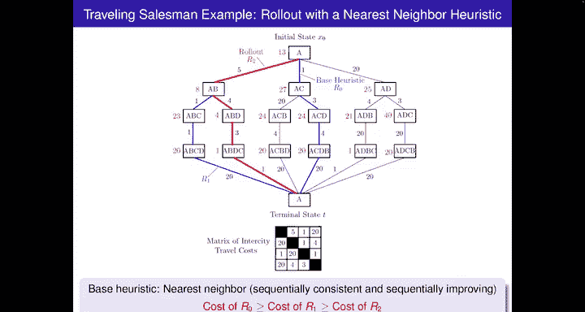

### 不满足条件时的反例

如果基启发式不满足顺序改进条件，Rollout的性能可能比基策略更差。一个构造的反例显示，Rollout可能从一个本已是最优的基策略轨迹上偏离，转而选择一条更差的路径。这引出了**强化Rollout**的变体。

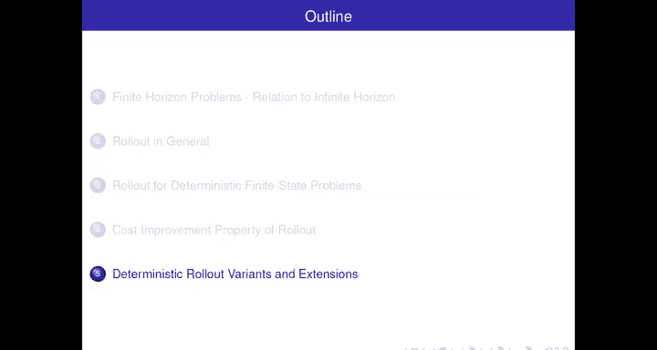

***

## 🔄 确定性Rollout的变体与扩展

最后，我们介绍几种Rollout的重要变体，以应对不同挑战。

### 简化Rollout

当控制空间非常大时（例如Wordle游戏中初始猜测有上万单词可选），计算所有控制的Q因子代价高昂。简化Rollout不要求选择最小Q因子的控制，而是选择**任何一个Q因子不差于当前启发式成本**的控制。这聚焦于一个有希望的小控制子集，能节省大量计算，同时仍能保持成本改进性质。

### 超启发式Rollout

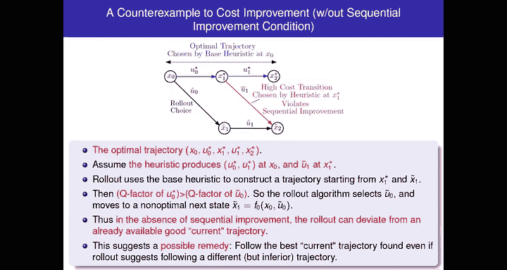

有时很难确定哪个单一启发式作为基策略最好。超启发式Rollout同时运行多个启发式，在每个状态选择这些启发式中给出的最好（成本最低）的轨迹作为基策略输出。可以证明，如果所有组成的启发式都是顺序改进的，那么超启发式也是顺序改进的。

### 强化Rollout

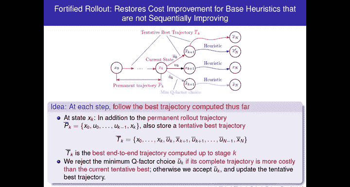

针对基启发式不满足顺序改进条件的情况，强化Rollout旨在恢复成本改进保证。其核心思想是：在在线执行过程中，不仅遵循Rollout的决策，还**在内存中保留当前找到的最佳轨迹及其成本**。在每一步，如果Rollout建议的控制所对应的完整轨迹成本，高于当前存储的最佳轨迹成本，则拒绝Rollout的建议，转而遵循当前最佳轨迹的下一步。这样可以防止Rollout偏离已知的好解。

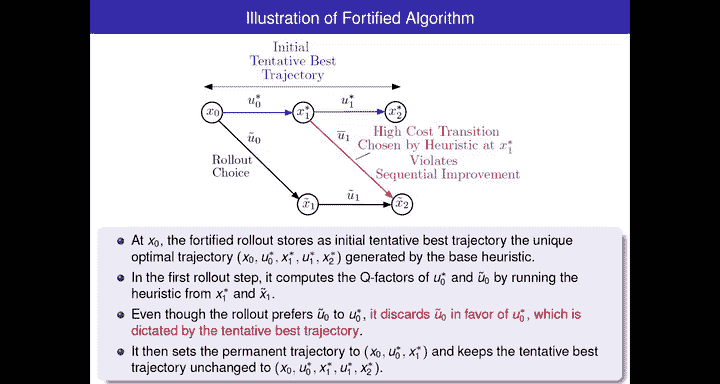

### 基于专家的无模型Rollout

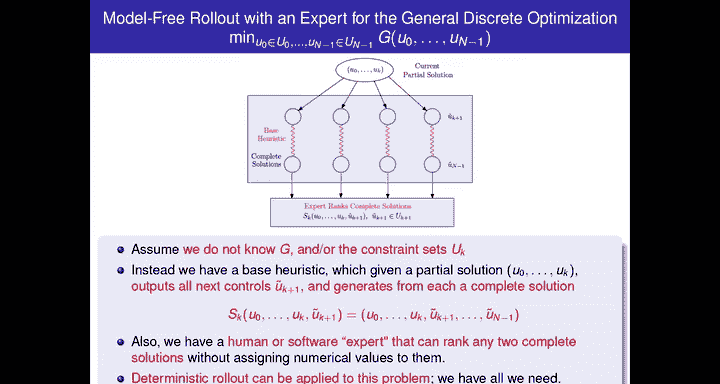

在某些问题中，我们可能没有明确的成本函数 \(G\)，甚至不清楚约束。基于专家的无模型Rollout依赖于一个“专家”（可以是人或软件），该专家能够：
1.  给定一个部分解，生成一个完整的解（充当基启发式）。
2.  比较任意两个完整解，判断孰优孰劣（提供排序能力）。
有了这两点，我们就可以执行Rollout：在每一步，用专家补全各种可能的下一步选择，然后用专家比较这些完整解，选择排名最高的那个下一步。这种方法已成功应用于RNA折叠等实际问题中。

***

## 🎓 总结

本节课中我们一起学习了：
1.  **有限与无限时域问题的联系**：通过一个构造，可以将任何有限时域动态规划问题转化为一个等价的无限时域问题，从而继承后者的分析工具和直觉。
2.  **Rollout方法核心**：Rollout是近似值空间方法的一种，通过一步（或多步）前瞻并模拟一个基启发式来近似未来成本，从而在线生成改进的策略。它是策略迭代的单次迭代，并与牛顿法有深刻联系。
3.  **确定性问题的应用**：Rollout可广泛应用于组合优化问题（如N皇后、车辆路径），通过将问题建模为顺序决策并在图上执行Rollout来寻找优质解。
4.  **性能保证**：Rollout策略成本不差于基策略成本的条件是基启发式满足**顺序改进**（或更强的顺序一致性）条件。
5.  **主要变体**：我们探讨了**简化Rollout**（处理大控制空间）、**超启发式Rollout**（组合多个启发式）、**强化Rollout**（应对非顺序改进的基策略）和**基于专家的无模型Rollout**（当成本函数未知时）。

下一讲，我们将继续深入，探讨多步前瞻Rollout、约束问题的Rollout以及在整数规划中的应用。