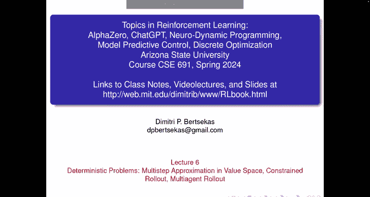
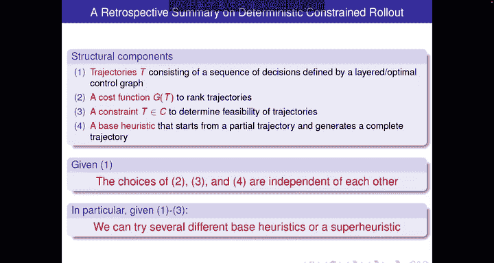
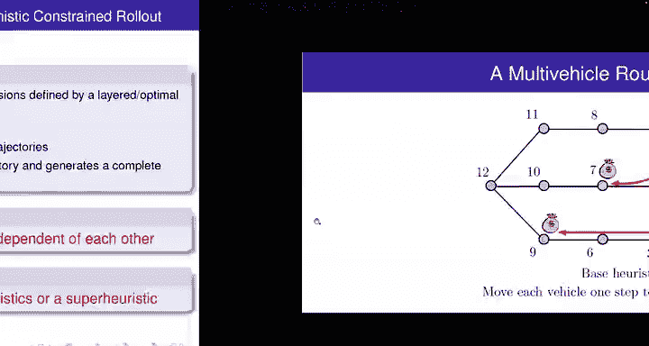
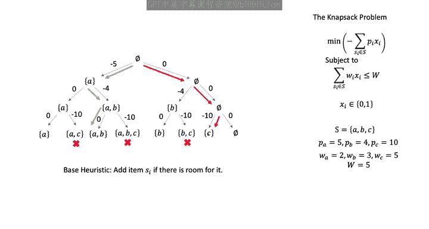
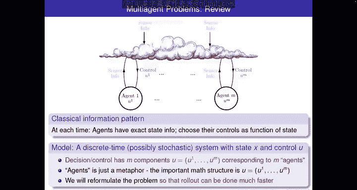
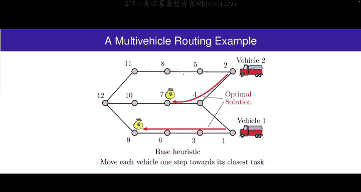
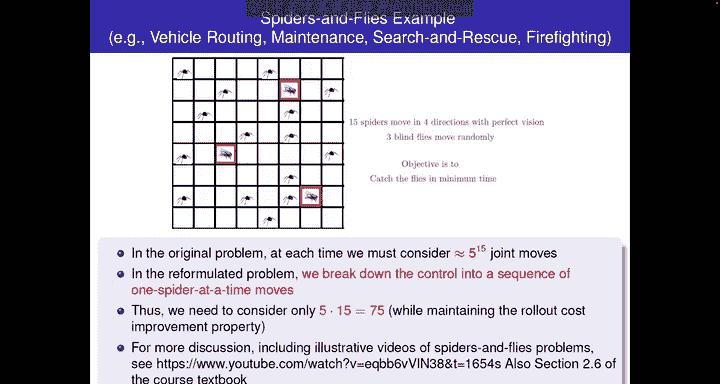
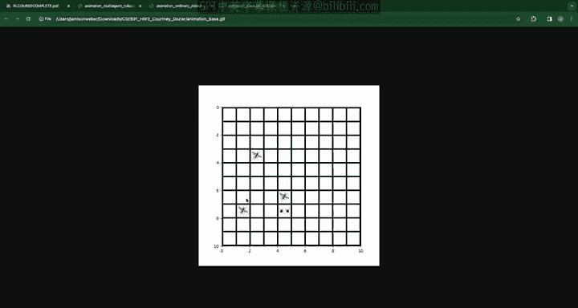

# 6：值空间多步近似与约束优化 🧠

## 概述
在本节课中，我们将深入学习确定性问题的多步近似方法，重点探讨如何在值空间中进行多步前瞻以优化计算，并介绍约束条件下的Rollout算法。这些技术对于理解复杂优化问题和完成当前作业至关重要。

---

## 第一部分：值空间中的多步近似前瞻 🌳

上一节我们介绍了值函数近似的基础，本节中我们来看看如何通过多步前瞻来提升策略质量，同时管理计算成本。

多步近似在值空间中的核心思想是构建一个有限深度的前瞻树。我们从当前状态 `Xk` 出发，考虑未来 `L` 步内所有可能的控制序列，形成一个树状结构。树的节点代表状态，弧代表施加的控制。对于树末端的叶节点，我们使用一个终端成本函数近似值 `J̃`（可能结合了基础启发式策略）进行评估。

**核心公式：** 我们的目标是找到从 `Xk` 到 `Xk+L` 的轨迹，最小化路径成本与终端近似成本之和：
`min Σ g(x_i, u_i) + J̃(x_k+L)`

一个重要的观察是：**前瞻步数越长，通常策略性能越好**（例如AlphaGo Zero的成功便基于此）。然而，计算成本会随前瞻步数 `L` 呈指数级增长。

为了在计算预算内工作，我们引入了 **“随时算法”** 的概念。该算法迭代地进行前瞻计算，每次迭代增加前瞻深度。在任何时刻中断算法，它都能返回上一次迭代得到的一个可行解，确保我们总能获得一个结果。

以下是几种优化多步前瞻计算的主要技术：

1.  **使用截断Rollout**：在叶节点运行基础策略时，只模拟有限步长而非到终点。这能将计算复杂度从指数级降低为多项式级。
2.  **前瞻树剪枝**：在构建前瞻树时，忽略那些成本远高于同层其他节点的状态和轨迹，从而缩小搜索空间，用相同的计算预算看得更远。

### 前向动态规划算法
为了配合“随时算法”的迭代加深过程，我们采用**前向动态规划**。这与标准的反向动态规划方向相反。

我们定义函数 `D_n(x_n)`，表示从初始状态 `x_0` 到第 `n` 层状态 `x_n` 的最短路径成本。其递推公式为：
`D_{n+1}(x_{n+1}) = min_{x_n} [ D_n(x_n) + g(x_n, u_n) ]`
其中，`u_n` 是使状态从 `x_n` 转移到 `x_{n+1}` 的控制。

通过从 `x_0` 开始逐层向前计算，我们可以高效地复用之前迭代的结果。

### 增量多步Rollout与动态剪枝
这是一种更灵活的树搜索算法，具有类似Dijkstra或A*搜索的风格。

算法维护一个从根节点 `x_0` 开始的无环连通子图 `S`。在每次迭代中：
1.  计算子图 `S` 中所有节点 `x` 的 `D(x)`（从 `x_0` 到 `x` 的最短成本）。
2.  找到一个叶节点 `x*`，它最小化 `D(x) + H(x)`，其中 `H(x)` 是一个启发式估计，表示从 `x` 到目标层的大致成本。
3.  扩展子图 `S`：将节点 `x*` 的所有后继节点（即应用所有可能控制后到达的新状态）加入 `S`。

**启发式函数 `H(x)` 示例：**
`H(x) = (基础启发式策略从x到终点的成本) + J̃(终点) + δ * (从x_0到x的跳数)`
参数 `δ` 控制探索与利用的权衡：
*   `δ = 0`：倾向于深度优先搜索，树形瘦长，可能错过好解。
*   `δ` 很大：倾向于广度优先搜索，树形宽大，探索更全面。

---

## 第二部分：确定性最优控制的约束Rollout 🚫

现在，我们来看待一类更复杂的问题：轨迹必须满足额外约束的确定性最优控制问题。例如，在旅行商问题中，我们可能要求总“风险”成本不能超过某个上限。

处理约束最直接的想法是：在Rollout过程中，直接丢弃所有导致不可行（违反约束）轨迹的候选控制。但这可能存在问题，因为早期的一个决策可能会在未来导致无法满足约束，从而陷入“死胡同”。

### 问题重构：状态扩增
为了解决约束耦合问题，我们再次使用**状态扩增**技术。我们将状态重新定义为**部分轨迹**。
新状态 `y_k = (x_0, u_0, x_1, u_1, ..., x_k)`，即到当前时刻为止的所有历史状态和控制序列。

这样，原问题转化为在新状态空间上最小化终端成本 `G(y_N)`，并满足约束 `y_N ∈ C`（`C` 是全体可行完整轨迹的集合）。这解耦了阶段间的约束干扰。

### 约束Rollout算法步骤
给定当前部分轨迹状态 `y_k`：
1.  **生成候选**：对每个可能的控制 `u_k`，生成扩展的部分轨迹 `y_{k+1}`。
2.  **完成轨迹**：对每个 `y_{k+1}`，运行基础启发式策略 `R`，得到一个完整的候选轨迹 `T(y_k, u_k)`。
3.  **可行性筛选**：从所有控制 `u_k` 中，筛选出那些能使完整轨迹 `T(y_k, u_k)` 满足约束（即属于 `C`）的子集，记为可行控制集 `Ũ_k`。
4.  **最小化选择**：从可行控制集 `Ũ_k` 中，选择能使完整轨迹成本 `G(T(y_k, u_k))` 最小的控制作为Rollout决策。
`ũ_k = argmin_{u_k ∈ Ũ_k} G( T(y_k, u_k) )`

### 理论性质：序列改进与序列一致
要使约束Rollout保证成本改进，基础启发式策略需要满足**序列改进**条件，这比无约束情况多一个要求：
1.  在Rollout可能访问的**任何**部分轨迹状态 `y_k` 处，可行控制集 `Ũ_k` **非空**（即总能找到至少一个可行后续动作）。
2.  在 `y_k` 处，通过Rollout选择的最小Q因子成本，不大于直接从 `y_k` 运行基础启发式策略的成本。

如果基础启发式策略不满足序列改进条件，我们可以使用**强化版约束Rollout**。它维护一个“当前最佳”可行轨迹。当Rollout找不到更优的可行轨迹时，则继续跟随当前最佳轨迹。这要求基础启发式策略**必须能从初始状态生成一个可行解**。

---

## 第三部分：多智能体问题与重构 🤖

最后，我们探讨多智能体问题。在经典信息模式中，一个中央计算云可以自由与所有 `M` 个智能体通信，收集状态并分发控制指令。控制 `u` 是一个 `M` 维向量。

直接应用Rollout的挑战在于：如果每个智能体有 `n` 种可能动作，那么联合动作空间大小为 `n^M`，最小化计算是指数级的。

### 重构：以空间换时间
我们通过**状态扩增**来重构问题，将一步 `M` 维决策拆解为 `M` 步一维决策，从而用状态复杂度的增加换取控制复杂度的急剧下降。

**重构方法：**
1.  从原状态 `x` 开始。
2.  选择第一个智能体的控制 `u_1`，转移到新状态 `(x, u_1)`，并产生阶段成本 `g_1(x, u_1)`。
3.  选择第二个智能体的控制 `u_2`，转移到新状态 `(x, u_1, u_2)`，产生成本 `g_2((x, u_1), u_2)`。
4.  ... 以此类推，直到为所有 `M` 个智能体选择了控制，形成完整的控制向量 `u = (u_1, u_2, ..., u_M)`。
5.  此时，系统转移到真正的下一个原状态 `x' = f(x, u)`，并产生最终的成本 `g_M(..., u_M)`。

### 多智能体Rollout
对上述重构后的问题应用标准Rollout，即为**多智能体Rollout**。其关键假设是：**当为当前智能体选择动作时，假设序列中排在后面的所有智能体都将遵循基础启发式策略**。

**计算复杂度：** 从考虑 `n^M` 个联合动作，降至只需考虑约 `n * M` 个单个智能体动作（线性增长）。

**示例：多车辆路径问题**
考虑两辆车，顺序为车1、车2。
1.  **为车1决策**：假设车2按基础策略行动。计算车1去A或去B的Q因子（成本），选择最小的。
2.  **为车2决策**：车1的动作已固定。假设车2按基础策略完成后续。计算车2去C或去D的Q因子，选择最小的。

虽然这种顺序决策可能错过联合决策中找到的更优解，但在实践中，其性能损失通常很小，且计算效率提升巨大。

---

## 总结 🎯

本节课中我们一起学习了：
1.  **值空间多步近似**：通过构建前瞻树来提升决策质量，并利用迭代加深、剪枝、前向动态规划等技术在有限计算预算内优化过程。
2.  **约束Rollout**：通过状态扩增将带约束的轨迹优化问题重构，使得Rollout能够处理复杂的约束条件，并讨论了保证性能的理论条件。
3.  **多智能体Rollout**：通过将高维联合动作空间重构为序列化的一维决策，大幅降低了计算复杂度，使得多智能体系统的在线优化变得可行。

这些方法构成了解决大规模、带约束、多智能体确定性优化问题的强大工具箱。