# 7：案例研究 🧠

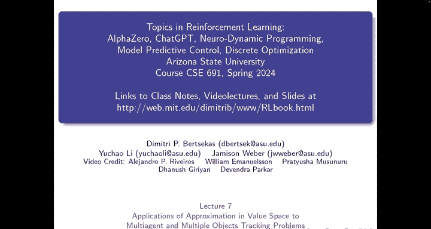

在本节课中，我们将学习近似值空间方法在几个实际应用中的运用。我们将探讨多智能体路径规划问题，并了解该方法如何适应经典与非经典信息模式。最后，我们将看到该方法如何应用于计算机视觉中的多目标跟踪问题。

---

## 多智能体仓库路径规划 🚚

上一节我们回顾了近似值空间方法。本节中，我们来看看该方法如何应用于多智能体仓库路径规划问题。

我们的目标是展示近似值空间方法和动态规划公式的通用性。

作为第一个应用，我们将展示多智能体滚动优化如何应用于仓库机器人路径规划问题。这是一个具有经典信息模式的问题。之后，Jamie 将分享他的研究，这是一个类似但本质上属于非经典信息模式的问题。

### 问题回顾与建模

多智能体问题是一个经典问题，其关键特征是有多个智能体选择性地收集和共享信息。每个智能体基于其可获得的信息，在离散时间点顺序地应用自己的决策。

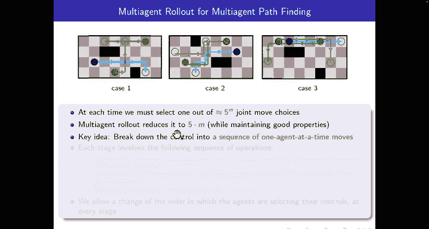

在经典信息模式中，所有智能体完全合作、完全共享信息且从不遗忘信息。这类问题被视为简单情况，因为它可以通过动态规划处理。

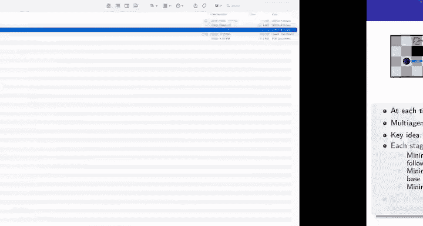

对于仓库机器人路径规划问题，我们考虑多个机器人在一个共享的仓库环境中移动。它们配备了可以共享本地感知信息的传感器或设备，因此每个智能体都能了解全局情况。

我们假设每个机器人都被分配了一个目标，它们作为一个团队工作，以尽快完成任务。目标是在避免彼此碰撞的同时，让所有机器人在最短时间内到达各自的目标。

### 动态规划公式

首先，我们将现实世界的问题抽象为网格世界表示。

下一步是使用数学术语并推导其动态规划公式。

此时，状态应包含所有对控制选择有用的信息。在本例中，即所有智能体的当前位置及其各自的目标。

在每个时间点，每个智能体最多有五个移动选择。因此，它们的组合构成了该问题的实际控制。控制空间的大小随智能体数量 M 呈指数级增长。

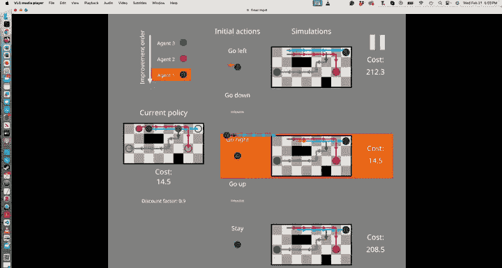

我们定义阶段成本为一个函数，它与每个时间点发生的碰撞次数以及在该时间点到达的目标数量相关。

至此，我们得到了一个原则上可以通过动态规划求解的问题。但由于控制或搜索空间呈指数级增长，实际上无法精确求解。

### 多智能体滚动优化

如前所述，在每个时间点，我们必须从最多 `5^M` 个可能的移动中选择一个。多智能体滚动优化将搜索空间减少到 `5 * M`，同时保持良好的性能。

其核心思想是将控制选择过程分解为一系列单智能体移动选择。

以下是多智能体滚动优化计算过程的步骤：

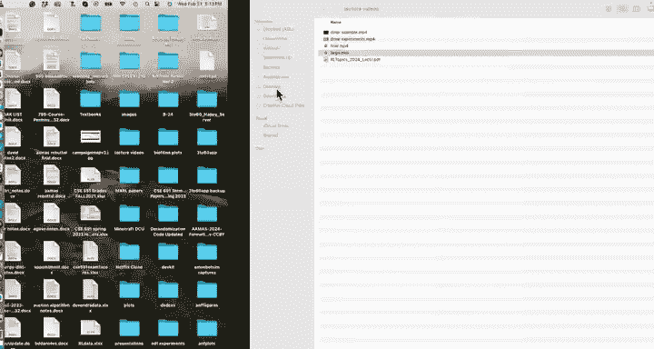

1.  首先，最小化与第一个智能体相关的 Q 因子，而第二和第三个智能体遵循其基本启发式策略。
2.  在此阶段完成后，第一个智能体完成其控制选择，我们进入下一阶段，第二个智能体进行 Q 因子最小化，而第三个智能体遵循基本启发式策略。
3.  最后，我们进行到最后阶段。此时，第一和第二个智能体已在当前阶段选择了其控制，只有第三个智能体需要执行 Q 因子最小化。

在基本启发式策略有效的情况下，多智能体滚动优化可以恢复该策略。而当基本启发式策略失败时，多智能体滚动优化能够为所有机器人找到可行的轨迹。

### 性能比较与讨论

我们执行了该算法，并将其与 David Silver 于 2005 年文章中介绍的协作 A* 算法进行了比较。

协作 A* 基本上一次计算一个智能体的整个路径，但仅在初始时刻计算。而多智能体滚动优化在每个阶段都进行计算。

在实践中，我们发现多智能体滚动优化总能找到可行路径。我们改变了环境中智能体的数量并执行多智能体滚动优化。如果未找到满足某些标准的可行路径，我们会重新调整智能体优化其控制的顺序。我们发现，通常最多两次随机重排就足以让所有智能体找到可行的动作。

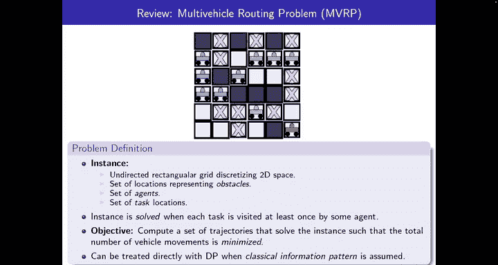

多智能体滚动优化始终能找到可行路径，且成本与协作 A* 相当。当智能体数量增加到 200 左右时，协作 A* 的成功率只有 60%，而多智能体滚动优化在我们的测试中总是成功。

### 算法变体与扩展

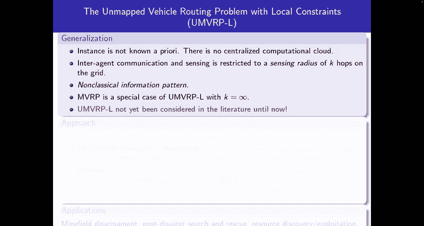

我们提到了多智能体滚动优化的一种变体，即重新调整顺序会导致不同但等价的问题。这相当于一个展开的系统动态，其中首先选择最后一个智能体的控制，然后选择倒数第二个，依此类推。因此，这相当于一个等价问题，其中多智能体滚动优化相当于应用于此等价问题的标准滚动优化，因此我们可以预期由于牛顿法效应而带来巨大改进。

另一个重要点是多智能体滚动优化允许并行计算 Q 因子。在动画中可以看到，我们可以同时为特定智能体生成候选解决方案并运行模拟等。如果有可用的并行计算资源，这可以并行完成。

此外，可以应用多种基本启发式策略来增强性能。所有这些想法都是相互独立的，并且可以组合使用。

---

## 非经典信息模式下的多智能体问题 🤖

上一节我们讨论了具有经典信息模式的多智能体问题。本节中，我们来看看当信息模式变为非经典时，问题如何变化以及如何解决。

我们将回顾多车辆路径问题及其一种特殊表述。然后，我们将研究针对非经典信息模式的多车辆路径问题的泛化。为了解决这类问题，我们将使用分布式计算方法，并介绍一种称为去中心化多智能体滚动优化的算法。

### 问题泛化：未知地图车辆路径问题

我们提出一个新问题：具有局部约束的未知地图车辆路径问题。

在这个泛化中，实例并非先验已知。我们不知道网络的样子，不知道智能体或任务的初始位置，甚至不知道障碍物的位置。此外，没有集中式计算云。智能体间的通信和感知被限制在网格上的 K 跳感知半径内。换句话说，一个智能体只能看到网格上距离其 K 跳范围内的区域。

这显然是一个非经典信息模式问题：没有计算云，智能体间的通信基于局部性受到限制。然而，如果将感知半径提高到无穷大，那么你就回到了常规的多车辆路径问题，因为只要至少有一个智能体，你就可以看到整个实例，并可以将其视为普通的多车辆路径问题。

### 分布式计算方法

我们的方法如下：我们将使用基于动态规划的分解来处理该问题。为此，我们将采用分布式计算方法。

智能体本身将是具有持久内存的处理器。它们能够进行有限的感知、移动和本地通信。在这个问题中，任何执行的计算都必须由某个智能体以其有限的知识和能力来完成。

策略是在智能体集群周围本地生成子实例，在这些集群中信息可以在智能体之间共享。这些将形成经典多车辆路径问题的小型实例。然后，我们将近似动态编程分别且并行地应用于这些子实例。在某些任务未被这些集群覆盖的情况下，需要有一些探索机制。因此，最终不属于任何集群的智能体将在图中进行随机搜索。

### 分布式计算基础

分布式模型涉及一组处理器，这些处理器具有某种内部状态，并属于一个通信网络。处理器可以通过端口沿着通道传递消息进行通信。

事件的特征可以是计算、发送消息、接收消息或任何可以更新单个处理器状态的操作。分布式算法可以被视为类似于转移函数的东西，它是分配给特定处理器的个体协议。

我们从一个初始配置开始，发生一个事件，然后应用分布式算法作为转移函数以达到下一个配置，依此类推。

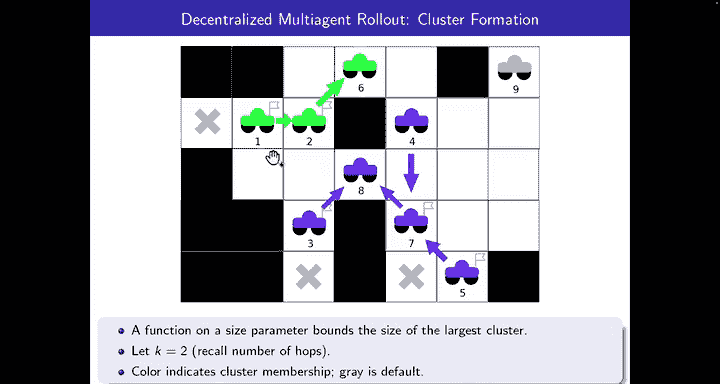

一个特殊的调度器是同步调度器。在这种调度器中，处理器重复地同时唤醒并执行其通用算法。这被分为多个轮次。在一个同步轮次中，每个人唤醒，执行其板载算法，然后返回睡眠状态，然后我们重复此过程。

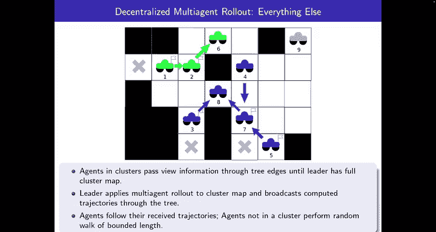

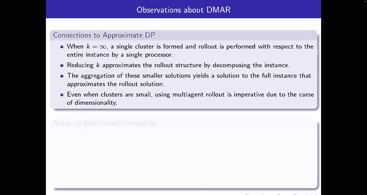

### 去中心化多智能体滚动优化算法

去中心化多智能体滚动优化是一种迭代分布式算法，它规定了状态更新和消息处理，从而产生以下集体行为：

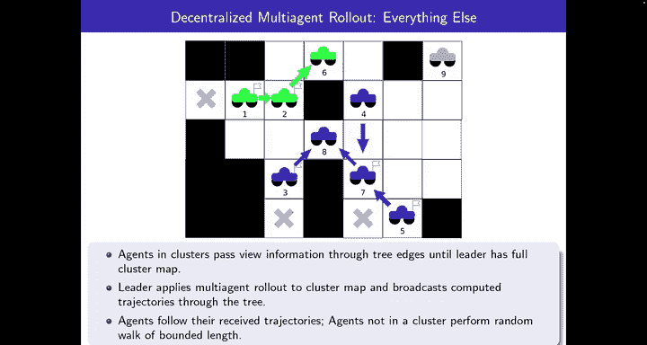

每个去中心化多智能体滚动优化迭代重复以下步骤：
1.  智能体围绕称为领导者的特殊智能体，在本地自组织成恒定大小的集群。
2.  这些集群内的智能体将形成树状通信网络。这些树的根将是该集群的领导者。
3.  如果存在彼此相邻的较小集群，我们将把它们合并成更大的集群。
4.  对于每个集群 K，集群中的智能体将其视图信息路由到集群领导者。
5.  对于每个集群 K，领导者根据多智能体滚动算法，使用某种基于贪心的策略，计算一组控制序列 R。这是应用于从上一步获得的聚合视图信息。
6.  这些轨迹被计算出来后，将在整个智能体树中广播。
7.  然后，每个智能体沿着其分配的控制轨迹移动，完成后，它将自行解除与集群的关联。
8.  可能有些智能体根本没有加入任何集群，因为它们距离任务或其他智能体太远。在这种情况下，它们将生成一个有限长度的随机轨迹并遵循它，以搜索任务。

### 与近似动态规划的联系

当 K 为无穷大时，会形成单个集群，并由单个处理器对整个实例执行滚动优化。减小 K 通过分解实例来近似滚动优化结构。这些较小解决方案的聚合产生了一个近似于滚动优化解决方案的完整实例解决方案。

即使这些集群很小，使用多智能体滚动优化而非标准滚动优化仍然是必要的，因为存在维数灾难。即使只有大约 10 个智能体，除非使用这种一次一个的方法，否则计算量也会大大增加。

### 实验研究与结果

我们进行了一项实验研究，以考察通信和协调对性能的影响。目标是量化去中心化多智能体滚动优化产生良好解决方案所需的本地信息量。

我们考虑了一个贪心策略，称为基本策略。它类似于去中心化多智能体滚动优化，但不使用多智能体滚动优化，只使用贪心最近任务类型的启发式方法。该基本策略不涉及协调。

我们考虑了八类网格，从 10x10 到 80x80。对于每个类别，我们考虑了三种不同的智能体与任务比例。对于每个大小和比例组合，我们在 20% 的节点上均匀分布障碍物，并重复 10 次以生成许多不同的实例。然后，对于每个生成的实例，我们在多个固定的 K 值上分别执行去中心化多智能体滚动优化和基本策略 10 次。对于每次运行，我们记录车辆移动的总次数以及运行时间。

结果发现，存在一个临界半径 K*。在此半径处，去中心化多智能体滚动优化开始持续优于基本策略。超过临界半径，存在一个有效范围。在有效范围内，与考虑的最大半径相比，去中心化多智能体滚动优化的成本存在两到四倍的损失，同时仍然有合理数量的去中心化发生，即仍然生成许多不同的集群。

我们发现，临界半径与网络节点数 N 的迭代对数函数 `log*(N)` 成比例增长。迭代对数函数增长极其缓慢，对于任何相关的实例，临界半径基本上只是一个小的常数，与网络大小无关。

### 物理实现与结论

我们在佐治亚理工学院的 Robotarium 平台上对该算法进行了物理实现。规划在离散空间和时间中进行，但一旦计算出这些控制，它们就会被映射到连续空间速度矢量，并通过执行器移动到新位置。

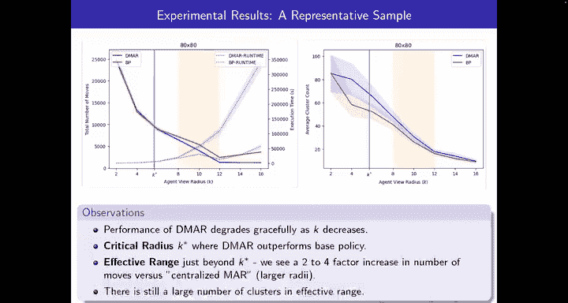

模拟使用不同的感知半径进行，结果反映了我们在离散模拟中的发现，即在性能上与基本策略竞争。

本研究的结论是：
*   我们通过调整经典设置中使用的方法以适应非经典设置，探索了经典与非经典信息模式之间的接口。
*   这导致了集群概念以及在去中心化和并行方式中应用多智能体决策。
*   连接经典与非经典信息模式的关键量是感知半径。
*   选择有效范围内的感知半径可以在解决方案成本略有损失的情况下极大地提高可扩展性。
*   由于临界感知半径的迭代对数增长，你可以在不了解网络大小的情况下选择一个好的感知半径。
*   感知半径必须足够大以获得良好的解决方案，但又不能大到智能体可以欺骗整个网络。
*   我们的方法具有高度可扩展性，在概念上可适应连续空间，并且对传感器噪声具有鲁棒性，这增强了其现实世界的适用性。

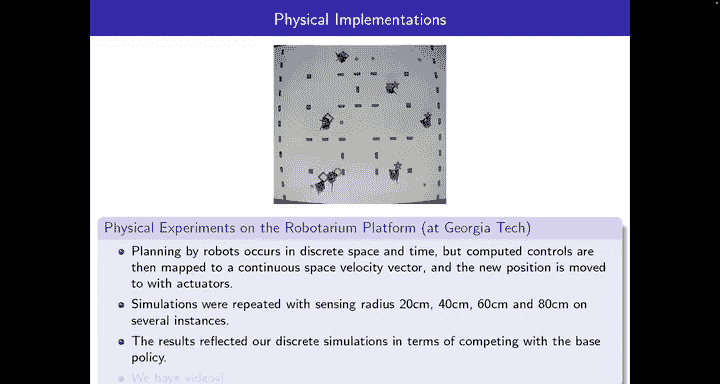

---

## 多目标跟踪中的数据关联 🎯

上一节我们探讨了多智能体路径规划。本节中，我们将转向一个截然不同但同样重要的领域：计算机视觉中的多目标跟踪，也称为数据关联问题。

我们将把近似值空间方法应用于所谓的多目标跟踪问题。这是一个重要的问题，在计算机视觉社区中备受关注。

### 问题表述

多目标跟踪问题旨在跨多个视频帧匹配同一对象。数学上，这类问题可以通过多维分配问题来建模。

我们有 M+1 层节点帧。出现在前一幻灯片中的每个人对应一个节点。我们想要构建分组，每个分组由 M+1 个节点组成，每个节点属于第 k 层。每个分组都有一个相关的成本。我们的目标是找到 M 个分组，使得每个节点属于且仅属于一个分组，并且最小化所有分组的总成本。

### 近似值空间方法的应用

我们将近似值空间方法应用于此问题。该问题的状态是部分解决方案，其中 `X_k` 对应 `U_0, U_1, ..., U_{k-1}`。我们希望逐帧匹配。

我们执行一步前瞻最小化，这意味着我们一帧一帧地选择匹配 `U_k`。但除此之外，我们还执行截断滚动优化。这意味着，为了选择控制 `U_k`，我们使用某种启发式方法从下一帧开始构建一些试探性匹配。然后应用具有匹配分配问题结构的某些成本函数近似。

具体来说，为了选择第 K 帧和第 K+1 帧之间的匹配，我们在这些两帧的所有弧之间构建一个成本矩阵。对于特定弧，我们分配的成本等于整个分组的成本。因此，构造的尾部问题部分有助于我们分配弧成本。由于这种特殊的成本结构，当我们选择 `U_k` 时，Q 因子最小化简化为求解一个二维分配问题。

通过考虑未来的帧来促进当前阶段的控制选择，可以产生针对遮挡的鲁棒且一致的匹配。

### 基准测试与效果

在一项基准研究中，使用基本启发式方法时，一位被遮挡后重新出现的先生被分配了一个新的 ID。而使用我们的近似值空间方法，由于利用了未来帧构建的试探性轨迹信息，该先生保持了相同的 ID。

这是因为未来的构造轨迹有助于在发生遮挡的帧之间连接点。因此，直观上，这产生了一致且鲁棒的匹配结果。

这种方法通常被称为批处理方法，与在每一帧传入时进行匹配的在线方法不同。在我们的实验中，如果截断滚动窗口是 8 帧，那么我们比在线方法实时落后 8 帧。

### 讨论与总结

该方法在精神上类似于滚动优化，但并不完全相同。一个原因是这是一个截断版本，因此不是滚动优化精确版本的忠实再现。其次，即使我们构造了一个试探性尾部并分配分组成本，该分组成本也涉及大量启发式和测试。实际上，我们并不真正知道特定匹配的正确分组成本是什么。因此，这更多是由理论指导的启发式应用。

---

## 总结 📝

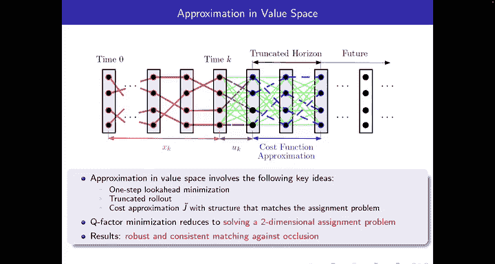

本节课中，我们一起学习了近似值空间方法在三个不同领域的应用：
1.  **多智能体仓库路径规划**：我们看到了多智能体滚动优化如何有效解决具有经典信息模式的路径规划问题，通过分解控制空间来管理计算复杂度。
2.  **非经典信息模式下的多智能体问题**：我们探讨了当通信受限时的挑战，并介绍了去中心化多智能体滚动优化算法，该算法利用分布式计算和本地集群来解决问题。
3.  **多目标跟踪中的数据关联**：我们了解了如何将问题建模为多维分配，并应用近似值空间方法，通过结合未来帧信息来提高跟踪的鲁棒性和一致性，有效处理遮挡等问题。

这些案例展示了近似值空间和动态规划框架的广泛适用性和强大功能，即使面对计算复杂或信息受限的挑战性问题。