# 8：随机动态规划的Rollout与值空间近似 🎲

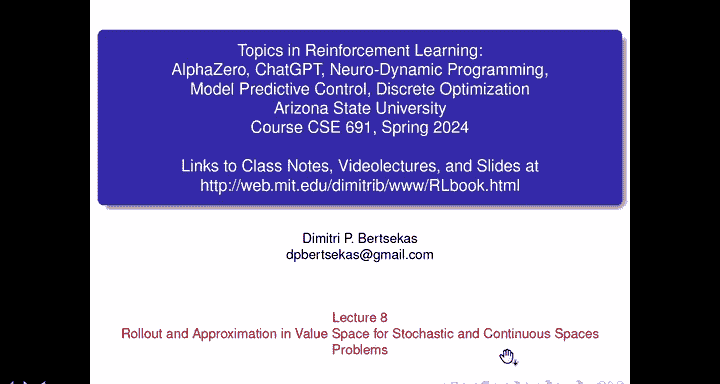

在本节课中，我们将学习如何将Rollout算法和值空间近似方法应用于**随机动态规划**问题，以及如何处理具有**连续状态和控制空间**的问题。我们将探讨这些方法在随机环境下面临的计算挑战，并介绍几种关键的优化技术。

---

## 随机问题的Rollout算法

上一讲我们详细讨论了确定性问题的Rollout方法。本节中，我们来看看当系统存在随机扰动时，Rollout算法应如何调整。

### 单步前瞻的随机Rollout

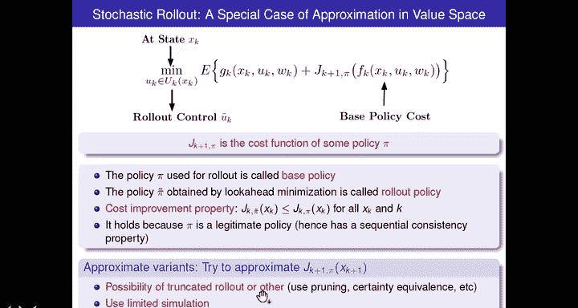

在状态 \( x_k \)，我们选择控制 \( u_k \) 以最小化期望总成本。其核心公式如下：

\[
\tilde{\mu}_k(x_k) = \arg \min_{u_k \in U_k(x_k)} E \left\{ g_k(x_k, u_k, w_k) + \tilde{J}_{k+1}(f_k(x_k, u_k, w_k)) \right\}
\]

其中：
*   \( g_k \) 是当前阶段的成本。
*   \( \tilde{J}_{k+1} \) 是未来成本的近似值，通常由某个**基策略** \( \pi \) 的成本函数给出。
*   \( w_k \) 是随机扰动，因此需要计算期望值 \( E \)。

由此最小化得到的控制构成了**Rollout策略** \( \tilde{\pi} \)。一个重要性质是，对于每个状态和时间，Rollout策略的性能**至少不差于**（通常优于）基策略。这是因为基策略本身是一个定义良好的策略，自动满足了“序列一致性”条件。

### 主要挑战：计算量

随机Rollout面临的核心难题是巨大的计算量。期望值的计算通常没有闭式解，必须通过**蒙特卡洛模拟**来近似。这意味着需要对每个候选控制 \( u_k \) 和每个可能的扰动 \( w_k \) 进行大量从当前状态到问题结束的模拟。

以下是几种应对计算挑战的主要方法：
*   **截断Rollout**：不模拟到问题结束，而是只向前模拟有限步。
*   **确定性等价近似**：在第一步之后，将后续的随机扰动固定为某个标称值，从而将问题转化为确定性优化，大幅减少模拟量。
*   **蒙特卡洛树搜索**：一种自适应采样方法，将更多的计算资源分配给看起来更有希望的控制选项。

---

## 应用实例：西洋双陆棋程序 🎲

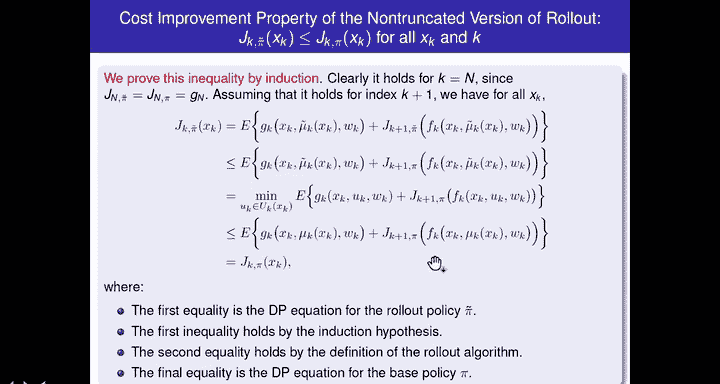

随机Rollout最早且最著名的应用之一是Tesauro在1996年开发的西洋双陆棋程序。早期的TD-Gammon程序使用一步前瞻和通过时序差分学习得到的值函数近似，已经表现出色。Tesauro在此基础上引入了**截断Rollout**，即向前模拟若干步后，使用TD-Gammon自身的估值函数作为终端成本近似。这个结合了Rollout的程序性能得到了显著提升，超越了所有人类选手和之前的程序。这个案例凸显了Rollout的威力，也暴露了其在线计算量大的挑战。

---

## 理论基础：成本改进性质的证明

我们简要证明Rollout策略的成本改进性质。目标是证明对于所有状态 \( x_k \) 和时间 \( k \)，有：
\[
J_{k, \tilde{\pi}}(x_k) \leq J_{k, \pi}(x_k)
\]
我们使用数学归纳法：
1.  **基础情况**：当 \( k = N \) 时，两者都等于终端成本 \( g_N(x_N) \)，不等式成立。
2.  **归纳假设**：假设在 \( k+1 \) 时刻，对所有状态有 \( J_{k+1, \tilde{\pi}} \leq J_{k+1, \pi} \)。
3.  **归纳步骤**：在 \( k \) 时刻，Rollout策略的成本为：
    \[
    J_{k, \tilde{\pi}}(x_k) = E \left\{ g_k(x_k, \tilde{\mu}_k(x_k), w_k) + J_{k+1, \tilde{\pi}}(f_k(...)) \right\}
    \]
    根据归纳假设，上式小于等于：
    \[
    E \left\{ g_k(x_k, \tilde{\mu}_k(x_k), w_k) + J_{k+1, \pi}(f_k(...)) \right\}
    \]
    根据Rollout控制 \( \tilde{\mu}_k(x_k) \) 的定义，它正是最小化上述期望值的控制，因此该值小于等于选择基策略控制 \( \mu_k(x_k) \) 时的期望值：
    \[
    E \left\{ g_k(x_k, \mu_k(x_k), w_k) + J_{k+1, \pi}(f_k(...)) \right\} = J_{k, \pi}(x_k)
    \]
    由此得证。这个证明也适用于满足序列一致性的确定性情况。

---

## 实现细节与方差缩减

在实现中，我们需要为每个候选控制 \( u \) 计算其Q因子的蒙特卡洛估计 \( \hat{Q}(x_k, u) \)。一个重要的技巧是使用**相同的随机数种子**来模拟所有候选控制。这样做可以增加不同控制对应的成本估计之间的正相关性，从而**显著减小它们差值的方差**，使得我们更容易准确识别出最优控制。这是因为我们关心的是Q因子之间的相对大小（差值），而非绝对值。

---

## 随机问题的多步前瞻Rollout

多步前瞻通常能带来更好的性能。在随机情况下，它涉及求解一个L步的随机动态规划问题，然后仅执行第一步的控制。

然而，计算量会随着前瞻步数 \( L \) 呈指数级增长。我们不仅要枚举更多未来状态，还要为每个状态进行大量的蒙特卡洛模拟。因此，必须采用节省计算的方法。

以下是三种核心的节省计算的方法：
1.  **截断Rollout**：减少每个前瞻分支的模拟深度。
2.  **确定性等价近似**：这是本节重点，能极大减少计算量。
3.  **蒙特卡洛树搜索**：自适应地分配模拟资源。

---

## 确定性等价近似详解

这种方法的核心思想是：**只将第一步的扰动 \( w_k \) 视为随机变量并计算其期望，而将后续所有扰动 \( w_{k+1}, ..., w_{N-1} \) 固定为某个标称值（如期望值）**。

这样做带来两大好处：
1.  **前瞻树变“瘦”**：因为后续没有随机分支，从状态节点到下一层仅通过控制 \( u \) 连接，树的分支因子大大减小。
2.  **终端模拟变“易”**：从L步前瞻后的状态开始，到问题结束的模拟是确定性的，计算成本远低于随机模拟。

因此，在相同的计算预算下，我们可以进行**更长的前瞻**（例如，前瞻步数增加一倍），从而可能获得更好的策略性能。从牛顿法视角看，这种近似仍然构成了一个改进步骤。

---

## 蒙特卡洛树搜索简介

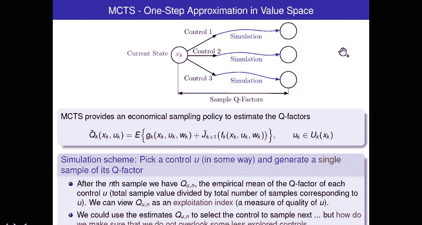

蒙特卡洛树搜索是一种用于随机决策的自适应模拟方法，旨在平衡**利用**和**探索**。

*   **利用**：对当前模拟结果看起来最好的控制投入更多采样，以更精确地估计其价值。
*   **探索**：也对其他控制进行一定程度的采样，以避免因早期模拟不佳而错过潜在的好控制。

一个经典的平衡策略是**上置信界**规则。它为每个控制 \( u \) 计算一个索引：
\[
\text{索引}(u) = \hat{Q}_u + c \sqrt{\frac{\log N}{s_u}}
\]
其中：
*   \( \hat{Q}_u \) 是当前Q因子估计（利用项）。
*   \( s_u \) 是该控制已被采样的次数。
*   \( N \) 是总采样次数。
*   \( c \) 是一个可调参数。

算法总是选择索引最高的控制进行下一次采样。随着 \( s_u \) 增加，探索项减小，算法逐渐倾向于利用。MCTS在诸如AlphaGo等程序中取得了成功，但其性能严重依赖于参数调优和问题特性。

---

## 连续状态与控制空间的问题 🤖

当状态空间或控制空间是连续的（例如，机器人控制、路径规划），之前的方法会遇到困难，因为我们无法枚举无限多的控制来计算Q因子。

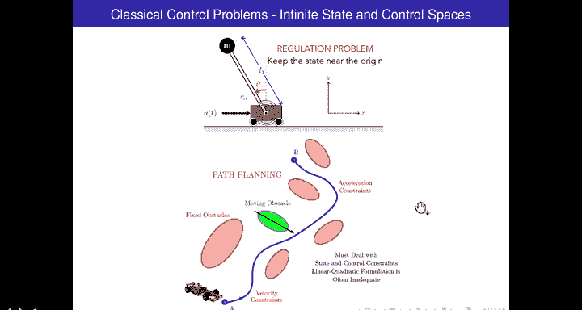

解决方法是将多步前瞻本身视为一个**连续优化问题**。我们不再分别评估每个控制的Q因子，而是直接求解一个L步的优化问题：
\[
\min_{u_k, ..., u_{k+L-1}} E \left\{ \sum_{i=k}^{k+L-1} g_i(x_i, u_i, w_i) + \tilde{J}_{k+L}(x_{k+L}) \right\}
\]
解出最优控制序列 \( u_k^*, ..., u_{k+L-1}^* \) 后，仅执行第一步控制 \( u_k^* \)。这可以通过**非线性规划**、**最优控制**（如二次规划、梯度下降、牛顿法）等技术求解。这正是**模型预测控制**（MPC）的核心思想。

### 示例：多阶段线性/整数规划

许多资源分配问题可以建模为多阶段线性规划。在线求解大规模LP或混合整数规划可能很困难。此时，可以采用截断前瞻结合终端代价近似的RL方法：在线求解一个规模较小的、仅包含未来若干阶段的LP/MIP子问题，从而做出当前决策。这种方法能自然处理约束和在线重规划。

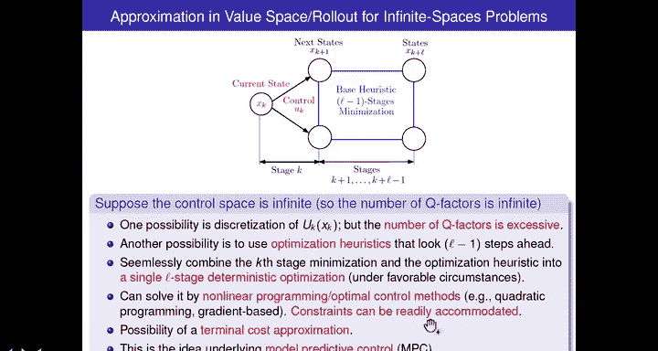

---

## 随机规划：一个特例 📊

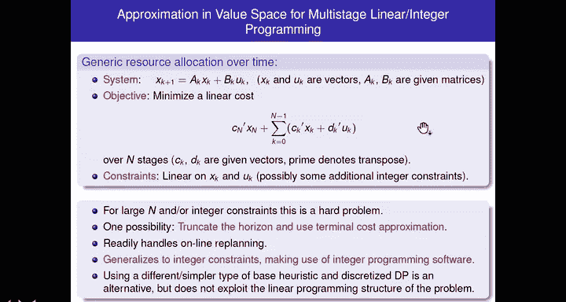

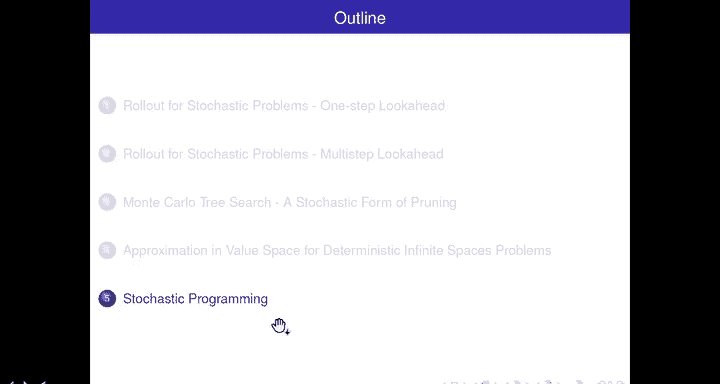

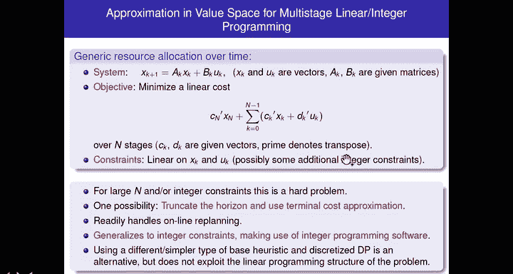

随机规划是一类经典的序列决策模型，通常涉及在不确定性揭示前后做出决策（例如，两阶段问题：先投资，看到需求后再分配）。传统的随机规划方法在阶段数增多时，变量会爆炸性增长。

我们可以将多阶段随机规划视为有限时域随机最优控制的特例，从而应用强化学习的方法：
*   使用**值空间近似**和**Rollout**。
*   使用**两阶段随机规划**（可解）加上终端代价近似作为**基启发式策略**。
*   应用**确定性等价近似**或**有限模拟**来降低计算复杂度。

---

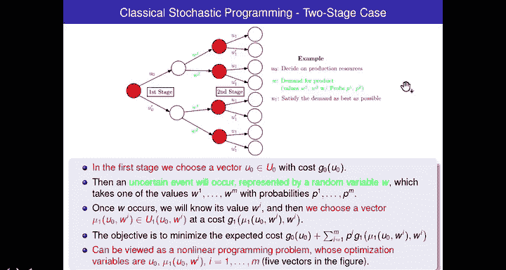

## 总结

本节课我们一起学习了将Rollout和值空间近似扩展到随机动态规划问题的核心内容。我们了解到：

1.  随机Rollout保留了成本改进性质，但面临巨大的蒙特卡洛模拟计算负担。
2.  **确定性等价近似**和**蒙特卡洛树搜索**是应对计算挑战的两种重要技术，前者通过将后续问题确定性化来大幅提高效率，后者通过智能分配采样来平衡探索与利用。
3.  对于**连续空间问题**，我们需要转向基于多步连续优化的框架，这与模型预测控制紧密相关。
4.  **随机规划**这类传统难题也可以纳入强化学习的框架，通过近似方法进行求解。

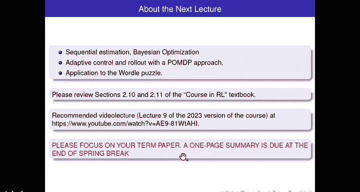

掌握这些方法使我们能够将强化学习的强大思想应用于更广泛、更贴近实际的应用场景。