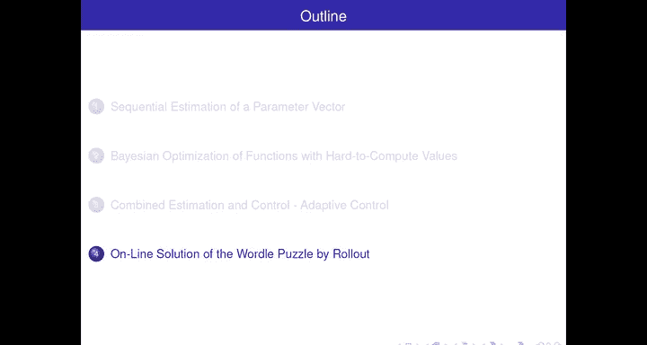
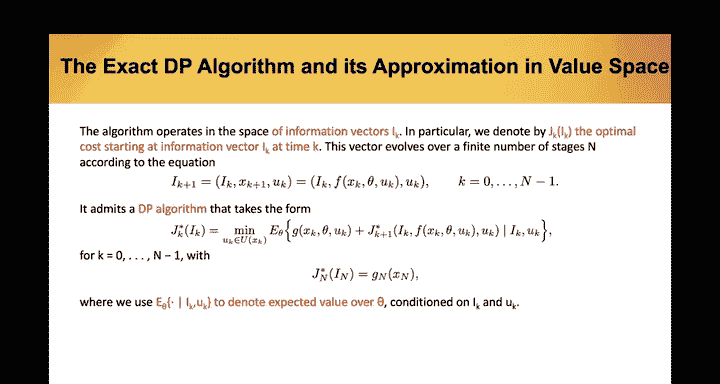
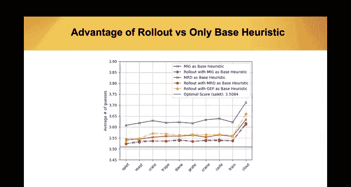
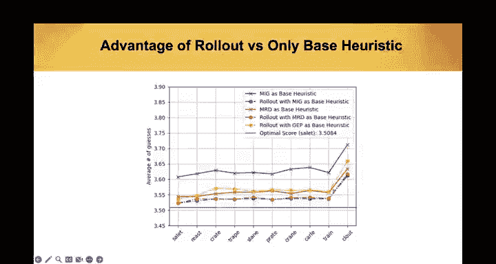
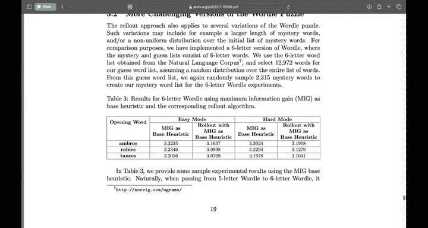

# 9：贝叶斯优化与自适应控制 🧠

在本节课中，我们将学习结合估计与控制的主题，特别是顺序估计的通用框架。我们将深入探讨一个称为贝叶斯优化的特例，并研究自适应控制。所有这些方法都采用了部分可观测马尔可夫决策过程（POMDP）的视角。

---

## 概述：顺序估计与决策

首先，我们将探讨参数向量的通用顺序估计，并讨论为何需要这样做。

然后，我们将研究一个特例：针对难以计算的黑箱函数进行贝叶斯优化。

接着，我们将探讨一组更具挑战性的顺序估计问题，这些问题涉及在估计状态的同时施加控制。

最后，我们将通过Wordle谜题的应用，展示结合估计与控制的实际案例，并介绍一种称为“Rollout”的方法。

---

## 顺序估计：通用框架

我们考虑一个具有未知参数向量 **θ** 的系统。**θ** 是一个具有已知分布的随机向量。通过使用代价高昂的观测，我们试图估计这个参数向量。

观测的数量和类型是可以选择的。如果存在多种传感类型，每种类型可能都有相关的成本。从根本上说，我们面临的是一个决策问题：如何以及是否施加观测控制。

这些观测的结果是在线获取和评估的，目的是停止或修改观测过程。

以下是该过程的示意图：

我们的系统具有未知参数 **θ**。我们获得一个观测结果，然后在线考虑是否希望以一定成本进行进一步的观测，以及我们希望进行何种类型的观测。这个过程持续进行，我们选择观测类型并持续观察结果，直到最终决定停止（可能是因为计算预算耗尽，或满足其他停止标准）。一旦停止，我们对 **θ** 的估计就是最终要使用的那个。

从根本上说，这涉及顺序决策，因此需要运用动态规划。

### 动机示例：工业工程中的质量控制

假设你有一个产品的生产批次，希望通过抽样观测来测试该批次是否合格。你可能有两个假设：假设A（生产批次合格）和假设B（生产批次不合格）。我们希望接受其中一个假设。

我们通过抽取生产批次的一部分来获得观测。一种称为“顺序概率比检验”的算法（可追溯到20世纪40年代，基于动态规划）指出，在特定观测后，我们更新关于假设A或假设B成立的后验概率分布。如果其中一个概率达到某个阈值，我们就接受该假设。这只是工业工程领域的一个例子。

### 其他应用领域

顺序估计框架适用于多种场景：
*   **经典和顺序实验设计问题**：或统计学中的顺序抽样策略。
*   **临床试验设计或医学诊断测试**。
*   **经典顺序搜索问题**：例如搜救任务。搜索每个位置都有成本。
*   **传感器网络中的路径规划**：激活每个传感器都有成本，目标是找到一系列传感器激活序列，以获取所需信息。
*   **顺序解码问题**：例如Mastermind和Wordle谜题。
*   **通过贝叶斯优化估计代理函数**：用于最小化黑箱函数。

### 一个重要区别

一个重要的区别是：当前的观测选择是否会影响未来观测的可用性、质量或成本？例如，传感器是否只能使用有限次数，或者使用传感器是否会降低读数质量？

如果答案是**否**，我们称之为**简单顺序估计问题**。我们将在贝叶斯优化的背景下首先讨论这些问题。

如果答案是**是**，则可以将其视为**结合估计与控制的问**题，并在**自适应控制**的背景下看待。在自适应控制中，问题的参数可能随时间变化，我们讨论的策略是估计参数，然后在整个问题中应用控制，仿佛这些估计是真实的。

对于“是”的情况，我们需要一个更原则性的POMDP方法。我们将在课程后期（Wordle演示之前）讨论这部分。现在，我们将专注于用于代理函数的贝叶斯优化。

---

## 贝叶斯优化

黑箱函数是指没有已知解析形式的函数。在实践中评估该函数的值可能很困难。这里的策略是使用所谓的**代理函数**。我们生成一个不同的函数来近似未知的黑箱函数，然后最小化这个代理函数。

因此，我们近似地最小化一个函数，该函数在给定点的值只能通过耗时的计算、模拟或实验获得。我们假设观测成本很高。

下图与我们之前看到的类似。我们引入了具有参数 **θ** 的成本函数的参数模型。未知函数具有未知参数 **θ** 和已知的初始分布。我们顺序地观察函数在少数几个观测点处的真实成本（不会很多）。然后，我们通过估计 **θ** 来构建成本函数的模型，称之为代理函数。接着，我们最小化代理函数以获得次优解。

一个关键问题是：**如何根据先前观测的结果选择观测点？** 因为观测成本高，我们不能做太多。这再次引出了**探索与利用的权衡**主题。我们是希望在可能具有接近最优值（例如函数均值较低）的点进行观测，还是希望在搜索空间中相对未探索（方差仍然很高）的区域进行观测？

### 代理优化的示例

*   **地质统计学插值**：经典例子，涉及金矿开采。实践称为“克里金法”，由南非工程师Matheron和Krige开创。他们试图根据少数钻孔样本识别高含金量的位置。钻孔过程非常昂贵。
*   **设计优化**：在空气动力学、材料设计或药物开发等领域，构建原型成本高昂。
*   **机器学习模型的超参数选择**：例如学习率、参数数量或模型层数。这种方法特别用于AlphaZero中使用的深度神经网络的架构参数选择。

### 贝叶斯优化的形式化描述

我们将引入一个M维参数向量 **θ**。**θ** 基本上将代表函数 **F**。我们将代理函数的定义域离散化。对于索引 **u**，**θ_u** 将代表函数 **F(u)** 的输出。因此，我们将定义域限制为一个有限集，向量 **θ** 将代表函数 **F** 的输出，索引对应于输入。

我们的观测形式为：**z = F(u) + w**，其中 **w** 是噪声。我们今天要研究的一个重要特例是**无噪声**情况，即我们可以通过观测直接观察函数输出。

我们使用在不同点 **u1, ..., uN** 选择的N个带噪声测量值来估计 **θ**。理想情况下，我们希望N远小于M，因为观测是昂贵的。

我们假设 **θ** 具有给定的先验分布 **B0**，这是一个M维随机向量，每个分量具有已知的初始分布。理想情况下，**F** 在相邻点的值应该是相关的，换句话说，接近的输入应该产生接近的输出。决定这个初始分布是一门艺术，但理想情况下，应该选择那些相距较远的点相关性逐渐减小的分布。

### 过程的归纳描述

在点 **u1, ..., uk** 进行观测后，我们选择下一个点 **u_{k+1}** 来观察 **F** 的值。然后，我们使用某个估计器函数更新后验分布 **Bk**。**Bk** 就像一个状态估计器函数，可以通过在线模拟计算，或者可以是粒子滤波器、常见滤波器等。它以当前后验分布 **Bk**、下一个观测点 **u_{k+1}** 以及该观测的结果 **z_{k+1}** 作为输入，并产生一个新的后验分布 **B_{k+1}**。

因此，**Bk** 本质上是第k次观测后的代理成本函数。我们做的观测越多，我们的代理函数就越接近未知的黑箱函数。

一个重要的特例是，如果 **B0** 和噪声 **w** 是高斯分布，那么 **Bk** 可以使用封闭形式（高斯过程回归公式）进行更新。

### 图示：真实成本函数与其代理函数

下图展示了真实成本函数 **F**（黑线）及其代理函数（紫色区域）。紫色分布的中线代表均值，边界代表围绕均值的标准差或置信区间。这是经过7次无噪声观测后的情况。在这7个点（1到7），由于无噪声，方差坍缩，我们得到了函数的真实输出。随着我们持续进行，紫色分布将开始围绕黑色曲线形成。

---

## 近视贝叶斯优化

关键问题是：给定从先前选择的点 **u1, ..., uk** 获得的观测结果 **z1, ..., zk**，我们如何顺序地选择下一个观测点 **u_{k+1}**？

从动态规划的角度看，可以将其框架化为一个部分可观测马尔可夫决策过程（POMDP）。在这种模型中，给定截至时间k的观测的后验分布 **Bk** 是信念状态。**uk** 是控制。信念估计器函数 **B(·)** 代表系统方程。成本函数基于观测成本和最终获得的代理函数的质量。

但在实践中占主导地位的方法是**贪婪或近视策略**，它基于一个称为**采集函数**的东西。

采集函数记作 **A_k**，它以当前后验分布和一个新观测点为输入。它是当信念状态为 **Bk** 时选择点 **u_{k+1}** 的启发式收益的度量。然后，近视策略是选择对应于采集函数最大值的观测点。

另一种方法是使用基于近视策略的**Rollout**方法。自2016年以来，这已在几项研究工作中得到提倡和实施，并取得了有希望的结果，尽管仍需要更多测试。如果你感兴趣，这是一个肥沃的研究前沿。

### 采集函数示例

近视策略试图最大化采集函数 **A_k**。以下是近视贝叶斯优化中常见的采集函数示例：

1.  **上置信界**：该采集函数是两个项的和：**T_k(B_k, u) + β * R_k(B_k, u)**，其中 **β** 是权重参数。
    *   **T_k** 函数是 **F(u)** 在 **Bk** 下的**负均值**。由于我们试图最小化代理函数，我们寻找均值低的点。取负号意味着在最大化过程中，均值低的点更有利。这可以看作是**利用指数**。
    *   **R_k** 函数是 **F(u)** 在 **Bk** 下的**标准差**。方差高的区域在最大化 **R_k** 时更具吸引力。这可以看作是**探索指数**。
    *   **β** 参数就像一个探索参数，告诉你在探索与利用之间想要偏重多少。

2.  **期望改进函数**：它是 **F(u)** 相对于截至时间k获得的 **F** 的最小值的**减少量**的期望值。换句话说，它表示我们可以在哪里获得相对于目前最佳结果的最大改进。

### 贝叶斯优化过程示例

在文献中，代理函数优化通常被视为一个**最大化**问题，因为他们考虑的是收益。到目前为止，我们一直将其框架为试图最小化成本。为了与常见示例保持一致，我们现在切换为**最大化代理函数**。

这是一个来自维基百科贝叶斯优化文章的例子。同样，真实函数用黑线表示，后验分布用紫色区域表示，所有观测都是无噪声的。

经过6次观测后，我们评估每个点的采集函数，然后选择对应于最大值的点。在这个例子中，我们使用期望改进采集函数。采集函数告诉我们，在某个点我们期望看到最大的改进。我们添加这个新的无噪声观测，看到 **F(u)** 在该点的确切值，然后更新分布。该点周围的方差坍缩，我们对函数在该区域的样子有了很好的估计。

我们重复这个过程：在7次观测后，采集函数告诉我们在另一个点附近期望看到最大的改进。我们进行观测，更新分布，现在有8次观测。持续进行，经过10次观测后，我们的估计函数部分开始非常接近真实函数。

---

## 贝叶斯优化的POMDP公式

现在，我们来看一个更原则性的方法：贝叶斯优化的POMDP公式的动态规划算法。

对于信念状态 **Bk**，最优成本由通常的贝尔曼方程给出：我们最小化控制集上的成本，包括进行观测 **u_{k+1}** 的即时成本，加上下一个信念状态（由估计器函数 **B(·)** 给出）的期望成本。这里，**c** 是观测的成本函数。最后，我们有一个终端成本函数 **G**，它查看完整的代理函数，并衡量最终获得的代理函数的质量（例如，偏好具有小均值最小值或低方差的代理函数）。

显然，这对于实际目的是难以处理的。因此，我们可以使用**值空间近似方法**。像往常一样，我们用 **J_{k+1}~** 替换 **J_{k+1}***，并选择对应于给定当前后验分布和新观测的近似Q因子最小的观测点。

一个具体案例是**Rollout**。我们可以使用基于采集函数的近视启发式方法的成本函数作为 **J_{k+1}~**。我们使用采集函数来模拟未来的控制，并执行Rollout。这最早由Lamb、Wilcox和Wolpert于2016年提出，后来其他人也进行了跟进，结果非常有希望，但仍需更多测试。

下图说明了这个过程：在当前后验分布下，我们考虑所有可能的观测，以获得所有可能的后验分布 **B_{k+1}**（这一层是随机的，是一个庞大的树）。然后，在每个下一个可能的后验分布处，我们使用采集函数运行为基策略的Rollout（实践中可能截断视野）。像往常一样，我们选择最小的Q因子。

---

## 自适应控制：结合估计与控制

现在，我们转向更具挑战性的一组顺序估计问题，这些问题在自适应控制的背景下增加了控制。

我们做了一些简化，但存在对以下内容的扩展或概括。我们有一个确定性系统，由函数 **F** 给出，它接受状态 **x_k**、参数向量 **θ** 和控制 **u_k**，并给出新状态 **x_{k+1}**。未知参数 **θ** 所在的空间被离散化为M个可能的向量值。因此，**θ** 可以是这M个值之一。

**x_k** 可以直接观测，而 **θ** 不能。我们将 **θ** 视为增广状态 **(x_k, θ)** 的一部分，并且这个状态是部分可观测的，因为 **θ** 是部分可观测的。

最优成本函数 **J_k*** 的贝尔曼方程由以下表达式给出。首先描述一些术语：
*   **I_k** 称为信息状态，是制定POMDP的方法之一，它包含迄今为止访问的状态和控制的历史。
*   **B_k(i)** 是在给定当前信息状态 **I_k** 的条件下，**θ** 取特定值 **θ_i** 的概率分布。对于所有i从1到M，我们都有这个分布的定义。这就是信念状态。

现在，信息状态的最优成本由通常的即时成本加上依赖于信息状态的未来成本给出。函数 **F** 将信息状态扩展一个状态和控制。所有这些都按 **B_k(i)** 加权然后求和，这就是展开的期望值。

同样，这通常是难以处理的。因此，我们可以使用值空间近似方法。我们使用近似 **J_i~(x_k, θ_i, u_k)**。在这些近似中，我们将忽略信息状态。我们为每个固定的 **θ** 值都有一个函数 **J_i**。

我们用它来代替 **J_{k+1}***，并最小化 **u_k** 以获得一步前瞻策略。

以下是 **J_i~** 的两个例子：
1.  如果 **θ** 固定为 **θ_i**，那么问题在未来就完全确定，你可能能够根据 **θ_i** 计算最优策略。
2.  使 **J_i~** 为一个已知基策略的成本函数，该策略再次假设 **θ** 固定为值 **θ_i**。这是Rollout的情况。

### 自适应控制Rollout示例

下图几乎是通常的示意图。在当前状态 **x_k**，我们考虑所有可能的控制（例如两个）。对于每个控制，我们考虑 **θ_i** 的所有可能值（例如两个）。假设我们选择控制 **u_k**，现在考虑 **θ_1**。在这个下一个状态，我们使用某个基策略（例如 **π_1**）模拟到视野结束。我们对同一固定控制 **u_k** 考虑 **θ** 的其他可能值，并做同样的事情（可能使用另一个基策略 **π_2**）。计算完这两者后，我们取平均值，这就成为Q因子的值。

在 **x_k** 处，我们最小化 **Q̂_k**，它是加权平均Q因子 **Q(u)**，定义为：查看 **θ_i** 的所有可能值，计算假设该值固定的Q因子，然后使用信念状态分布计算加权平均。

如果每个 **π_i** 都相同（即它们都使用相同的基策略），那么可以证明成本改进特性。

---

## 连接：Rollout解决Wordle谜题

现在，我们进入课程的最后部分，通过Rollout在线解决Wordle谜题。首先，将其与今天讨论的内容联系起来。

这篇题为“Rollout方法用于在线解决Wordle谜题”的论文是几年前的工作。让我给你一个快速概述。

存在一个隐藏的谜底词或代码词 **θ**，它是根据已知分布从初始谜底词列表中抽取的。在谜题的标准版本中，这个分布是均匀的。然后，谜底词列表随着猜测和观测的结果而缩小。

猜测是基于先前猜测提供的关于谜底词的反馈来选择的。当谜底词列表缩小到只有一个元素时，谜题就解决了。我们希望最小化解谜的期望猜测次数。

一个重要的事实是：在整个解谜过程中，当前谜底词列表上的信念分布**始终保持均匀**。这使得使用精确动态规划求解最优解成为可能，但这需要数天的计算时间（由Selby在2022年完成）。

重要的是要注意，如果没有这个均匀初始信念分布的假设，并且如果你对问题结构进行小的更改（例如增加单词的字母数），计算精确解将是我们有生之年不可能完成的。

然而，这篇论文的结论是：**Rollout可以在几秒钟内在线近乎最优地解决谜题及其变体**，而不是数天。

---

## 总结

在本节课中，我们一起学习了：

1.  **顺序估计的通用框架**，以及它在质量控制、实验设计等领域的应用。
2.  **贝叶斯优化**作为顺序估计的一个特例，用于优化难以评估的黑箱函数。我们讨论了近视策略（使用采集函数）和更原则性的POMDP Rollout方法。
3.  **自适应控制**中结合估计与控制的更具挑战性的问题，并介绍了使用固定参数假设基策略的Rollout方法。
4.  最后，我们看到了**Rollout方法在Wordle谜题中的成功应用**，它能够在线快速计算近乎最优的解，展示了近似动态规划方法解决复杂POMDP问题的强大能力。

核心概念如信念状态 **B_k**、采集函数 **A_k(B_k, u)** 以及Rollout中的Q因子近似 **Q̂_k**，都是将理论应用于实际决策问题的关键工具。