# 10：N-Gram、GPT、HMM与马尔可夫链中的序列生成与Rollout算法 🧠

在本节课中，我们将学习如何将N-Gram、GPT和隐马尔可夫模型中的序列生成问题，形式化为一个动态规划问题。我们将探讨如何利用Rollout算法等次优策略来解决因状态空间巨大而导致的“计算难解”问题，并展示其在小型马尔可夫链和GPT文本生成中的实际应用效果。

---

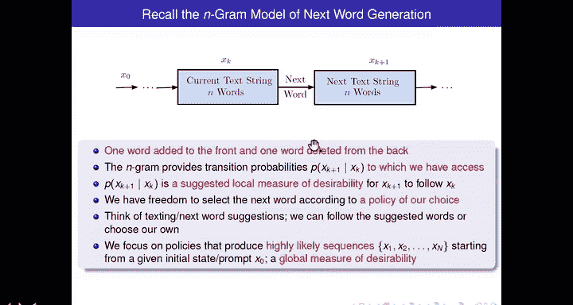

## 1. 问题回顾与概述 📝

首先，我们对N-Gram模型和序列生成问题进行回顾。N-Gram模型在生成文本时，会基于当前n个词的序列，给出下一个词出现的概率建议。我们的核心问题是：给定一个初始状态（或提示词），如何选择一个词序列，使得整个序列的生成概率最大化？这是一个全局优化问题，而非仅考虑下一步的局部最优。

---

## 2. 从动态规划到次优策略 🔄

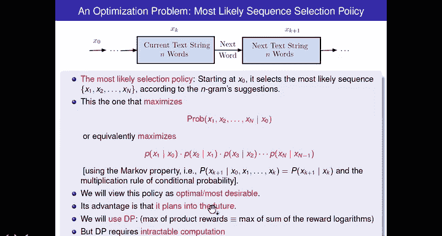

上一节我们定义了序列生成问题。本节中，我们来看看如何将其形式化为一个动态规划问题，并理解为何需要次优策略。

### 2.1 动态规划形式化

我们将序列生成过程建模为一个马尔可夫链。一个选择策略 π 是一系列函数，给定当前状态 x_k，决定下一个状态 x_{k+1}。给定初始状态 x_0 和策略 π，整个序列的生成概率是各步转移概率的乘积：

**公式：** `P(x_1, ..., x_N | x_0, π) = ∏_{k=0}^{N-1} P(x_{k+1} | x_k, π_k(x_k))`

最优策略 π* 就是最大化上述乘积的策略。通过取对数，这个乘积最大化问题可以等价转化为一个加性成本的动态规划问题。然而，对于词汇量巨大（例如5万个词）的N-Gram，状态空间是词汇量的n次方，精确的动态规划计算是**难解的**（计算量随参数呈指数级增长）。

### 2.2 引入次优策略

由于精确求解不可行，我们转向次优策略。以下是几种关键策略：

以下是几种核心的次优策略：

*   **贪婪策略**：在每个状态，简单地选择具有最高**下一步转移概率**的词。它只考虑局部最优，无需离线计算。
*   **Rollout策略**：以贪婪策略作为“基础策略”。在当前状态，评估所有可能下一个状态的“Q因子”，即选择该词后，**继续使用贪婪策略直到结束**所能得到的序列概率。然后选择Q因子最高的词。这相当于进行了一步前瞻优化。
*   **多步前瞻Rollout**：将上述前瞻步数从一步扩展到L步，评估更远的未来后再做决策。
*   **截断Rollout**：在评估Q因子时，不模拟到序列终点，而只模拟未来有限的M步（例如10步），以节省计算。
*   **双重Rollout**：将单次Rollout策略作为新的基础策略，再次应用Rollout算法，相当于进行了两次策略迭代。

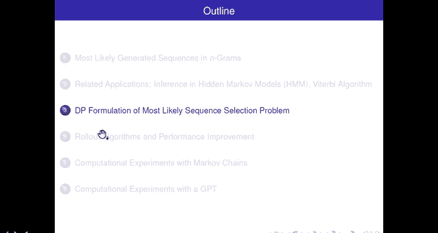

---

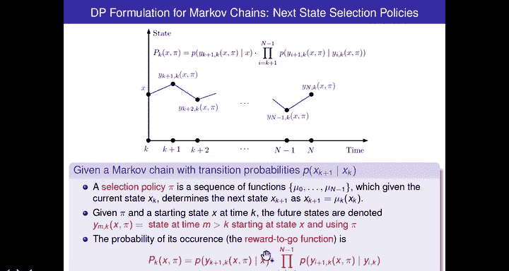

## 3. 与隐马尔可夫模型的联系 ⛓️

上一节我们介绍了在N-Gram框架下的算法。本节中我们来看看一个更广泛的关联应用领域：隐马尔可夫模型。

HMM中的状态推断问题在数学形式上与我们的序列生成问题等价。在HMM中，我们观测到的是与隐藏状态相关的数据（如语音识别中的音素），目标是推断出最可能产生这些观测数据的隐藏状态序列（如单词）。著名的**维特比算法**就是用来解决这个问题的动态规划算法。

对于状态空间巨大的HMM，维特比算法同样会变得难解。因此，我们讨论的Rollout等次优算法同样适用于HMM推断问题，其中转移概率由数据似然重新加权。

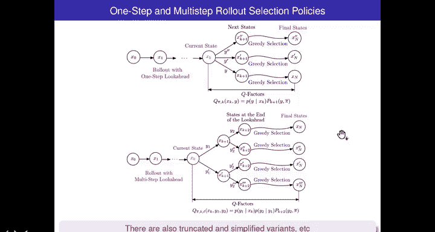

---

## 4. Rollout算法的性能提升证明 📈

Rollout算法有一个重要的理论保证：性能提升性质。即Rollout策略得到的序列概率，总是**不低于**其基础策略（如贪婪策略）得到的概率。

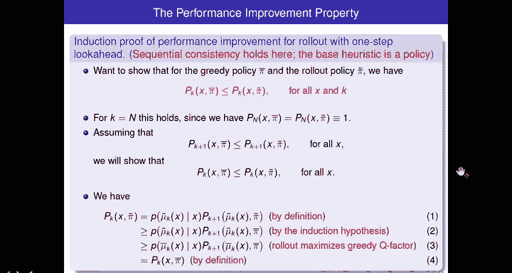

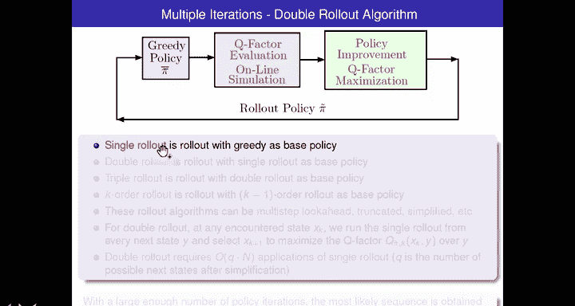

**证明概要（归纳法）**：
1.  在最终时刻N，两者性能定义相等。
2.  假设在时刻k+1，Rollout策略的性能值 `P̃_{k+1}(x)` 不低于贪婪策略的性能值 `P̄_{k+1}(x)`。
3.  在时刻k，Rollout策略选择最大化 `P(x_{k+1}|x_k) * P̃_{k+1}(x_{k+1})` 的动作。
4.  根据归纳假设，`P̃_{k+1}(x_{k+1}) ≥ P̄_{k+1}(x_{k+1})`。
5.  因此，Rollout策略的最大化值至少等于贪婪策略所选动作对应的值 `P(x̄_{k+1}|x_k) * P̄_{k+1}(x̄_{k+1})`，而后者正是贪婪策略在k时刻的性能值 `P̄_k(x_k)`。
6.  故 `P̃_k(x_k) ≥ P̄_k(x_k)`，性质得证。

这一性质成立的关键在于基础策略（贪婪策略）是**序列一致**的。

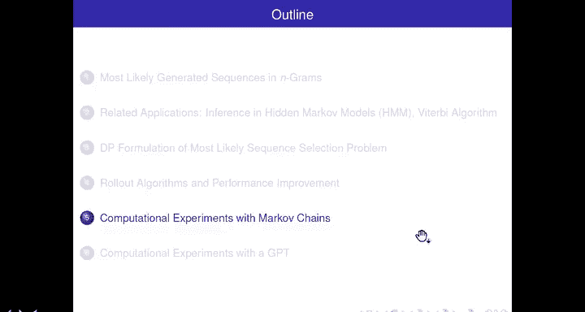

---

## 5. 在小型马尔可夫链上的计算实验 💻

为了精确评估Rollout算法的性能，我们首先在状态数可控（100个状态）的小型马尔可夫链上进行实验，因为此时可以计算精确最优解。

我们使用**贪婪策略的优化损失恢复百分比**来衡量Rollout的效果：
`恢复百分比 = (P̃ - P̄) / (P* - P̄) * 100%`
其中 `P*` 是最优概率，`P̄` 是贪婪策略概率，`P̃` 是Rollout策略概率。

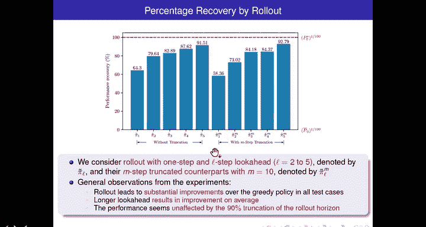

以下是实验的主要发现：

*   **显著提升**：所有Rollout变体都比贪婪策略有显著提升。
*   **前瞻步数**：增加前瞻步数（L）能带来平均性能的进一步提升。
*   **截断的有效性**：即使只模拟未来10步（总长100步），性能下降也很小，这说明截断是高效的计算节省手段。

我们还观察了不同马尔可夫链上的性能模式。在大多数情况下，多步前瞻能持续接近最优解。性能提升性质在所有测试案例中都成立。

### 5.1 双重Rollout实验

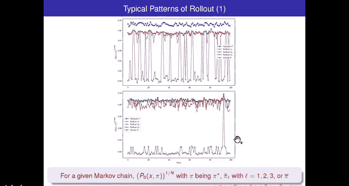

由于问题是确定性的，我们可以实施双重Rollout。实验表明：
*   双重Rollout能带来比单次Rollout**进一步的显著提升**。
*   截断版双重Rollout同样有效，性能衰减相对较小。

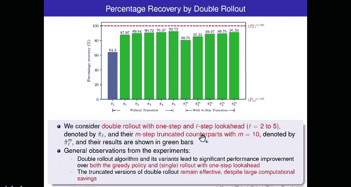

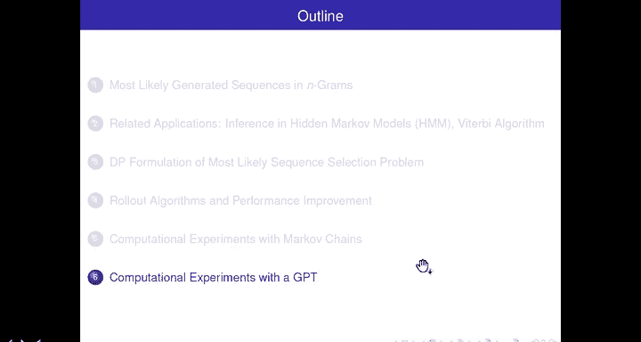

---

## 6. 在微调GPT上的文本生成实验 🤖

我们将方法应用于一个更真实且难解的场景：从一个微调过的GPT-2模型生成最可能文本序列。

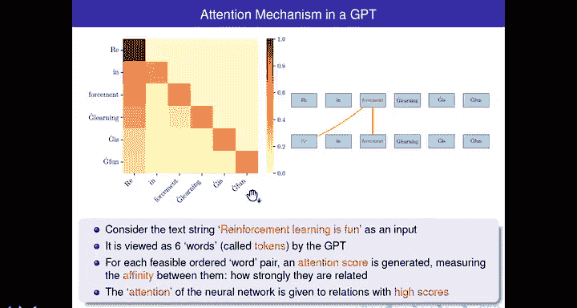

### 6.1 挑战与简化

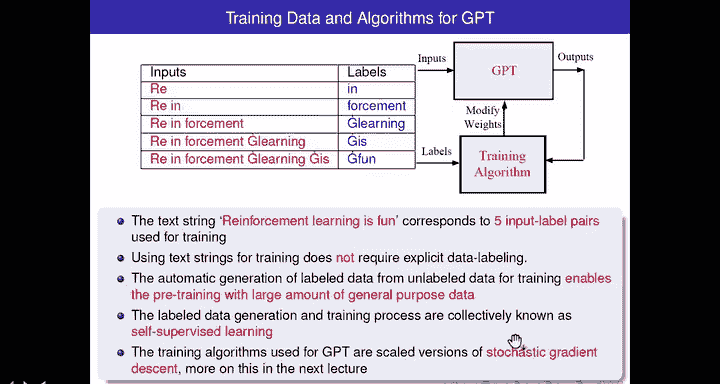

与小型马尔可夫链不同，GPT的“状态”是长达1024个token的上下文窗口，词汇量约5万。存储或计算精确的动态规划解是完全不可行的。即使执行一步前瞻的Rollout，也需要为每个决策计算5万条完整轨迹的Q因子，计算量巨大。

为此，我们实施了两种简化：
1.  **简化Rollout**：仅考虑当前预测概率**最高的前10个**词作为下一个状态的候选，而非全部5万个。
2.  **截断模拟**：在计算Q因子时，只使用基础策略（贪婪）模拟未来10步。

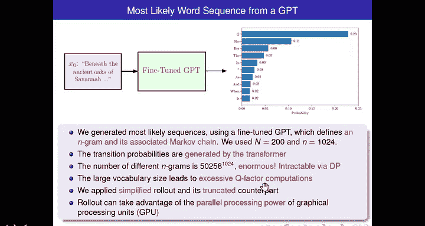

### 6.2 实验结果

我们在20个不同的初始句子（提示词）上测试。结果显示：
*   **简化Rollout**在计算量适度增加的情况下，仍能比贪婪策略取得**实质性改进**。
*   **截断版Rollout**在所有测试案例中也都优于贪婪策略。

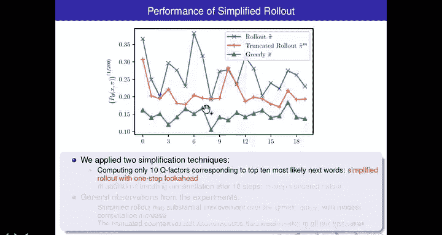

这些实验证明，即使面对GPT这样复杂的模型，通过合理的简化，Rollout算法依然是一个有效且可行的次优优化工具。

---

## 7. 总结与下节预告 🎯

本节课我们一起学习了如何将N-Gram、GPT和HMM中的序列生成问题构建为动态规划问题，并深入探讨了Rollout算法及其变体（多步前瞻、截断、双重Rollout）作为解决计算难解问题的有力工具。

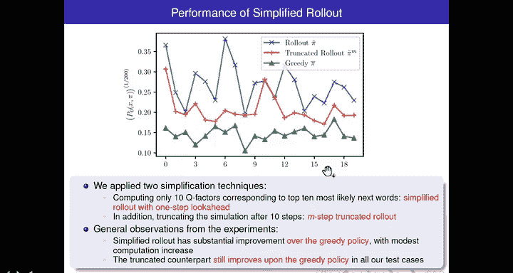

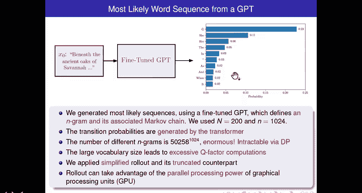

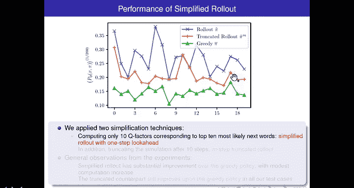

核心要点包括：
1.  贪婪策略只考虑局部最优，而Rollout通过一步前瞻和基础策略模拟，实现了显著的性能提升。
2.  理论证明了Rollout的性能不低于其基础策略。
3.  在小型马尔可夫链和真实GPT模型上的实验表明，Rollout及其变体能有效恢复大部分因贪婪策略导致的优化损失，且通过简化（如候选集缩减和截断）可在实际复杂模型中应用。

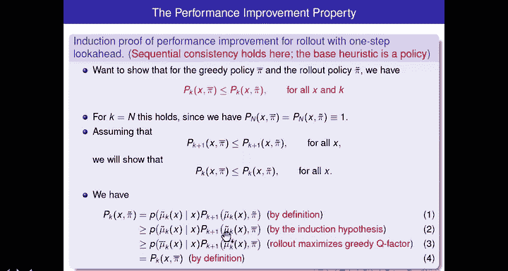

在下一讲中，我们将探讨其他神经网络与近似架构，并介绍它们在离线训练及强化学习上下文中的应用。