# 11：离线训练、神经网络与增量优化方法 🧠

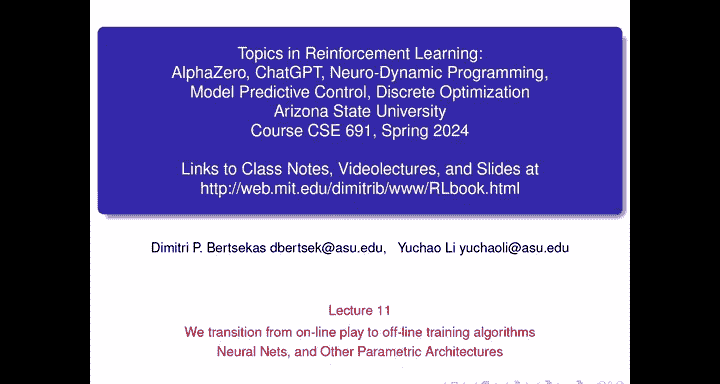

在本节课中，我们将学习离线训练算法，这是强化学习核心架构的重要组成部分。我们将介绍用于离线训练的几种参数化近似架构，包括经典架构和神经网络，并探讨如何训练这些架构。此外，我们还将学习更通用的增量优化方法，用于优化大量可微函数的和，其中架构训练是这类问题的一个特例。最后，我们会简要介绍神经网络，并将其与之前讨论的增量优化算法联系起来。

##回顾与未来计划 📅

在之前的课程中，我们主要关注在线执行算法，特别是值空间近似及其变体，以及其在随机和确定性等问题中的应用。我们还讨论了一些应用和案例研究。

本节课，我们将转向讨论离线训练算法，以及一些其他的参数化架构。

### 核心架构回顾

我们反复提及的核心架构是AlphaZero或模型预测控制架构。它由两个基本要素组成：**离线训练**和**在线执行**。这两个部分在很大程度上可以独立设计和实现，并且有很大的灵活性来修改这个架构。

离线训练和在线执行组件之间存在一些关键差异：
*   **离线训练**如其名，是离线完成的。其目标是训练或获得一个终端成本近似函数或策略。训练的目标是尽可能好地近似几乎所有（如果不是全部）状态。
*   **在线执行**部分则只针对我们在实时操作中实际遇到的状态进行计算。这部分需要在实时在线环境中完成。

在线执行部分的第一步，在概念上是求解贝尔曼方程的牛顿步。

### 已覆盖内容总结

在前四讲中，我们从概述和宏观视角开始，介绍了离线训练和在线执行的牛顿步解释框架。之后，我们涵盖了适用于确定性、随机性、有限和无限视野问题的精确动态规划内容。接着，我们深入讲解了本课程的主要工具：值空间近似和滚动算法。我们还讨论了问题表述和转换，以及自适应和模型预测控制。然后，我们专注于在线执行算法，包括用于确定性和随机性问题的滚动算法及其变体、多步前瞻搜索、多智能体控制问题，以及贝叶斯优化。

### 未来课程计划

未来的课程将涵盖教材第三章的内容：我们将深入探讨使用神经网络和其他架构进行值和策略近似；讨论使用增量梯度方法训练近似架构；介绍使用近似架构以及聚合方法进行值和策略近似。本节课将涵盖前两个主题，剩余主题将在下一讲中介绍。

需要注意的是，我们省略了许多在之前课程和教材中广泛涉及的主题，包括更多关于无限视野问题的理论、用于值空间近似的随机训练方法（如TD(λ)和Q学习）的细节，以及策略梯度方法。

## 参数化近似架构 🏗️

现在，让我们回到用于离线训练的参数化近似架构。

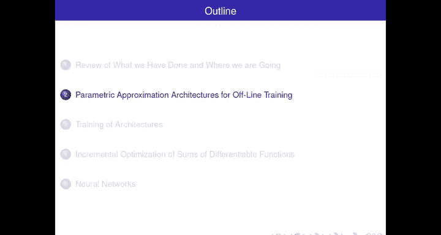

### 近似目标

在强化学习中，离线近似主要有两种类型：
1.  **成本函数近似**：用于有限和无限视野问题。我们可以近似最优成本函数 \(J_k^*\) 或 \(J^*\)，或者近似最优Q函数 \(Q_k^*\) 或 \(Q^*\)。我们也可以近似某个策略 \(\pi\) 的成本函数 \(J_\pi\) 或其对应的Q函数。
2.  **策略近似**：用于有限和无限视野问题。我们可以近似最优策略 \(\mu_k^*\) 或 \(\mu^*\)，或者一个给定的策略 \(\mu_k\) 或 \(\mu\)。

我们将重点放在**参数化近似架构**上。在这种架构中，无论是成本函数近似还是策略近似，都由一个参数向量 \(r\) 参数化（在神经网络中称为权重）。我们假设架构本身（如层数）是给定的，目标是优化参数以最好地拟合给定的数据。

### 成本函数近似

以下是成本函数参数化近似的示意图：

我们从一个依赖于状态 \(x\) 和参数向量 \(r\) 的函数类 \(\tilde{J}\) 开始。我们调整 \(r\) 以使 \(\tilde{J}\) 匹配来自目标函数的训练数据。训练算法是选择 \(r\) 的算法，通常是一个回归过程。

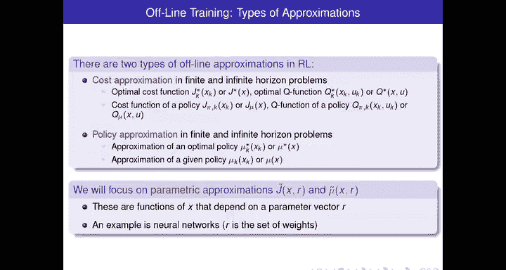

根据架构类型，我们称之为线性或非线性。如果它显式地依赖于特征向量，则称为基于特征的。

具体来说，一个**基于特征的线性架构**如下所示：
\[
\tilde{J}(x, r) = r'\phi(x) = \sum_{\ell=1}^{m} r_\ell \phi_\ell(x)
\]
其中 \(\phi(x)\) 是特征向量，\(r_\ell\) 是待训练的参数。

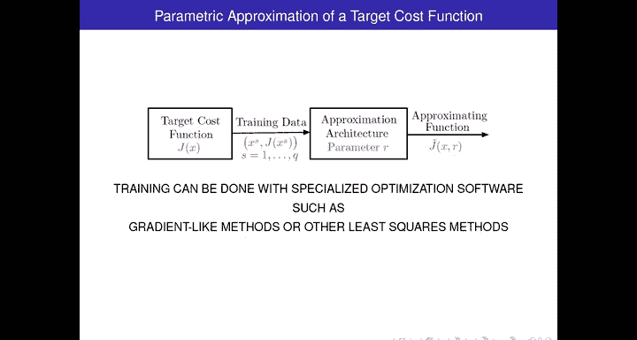

一个简单的例子是**分段常数近似**，我们将状态空间划分为子集 \(S_1, \ldots, S_m\)，第 \(\ell\) 个特征由状态是否属于子集 \(S_\ell\) 的指示函数定义。其对应的成本函数近似是分段常数函数。这种架构在理论上是强大的，但对于高维状态空间，设计分区可能非常复杂。

另一种常用类型是**通用多项式架构**。我们以二次多项式近似为例。给定具有 \(n\) 个分量的状态 \(x\)，其特征可以包括常数偏移、单个分量以及两个分量的乘积。基于这些特征的线性近似架构将为常数项、每个单个分量以及每个乘积组合分配一个权重。更一般地，我们可以使用特征向量 \(\phi_i\) 的多项式项来代替 \(x_i\) 和 \(x_j\)。

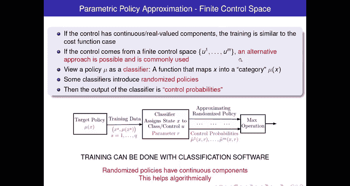

### 策略近似

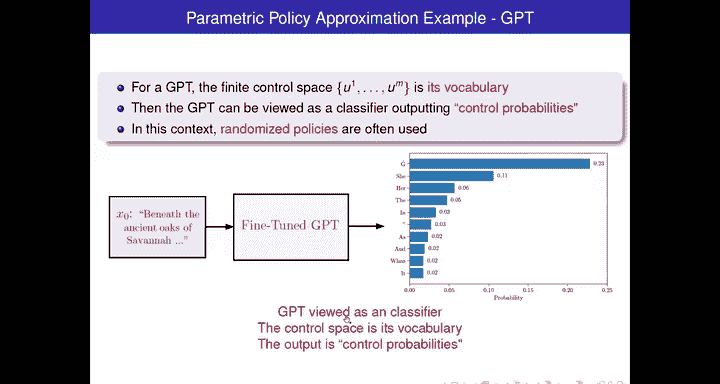

当近似策略时，特别是当可能控制的数量有限时，情况略有不同。如果控制具有连续或实值分量，训练类似于成本函数的情况。另一方面，如果控制来自有限控制集 \(\{u^1, \ldots, u^m\}\)，则可以使用另一种常见方法：将策略 \(\mu\) 视为一个**分类器**，它是一个将状态 \(x\) 映射到一个类别 \(\mu(x)\) 的函数。

训练后，我们通常使用输出概率最大的控制，或者在某些情况下使用随机策略（输出控制空间上的概率分布）。随机策略有助于训练过程。

### 案例研究中的特征

在案例研究中，特征的选择至关重要。例如：
*   **国际象棋**：特征可能包括子力平衡、王的安全性和机动性。
*   **俄罗斯方块**：特征可能包括每行的高度、相邻行的高度差、最大高度以及“空洞”的数量。

这些特征捕捉了问题的关键非线性特性。

### 通过特征进行状态空间划分

划分状态空间的一种简单方法是将其划分为几个子集，并在每个子集中构建单独的成本函数近似。一个实际问题是需要协调分区边界附近的状态。通常，使用特征来生成分区是一个好主意：我们在特征空间中进行规则划分，然后映射回原始状态空间。直观上，我们希望将具有相似成本的状态分组在一起，而特征通常能捕捉成本函数的主要非线性特性。

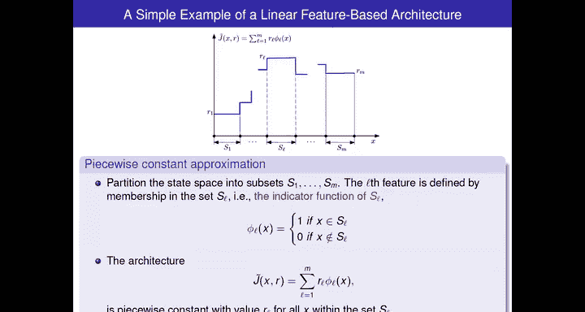

## 神经网络作为特征构造器 🤖

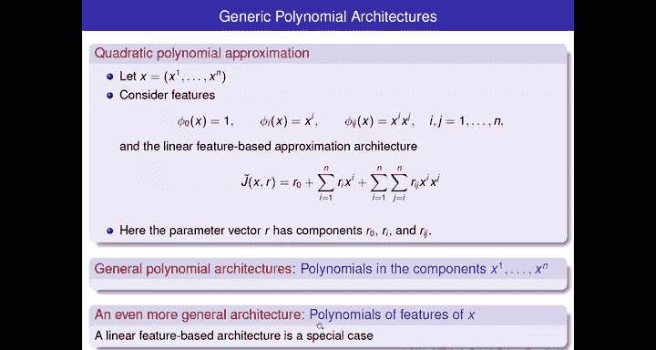

神经网络是一种无需预先了解特征即可自动构造特征的架构。以下是单层神经网络的示例：

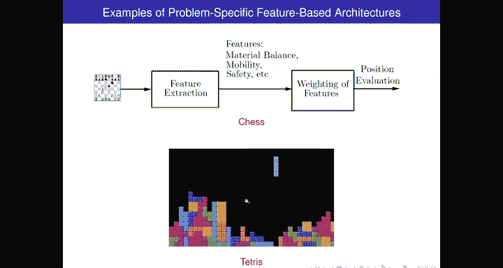

给定一组状态和成本训练对 \((x^s, \beta^s)\)，该神经网络的参数可以通过解决以下训练问题来优化：
\[
\min_{A, b, r} \sum_{s=1}^{q} \left( r' \phi(A y(x^s) + b) - \beta^s \right)^2
\]
其中，\(y(x)\) 可能来自状态编码层，\(\phi\) 是非线性激活函数。

理论上，神经网络具有**通用近似性质**：即使只有单层，只要非线性单元足够多，就可以任意好地近似任何连续函数。然而，该理论并未回答需要多少非线性单元才能近似特定函数。实践表明，使用更深的神经网络通常是更好的方式。

## 架构训练 🏋️

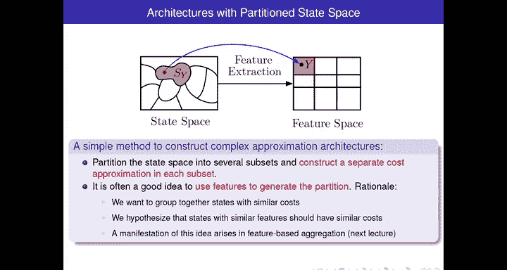

通常，在近似成本函数或具有连续分量的策略时，可以将其视为最小二乘回归问题。我们收集一组状态和成本训练对 \((x^s, \beta^s)\)，并通过最小化 \(\tilde{J}(x^s, r)\) 与 \(\beta^s\) 之间的平方差之和来确定权重 \(r\)。有时会添加一个二次正则化项 \(\beta \|r\|^2\) 以促进最小化并避免过拟合。

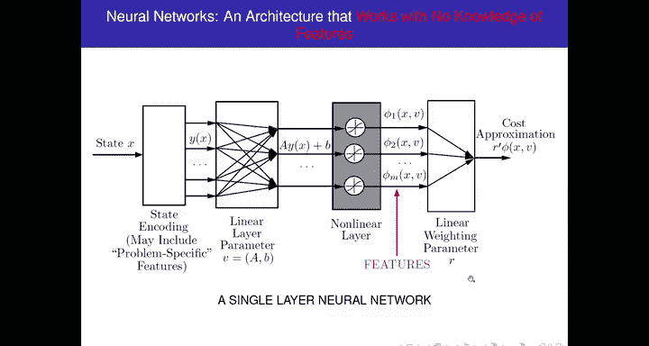

对于**基于特征的线性架构**，训练问题涉及二次最小化，可以通过闭式解解决：
\[
r^* = \left( \sum_{s=1}^{q} \phi(x^s) \phi(x^s)' + \beta I \right)^{-1} \left( \sum_{s=1}^{q} \beta^s \phi(x^s) \right)
\]
然而，当特征维度 \(m\) 很大时，计算可能具有挑战性。

更一般地，对于非线性架构，训练问题可能是非凸的，具有许多局部最小值，并且求和项 \(q\) 可能非常大。这使得标准的梯度方法基本上不适用。因此，每次迭代只对单个项进行操作的**增量迭代方法**效果很好。

## 可微函数和的增量优化 ⚙️

架构训练问题是更一般问题的特例：最小化可微函数和的问题。我们将讨论在80年代发明的增量梯度方法。

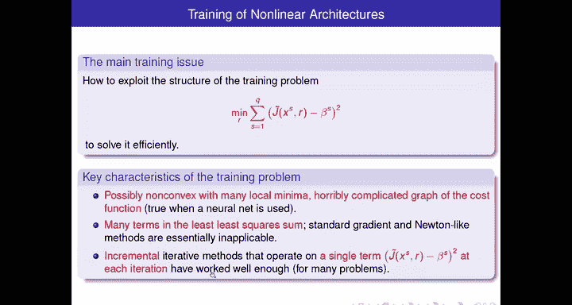

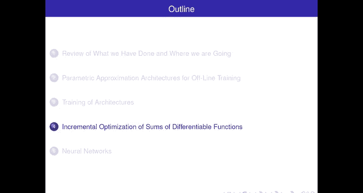

我们关注这个通用的求和项优化问题：
\[
\min_{y \in \mathbb{R}^n} F(y) = \sum_{i=1}^{m} f_i(y)
\]
其中每个 \(f_i\) 是 \(n\) 维向量 \(y\) 的可微标量函数。

**普通梯度法**按照以下公式生成序列：
\[
y_{k+1} = y_k - \gamma_k \nabla F(y_k) = y_k - \gamma_k \sum_{i=1}^{m} \nabla f_i(y_k)
\]
其中 \(\gamma_k > 0\) 是步长参数。

**增量梯度法**则随机选择一个索引 \(i_k\)，并按照以下公式迭代：
\[
y_{k+1} = y_k - \gamma_k \nabla f_{i_k}(y_k)
\]
与普通梯度法相比，这节省了大量计算，因为每次迭代只计算一个分量的梯度。

为什么这种方法有效？直观上，当当前点 \(y_k\) 远离收敛区域时，无论选择哪个分量，梯度方向大致相同，因此增量梯度法与普通梯度法一样有效，但计算量仅为 \(1/m\)。然而，当接近收敛区域时，不同分量的梯度方向可能相互矛盾，导致更新方向左右摇摆。理论上，可以通过使用**递减步长** \(\gamma_k = \frac{\gamma}{k}\) 来确保收敛。

还有**增量聚合方法**的变体，可以加速收敛过程。它评估单个项的梯度，但使用先前计算的梯度（仿佛它们是最新的）进行聚合。

在神经网络训练的背景下，你经常听到**随机梯度下降法**。它适用于最小化期望形式 \(F(y) = E_{w} [f(y, w)]\) 的函数。增量梯度法与随机索引选择等同于SGD，如果我们根据均匀分布选择索引。

### 实际问题

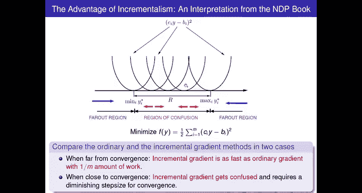

实现增量方法的一些实际问题包括：
*   **如何选择步长 \(\gamma_k\)**：通常使用递减步长以确保收敛。
*   **如何处理收敛区域问题**：检测何时进入收敛区域并开始减小步长。
*   **如何选择迭代项的顺序**：可以按某种顺序循环遍历所有分量，或进行随机选择。关键是确保选择过程对应于所有分量的均匀分布。
*   **诊断缩放**：为 \(y\) 的每个分量使用不同的步长。

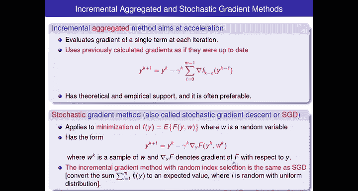

## 神经网络基础 🧬

如前所述，神经网络是自动构造特征的架构。以下是单层神经网络的示例：

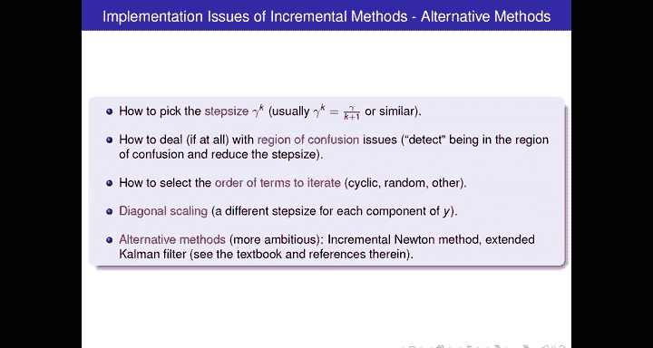

### 激活函数

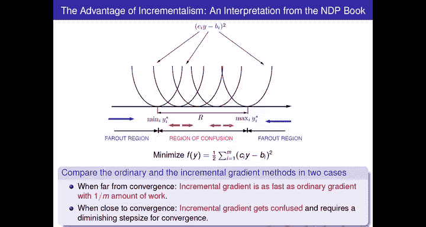

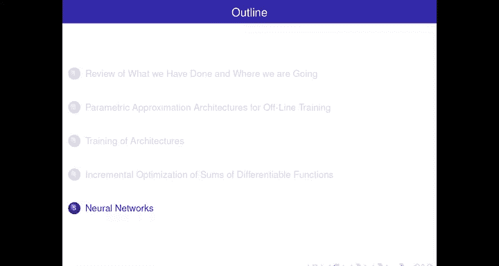

典型的非线性单元（激活函数）包括：
*   **整流线性单元**：\(\sigma(z) = \max\{0, z\}\)
*   **平滑版本**：如 \(\sigma(z) = \ln(1+e^z)\) 或 \(\sigma(z) = \ln(1+e^{-z})^{-1}\)
*   **Sigmoid函数**：如双曲正切函数或逻辑函数，它们在正值和负值范围内都会饱和。

### 深度神经网络

实践表明，**深度神经网络**比浅层网络更强大。深度网络通过重复线性层和非线性层来构建。最近的研究表明，**过参数化**（参数数量多于数据点数量）是其主要原因。当参数与数据点的比率 \(R\) 远大于1时，过拟合问题实际上得到了克服。

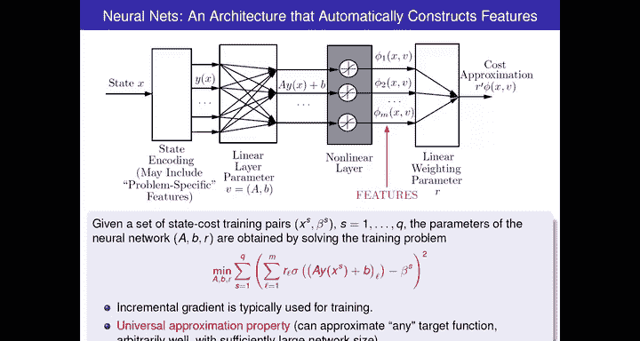

### 关键创新

除了之前讨论过的注意力机制外，还有两项重要的技术创新使得深度神经网络得以成功应用：**残差连接**和**层归一化**。

**残差连接**的基本构建块如下所示：

输入 \(y\) 经过几个线性层后，与原始输入 \(y\) 相加，作为该构建块的输出。这种设计保证了更深的网络至少不会比其更浅的对应版本表现更差，因为可以通过将中间层的权重设为零来“跳过”额外的层。

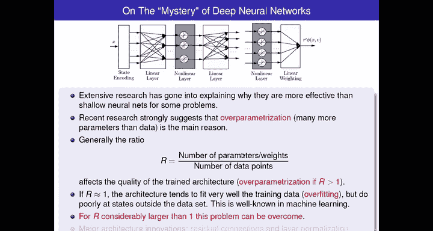

**层归一化**有助于训练。在线性层之后，输出通过非线性层得到 \(\phi_1, \ldots, \phi_m\)。然后，层归一化块计算这些 \(\phi_i\) 的经验均值和方差，并使用以下公式进行归一化：
\[
\hat{\phi}_i = \frac{\phi_i - \bar{\phi}}{\sqrt{\frac{1}{m}\sum_{j=1}^{m}(\phi_j - \bar{\phi})^2 + \epsilon}}
\]
其中 \(\bar{\phi}\) 是均值，\(\epsilon\) 是一个小的固定数。归一化后，\(\hat{\phi}_i\) 的分布近似为标准正态分布，这有助于计算有意义的梯度。

## 总结 📝

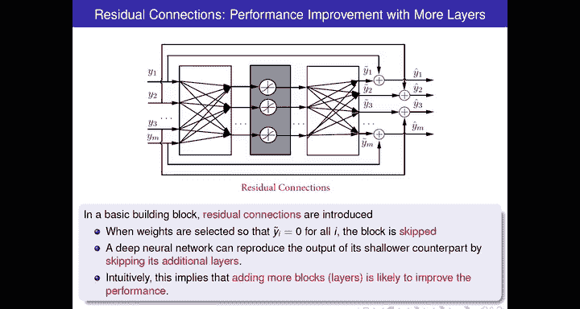

在本节课中，我们一起学习了强化学习中的离线训练算法。我们首先回顾了核心架构和课程计划，然后介绍了用于离线训练的参数化近似架构，包括基于特征的线性架构和多项式架构。接着，我们探讨了如何训练这些架构，并将其视为最小二乘回归问题。

之后，我们转向更通用的增量优化方法，用于最小化可微函数的和，并解释了增量梯度法的工作原理及其与随机梯度下降法的联系。最后，我们介绍了神经网络作为自动特征构造器，讨论了其通用近似性质、深度网络的优势以及残差连接和层归一化等关键创新。

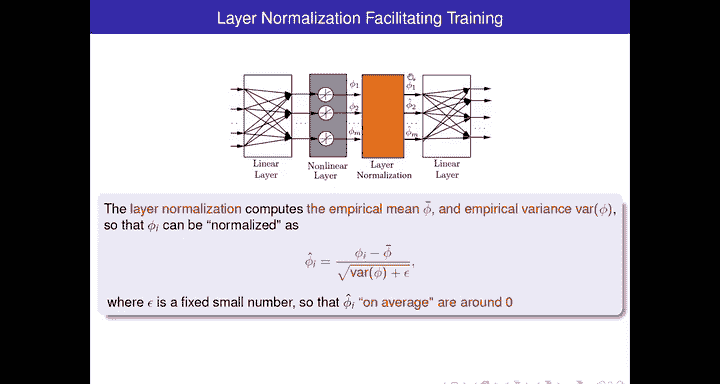

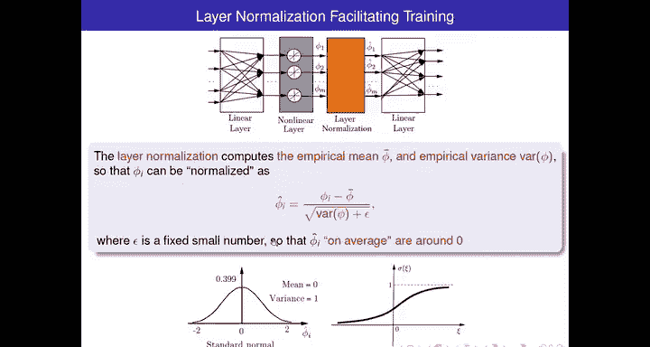

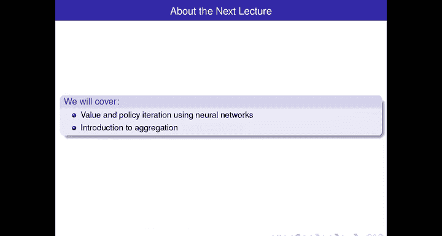

在下一讲中，我们将介绍使用神经网络进行值和策略近似，并介绍聚合方法。