# 12：离线训练与聚合方法 🧠

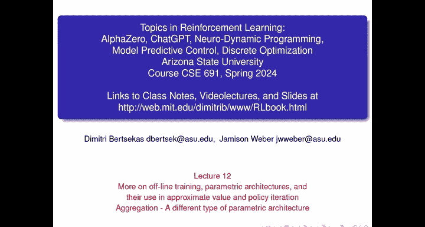

在本节课中，我们将学习如何将离线训练技术应用于近似动态规划，并介绍一种称为“聚合”的简化问题方法。我们将首先回顾参数化架构的离线训练，然后探讨其在有限与无限时域问题中的应用，最后深入讲解聚合方法及其在连续状态空间问题中的实现。

***

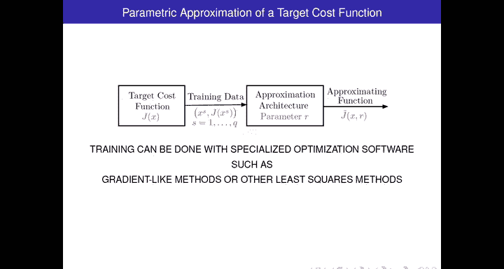

## 回顾：参数化架构的离线训练 📊

上一节我们介绍了近似价值空间的基本框架。本节中，我们来看看如何使用参数化架构（特别是神经网络）来近似未来成本函数。

参数化近似涉及选择一个由参数向量 **r** 控制的函数类 **J̃(x, r)**。我们通过调整 **r** 来使 **J̃** 拟合目标函数的训练数据。

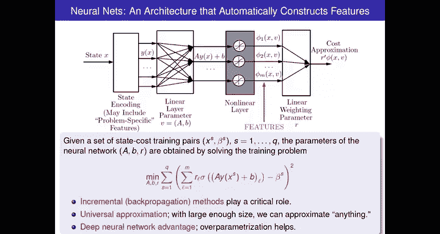

以下是实现步骤：
1.  选择一个函数类 **J̃(x, r)**，它依赖于状态 **x** 和可调参数向量 **r**。
2.  获取一组训练样本 **{(x_s, β_s)}**，其中 **β_s** 是状态 **x_s** 对应的真实成本。
3.  通过最小化预测成本与真实成本之间的差异来训练参数 **r**，通常使用最小二乘回归：
    ```python
    minimize_r Σ_s (J̃(x_s, r) - β_s)^2
    ```

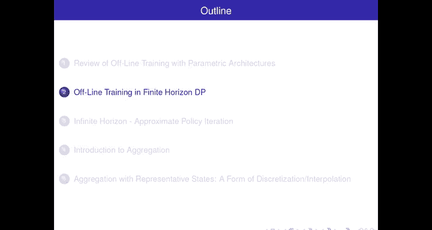

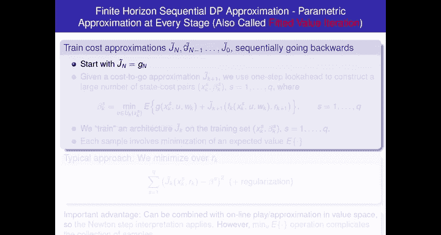

基于特征的线性架构形式为：
**J̃(x, r) = r^T φ(x) = Σ_{l=1}^m r_l φ_l(x)**
其中 **φ(x)** 是从状态 **x** 提取的特征向量。

神经网络的优势在于能自动构建特征。一个简单的神经网络架构如下：
1.  对状态 **x** 进行编码，得到 **y(x)**。
2.  通过一个由权重矩阵 **A** 和偏置向量 **b** 参数化的线性层：**z = A y(x) + b**。
3.  应用非线性激活函数 **σ**（按元素操作）得到特征向量：**φ = σ(z)**。
4.  最后通过线性加权得到近似成本：**J̃(x, r) = r^T φ**。

训练网络参数 **(A, b, r)** 同样通过最小二乘回归完成，常使用反向传播和随机梯度下降等增量方法。

***

## 有限时域问题的离线训练：拟合价值迭代 ⏳

现在，我们将离线训练应用于有限时域序贯动态规划问题。我们将介绍一种称为“拟合价值迭代”的算法。

该算法涉及在动态规划的每个阶段进行参数化近似。我们按时间倒序依次训练 **N+1** 个网络：
1.  首先，使用初始数据点训练网络 **J̃_N** 来近似终端成本。
2.  然后，对于 **k = N-1, ..., 0**：
    *   使用已训练好的 **J̃_{k+1}**，通过一步前瞻为大量状态 **x_k^s** 生成目标成本 **β_k^s**：
        **β_k^s = min_u E[ g_k(x_k^s, u, w_k) + J̃_{k+1}(f_k(x_k^s, u, w_k), r_{k+1}) ]**
    *   利用生成的状态-成本对样本 **{(x_k^s, β_k^s)}** 训练当前阶段的架构 **J̃_k**。

这种方法的一个主要挑战在于，为每个样本计算期望值的最小值可能计算量巨大。

***

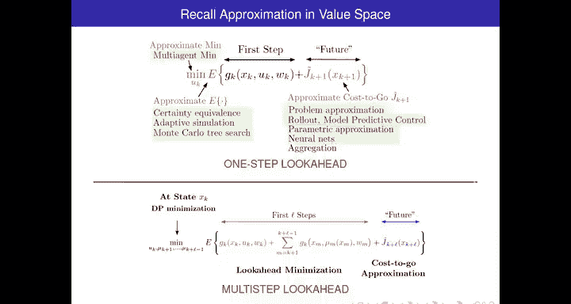

## 使用Q因子的拟合价值迭代 🔄

为了处理最小化期望值的计算难题，我们转向使用Q因子的拟合价值迭代方法。

我们定义近似Q因子：
**Q̃_k(x, u, r) ≈ E[ g_k(x, u, w_k) + J̃_{k+1}(f_k(x, u, w_k), r_{k+1}) ]**
其中 **J̃_{k+1}(x‘) = min_{u’} Q̃_{k+1}(x‘, u‘, r_{k+1})**。

关键点在于，我们交换了期望和最小化的顺序。计算“最小值的期望”比计算“期望的最小值”更容易，因为前者可以通过采样（甚至是单一样本）来近似。

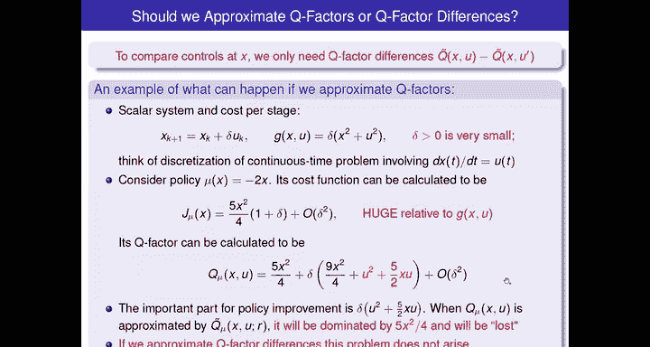

这种方法还支持**无模型**学习。我们只需要一个模拟器，能够生成 **(状态, 控制, 成本, 下一状态)** 的随机样本，即可近似Q因子。

在线控制选择简化为：
**μ̃_k(x_k) = arg min_u Q̃_k(x_k, u, r_k)**
这避免了在线计算复杂的期望值，但失去了牛顿步的特性。

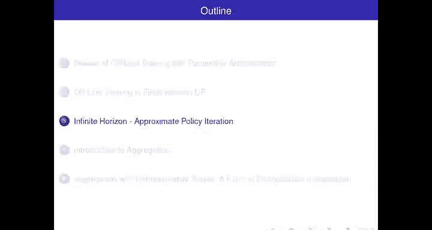

***

## Q因子与Q因子差值的近似 📉

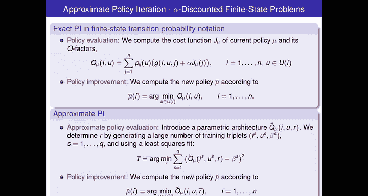

在近似Q因子时，一个常见问题是项之间的比例失衡。例如，在连续时间问题的离散化中，瞬时成本可能远小于总成本，导致在近似时重要信号被淹没。

解决方案是近似**Q因子差值**而非Q因子本身。这相当于为Q因子减去一个仅依赖于状态的基线（baseline），从而聚焦于与控制相关的部分，可以显著降低方差。

一般性补救措施包括：
*   **差分训练**：直接近似成本函数差值。
*   **优势更新**：使用相对Q因子，即减去最小Q因子作为基线。

***

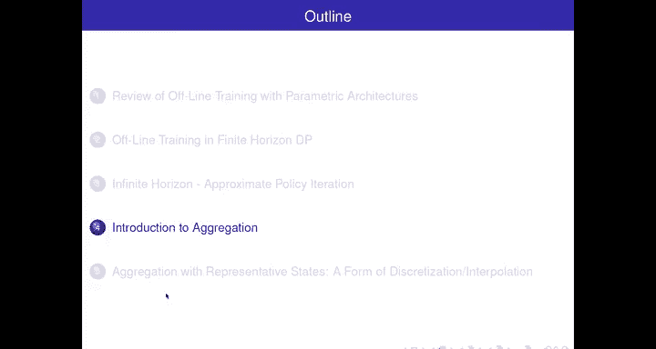

## 无限时域问题：近似策略迭代 ♾️

现在，我们将目光转向无限时域问题，并介绍近似策略迭代算法。

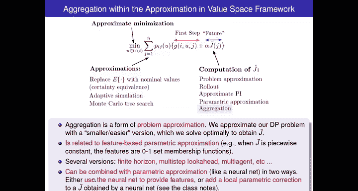

精确策略迭代在有限状态问题时效果良好，但计算成本高昂，因为它需要遍历整个状态和控制空间。近似策略迭代通过参数化近似来克服这一挑战。

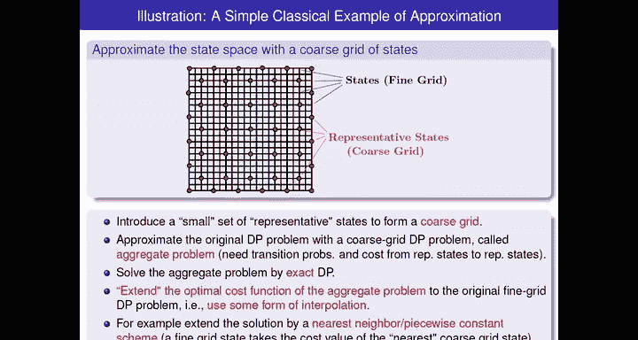

算法每次迭代包含两个阶段：
1.  **近似策略评估**：对于当前策略 **μ**，使用参数化架构 **Q̃(x, u, r)** 来近似其Q因子。通过生成训练三元组 **(x_s, u_s, β_s)** 并求解最小二乘问题来确定参数 **r̄**。
2.  **策略改进**：基于训练好的架构更新策略：
    **μ̃(x) = arg min_u Q̃(x, u, r̄)**

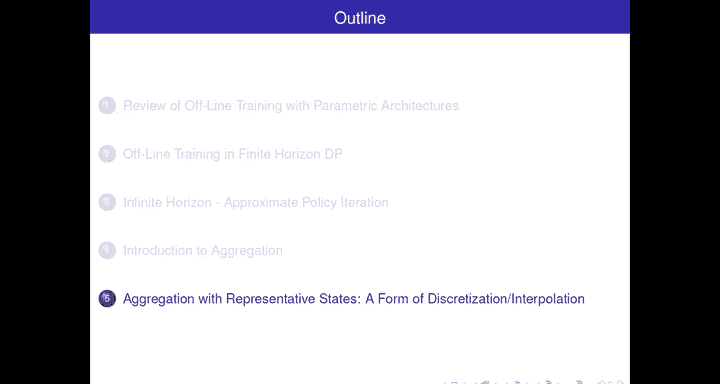

近似策略迭代面临几个重大挑战：
*   **架构问题**：设计好的特征或训练稳定的神经网络非常困难。
*   **探索不足**：在策略 **μ** 下模拟会过采样常见状态，导致其他状态欠采样，影响策略改进。补救方法包括从不同起始状态模拟短轨迹，或使用离策略探索。
*   **振荡问题**：策略质量可能无法收敛，而是在某个水平附近振荡。参数可能收敛，但对应的策略仍可能变化（“抖动”现象）。

***

## 聚合方法介绍 🧩

接下来，我们介绍一种不同的问题近似方法：**聚合**。其核心思想是用一个更小、更简单的动态规划问题（聚合问题）来近似原始问题，然后通过插值将聚合问题的解扩展到原始问题。

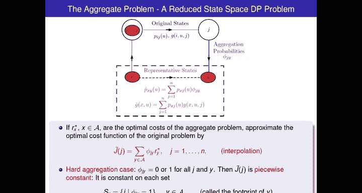

聚合与基于特征的参数化近似相关。例如，在硬聚合中，近似成本函数 **J̃** 是分段常数。

基本步骤如下：
1.  从原始状态空间中选择一个有限的**代表状态**子集 **A**。
2.  定义**聚合概率** **ϕ_{jy}**，表示原始状态 **j** 与代表状态 **y** 的相似度，它构成一个概率分布。
3.  构建**聚合问题**的动态特性（转移概率 **p̂_{xy}**）和成本函数 **ĝ(x, u)**：
    *   **p̂_{xy} = Σ_j p_{xj} ϕ_{jy}**
    *   **ĝ(x, u) = Σ_j p_{xj} g(x, u, j)**
4.  使用精确动态规划方法（如价值迭代、策略迭代）求解聚合问题，得到最优成本 **r_y^***。
5.  通过插值获得原始问题的近似最优成本：
    **J̃(j) = Σ_y ϕ_{jy} r_y^***

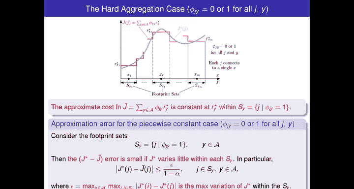

在**硬聚合**中，每个原始状态 **j** 严格映射到一个代表状态 **y**（即 **ϕ_{jy}=1**），从而形成原始状态空间的一个划分。此时 **J̃** 是分段常数函数。

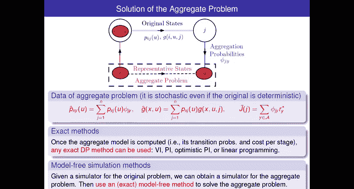

近似误差受到划分内最优成本函数 **J*** 变化幅度的限制。如果每个划分块内 **J*** 变化很小，则近似效果很好。

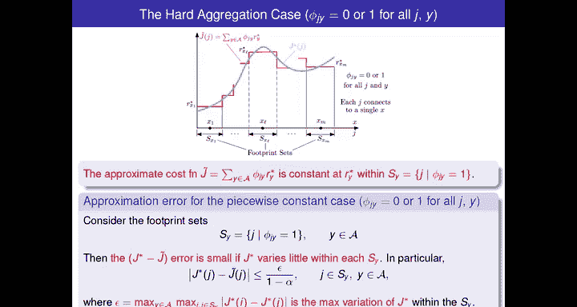

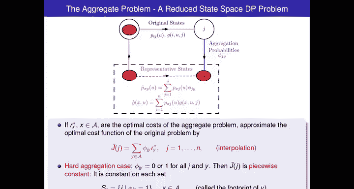

***

## 代表状态聚合与连续空间离散化 📐

聚合方法可用于离散化连续状态空间问题，例如部分可观测马尔可夫决策过程。

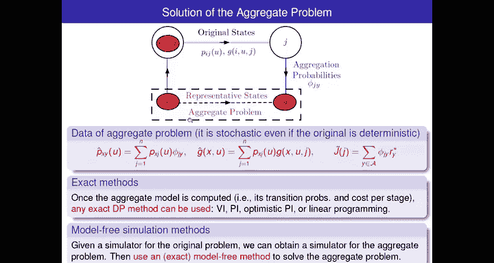

在POMDP中，信念状态空间是连续的。我们可以选择一组代表性的信念状态，构建一个有限状态的聚合MDP问题并求解。然后通过插值得到原始POMDP信念状态的近似成本，进而用于设计一步或多步前瞻控制方案。

然而，在同时存在连续状态和**连续控制**空间时，需要谨慎。仅离散化状态空间而保持控制空间离散化程度不足，可能导致近似解严重偏离真正的最优解（例如，网格世界中的曼哈顿距离与欧氏距离问题）。为了获得良好的近似，控制空间的离散化也必须足够精细。

定义好的代表状态集可能很困难。一种更灵活的方法是先通过神经网络等提取状态的特征向量，然后在**特征空间**中进行离散化和聚合，使得每个划分块内的状态具有相似的特征。


***

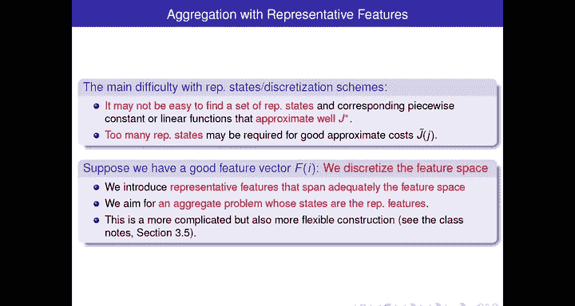

## 总结 🎯

本节课我们一起学习了以下内容：
1.  **参数化离线训练**：使用神经网络等架构近似成本函数，并通过训练数据拟合参数。
2.  **拟合价值迭代**：将离线训练应用于有限时域动态规划，按阶段倒序训练近似网络。
3.  **基于Q因子的方法**：通过交换期望与最小化顺序，简化计算并支持无模型学习。
4.  **近似策略迭代**：在无限时域问题中，交替进行策略的近似评估与改进，同时认识到其面临的探索、振荡等挑战。
5.  **聚合方法**：通过构建并求解一个简化的聚合问题，再插值回原始问题，来获得近似解。这种方法特别适用于连续状态空间（如POMDP）的离散化。

这些方法为处理大规模或复杂的强化学习问题提供了强大的近似工具。