# 13：近似线性规划与策略空间近似 🧮

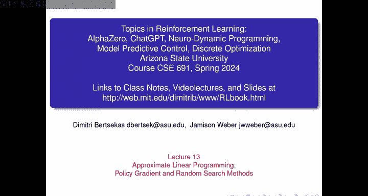

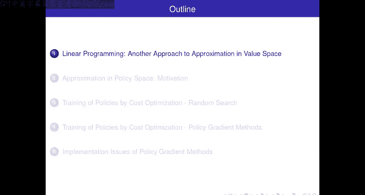

在本节课中，我们将学习两种重要的近似方法：近似线性规划和策略空间近似。首先，我们将探讨如何将动态规划问题表述为线性规划问题，并介绍其近似版本。随后，我们将重点转向策略空间近似，讨论其动机、应用场景以及两种核心优化技术：随机搜索和策略梯度。

## 线性规划作为精确动态规划的一种方法

上一节我们回顾了值迭代和策略迭代。本节中，我们来看看动态规划的第三种精确求解方法：线性规划。

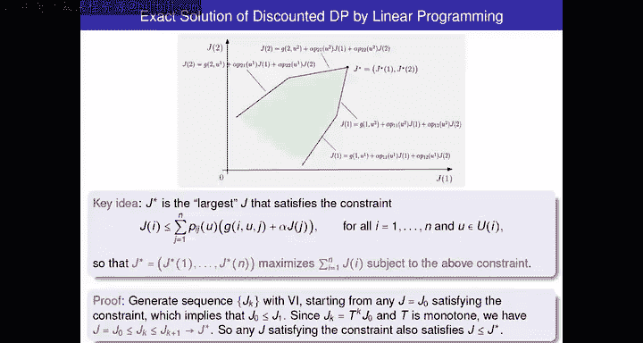

线性规划问题包含一组变量、一个需要优化的线性目标函数，以及一组关于这些变量的线性约束。我们可以将任何动态规划问题表述为一个线性规划问题。

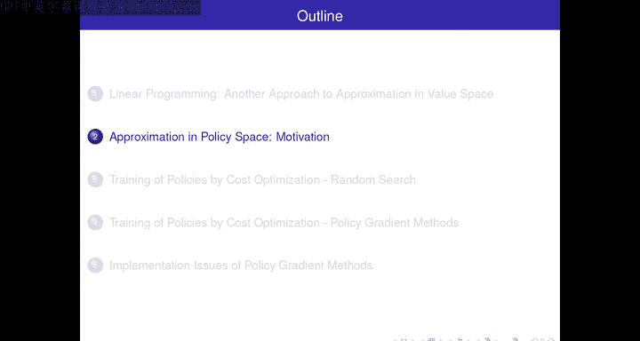

具体做法是，将每个状态的成本 `J(i)` 视为一个变量，形成一个成本向量 `J`。目标是最大化所有状态成本之和 `∑ J(i)`。约束条件是，对于每个状态 `i` 和可能的控制 `u`，成本 `J(i)` 必须不大于贝尔曼方程的右侧项：`g(i, u) + α * ∑ p_ij(u) * J(j)`。这个约束确保了成本向量满足贝尔曼最优性条件。

通过求解这个线性规划，我们可以得到最优成本向量 `J*`。理论上，我们可以使用商业求解器（如CPLEX或Gurobi）直接求解。然而，对于大规模问题，变量和约束的数量会随着状态空间和控制空间的增大而爆炸式增长，使得精确求解变得不可行。

## 近似线性规划

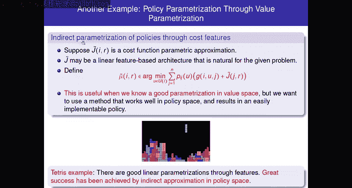

由于精确线性规划在大规模问题上不可行，我们需要引入近似方法。这属于值空间近似的范畴。

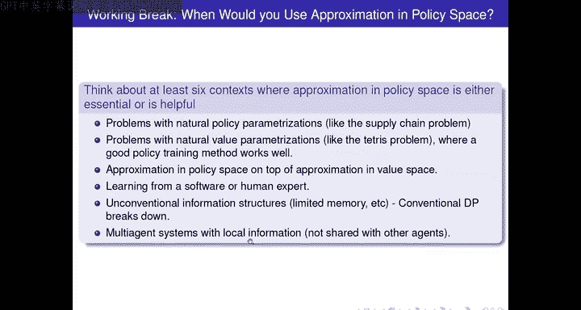

核心思想是使用一个参数化的线性特征架构来近似最优成本函数：`J̃(i, r) = ∑ φ_k(i) * r_k`，其中 `r` 是参数向量，`φ_k` 是状态特征。这样，我们将需要优化的变量从状态数量（巨大）减少到参数数量（较小）。

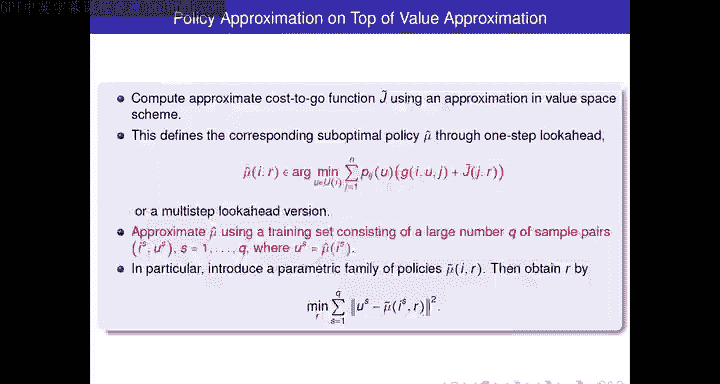

同时，为了减少约束数量，我们引入约束采样技术。我们只在一组有代表性的状态 `Ĩ` 和有代表性的控制上施加贝尔曼约束。新的线性规划变为：最大化 `∑_{i∈Ĩ} J̃(i, r)`，并满足约束 `J̃(i, r) ≥ g(i, u) + α * ∑ p_ij(u) * J̃(j, r)`（对所有 `i∈Ĩ, u∈Ũ(i)`）。

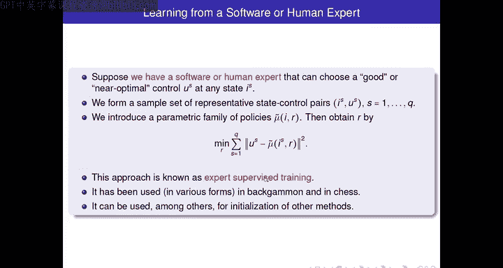

代表性状态和控制通常通过运行次优策略并收集其产生的轨迹样本来获得。如果结果不理想，可以逐步添加新的轨迹数据来丰富样本集。这种方法虽然在某些测试问题上取得了成功，但总体上不如其他近似方法流行。它的优势在于能够利用成熟的大规模线性规划求解软件。

## 策略空间近似：动机与概述

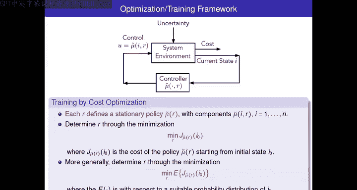

前面我们介绍了值空间近似。本节中，我们将转向另一种不直接近似成本函数的方法：策略空间近似。

策略空间近似的核心是直接对策略进行参数化。我们定义一个由参数向量 `r` 参数化的平稳策略族 `μ̃(r)`。然后，我们优化某个衡量该策略性能的指标（如从某个初始状态出发的期望总成本），直接对参数 `r` 进行优化。

以下是策略空间近似特别有用或必要的几种场景：

*   **具有自然策略参数化的问题**：例如，在库存控制中，一个近乎最优的策略形式可能是“当库存低于阈值 `r1` 时，订购数量 `r2`”。整个复杂问题被简化为优化两个参数。
*   **具有自然值函数参数化的问题**：例如，在俄罗斯方块游戏中，研究者已经总结出一组有效的状态特征（如最高列、空洞数量等）。我们可以利用这些特征构建一个直观的成本函数近似 `J̃(r)`，然后通过求解近似贝尔曼方程间接得到一个策略。
*   **在值函数近似之上进行策略近似**：即使我们有一个好的值函数近似 `J̃`，在线使用时，通过 `min_u [ g(i,u) + α E[J̃(j,r)] ]` 来计算控制可能仍然很耗时（需要最小化和求期望）。我们可以离线采样大量状态-最优控制对 `(i, u*)`，然后用一个快速的参数化函数（如神经网络）`μ̃(i, r)` 去拟合这些样本，从而得到一个能快速在线评估的策略。
*   **向软件或人类专家学习**：如果我们有一个能提供近乎最优控制的专家（人类或软件），可以收集专家在大量状态下的决策样本，然后通过监督学习训练一个策略网络 `μ̃(i, r)` 来模仿专家行为。这常被用作更复杂方法（如AlphaGo）的初始化。
*   **非常规信息结构**：在多智能体系统中，每个智能体只能根据本地信息做决策，传统的基于全局状态的动态规划结构不再适用。策略空间近似允许我们为每个智能体训练一个基于其本地信息的策略网络。
*   **模型未知或难以处理**：当系统模型未知或计算期望非常困难时，直接优化参数化策略（通过与环境的交互来评估）可能比依赖模型的值函数方法更可行。

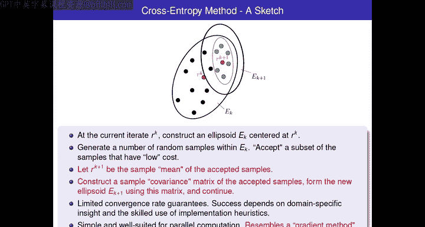

## 策略空间近似框架与随机搜索优化

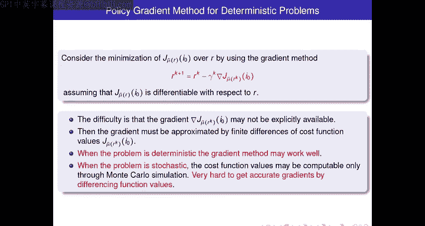

在策略空间近似框架下，我们假设一个由连续参数 `r` 定义的平稳策略 `μ̃(r)`。目标是最小化从初始状态 `i0` 出发使用该策略的期望总成本 `J(μ̃(r), i0)`。我们通过在该参数空间中搜索来优化 `r`。

随机搜索方法适用于这种最小化问题。它们迭代地生成参数序列 `{r_k}`，通过在当前参数 `r_k` 的邻域内随机采样新点并评估其成本，选择成本更低的点作为下一步迭代值。这类方法不要求成本函数可微，也能处理离散和连续问题，并且不易陷入局部极小点，但可能收敛较慢。

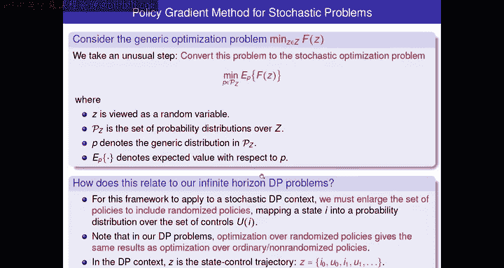

以下是几种常见的随机搜索算法：
*   **进化规划/遗传算法**：受进化论启发，维护一个参数“个体”的种群，通过选择、交叉、变异等操作迭代进化。
*   **禁忌搜索**：避免重访已经搜索过的区域。
*   **模拟退火**：受统计力学启发，在“高温”时进行大范围探索，“低温”时进行精细搜索。
*   **交叉熵方法**：一种迭代方法。在每次迭代中，以当前参数 `r_k` 为中心定义一个椭圆区域，在该区域内随机采样若干点，评估它们的成本，选出成本较好的一部分“精英”样本，计算这些精英样本的均值作为新的中心 `r_{k+1}`，并根据其协方差更新椭圆区域（通常会启发式地扩大区域以避免过早收缩）。该方法适合并行计算。

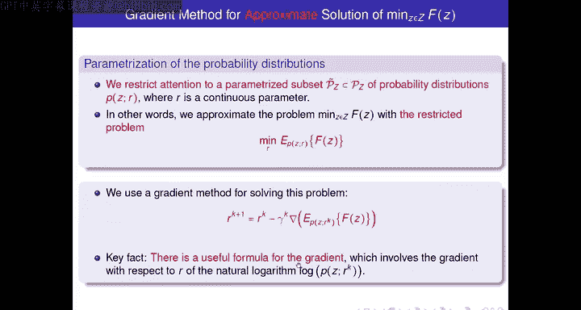

## 策略梯度方法

随机搜索方法可能效率较低。本节中，我们来看看一种利用梯度信息的高效方法：策略梯度。

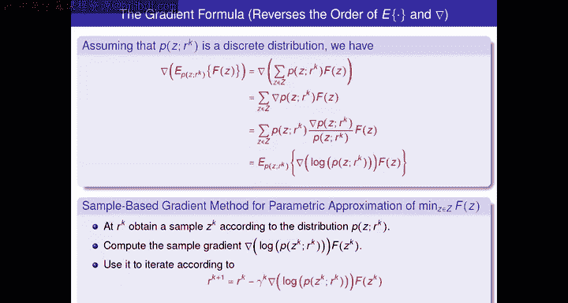

首先考虑确定性问题的简单梯度下降：`r_{k+1} = r_k - γ_k * ∇_r J(μ̃(r_k), i0)`。但梯度 `∇_r J` 通常无法直接计算，通过有限差分近似在随机问题中会因蒙特卡洛噪声而导致不准确。

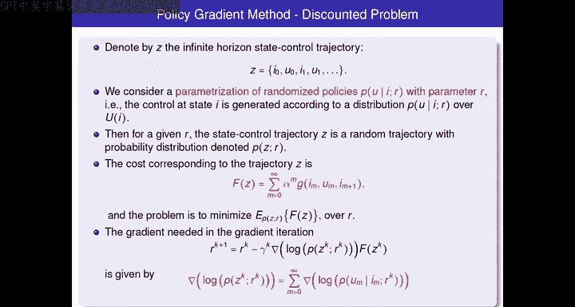

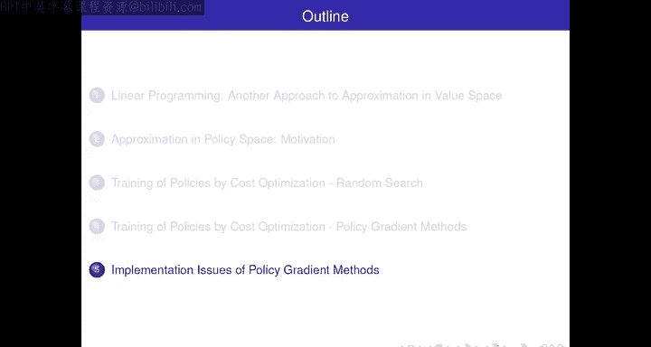

策略梯度方法采用了一个巧妙的转换。它将最小化确定性成本 `J(μ̃(r), i0)` 的问题，转化为最小化一个随机策略下轨迹成本的期望问题。具体来说，我们引入参数化的随机策略 `π(u|i; r)`，它给出在状态 `i` 下选择控制 `u` 的概率。轨迹 `z`（状态-控制序列）的概率分布为 `p(z|r)`，其成本为 `F(z)`。原问题近似为最小化期望成本 `E_{z∼p(z|r)}[F(z)]`。

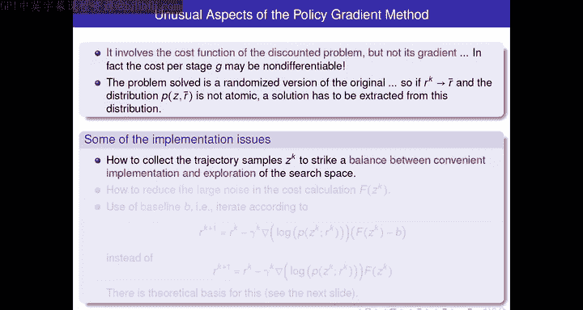

关键技巧在于计算该期望的梯度。通过数学推导，可以得到一个重要公式：
`∇_r E_{z∼p(z|r)}[F(z)] = E_{z∼p(z|r)}[ F(z) * ∇_r log p(z|r) ]`

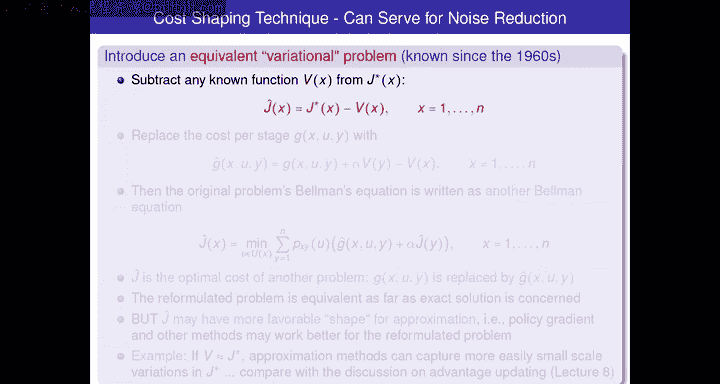

对于无限视野折扣问题，轨迹概率 `p(z|r)` 可分解为策略概率与系统转移概率的乘积。由于转移概率与参数 `r` 无关，在对数求梯度时会消失。最终，梯度公式简化为：
`∇_r J(r) ≈ E [ (∑_{t=0}^{∞} α^t g(i_t, u_t)) * (∑_{t=0}^{∞} ∇_r log π(u_t|i_t; r)) ]`

这个公式的美妙之处在于：**我们不需要计算成本函数 `J` 的梯度，也不需要知道系统的转移概率模型**。我们只需要根据当前随机策略 `π(u|i; r_k)` 采样轨迹 `z_k`，计算该轨迹的总成本 `F(z_k)` 和策略概率对数的梯度之和，然后用它们的乘积作为梯度的无偏估计：`\hat{∇}_r J ≈ F(z_k) * ∑_t ∇_r log π(u_t|i_t; r_k)`。然后进行梯度更新：`r_{k+1} = r_k - γ_k * \hat{∇}_r J`。

## 实施细节与总结

策略梯度的实施面临一些挑战。一是探索与利用的平衡，需要确保采样轨迹能充分探索策略空间。二是蒙特卡洛估计带来的高方差（噪声）问题。

为了减少方差，一个常见技术是引入基线。我们不是使用轨迹成本 `F(z)`，而是使用 `(F(z) - b)` 来乘以梯度，其中基线 `b` 可以是一个常数（如平均成本），也可以是依赖于状态的值。这可以在不改变梯度期望值的情况下，显著降低估计的方差。这关联到“成本塑形”的思想，即通过减去一个接近 `J*` 的函数来重塑成本函数，使问题更容易学习。

策略梯度方法完全离线训练，训练好后在线应用速度极快。但它无法适应问题参数的变化，也失去了在线前瞻优化（如rollout）的优势。在实践中，策略空间近似常扮演辅助角色，例如用于为rollout算法提供基策略，或为蒙特卡洛树搜索快速生成轨迹（正如在AlphaZero中所示）。

在本节课中，我们一起学习了近似线性规划和策略空间近似。我们看到了如何将DP问题转化为线性规划，并通过参数化和采样来近似求解。我们深入探讨了策略空间近似的动机、通用框架，并详细介绍了两种优化方法：不依赖梯度的随机搜索（如交叉熵方法）和利用梯度信息的策略梯度方法。策略梯度通过巧妙的数学变换，实现了无需模型、无需计算成本函数梯度的优化，成为强化学习中的一个重要工具。最后，我们讨论了这些方法的实现挑战、优缺点及其在整体强化学习解决方案中的定位。