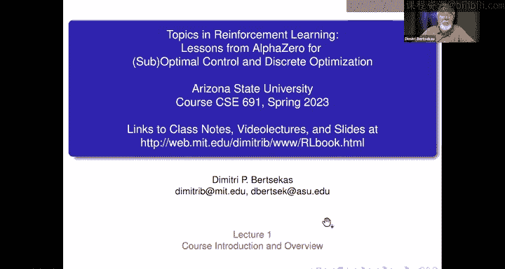
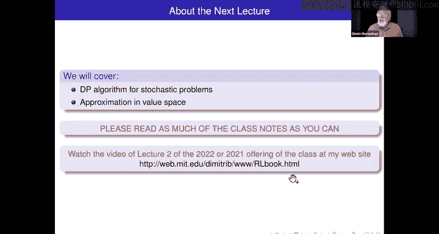

# 14：强化学习导论、AlphaZero与确定性动态规划 🚀

在本节课中，我们将学习强化学习的基本概念，通过分析AlphaZero等标志性程序来理解其核心架构，并深入探讨确定性动态规划的基础原理。我们还将了解本课程的组织结构和学习目标。

***

## 概述

强化学习是一个融合了人工智能、决策与控制、运筹学等多个领域的交叉学科。本节课将从AlphaZero程序入手，介绍其离线训练和在线对弈的两阶段算法设计，并阐述其与动态规划、模型预测控制等经典方法的深刻联系。随后，我们将正式进入技术部分，学习确定性动态规划的基本原理和算法。

***

## 1. 两个卓越的程序：AlphaZero与TD-Gammon 🎲

上一节我们介绍了课程的整体框架，本节中我们来看看两个具有里程碑意义的强化学习程序：AlphaZero和TD-Gammon。

AlphaZero于2017年问世，以其在围棋、国际象棋等游戏中的卓越表现和原创性玩法引起了轰动，并将强化学习领域推向了公众视野。TD-Gammon则是一个25年前（1992年）的西洋双陆棋程序，同样令人印象深刻。尽管相隔二十多年，这两个程序共享着相似的设计理念和算法架构。

它们都包含两个核心算法：
1.  **离线训练算法**：使用神经网络和自生成数据来构建一个评估局面优劣的**价值函数**，以及一个根据局面生成行动的**策略**。
2.  **在线对弈算法**：利用离线训练的成果，在与人类或计算机对手对弈时实时运行。它结合了**多步前瞻搜索**、**推演**和**价值函数近似**。

这些算法与经典的动态规划方法（如策略迭代）以及涉及神经网络训练的机器学习近似方法有着紧密的联系。本课程的目标就是深入理解这套方法论，并将其应用于更广泛的领域。

***

## 2. 在线对弈算法与价值空间近似 🔍

理解了程序的双算法架构后，本节我们重点剖析其在线对弈部分，即**价值空间近似**方法。

在线对弈算法可以看作是在一个决策树上进行在线搜索。给定当前棋局状态（或更一般的决策问题状态），算法会：
1.  向前搜索若干步，生成一个前瞻树。
2.  在搜索树的叶子节点，使用一个**基础策略**（由离线训练得到）进行多步模拟推演。
3.  使用一个**局面评估器**（同样由离线训练得到）来近似评估推演结束后的终端局面价值。
4.  将这些价值反向传播回根节点，计算当前每个可选行动的价值（即Q值）。
5.  选择价值最高的行动执行。

执行一步后，到达新的状态，重复上述过程。这种架构在TD-Gammon和AlphaZero中均有使用，也与控制理论中的**模型预测控制**高度相似。区别主要在于，游戏的状态空间是有限的，而MPC通常处理连续状态空间。

***

## 3. 离线训练算法 🏋️

在线对弈的强大依赖于优质的离线训练。本节我们来看看离线训练如何运作。

AlphaZero的离线训练采用了一种**近似策略迭代**算法，这是动态规划中的经典算法。该过程生成一系列不断改进的策略（即棋手）：
1.  **策略评估**：让当前策略进行大量自我对弈，根据胜负结果来评估其性能。这个评估函数通过训练一个**价值网络**来近似表示。
2.  **策略改进**：利用上一步得到的价值函数，通过一种包含多步前瞻最小化的操作（在AlphaZero中是一种近似的蒙特卡洛树搜索）来生成一个改进的新策略。这个新策略通过训练一个**策略网络**来表示。
3.  **循环迭代**：将新策略作为当前策略，重复上述评估与改进的循环。

TD-Gammon也使用了类似的策略迭代进行离线训练，但其价值网络的训练方法不同（使用TD(λ)算法），且没有使用策略网络和蒙特卡洛树搜索。在模型预测控制和离散优化中，离线训练可能更初级，重点更多地放在在线对弈上。

***

## 4. 关键经验观察与历史脉络 📜

我们已经了解了核心算法，现在来看看从这些程序的成功中得出的重要经验，并回顾领域的发展历史。

以下是两个关键观察：
*   **在线对弈能大幅提升性能**：AlphaZero的在线对弈程序（使用前瞻搜索）的表现远优于其纯离线训练的策略。这表明，在离线训练的基础上进行在线计算可以显著提升性能。
*   **推演至关重要**：在TD-Gammon中，加入“截断推演”（即使用基础策略进行中段模拟）能极大提升程序水平。这提供了一种在不显著增加搜索树规模的前提下延长前瞻深度的方法。

**历史发展**：
强化学习的现状源于人工智能思想与决策控制思想的富有成果的融合。动态规划诞生于20世纪50年代。强化学习作为AI的一个子领域，在20世纪80年代末被发现与动态规划有深刻联系。TD-Gammon的成功吸引了广泛关注，促进了这一融合。进入21世纪，机器学习复兴、计算能力提升、数据可用性增加，以及深度学习的发展，共同推动了领域的进步。2017年AlphaZero的出现引爆了整个领域。如今，强化学习已成为非常热门的研究方向。

**当前现状**：
近似动态规划和强化学习方法雄心勃勃且具有普适性。它继承了精确动态规划广泛的应用范围（确定性、随机性、组合优化、最优控制、博弈等），并通过**函数近似**（如神经网络）来应对“维数灾难”，通过**仿真**和**计算模型**来避免对精确数学模型的依赖。然而，该方法尚不可靠，没有保证能解决所有问题的通用方法，但提供了大量基于不同思想的算法，为求解极其困难的问题提供了可能。

***

## 5. 确定性动态规划基础 ⚙️

在了解了高层概念和历史后，我们现在开始学习强化学习的核心数学工具——动态规划。本节从最简单的确定性情况开始。

我们考虑一个**确定性有限阶段决策问题**。系统从初始状态 \(x_0\) 开始，在阶段 \(k\)，我们在状态 \(x_k\) 选择控制 \(u_k\)，系统根据状态转移方程 \(x_{k+1} = f_k(x_k, u_k)\) 演化到下一状态，并产生阶段代价 \(g_k(x_k, u_k)\)。最终到达终端状态 \(x_N\) 时还有终端代价 \(g_N(x_N)\)。总代价是各阶段代价之和。目标是找到最优控制序列 \(\{u_0^*, u_1^*, ..., u_{N-1}^*\}\)，以最小化从 \(x_0\) 开始的总代价。

对于有限状态和有限控制的问题，可以将其建模为一个**有向无环图**上的**最短路径问题**。节点代表各阶段的状态，弧代表控制动作，弧上的权重代表代价。最优控制序列对应从起点到终点的最短路径。

***

## 6. 最优性原理与动态规划算法 🧮

解决上述最短路径问题，我们依赖**最优性原理**。

最优性原理指出：**最优策略的子策略构成其后续子问题的最优策略**。换言之，如果从初始状态出发的策略是最优的，那么从路径上任何一个中间状态开始，剩余的策略对于从该状态开始的子问题而言也是最优的。

基于该原理，我们可以推导出**动态规划算法**。该算法通过解决一系列从后向前的“尾部子问题”来高效求解原问题。

定义 \(J_k^*(x_k)\) 为从阶段 \(k\) 的状态 \(x_k\) 出发到过程结束的最小代价（即最优代价函数）。

动态规划算法步骤如下：
1.  **初始化**：从最后阶段开始，设置终端代价 \(J_N^*(x_N) = g_N(x_N)\)。
2.  **逆向迭代**：对于 \(k = N-1, N-2, ..., 0\)，计算：
    \[
    J_k^*(x_k) = \min_{u_k \in U_k(x_k)} \left[ g_k(x_k, u_k) + J_{k+1}^*(f_k(x_k, u_k)) \right]
    \]
    其中 \(U_k(x_k)\) 是在状态 \(x_k\) 下可用的控制集合。
3.  **得到最优值**：迭代完成后，\(J_0^*(x_0)\) 即为原问题的最优总代价。

在计算出所有 \(J_k^*\) 后，可以通过**前向计算**构造最优控制序列：从 \(x_0\) 开始，在每个阶段 \(k\)，选择使上述括号内表达式最小的控制 \(u_k^*\)，并计算下一状态 \(x_{k+1}^* = f_k(x_k^*, u_k^*)\)，直至结束。

***

## 7. 示例：调度问题与旅行商问题 📊

为了加深理解，我们看两个确定性动态规划的例子。

**调度问题**：有四个操作 A, B, C, D 需要排序，约束是 A 必须在 B 之前，C 必须在 D 之前，各操作间转换有成本。我们可以将“部分调度”（如已完成的操作集合）定义为状态，构建一个有向无环图，弧上的权重是转换成本。应用动态规划算法，从后向前计算每个部分调度状态到达完成的最小成本，最终得到最优调度顺序及其总成本。

**旅行商问题**：访问四个城市各一次并回到起点，求最短环路。我们将“已访问的城市集合及当前所在城市”定义为状态。同样构建状态转移图，弧的权重是城市间距离。通过动态规划逆向计算从每个状态出发完成整个回路的最短距离，最终得到最优路径。此例中，状态数随城市数指数增长，体现了精确动态规划的“维数灾难”，但这正是近似方法（如我们后面要学的Rollout算法）的用武之地。

***

## 8. 从精确到近似：价值空间近似 🎯

精确动态规划虽然优美，但在大规模或连续状态空间中难以直接应用。本节我们引出本课程的核心——**近似动态规划**，特别是**价值空间近似**。

其核心思想很简单：用易于计算的近似函数 \(\tilde{J}_k\) 来替代难以获得的精确最优代价函数 \(J_k^*\)。

**在线对弈（近似控制序列生成）**：
1.  从初始状态 \(x_0\) 开始。
2.  在阶段 \(k\)，处于状态 \(\tilde{x}_k\)，选择控制 \(\tilde{u}_k\) 使得：
    \[
    \tilde{u}_k \in \arg\min_{u_k \in U_k(\tilde{x}_k)} \left[ g_k(\tilde{x}_k, u_k) + \tilde{J}_{k+1}(f_k(\tilde{x}_k, u_k)) \right]
    \]
3.  计算下一状态 \(\tilde{x}_{k+1} = f_k(\tilde{x}_k, \tilde{u}_k)\)。
4.  重复步骤2-3直至结束。

**离线训练**：目标就是通过某种方法（如神经网络训练、策略迭代等）来获得这些近似的 \(\tilde{J}_k\) 函数。这就是AlphaZero等程序中离线训练部分所完成的工作。

对于随机性问题，计算中还需要加入期望，我们将在下节课讨论。

***

## 9. 课程组织与学习建议 📚

最后，我们来了解一下本课程的具体安排。

**课程目标**：本课程是研究导向的研究生级别课程，旨在探索近似动态规划与强化学习的前沿。重点主题包括Rollout算法、策略迭代等。目标是为大家提供在该领域进行探索研究的机会。

**课程资源**：主要使用讲义，内容涵盖确定性动态规划、Rollout算法、神经网络在价值函数和策略表示中的应用等。课程网站提供了以往所有授课的视频、幻灯片和笔记。

**课程要求**：
*   **作业**：占成绩25%，包含分析和计算，需独立完成并提交代码。
*   **期末论文**：占成绩75%，二选一：
    *   **小型研究项目**：与强化学习相关的自选课题，可1-3人组队。期末进行项目展示。
    *   **阅读报告**：深入评述2-3篇与强化学习相关的研究论文。

**数学基础**：需要微积分和概率论的基本知识。本课程强调通过数学公式来理解和表达算法，以获得更深刻的洞察力。

**后续内容预告**：下节课我们将讨论**随机性动态规划问题**，其中状态转移不再确定，而是具有概率性，这将引入期望运算，并使问题更加复杂和有趣。

***

## 总结

本节课中，我们一起学习了强化学习的广阔图景。我们从AlphaZero和TD-Gammon的成功案例出发，理解了其离线训练与在线对弈相结合的强大架构。我们深入学习了确定性动态规划的基本原理，包括最优性原理、动态规划算法及其在调度和TSP问题上的应用。最后，我们引出了近似动态规划的核心思想——价值空间近似，这为后续学习随机动态规划、Rollout、神经网络近似等高级主题奠定了基础。希望大家通过本课程，能掌握将强化学习思想应用于各自研究领域的工具和视角。