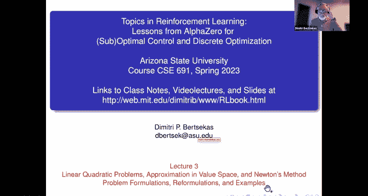
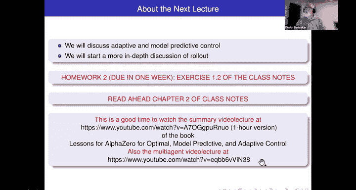

# 16：价值空间近似与牛顿步法 🚀




## 概述
在本节课中，我们将学习两个主要部分。第一部分是关于线性二次型问题的延续，特别是价值空间近似在这些问题中的应用，以及如何利用牛顿方法来可视化在线训练与在线博弈之间的关系。第二部分将讨论如何将实际问题表述为动态规划问题，并介绍一些表述示例。

---

## 第一部分：线性二次型问题回顾与价值空间近似

上一讲我们结束于一维线性二次型问题。本节中，我们将继续深入，并聚焦于其视觉表示和解释。

### 无限视野线性二次型问题回顾
我们讨论的是确定性一维线性二次型问题。系统动态为：
`x_{k+1} = a * x_k + b * u_k`
其中 `x_k` 是标量状态，`u_k` 是标量控制。成本函数涉及二次成本：
`g(x, u) = q * x^2 + r * u^2`
其中 `q` 和 `r` 是成本系数，表达了我们希望状态和控制都接近零的期望。

贝尔曼方程如下：
`J(x) = min_u [ g(x, u) + J( a*x + b*u ) ]`
当右侧等于 `J(x)` 时，我们得到对应于状态 `x` 的方程。由于 `x` 是标量，这构成了一个函数方程。

对于线性策略 `u = L * x`，也存在一个贝尔曼方程：
`J_L(x) = g(x, Lx) + J_L( a*x + b*L*x )`
这个方程更简单，因为它不涉及最小化。

### 里卡蒂方程与贝尔曼方程
我们可以猜测二次形式的解：`J(x) = K * x^2`。将其代入贝尔曼方程，经过最小化运算并消去 `x^2`，我们得到**里卡蒂方程**：
`K = q + (a^2 * r * K) / (r + b^2 * K)`
这本质上是贝尔曼方程在二次函数子空间上的限制。

类似地，对于给定的线性策略 `L`，代入 `J_L(x) = K_L * x^2`，我们得到一个线性方程：
`K_L = q + L^2 * r + (a + b*L)^2 * K_L`

如果找到正解 `K*`，我们就得到了最优成本函数。给定 `K*`，我们可以最小化贝尔曼方程的右侧，得到最优策略：
`u* = L* * x`，其中 `L* = -(a * b * K*) / (r + b^2 * K*)`
这表明最优成本函数是二次的，最优策略是线性的，这也是“线性二次型”名称的双重含义。

### 算法的图形化解释
我们有两种基本算法：值迭代和策略迭代。值迭代使用递归：
`K_{k+1} = q + (a^2 * r * K_k) / (r + b^2 * K_k)`
这等价于在里卡蒂方程上应用贝尔曼算子。

现在，我们想图形化地解释贝尔曼方程及其等价形式——里卡蒂方程。方程右侧 `F(K)` 是一个凹函数，其图形有一条红色曲线。方程左侧是45度黑线。解 `K*` 位于红黑线相交处（正解）。

对于线性策略 `L`，其对应的成本系数 `K_L` 由绿线与黑线的交点给出。这里有一个关键区别：**稳定**与**不稳定**的线性策略。当闭环系统 `a + bL` 的绝对值小于1时，策略稳定（状态渐近趋于零）；大于1时，策略不稳定（状态发散）。

### 价值空间近似与牛顿步法
现在，我们来看价值空间近似。考虑一个简单的架构：离线训练产生一个二次成本函数近似 `J̃(x) = K̃ * x^2`，在线博弈时，在给定状态 `x` 下，我们最小化单步成本加上由 `J̃` 近似的终端成本。

**关键主张是：这个一步前瞻过程等价于求解里卡蒂方程的一个牛顿步。**

以下是牛顿方法的回顾：为了求解方程 `y = G(y)`，在迭代点 `y_k` 处，我们对 `G` 进行线性化，然后求解线性化方程得到 `y_{k+1}`。牛顿法以其超线性收敛速度著称。

在我们的上下文中，最小贝尔曼算子 `F(K)`（红色曲线）可以表示为一系列线性算子 `F_L(K)`（蓝色直线）的下包络。对于给定的 `K̃`，找到使 `F_L(K̃)` 最小的 `L`，本质上就是在 `K̃` 处对 `F` 进行线性化（取切线）。然后，求解这个线性化方程（即切线与45度线的交点），就得到了在线博弈策略的成本系数 `K_new`。这正是牛顿步。

因此，**在线博弈通过执行一个牛顿步，显著改进了离线训练的结果**。当起始点 `K̃` 接近最优解 `K*` 时，这种改进尤其有效。

### 稳定性区域与多步前瞻
然而，起始点 `K̃` 的选择至关重要。存在一个**稳定性区域**。如果 `K̃` 在 `K*` 右侧或左侧但不太远，牛顿步会产生一个稳定的策略。如果 `K̃` 在 `K*` 左侧太远，线性化的斜率可能大于45度，导致产生不稳定策略，其成本为无穷大。

多步前瞻和截断滚动可以缓解这个问题。它们的作用是将牛顿步的起始点推向更接近 `K*` 或更深入稳定性区域的位置。

*   **值迭代的图形化**：值迭代 `K_{k+1} = F(K_k)` 在图上表现为一个阶梯结构，从 `K_k` 垂直移动到红曲线，再水平反射到45度线得到 `K_{k+1}`。
*   **两步前瞻（无滚动）**：从 `K̃` 开始，先进行一次值迭代得到 `K' = F(K̃)`，然后以 `K'` 为起点执行牛顿步。这相当于从一个更接近 `K*` 的点开始牛顿步。
*   **两步前瞻加截断滚动**：从 `K̃` 开始，进行两步最小化，然后使用一个稳定的基策略进行若干步截断滚动，到达一个新点，再从此点执行牛顿步。滚动步骤也帮助将点推入稳定性区域。

多步前瞻和滚动增强了所得策略的稳定性，也提高了牛顿步的收敛速度。但需权衡：多步最小化计算成本高，而截断滚动（只是运行基策略）则便宜得多，且能达到类似的效果。

### 策略迭代与滚动
策略迭代是成熟的牛顿法。它循环进行：策略评估（计算当前策略的成本函数 `K_k`）和策略改进（通过最小化得到新策略系数 `L_{k+1}`）。乐观策略迭代是其中的一个变种，它使用有限步的值迭代（相当于截断滚动）来进行策略评估。

总之，在价值空间近似中：
*   一步前瞻（无滚动）是单个牛顿步。
*   多步前瞻和/或截断滚动增强了该牛顿步的稳定性和收敛性。
*   精确的策略迭代是完整的牛顿法。

---

## 第二部分：动态规划问题表述

上一节我们深入探讨了线性二次型框架下的算法解释。本节中，我们来看看如何将实际问题表述为动态规划问题。

### 表述的艺术
在实践中，你通常不会直接获得动态规划的标准数学模型。你需要从实际问题中识别出决策、阶段、状态和成本。

一个实用的方法是：
1.  **首先定义决策**：例如，在旅行商问题中，决策就是选择下一个要前往的城市。
2.  **然后确定阶段**：在随机问题中，阶段通常由新信息到达的时刻来划分。
3.  **最后定义状态**：状态应总结过去所有对未来优化必要的信息。一个好的状态是，知道了它，所有历史信息就与未来决策无关。

### 状态扩充
状态扩充是一个非常重要的通用技术。当系统动态涉及延迟或依赖更早的信息时，可以通过引入额外的状态变量来将其转化为标准形式。

**例子：控制延迟**。假设下一个状态 `x_{k+1}` 不仅依赖于当前状态 `x_k` 和控制 `u_k`，还依赖于之前的状态 `x_{k-1}` 和控制 `u_{k-1}`。我们可以定义扩充状态 `X_k = (x_k, x_{k-1}, u_{k-1})`。那么新的系统方程变为：
```
x_{k+1} = f(x_k, x_{k-1}, u_k, u_{k-1}, w_k)
y_{k+1} = x_k
s_{k+1} = u_k
```
这样，`X_{k+1}` 就只依赖于 `X_k`、`u_k` 和 `w_k`，符合标准形式。代价是状态维度变大了。

其他需要状态扩充的情况包括：对未来不确定性的预测、问题参数未知等。

### 多智能体问题表述
多智能体问题中，多个决策实体（智能体）各自有控制分量 `u_k^i`，联合控制向量 `u_k = (u_k^1, ..., u_k^m)`。这导致控制空间随智能体数量 `m` 指数级增长，计算极具挑战性。

一个关键的区分是**信息模式**：
*   **经典信息模式**：所有智能体共享相同信息（如同一个云端）。这可以简化为一个大的集中式动态规划问题，但控制空间巨大。
*   **非经典信息模式**：智能体信息不对称或不完全共享。这要困难得多。

对于经典信息模式下的控制空间爆炸问题，一种**重构方法**是：将 `m` 个智能体的并行联合决策，展开为 `m` 个阶段的顺序决策。在每个子阶段，只为一个智能体选择控制。这样，每步的控制选择数从指数级 (`c^m`) 降为线性级 (`m * c`)，但阶段数增加了 `m` 倍，状态空间也变得更复杂（需要记录哪些智能体已行动）。这种用状态复杂度换取控制复杂度的方式，对于滚动等算法特别有利，因为滚动主要受每步分支因子（控制选择数）影响，而对状态空间大小不敏感。

### 部分可观测状态问题
在许多实际问题中，状态无法直接完全观测，只能通过带有噪声的测量 `y_k` 来推断。例如，通过雷达观测车辆的位置和速度。

**什么是合适的状态？** 它必须包含用于未来决策的所有必要信息。两个候选者是：
1.  所有历史观测的集合 `I_k`。
2.  **信念状态**：在给定所有现有信息 `I_k` 的条件下，真实状态的概率分布 `b_k`。

信念状态是一个概率分布，它总结了所有相关信息，并且可以根据新观测和控制进行更新（通过贝叶斯规则）。这样，一个部分可观测问题就被重构为一个关于信念状态 `b_k` 的完全可观测问题。

重构后的动态规划算法（直觉形式）如下：
```
J_k(b_k) = min_u [ E{ g(x_k, u) | b_k } + E{ J_{k+1}( B(b_k, u, y_{k+1}) ) | b_k, u } ]
```
其中 `B(...)` 是信念状态更新函数。这个方程在信念状态空间上求解，而信念空间通常是连续的（如概率单纯形），这使得精确求解极其困难，必须依赖近似方法，如滚动。

---

## 总结
本节课我们一起学习了两个核心主题。

在第一部分，我们以线性二次型问题为背景，深入探讨了价值空间近似。我们看到了贝尔曼方程和里卡蒂方程的图形化表示，并建立了价值空间近似与牛顿方法之间的深刻联系。一步前瞻相当于一个牛顿步，而多步前瞻和截断滚动则能增强这个牛顿步的稳定性和收敛性。策略迭代则对应于完整的牛顿法。

在第二部分，我们探讨了动态规划的问题表述艺术。我们介绍了状态扩充这一关键技术，用于处理延迟等非标准动态。我们还分析了多智能体问题和部分可观测问题的挑战，并讨论了如何通过重构（如顺序决策、使用信念状态）将其纳入动态规划框架，尽管这通常会带来新的计算复杂度问题，而滚动等算法在其中显示出潜力。



这些概念为我们在后续课程中学习更具体的算法和应用奠定了基础。